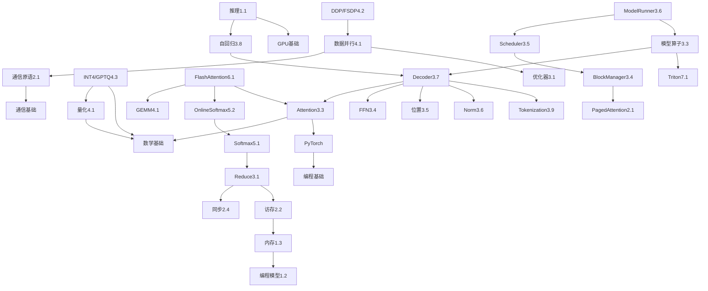

# AI Infra 文档级学习导航与前置依赖（2026-11-16）

> 最新120学习日细化版；课程为主，周末不学。图谱是教学依赖建议，不是仓库官方引用图。

可视化入口：[交互知识图谱](2026-11-16_AIInfra_文档级学习知识图谱.html)

## 使用顺序

1. 看当天首读及范围；2. 概念卡住查补课索引；3. 只补对应小节；4. 返回目标验收；5. 下次导师汇报一项真实证据。
工作日默认75分钟，周一材料周五备好，前置不过按工作日顺延。W1–W2按2026-11-16起步，远期不绑定自然日期。
深入理解的前置不阻止先导概览。上游列表不代表全部要精读，不代表每天读完一篇。

## 一、全部课程文档ID（102篇）

67正文＋2概览＋1导航＋32提纲。只纳入docs/guides，不把面试/图片/正文代码块当完整本地课程或可运行脚本。

### P1 · 第1章-编程语言基础 [正文]
- 文档：[P1 · 第1章-编程语言基础](../docs/guides/%E6%A8%A1%E5%9D%97%E4%B8%80-%E5%89%8D%E7%BD%AE%E7%9F%A5%E8%AF%86/%E7%AC%AC1%E7%AB%A0-%E7%BC%96%E7%A8%8B%E8%AF%AD%E8%A8%80%E5%9F%BA%E7%A1%80.md)
- 相对课程根路径：`模块一-前置知识/第1章-编程语言基础.md`
- 直接前置：无课程内硬前置
- 辅助复习：无额外指定

### P2 · 第2章-数学基础 [正文]
- 文档：[P2 · 第2章-数学基础](../docs/guides/%E6%A8%A1%E5%9D%97%E4%B8%80-%E5%89%8D%E7%BD%AE%E7%9F%A5%E8%AF%86/%E7%AC%AC2%E7%AB%A0-%E6%95%B0%E5%AD%A6%E5%9F%BA%E7%A1%80.md)
- 相对课程根路径：`模块一-前置知识/第2章-数学基础.md`
- 直接前置：无课程内硬前置
- 辅助复习：无额外指定

### P3 · PyTorch框架入门 [正文]
- 文档：[P3 · PyTorch框架入门](../docs/guides/%E6%A8%A1%E5%9D%97%E4%B8%80-%E5%89%8D%E7%BD%AE%E7%9F%A5%E8%AF%86/pyroch/PyTorch%E6%A1%86%E6%9E%B6%E5%85%A5%E9%97%A8.md)
- 相对课程根路径：`模块一-前置知识/pyroch/PyTorch框架入门.md`
- 直接前置：[P1 · 第1章-编程语言基础](../docs/guides/%E6%A8%A1%E5%9D%97%E4%B8%80-%E5%89%8D%E7%BD%AE%E7%9F%A5%E8%AF%86/%E7%AC%AC1%E7%AB%A0-%E7%BC%96%E7%A8%8B%E8%AF%AD%E8%A8%80%E5%9F%BA%E7%A1%80.md)：§2 Python对象/控制流；[P2 · 第2章-数学基础](../docs/guides/%E6%A8%A1%E5%9D%97%E4%B8%80-%E5%89%8D%E7%BD%AE%E7%9F%A5%E8%AF%86/%E7%AC%AC2%E7%AB%A0-%E6%95%B0%E5%AD%A6%E5%9F%BA%E7%A1%80.md)：§2 张量与矩阵、§6反向、§7优化
- 辅助复习：无额外指定

### P4 · gpu-basics [正文]
- 文档：[P4 · gpu-basics](../docs/guides/%E6%A8%A1%E5%9D%97%E4%B8%80-%E5%89%8D%E7%BD%AE%E7%9F%A5%E8%AF%86/gpu/gpu-basics.md)
- 相对课程根路径：`模块一-前置知识/gpu/gpu-basics.md`
- 直接前置：无课程内硬前置
- 辅助复习：[P2 · 第2章-数学基础](../docs/guides/%E6%A8%A1%E5%9D%97%E4%B8%80-%E5%89%8D%E7%BD%AE%E7%9F%A5%E8%AF%86/%E7%AC%AC2%E7%AB%A0-%E6%95%B0%E5%AD%A6%E5%9F%BA%E7%A1%80.md)

### P5 · nvidia-gpu-evolution [正文]
- 文档：[P5 · nvidia-gpu-evolution](../docs/guides/%E6%A8%A1%E5%9D%97%E4%B8%80-%E5%89%8D%E7%BD%AE%E7%9F%A5%E8%AF%86/gpu/nvidia-gpu-evolution.md)
- 相对课程根路径：`模块一-前置知识/gpu/nvidia-gpu-evolution.md`
- 直接前置：[P4 · gpu-basics](../docs/guides/%E6%A8%A1%E5%9D%97%E4%B8%80-%E5%89%8D%E7%BD%AE%E7%9F%A5%E8%AF%86/gpu/gpu-basics.md)：SM/显存/Tensor Core
- 辅助复习：无额外指定

### P6 · collective-communication-primer [正文]
- 文档：[P6 · collective-communication-primer](../docs/guides/%E6%A8%A1%E5%9D%97%E4%B8%80-%E5%89%8D%E7%BD%AE%E7%9F%A5%E8%AF%86/communication/collective-communication-primer.md)
- 相对课程根路径：`模块一-前置知识/communication/collective-communication-primer.md`
- 直接前置：[P4 · gpu-basics](../docs/guides/%E6%A8%A1%E5%9D%97%E4%B8%80-%E5%89%8D%E7%BD%AE%E7%9F%A5%E8%AF%86/gpu/gpu-basics.md)：互联与设备；代码实验另看P1/P3
- 辅助复习：[P1 · 第1章-编程语言基础](../docs/guides/%E6%A8%A1%E5%9D%97%E4%B8%80-%E5%89%8D%E7%BD%AE%E7%9F%A5%E8%AF%86/%E7%AC%AC1%E7%AB%A0-%E7%BC%96%E7%A8%8B%E8%AF%AD%E8%A8%80%E5%9F%BA%E7%A1%80.md)；[P3 · PyTorch框架入门](../docs/guides/%E6%A8%A1%E5%9D%97%E4%B8%80-%E5%89%8D%E7%BD%AE%E7%9F%A5%E8%AF%86/pyroch/PyTorch%E6%A1%86%E6%9E%B6%E5%85%A5%E9%97%A8.md)

### R0 · AI Infra学习路线 [导航]
- 文档：[R0 · AI Infra学习路线](../docs/guides/AI%20Infra%E5%AD%A6%E4%B9%A0%E8%B7%AF%E7%BA%BF.md)
- 相对课程根路径：`AI Infra学习路线.md`
- 直接前置：无课程内硬前置
- 辅助复习：无额外指定

### R1 · Transformer架构快速入门 [概览]
- 文档：[R1 · Transformer架构快速入门](../docs/guides/%E6%A8%A1%E5%9D%97%E4%B8%80-%E5%89%8D%E7%BD%AE%E7%9F%A5%E8%AF%86/transformer/Transformer%E6%9E%B6%E6%9E%84%E5%BF%AB%E9%80%9F%E5%85%A5%E9%97%A8.md)
- 相对课程根路径：`模块一-前置知识/transformer/Transformer架构快速入门.md`
- 直接前置：无课程内硬前置
- 辅助复习：无额外指定

### R2 · CUDA编程入门指南 [概览]
- 文档：[R2 · CUDA编程入门指南](../docs/guides/%E6%A8%A1%E5%9D%97%E4%BA%8C-CUDA%E7%BC%96%E7%A8%8B%E4%B8%8E%E7%AE%97%E5%AD%90%E4%BC%98%E5%8C%96/CUDA%E7%BC%96%E7%A8%8B%E5%85%A5%E9%97%A8%E6%8C%87%E5%8D%97.md)
- 相对课程根路径：`模块二-CUDA编程与算子优化/CUDA编程入门指南.md`
- 直接前置：无课程内硬前置
- 辅助复习：无额外指定

### T1 · 3.1 AI Infra工程师为什么必须懂Transformer [正文]
- 文档：[T1 · 3.1 AI Infra工程师为什么必须懂Transformer](../docs/guides/%E6%A8%A1%E5%9D%97%E4%B8%80-%E5%89%8D%E7%BD%AE%E7%9F%A5%E8%AF%86/transformer/3.1%20AI%20Infra%E5%B7%A5%E7%A8%8B%E5%B8%88%E4%B8%BA%E4%BB%80%E4%B9%88%E5%BF%85%E9%A1%BB%E6%87%82Transformer.md)
- 相对课程根路径：`模块一-前置知识/transformer/3.1 AI Infra工程师为什么必须懂Transformer.md`
- 直接前置：无课程内硬前置
- 辅助复习：无额外指定

### T2 · 3.2 Transformer全貌及代码实现 [正文]
- 文档：[T2 · 3.2 Transformer全貌及代码实现](../docs/guides/%E6%A8%A1%E5%9D%97%E4%B8%80-%E5%89%8D%E7%BD%AE%E7%9F%A5%E8%AF%86/transformer/3.2%20Transformer%E5%85%A8%E8%B2%8C%E5%8F%8A%E4%BB%A3%E7%A0%81%E5%AE%9E%E7%8E%B0.md)
- 相对课程根路径：`模块一-前置知识/transformer/3.2 Transformer全貌及代码实现.md`
- 直接前置：[P3 · PyTorch框架入门](../docs/guides/%E6%A8%A1%E5%9D%97%E4%B8%80-%E5%89%8D%E7%BD%AE%E7%9F%A5%E8%AF%86/pyroch/PyTorch%E6%A1%86%E6%9E%B6%E5%85%A5%E9%97%A8.md)：Tensor/Module；[P2 · 第2章-数学基础](../docs/guides/%E6%A8%A1%E5%9D%97%E4%B8%80-%E5%89%8D%E7%BD%AE%E7%9F%A5%E8%AF%86/%E7%AC%AC2%E7%AB%A0-%E6%95%B0%E5%AD%A6%E5%9F%BA%E7%A1%80.md)：§2；[T9 · 3.9 Tokenization与词嵌入](../docs/guides/%E6%A8%A1%E5%9D%97%E4%B8%80-%E5%89%8D%E7%BD%AE%E7%9F%A5%E8%AF%86/transformer/3.9%20Tokenization%E4%B8%8E%E8%AF%8D%E5%B5%8C%E5%85%A5.md)：输入与词嵌入（结构概览可先读）
- 辅助复习：[R1 · Transformer架构快速入门](../docs/guides/%E6%A8%A1%E5%9D%97%E4%B8%80-%E5%89%8D%E7%BD%AE%E7%9F%A5%E8%AF%86/transformer/Transformer%E6%9E%B6%E6%9E%84%E5%BF%AB%E9%80%9F%E5%85%A5%E9%97%A8.md)；[T1 · 3.1 AI Infra工程师为什么必须懂Transformer](../docs/guides/%E6%A8%A1%E5%9D%97%E4%B8%80-%E5%89%8D%E7%BD%AE%E7%9F%A5%E8%AF%86/transformer/3.1%20AI%20Infra%E5%B7%A5%E7%A8%8B%E5%B8%88%E4%B8%BA%E4%BB%80%E4%B9%88%E5%BF%85%E9%A1%BB%E6%87%82Transformer.md)

### T3 · 3.3 Self-Attention机制深入理解 [正文]
- 文档：[T3 · 3.3 Self-Attention机制深入理解](../docs/guides/%E6%A8%A1%E5%9D%97%E4%B8%80-%E5%89%8D%E7%BD%AE%E7%9F%A5%E8%AF%86/transformer/3.3%20Self-Attention%E6%9C%BA%E5%88%B6%E6%B7%B1%E5%85%A5%E7%90%86%E8%A7%A3.md)
- 相对课程根路径：`模块一-前置知识/transformer/3.3 Self-Attention机制深入理解.md`
- 直接前置：[T2 · 3.2 Transformer全貌及代码实现](../docs/guides/%E6%A8%A1%E5%9D%97%E4%B8%80-%E5%89%8D%E7%BD%AE%E7%9F%A5%E8%AF%86/transformer/3.2%20Transformer%E5%85%A8%E8%B2%8C%E5%8F%8A%E4%BB%A3%E7%A0%81%E5%AE%9E%E7%8E%B0.md)：结构数据流；[P2 · 第2章-数学基础](../docs/guides/%E6%A8%A1%E5%9D%97%E4%B8%80-%E5%89%8D%E7%BD%AE%E7%9F%A5%E8%AF%86/%E7%AC%AC2%E7%AB%A0-%E6%95%B0%E5%AD%A6%E5%9F%BA%E7%A1%80.md)：§2.4/2.6/2.7、§4.6、§5.2；[P3 · PyTorch框架入门](../docs/guides/%E6%A8%A1%E5%9D%97%E4%B8%80-%E5%89%8D%E7%BD%AE%E7%9F%A5%E8%AF%86/pyroch/PyTorch%E6%A1%86%E6%9E%B6%E5%85%A5%E9%97%A8.md)：Tensor shape
- 辅助复习：[R1 · Transformer架构快速入门](../docs/guides/%E6%A8%A1%E5%9D%97%E4%B8%80-%E5%89%8D%E7%BD%AE%E7%9F%A5%E8%AF%86/transformer/Transformer%E6%9E%B6%E6%9E%84%E5%BF%AB%E9%80%9F%E5%85%A5%E9%97%A8.md)

### T4 · 3.4 Transformer前馈网络FFN深入理解 [正文]
- 文档：[T4 · 3.4 Transformer前馈网络FFN深入理解](../docs/guides/%E6%A8%A1%E5%9D%97%E4%B8%80-%E5%89%8D%E7%BD%AE%E7%9F%A5%E8%AF%86/transformer/3.4%20Transformer%E5%89%8D%E9%A6%88%E7%BD%91%E7%BB%9CFFN%E6%B7%B1%E5%85%A5%E7%90%86%E8%A7%A3.md)
- 相对课程根路径：`模块一-前置知识/transformer/3.4 Transformer前馈网络FFN深入理解.md`
- 直接前置：[T2 · 3.2 Transformer全貌及代码实现](../docs/guides/%E6%A8%A1%E5%9D%97%E4%B8%80-%E5%89%8D%E7%BD%AE%E7%9F%A5%E8%AF%86/transformer/3.2%20Transformer%E5%85%A8%E8%B2%8C%E5%8F%8A%E4%BB%A3%E7%A0%81%E5%AE%9E%E7%8E%B0.md)：线性层；[P2 · 第2章-数学基础](../docs/guides/%E6%A8%A1%E5%9D%97%E4%B8%80-%E5%89%8D%E7%BD%AE%E7%9F%A5%E8%AF%86/%E7%AC%AC2%E7%AB%A0-%E6%95%B0%E5%AD%A6%E5%9F%BA%E7%A1%80.md)：§2.3/2.6/2.8；[P3 · PyTorch框架入门](../docs/guides/%E6%A8%A1%E5%9D%97%E4%B8%80-%E5%89%8D%E7%BD%AE%E7%9F%A5%E8%AF%86/pyroch/PyTorch%E6%A1%86%E6%9E%B6%E5%85%A5%E9%97%A8.md)：nn.Linear
- 辅助复习：无额外指定

### T5 · 3.5 Transformer位置编码深入理解 [正文]
- 文档：[T5 · 3.5 Transformer位置编码深入理解](../docs/guides/%E6%A8%A1%E5%9D%97%E4%B8%80-%E5%89%8D%E7%BD%AE%E7%9F%A5%E8%AF%86/transformer/3.5%20Transformer%E4%BD%8D%E7%BD%AE%E7%BC%96%E7%A0%81%E6%B7%B1%E5%85%A5%E7%90%86%E8%A7%A3.md)
- 相对课程根路径：`模块一-前置知识/transformer/3.5 Transformer位置编码深入理解.md`
- 直接前置：[T3 · 3.3 Self-Attention机制深入理解](../docs/guides/%E6%A8%A1%E5%9D%97%E4%B8%80-%E5%89%8D%E7%BD%AE%E7%9F%A5%E8%AF%86/transformer/3.3%20Self-Attention%E6%9C%BA%E5%88%B6%E6%B7%B1%E5%85%A5%E7%90%86%E8%A7%A3.md)：QK计算；[T9 · 3.9 Tokenization与词嵌入](../docs/guides/%E6%A8%A1%E5%9D%97%E4%B8%80-%E5%89%8D%E7%BD%AE%E7%9F%A5%E8%AF%86/transformer/3.9%20Tokenization%E4%B8%8E%E8%AF%8D%E5%B5%8C%E5%85%A5.md)：token位置；[P2 · 第2章-数学基础](../docs/guides/%E6%A8%A1%E5%9D%97%E4%B8%80-%E5%89%8D%E7%BD%AE%E7%9F%A5%E8%AF%86/%E7%AC%AC2%E7%AB%A0-%E6%95%B0%E5%AD%A6%E5%9F%BA%E7%A1%80.md)：§2.4/2.6/2.9
- 辅助复习：无额外指定

### T6 · 3.6 LayerNorm与残差连接深入理解 [正文]
- 文档：[T6 · 3.6 LayerNorm与残差连接深入理解](../docs/guides/%E6%A8%A1%E5%9D%97%E4%B8%80-%E5%89%8D%E7%BD%AE%E7%9F%A5%E8%AF%86/transformer/3.6%20LayerNorm%E4%B8%8E%E6%AE%8B%E5%B7%AE%E8%BF%9E%E6%8E%A5%E6%B7%B1%E5%85%A5%E7%90%86%E8%A7%A3.md)
- 相对课程根路径：`模块一-前置知识/transformer/3.6 LayerNorm与残差连接深入理解.md`
- 直接前置：[T2 · 3.2 Transformer全貌及代码实现](../docs/guides/%E6%A8%A1%E5%9D%97%E4%B8%80-%E5%89%8D%E7%BD%AE%E7%9F%A5%E8%AF%86/transformer/3.2%20Transformer%E5%85%A8%E8%B2%8C%E5%8F%8A%E4%BB%A3%E7%A0%81%E5%AE%9E%E7%8E%B0.md)：Block结构；[P2 · 第2章-数学基础](../docs/guides/%E6%A8%A1%E5%9D%97%E4%B8%80-%E5%89%8D%E7%BD%AE%E7%9F%A5%E8%AF%86/%E7%AC%AC2%E7%AB%A0-%E6%95%B0%E5%AD%A6%E5%9F%BA%E7%A1%80.md)：§4.6、§6.4、§7.4–7.8；[P3 · PyTorch框架入门](../docs/guides/%E6%A8%A1%E5%9D%97%E4%B8%80-%E5%89%8D%E7%BD%AE%E7%9F%A5%E8%AF%86/pyroch/PyTorch%E6%A1%86%E6%9E%B6%E5%85%A5%E9%97%A8.md)：autograd
- 辅助复习：无额外指定

### T7 · 3.7 Transformer Decoder Block完整解析 [正文]
- 文档：[T7 · 3.7 Transformer Decoder Block完整解析](../docs/guides/%E6%A8%A1%E5%9D%97%E4%B8%80-%E5%89%8D%E7%BD%AE%E7%9F%A5%E8%AF%86/transformer/3.7%20Transformer%20Decoder%20Block%E5%AE%8C%E6%95%B4%E8%A7%A3%E6%9E%90.md)
- 相对课程根路径：`模块一-前置知识/transformer/3.7 Transformer Decoder Block完整解析.md`
- 直接前置：[T3 · 3.3 Self-Attention机制深入理解](../docs/guides/%E6%A8%A1%E5%9D%97%E4%B8%80-%E5%89%8D%E7%BD%AE%E7%9F%A5%E8%AF%86/transformer/3.3%20Self-Attention%E6%9C%BA%E5%88%B6%E6%B7%B1%E5%85%A5%E7%90%86%E8%A7%A3.md)：Attention；[T4 · 3.4 Transformer前馈网络FFN深入理解](../docs/guides/%E6%A8%A1%E5%9D%97%E4%B8%80-%E5%89%8D%E7%BD%AE%E7%9F%A5%E8%AF%86/transformer/3.4%20Transformer%E5%89%8D%E9%A6%88%E7%BD%91%E7%BB%9CFFN%E6%B7%B1%E5%85%A5%E7%90%86%E8%A7%A3.md)：FFN；[T5 · 3.5 Transformer位置编码深入理解](../docs/guides/%E6%A8%A1%E5%9D%97%E4%B8%80-%E5%89%8D%E7%BD%AE%E7%9F%A5%E8%AF%86/transformer/3.5%20Transformer%E4%BD%8D%E7%BD%AE%E7%BC%96%E7%A0%81%E6%B7%B1%E5%85%A5%E7%90%86%E8%A7%A3.md)：位置编码；[T6 · 3.6 LayerNorm与残差连接深入理解](../docs/guides/%E6%A8%A1%E5%9D%97%E4%B8%80-%E5%89%8D%E7%BD%AE%E7%9F%A5%E8%AF%86/transformer/3.6%20LayerNorm%E4%B8%8E%E6%AE%8B%E5%B7%AE%E8%BF%9E%E6%8E%A5%E6%B7%B1%E5%85%A5%E7%90%86%E8%A7%A3.md)：Norm/残差；[T9 · 3.9 Tokenization与词嵌入](../docs/guides/%E6%A8%A1%E5%9D%97%E4%B8%80-%E5%89%8D%E7%BD%AE%E7%9F%A5%E8%AF%86/transformer/3.9%20Tokenization%E4%B8%8E%E8%AF%8D%E5%B5%8C%E5%85%A5.md)：词嵌入
- 辅助复习：[R1 · Transformer架构快速入门](../docs/guides/%E6%A8%A1%E5%9D%97%E4%B8%80-%E5%89%8D%E7%BD%AE%E7%9F%A5%E8%AF%86/transformer/Transformer%E6%9E%B6%E6%9E%84%E5%BF%AB%E9%80%9F%E5%85%A5%E9%97%A8.md)；[T2 · 3.2 Transformer全貌及代码实现](../docs/guides/%E6%A8%A1%E5%9D%97%E4%B8%80-%E5%89%8D%E7%BD%AE%E7%9F%A5%E8%AF%86/transformer/3.2%20Transformer%E5%85%A8%E8%B2%8C%E5%8F%8A%E4%BB%A3%E7%A0%81%E5%AE%9E%E7%8E%B0.md)

### T8 · 3.8 从Transformer到LLM自回归生成深入理解 [正文]
- 文档：[T8 · 3.8 从Transformer到LLM自回归生成深入理解](../docs/guides/%E6%A8%A1%E5%9D%97%E4%B8%80-%E5%89%8D%E7%BD%AE%E7%9F%A5%E8%AF%86/transformer/3.8%20%E4%BB%8ETransformer%E5%88%B0LLM%E8%87%AA%E5%9B%9E%E5%BD%92%E7%94%9F%E6%88%90%E6%B7%B1%E5%85%A5%E7%90%86%E8%A7%A3.md)
- 相对课程根路径：`模块一-前置知识/transformer/3.8 从Transformer到LLM自回归生成深入理解.md`
- 直接前置：[T7 · 3.7 Transformer Decoder Block完整解析](../docs/guides/%E6%A8%A1%E5%9D%97%E4%B8%80-%E5%89%8D%E7%BD%AE%E7%9F%A5%E8%AF%86/transformer/3.7%20Transformer%20Decoder%20Block%E5%AE%8C%E6%95%B4%E8%A7%A3%E6%9E%90.md)：Decoder；[P2 · 第2章-数学基础](../docs/guides/%E6%A8%A1%E5%9D%97%E4%B8%80-%E5%89%8D%E7%BD%AE%E7%9F%A5%E8%AF%86/%E7%AC%AC2%E7%AB%A0-%E6%95%B0%E5%AD%A6%E5%9F%BA%E7%A1%80.md)：§4.2、§5.1–5.5/5.9
- 辅助复习：[I11 · 1.1-LLM推理基础](../docs/guides/%E6%A8%A1%E5%9D%97%E5%9B%9B-%E6%8E%A8%E7%90%86%E4%BC%98%E5%8C%96/%E7%AC%AC1%E7%AB%A0-LLM%E6%8E%A8%E7%90%86%E5%9F%BA%E7%A1%80/1.1-LLM%E6%8E%A8%E7%90%86%E5%9F%BA%E7%A1%80.md)

### T9 · 3.9 Tokenization与词嵌入 [正文]
- 文档：[T9 · 3.9 Tokenization与词嵌入](../docs/guides/%E6%A8%A1%E5%9D%97%E4%B8%80-%E5%89%8D%E7%BD%AE%E7%9F%A5%E8%AF%86/transformer/3.9%20Tokenization%E4%B8%8E%E8%AF%8D%E5%B5%8C%E5%85%A5.md)
- 相对课程根路径：`模块一-前置知识/transformer/3.9 Tokenization与词嵌入.md`
- 直接前置：[P1 · 第1章-编程语言基础](../docs/guides/%E6%A8%A1%E5%9D%97%E4%B8%80-%E5%89%8D%E7%BD%AE%E7%9F%A5%E8%AF%86/%E7%AC%AC1%E7%AB%A0-%E7%BC%96%E7%A8%8B%E8%AF%AD%E8%A8%80%E5%9F%BA%E7%A1%80.md)：§2 Python；[P2 · 第2章-数学基础](../docs/guides/%E6%A8%A1%E5%9D%97%E4%B8%80-%E5%89%8D%E7%BD%AE%E7%9F%A5%E8%AF%86/%E7%AC%AC2%E7%AB%A0-%E6%95%B0%E5%AD%A6%E5%9F%BA%E7%A1%80.md)：§2.1/2.4/2.6；[P3 · PyTorch框架入门](../docs/guides/%E6%A8%A1%E5%9D%97%E4%B8%80-%E5%89%8D%E7%BD%AE%E7%9F%A5%E8%AF%86/pyroch/PyTorch%E6%A1%86%E6%9E%B6%E5%85%A5%E9%97%A8.md)：Tensor与Embedding
- 辅助复习：无额外指定
- 注意：文中旧引用“3.6位置编码”应对应实际3.5位置编码（T5），不是LayerNorm（T6）。

### C11 · 1.1-CUDA开发环境搭建 [正文]
- 文档：[C11 · 1.1-CUDA开发环境搭建](../docs/guides/%E6%A8%A1%E5%9D%97%E4%BA%8C-CUDA%E7%BC%96%E7%A8%8B%E4%B8%8E%E7%AE%97%E5%AD%90%E4%BC%98%E5%8C%96/1.1-CUDA%E5%BC%80%E5%8F%91%E7%8E%AF%E5%A2%83%E6%90%AD%E5%BB%BA.md)
- 相对课程根路径：`模块二-CUDA编程与算子优化/1.1-CUDA开发环境搭建.md`
- 直接前置：[P1 · 第1章-编程语言基础](../docs/guides/%E6%A8%A1%E5%9D%97%E4%B8%80-%E5%89%8D%E7%BD%AE%E7%9F%A5%E8%AF%86/%E7%AC%AC1%E7%AB%A0-%E7%BC%96%E7%A8%8B%E8%AF%AD%E8%A8%80%E5%9F%BA%E7%A1%80.md)：§4、§5、§7、§8 编程与环境；[P4 · gpu-basics](../docs/guides/%E6%A8%A1%E5%9D%97%E4%B8%80-%E5%89%8D%E7%BD%AE%E7%9F%A5%E8%AF%86/gpu/gpu-basics.md)：GPU
- 辅助复习：无额外指定

### C12 · 1.2-CUDA编程模型 [正文]
- 文档：[C12 · 1.2-CUDA编程模型](../docs/guides/%E6%A8%A1%E5%9D%97%E4%BA%8C-CUDA%E7%BC%96%E7%A8%8B%E4%B8%8E%E7%AE%97%E5%AD%90%E4%BC%98%E5%8C%96/1.2-CUDA%E7%BC%96%E7%A8%8B%E6%A8%A1%E5%9E%8B.md)
- 相对课程根路径：`模块二-CUDA编程与算子优化/1.2-CUDA编程模型.md`
- 直接前置：[C11 · 1.1-CUDA开发环境搭建](../docs/guides/%E6%A8%A1%E5%9D%97%E4%BA%8C-CUDA%E7%BC%96%E7%A8%8B%E4%B8%8E%E7%AE%97%E5%AD%90%E4%BC%98%E5%8C%96/1.1-CUDA%E5%BC%80%E5%8F%91%E7%8E%AF%E5%A2%83%E6%90%AD%E5%BB%BA.md)：环境；[P4 · gpu-basics](../docs/guides/%E6%A8%A1%E5%9D%97%E4%B8%80-%E5%89%8D%E7%BD%AE%E7%9F%A5%E8%AF%86/gpu/gpu-basics.md)：SM；[P1 · 第1章-编程语言基础](../docs/guides/%E6%A8%A1%E5%9D%97%E4%B8%80-%E5%89%8D%E7%BD%AE%E7%9F%A5%E8%AF%86/%E7%AC%AC1%E7%AB%A0-%E7%BC%96%E7%A8%8B%E8%AF%AD%E8%A8%80%E5%9F%BA%E7%A1%80.md)：§4.1–4.2 指针与数组
- 辅助复习：无额外指定

### C13 · 1.3-CUDA内存模型 [正文]
- 文档：[C13 · 1.3-CUDA内存模型](../docs/guides/%E6%A8%A1%E5%9D%97%E4%BA%8C-CUDA%E7%BC%96%E7%A8%8B%E4%B8%8E%E7%AE%97%E5%AD%90%E4%BC%98%E5%8C%96/1.3-CUDA%E5%86%85%E5%AD%98%E6%A8%A1%E5%9E%8B.md)
- 相对课程根路径：`模块二-CUDA编程与算子优化/1.3-CUDA内存模型.md`
- 直接前置：[C12 · 1.2-CUDA编程模型](../docs/guides/%E6%A8%A1%E5%9D%97%E4%BA%8C-CUDA%E7%BC%96%E7%A8%8B%E4%B8%8E%E7%AE%97%E5%AD%90%E4%BC%98%E5%8C%96/1.2-CUDA%E7%BC%96%E7%A8%8B%E6%A8%A1%E5%9E%8B.md)：线程模型；[P1 · 第1章-编程语言基础](../docs/guides/%E6%A8%A1%E5%9D%97%E4%B8%80-%E5%89%8D%E7%BD%AE%E7%9F%A5%E8%AF%86/%E7%AC%AC1%E7%AB%A0-%E7%BC%96%E7%A8%8B%E8%AF%AD%E8%A8%80%E5%9F%BA%E7%A1%80.md)：§4.2–4.4 内存与生命周期
- 辅助复习：无额外指定

### C14 · 1.4-第一个实用Kernel [正文]
- 文档：[C14 · 1.4-第一个实用Kernel](../docs/guides/%E6%A8%A1%E5%9D%97%E4%BA%8C-CUDA%E7%BC%96%E7%A8%8B%E4%B8%8E%E7%AE%97%E5%AD%90%E4%BC%98%E5%8C%96/1.4-%E7%AC%AC%E4%B8%80%E4%B8%AA%E5%AE%9E%E7%94%A8Kernel.md)
- 相对课程根路径：`模块二-CUDA编程与算子优化/1.4-第一个实用Kernel.md`
- 直接前置：[C11 · 1.1-CUDA开发环境搭建](../docs/guides/%E6%A8%A1%E5%9D%97%E4%BA%8C-CUDA%E7%BC%96%E7%A8%8B%E4%B8%8E%E7%AE%97%E5%AD%90%E4%BC%98%E5%8C%96/1.1-CUDA%E5%BC%80%E5%8F%91%E7%8E%AF%E5%A2%83%E6%90%AD%E5%BB%BA.md)：构建；[C12 · 1.2-CUDA编程模型](../docs/guides/%E6%A8%A1%E5%9D%97%E4%BA%8C-CUDA%E7%BC%96%E7%A8%8B%E4%B8%8E%E7%AE%97%E5%AD%90%E4%BC%98%E5%8C%96/1.2-CUDA%E7%BC%96%E7%A8%8B%E6%A8%A1%E5%9E%8B.md)：索引；[C13 · 1.3-CUDA内存模型](../docs/guides/%E6%A8%A1%E5%9D%97%E4%BA%8C-CUDA%E7%BC%96%E7%A8%8B%E4%B8%8E%E7%AE%97%E5%AD%90%E4%BC%98%E5%8C%96/1.3-CUDA%E5%86%85%E5%AD%98%E6%A8%A1%E5%9E%8B.md)：内存；[P1 · 第1章-编程语言基础](../docs/guides/%E6%A8%A1%E5%9D%97%E4%B8%80-%E5%89%8D%E7%BD%AE%E7%9F%A5%E8%AF%86/%E7%AC%AC1%E7%AB%A0-%E7%BC%96%E7%A8%8B%E8%AF%AD%E8%A8%80%E5%9F%BA%E7%A1%80.md)：§3.6 计时
- 辅助复习：无额外指定

### C21 · 2.1-Warp与执行模型 [正文]
- 文档：[C21 · 2.1-Warp与执行模型](../docs/guides/%E6%A8%A1%E5%9D%97%E4%BA%8C-CUDA%E7%BC%96%E7%A8%8B%E4%B8%8E%E7%AE%97%E5%AD%90%E4%BC%98%E5%8C%96/2.1-Warp%E4%B8%8E%E6%89%A7%E8%A1%8C%E6%A8%A1%E5%9E%8B.md)
- 相对课程根路径：`模块二-CUDA编程与算子优化/2.1-Warp与执行模型.md`
- 直接前置：[C12 · 1.2-CUDA编程模型](../docs/guides/%E6%A8%A1%E5%9D%97%E4%BA%8C-CUDA%E7%BC%96%E7%A8%8B%E4%B8%8E%E7%AE%97%E5%AD%90%E4%BC%98%E5%8C%96/1.2-CUDA%E7%BC%96%E7%A8%8B%E6%A8%A1%E5%9E%8B.md)：线程模型；[C14 · 1.4-第一个实用Kernel](../docs/guides/%E6%A8%A1%E5%9D%97%E4%BA%8C-CUDA%E7%BC%96%E7%A8%8B%E4%B8%8E%E7%AE%97%E5%AD%90%E4%BC%98%E5%8C%96/1.4-%E7%AC%AC%E4%B8%80%E4%B8%AA%E5%AE%9E%E7%94%A8Kernel.md)：最小kernel；[P4 · gpu-basics](../docs/guides/%E6%A8%A1%E5%9D%97%E4%B8%80-%E5%89%8D%E7%BD%AE%E7%9F%A5%E8%AF%86/gpu/gpu-basics.md)：SM
- 辅助复习：无额外指定

### C22 · 2.2-内存访问优化 [正文]
- 文档：[C22 · 2.2-内存访问优化](../docs/guides/%E6%A8%A1%E5%9D%97%E4%BA%8C-CUDA%E7%BC%96%E7%A8%8B%E4%B8%8E%E7%AE%97%E5%AD%90%E4%BC%98%E5%8C%96/2.2-%E5%86%85%E5%AD%98%E8%AE%BF%E9%97%AE%E4%BC%98%E5%8C%96.md)
- 相对课程根路径：`模块二-CUDA编程与算子优化/2.2-内存访问优化.md`
- 直接前置：[C13 · 1.3-CUDA内存模型](../docs/guides/%E6%A8%A1%E5%9D%97%E4%BA%8C-CUDA%E7%BC%96%E7%A8%8B%E4%B8%8E%E7%AE%97%E5%AD%90%E4%BC%98%E5%8C%96/1.3-CUDA%E5%86%85%E5%AD%98%E6%A8%A1%E5%9E%8B.md)：存储层次；[C21 · 2.1-Warp与执行模型](../docs/guides/%E6%A8%A1%E5%9D%97%E4%BA%8C-CUDA%E7%BC%96%E7%A8%8B%E4%B8%8E%E7%AE%97%E5%AD%90%E4%BC%98%E5%8C%96/2.1-Warp%E4%B8%8E%E6%89%A7%E8%A1%8C%E6%A8%A1%E5%9E%8B.md)：warp；[P2 · 第2章-数学基础](../docs/guides/%E6%A8%A1%E5%9D%97%E4%B8%80-%E5%89%8D%E7%BD%AE%E7%9F%A5%E8%AF%86/%E7%AC%AC2%E7%AB%A0-%E6%95%B0%E5%AD%A6%E5%9F%BA%E7%A1%80.md)：§2.2 stride
- 辅助复习：无额外指定

### C23 · 2.3-Occupancy与资源分配 [正文]
- 文档：[C23 · 2.3-Occupancy与资源分配](../docs/guides/%E6%A8%A1%E5%9D%97%E4%BA%8C-CUDA%E7%BC%96%E7%A8%8B%E4%B8%8E%E7%AE%97%E5%AD%90%E4%BC%98%E5%8C%96/2.3-Occupancy%E4%B8%8E%E8%B5%84%E6%BA%90%E5%88%86%E9%85%8D.md)
- 相对课程根路径：`模块二-CUDA编程与算子优化/2.3-Occupancy与资源分配.md`
- 直接前置：[C13 · 1.3-CUDA内存模型](../docs/guides/%E6%A8%A1%E5%9D%97%E4%BA%8C-CUDA%E7%BC%96%E7%A8%8B%E4%B8%8E%E7%AE%97%E5%AD%90%E4%BC%98%E5%8C%96/1.3-CUDA%E5%86%85%E5%AD%98%E6%A8%A1%E5%9E%8B.md)：寄存器/shared；[C21 · 2.1-Warp与执行模型](../docs/guides/%E6%A8%A1%E5%9D%97%E4%BA%8C-CUDA%E7%BC%96%E7%A8%8B%E4%B8%8E%E7%AE%97%E5%AD%90%E4%BC%98%E5%8C%96/2.1-Warp%E4%B8%8E%E6%89%A7%E8%A1%8C%E6%A8%A1%E5%9E%8B.md)：执行单元
- 辅助复习：无额外指定

### C24 · 2.4-同步与原子操作 [正文]
- 文档：[C24 · 2.4-同步与原子操作](../docs/guides/%E6%A8%A1%E5%9D%97%E4%BA%8C-CUDA%E7%BC%96%E7%A8%8B%E4%B8%8E%E7%AE%97%E5%AD%90%E4%BC%98%E5%8C%96/2.4-%E5%90%8C%E6%AD%A5%E4%B8%8E%E5%8E%9F%E5%AD%90%E6%93%8D%E4%BD%9C.md)
- 相对课程根路径：`模块二-CUDA编程与算子优化/2.4-同步与原子操作.md`
- 直接前置：[C13 · 1.3-CUDA内存模型](../docs/guides/%E6%A8%A1%E5%9D%97%E4%BA%8C-CUDA%E7%BC%96%E7%A8%8B%E4%B8%8E%E7%AE%97%E5%AD%90%E4%BC%98%E5%8C%96/1.3-CUDA%E5%86%85%E5%AD%98%E6%A8%A1%E5%9E%8B.md)：可见性；[C21 · 2.1-Warp与执行模型](../docs/guides/%E6%A8%A1%E5%9D%97%E4%BA%8C-CUDA%E7%BC%96%E7%A8%8B%E4%B8%8E%E7%AE%97%E5%AD%90%E4%BC%98%E5%8C%96/2.1-Warp%E4%B8%8E%E6%89%A7%E8%A1%8C%E6%A8%A1%E5%9E%8B.md)：执行模型
- 辅助复习：[P1 · 第1章-编程语言基础](../docs/guides/%E6%A8%A1%E5%9D%97%E4%B8%80-%E5%89%8D%E7%BD%AE%E7%9F%A5%E8%AF%86/%E7%AC%AC1%E7%AB%A0-%E7%BC%96%E7%A8%8B%E8%AF%AD%E8%A8%80%E5%9F%BA%E7%A1%80.md)

### C31 · 3.1-CUDA Reduce算子优化 [正文]
- 文档：[C31 · 3.1-CUDA Reduce算子优化](../docs/guides/%E6%A8%A1%E5%9D%97%E4%BA%8C-CUDA%E7%BC%96%E7%A8%8B%E4%B8%8E%E7%AE%97%E5%AD%90%E4%BC%98%E5%8C%96/3.1-CUDA%20Reduce%E7%AE%97%E5%AD%90%E4%BC%98%E5%8C%96.md)
- 相对课程根路径：`模块二-CUDA编程与算子优化/3.1-CUDA Reduce算子优化.md`
- 直接前置：[C14 · 1.4-第一个实用Kernel](../docs/guides/%E6%A8%A1%E5%9D%97%E4%BA%8C-CUDA%E7%BC%96%E7%A8%8B%E4%B8%8E%E7%AE%97%E5%AD%90%E4%BC%98%E5%8C%96/1.4-%E7%AC%AC%E4%B8%80%E4%B8%AA%E5%AE%9E%E7%94%A8Kernel.md)：正确性；[C21 · 2.1-Warp与执行模型](../docs/guides/%E6%A8%A1%E5%9D%97%E4%BA%8C-CUDA%E7%BC%96%E7%A8%8B%E4%B8%8E%E7%AE%97%E5%AD%90%E4%BC%98%E5%8C%96/2.1-Warp%E4%B8%8E%E6%89%A7%E8%A1%8C%E6%A8%A1%E5%9E%8B.md)：warp；[C22 · 2.2-内存访问优化](../docs/guides/%E6%A8%A1%E5%9D%97%E4%BA%8C-CUDA%E7%BC%96%E7%A8%8B%E4%B8%8E%E7%AE%97%E5%AD%90%E4%BC%98%E5%8C%96/2.2-%E5%86%85%E5%AD%98%E8%AE%BF%E9%97%AE%E4%BC%98%E5%8C%96.md)：访存；[C24 · 2.4-同步与原子操作](../docs/guides/%E6%A8%A1%E5%9D%97%E4%BA%8C-CUDA%E7%BC%96%E7%A8%8B%E4%B8%8E%E7%AE%97%E5%AD%90%E4%BC%98%E5%8C%96/2.4-%E5%90%8C%E6%AD%A5%E4%B8%8E%E5%8E%9F%E5%AD%90%E6%93%8D%E4%BD%9C.md)：同步；[P2 · 第2章-数学基础](../docs/guides/%E6%A8%A1%E5%9D%97%E4%B8%80-%E5%89%8D%E7%BD%AE%E7%9F%A5%E8%AF%86/%E7%AC%AC2%E7%AB%A0-%E6%95%B0%E5%AD%A6%E5%9F%BA%E7%A1%80.md)：§8.4 归约顺序
- 辅助复习：[R2 · CUDA编程入门指南](../docs/guides/%E6%A8%A1%E5%9D%97%E4%BA%8C-CUDA%E7%BC%96%E7%A8%8B%E4%B8%8E%E7%AE%97%E5%AD%90%E4%BC%98%E5%8C%96/CUDA%E7%BC%96%E7%A8%8B%E5%85%A5%E9%97%A8%E6%8C%87%E5%8D%97.md)

### C41 · 4.1-CUDA GEMM算子性能优化 [正文]
- 文档：[C41 · 4.1-CUDA GEMM算子性能优化](../docs/guides/%E6%A8%A1%E5%9D%97%E4%BA%8C-CUDA%E7%BC%96%E7%A8%8B%E4%B8%8E%E7%AE%97%E5%AD%90%E4%BC%98%E5%8C%96/4.1-CUDA%20GEMM%E7%AE%97%E5%AD%90%E6%80%A7%E8%83%BD%E4%BC%98%E5%8C%96.md)
- 相对课程根路径：`模块二-CUDA编程与算子优化/4.1-CUDA GEMM算子性能优化.md`
- 直接前置：[C14 · 1.4-第一个实用Kernel](../docs/guides/%E6%A8%A1%E5%9D%97%E4%BA%8C-CUDA%E7%BC%96%E7%A8%8B%E4%B8%8E%E7%AE%97%E5%AD%90%E4%BC%98%E5%8C%96/1.4-%E7%AC%AC%E4%B8%80%E4%B8%AA%E5%AE%9E%E7%94%A8Kernel.md)：kernel；[C22 · 2.2-内存访问优化](../docs/guides/%E6%A8%A1%E5%9D%97%E4%BA%8C-CUDA%E7%BC%96%E7%A8%8B%E4%B8%8E%E7%AE%97%E5%AD%90%E4%BC%98%E5%8C%96/2.2-%E5%86%85%E5%AD%98%E8%AE%BF%E9%97%AE%E4%BC%98%E5%8C%96.md)：访存；[C23 · 2.3-Occupancy与资源分配](../docs/guides/%E6%A8%A1%E5%9D%97%E4%BA%8C-CUDA%E7%BC%96%E7%A8%8B%E4%B8%8E%E7%AE%97%E5%AD%90%E4%BC%98%E5%8C%96/2.3-Occupancy%E4%B8%8E%E8%B5%84%E6%BA%90%E5%88%86%E9%85%8D.md)：资源；[C24 · 2.4-同步与原子操作](../docs/guides/%E6%A8%A1%E5%9D%97%E4%BA%8C-CUDA%E7%BC%96%E7%A8%8B%E4%B8%8E%E7%AE%97%E5%AD%90%E4%BC%98%E5%8C%96/2.4-%E5%90%8C%E6%AD%A5%E4%B8%8E%E5%8E%9F%E5%AD%90%E6%93%8D%E4%BD%9C.md)：同步；[P2 · 第2章-数学基础](../docs/guides/%E6%A8%A1%E5%9D%97%E4%B8%80-%E5%89%8D%E7%BD%AE%E7%9F%A5%E8%AF%86/%E7%AC%AC2%E7%AB%A0-%E6%95%B0%E5%AD%A6%E5%9F%BA%E7%A1%80.md)：§2.6、§3 GEMM
- 辅助复习：[R2 · CUDA编程入门指南](../docs/guides/%E6%A8%A1%E5%9D%97%E4%BA%8C-CUDA%E7%BC%96%E7%A8%8B%E4%B8%8E%E7%AE%97%E5%AD%90%E4%BC%98%E5%8C%96/CUDA%E7%BC%96%E7%A8%8B%E5%85%A5%E9%97%A8%E6%8C%87%E5%8D%97.md)

### C51 · 5.1-CUDA Softmax朴素实现优化 [正文]
- 文档：[C51 · 5.1-CUDA Softmax朴素实现优化](../docs/guides/%E6%A8%A1%E5%9D%97%E4%BA%8C-CUDA%E7%BC%96%E7%A8%8B%E4%B8%8E%E7%AE%97%E5%AD%90%E4%BC%98%E5%8C%96/5.1-CUDA%20Softmax%E6%9C%B4%E7%B4%A0%E5%AE%9E%E7%8E%B0%E4%BC%98%E5%8C%96.md)
- 相对课程根路径：`模块二-CUDA编程与算子优化/5.1-CUDA Softmax朴素实现优化.md`
- 直接前置：[C31 · 3.1-CUDA Reduce算子优化](../docs/guides/%E6%A8%A1%E5%9D%97%E4%BA%8C-CUDA%E7%BC%96%E7%A8%8B%E4%B8%8E%E7%AE%97%E5%AD%90%E4%BC%98%E5%8C%96/3.1-CUDA%20Reduce%E7%AE%97%E5%AD%90%E4%BC%98%E5%8C%96.md)：归约；[P2 · 第2章-数学基础](../docs/guides/%E6%A8%A1%E5%9D%97%E4%B8%80-%E5%89%8D%E7%BD%AE%E7%9F%A5%E8%AF%86/%E7%AC%AC2%E7%AB%A0-%E6%95%B0%E5%AD%A6%E5%9F%BA%E7%A1%80.md)：§5.2、§8.5
- 辅助复习：[R2 · CUDA编程入门指南](../docs/guides/%E6%A8%A1%E5%9D%97%E4%BA%8C-CUDA%E7%BC%96%E7%A8%8B%E4%B8%8E%E7%AE%97%E5%AD%90%E4%BC%98%E5%8C%96/CUDA%E7%BC%96%E7%A8%8B%E5%85%A5%E9%97%A8%E6%8C%87%E5%8D%97.md)

### C52 · 5.2-CUDA Online Softmax实现 [正文]
- 文档：[C52 · 5.2-CUDA Online Softmax实现](../docs/guides/%E6%A8%A1%E5%9D%97%E4%BA%8C-CUDA%E7%BC%96%E7%A8%8B%E4%B8%8E%E7%AE%97%E5%AD%90%E4%BC%98%E5%8C%96/5.2-CUDA%20Online%20Softmax%E5%AE%9E%E7%8E%B0.md)
- 相对课程根路径：`模块二-CUDA编程与算子优化/5.2-CUDA Online Softmax实现.md`
- 直接前置：[C51 · 5.1-CUDA Softmax朴素实现优化](../docs/guides/%E6%A8%A1%E5%9D%97%E4%BA%8C-CUDA%E7%BC%96%E7%A8%8B%E4%B8%8E%E7%AE%97%E5%AD%90%E4%BC%98%E5%8C%96/5.1-CUDA%20Softmax%E6%9C%B4%E7%B4%A0%E5%AE%9E%E7%8E%B0%E4%BC%98%E5%8C%96.md)：稳定Softmax；[P2 · 第2章-数学基础](../docs/guides/%E6%A8%A1%E5%9D%97%E4%B8%80-%E5%89%8D%E7%BD%AE%E7%9F%A5%E8%AF%86/%E7%AC%AC2%E7%AB%A0-%E6%95%B0%E5%AD%A6%E5%9F%BA%E7%A1%80.md)：§9.4 分块合并
- 辅助复习：无额外指定

### C61 · 6.1-FlashAttention V1详解 [正文]
- 文档：[C61 · 6.1-FlashAttention V1详解](../docs/guides/%E6%A8%A1%E5%9D%97%E4%BA%8C-CUDA%E7%BC%96%E7%A8%8B%E4%B8%8E%E7%AE%97%E5%AD%90%E4%BC%98%E5%8C%96/6.1-FlashAttention%20V1%E8%AF%A6%E8%A7%A3.md)
- 相对课程根路径：`模块二-CUDA编程与算子优化/6.1-FlashAttention V1详解.md`
- 直接前置：[T3 · 3.3 Self-Attention机制深入理解](../docs/guides/%E6%A8%A1%E5%9D%97%E4%B8%80-%E5%89%8D%E7%BD%AE%E7%9F%A5%E8%AF%86/transformer/3.3%20Self-Attention%E6%9C%BA%E5%88%B6%E6%B7%B1%E5%85%A5%E7%90%86%E8%A7%A3.md)：Attention；[C41 · 4.1-CUDA GEMM算子性能优化](../docs/guides/%E6%A8%A1%E5%9D%97%E4%BA%8C-CUDA%E7%BC%96%E7%A8%8B%E4%B8%8E%E7%AE%97%E5%AD%90%E4%BC%98%E5%8C%96/4.1-CUDA%20GEMM%E7%AE%97%E5%AD%90%E6%80%A7%E8%83%BD%E4%BC%98%E5%8C%96.md)：GEMM；[C52 · 5.2-CUDA Online Softmax实现](../docs/guides/%E6%A8%A1%E5%9D%97%E4%BA%8C-CUDA%E7%BC%96%E7%A8%8B%E4%B8%8E%E7%AE%97%E5%AD%90%E4%BC%98%E5%8C%96/5.2-CUDA%20Online%20Softmax%E5%AE%9E%E7%8E%B0.md)：在线归一化；[P2 · 第2章-数学基础](../docs/guides/%E6%A8%A1%E5%9D%97%E4%B8%80-%E5%89%8D%E7%BD%AE%E7%9F%A5%E8%AF%86/%E7%AC%AC2%E7%AB%A0-%E6%95%B0%E5%AD%A6%E5%9F%BA%E7%A1%80.md)：反向部分§6
- 辅助复习：无额外指定

### C62 · 6.2-FlashAttention V2详解 [正文]
- 文档：[C62 · 6.2-FlashAttention V2详解](../docs/guides/%E6%A8%A1%E5%9D%97%E4%BA%8C-CUDA%E7%BC%96%E7%A8%8B%E4%B8%8E%E7%AE%97%E5%AD%90%E4%BC%98%E5%8C%96/6.2-FlashAttention%20V2%E8%AF%A6%E8%A7%A3.md)
- 相对课程根路径：`模块二-CUDA编程与算子优化/6.2-FlashAttention V2详解.md`
- 直接前置：[C61 · 6.1-FlashAttention V1详解](../docs/guides/%E6%A8%A1%E5%9D%97%E4%BA%8C-CUDA%E7%BC%96%E7%A8%8B%E4%B8%8E%E7%AE%97%E5%AD%90%E4%BC%98%E5%8C%96/6.1-FlashAttention%20V1%E8%AF%A6%E8%A7%A3.md)：V1；[C23 · 2.3-Occupancy与资源分配](../docs/guides/%E6%A8%A1%E5%9D%97%E4%BA%8C-CUDA%E7%BC%96%E7%A8%8B%E4%B8%8E%E7%AE%97%E5%AD%90%E4%BC%98%E5%8C%96/2.3-Occupancy%E4%B8%8E%E8%B5%84%E6%BA%90%E5%88%86%E9%85%8D.md)：资源；[C21 · 2.1-Warp与执行模型](../docs/guides/%E6%A8%A1%E5%9D%97%E4%BA%8C-CUDA%E7%BC%96%E7%A8%8B%E4%B8%8E%E7%AE%97%E5%AD%90%E4%BC%98%E5%8C%96/2.1-Warp%E4%B8%8E%E6%89%A7%E8%A1%8C%E6%A8%A1%E5%9E%8B.md)：工作分配
- 辅助复习：无额外指定

### C71 · 7.1-Triton编程框架 [正文]
- 文档：[C71 · 7.1-Triton编程框架](../docs/guides/%E6%A8%A1%E5%9D%97%E4%BA%8C-CUDA%E7%BC%96%E7%A8%8B%E4%B8%8E%E7%AE%97%E5%AD%90%E4%BC%98%E5%8C%96/7.1-Triton%E7%BC%96%E7%A8%8B%E6%A1%86%E6%9E%B6.md)
- 相对课程根路径：`模块二-CUDA编程与算子优化/7.1-Triton编程框架.md`
- 直接前置：[P1 · 第1章-编程语言基础](../docs/guides/%E6%A8%A1%E5%9D%97%E4%B8%80-%E5%89%8D%E7%BD%AE%E7%9F%A5%E8%AF%86/%E7%AC%AC1%E7%AB%A0-%E7%BC%96%E7%A8%8B%E8%AF%AD%E8%A8%80%E5%9F%BA%E7%A1%80.md)：§2 Python；[P3 · PyTorch框架入门](../docs/guides/%E6%A8%A1%E5%9D%97%E4%B8%80-%E5%89%8D%E7%BD%AE%E7%9F%A5%E8%AF%86/pyroch/PyTorch%E6%A1%86%E6%9E%B6%E5%85%A5%E9%97%A8.md)：Tensor；[C13 · 1.3-CUDA内存模型](../docs/guides/%E6%A8%A1%E5%9D%97%E4%BA%8C-CUDA%E7%BC%96%E7%A8%8B%E4%B8%8E%E7%AE%97%E5%AD%90%E4%BC%98%E5%8C%96/1.3-CUDA%E5%86%85%E5%AD%98%E6%A8%A1%E5%9E%8B.md)：仅存储层次概念；[P2 · 第2章-数学基础](../docs/guides/%E6%A8%A1%E5%9D%97%E4%B8%80-%E5%89%8D%E7%BD%AE%E7%9F%A5%E8%AF%86/%E7%AC%AC2%E7%AB%A0-%E6%95%B0%E5%AD%A6%E5%9F%BA%E7%A1%80.md)：§5.2
- 辅助复习：[C51 · 5.1-CUDA Softmax朴素实现优化](../docs/guides/%E6%A8%A1%E5%9D%97%E4%BA%8C-CUDA%E7%BC%96%E7%A8%8B%E4%B8%8E%E7%AE%97%E5%AD%90%E4%BC%98%E5%8C%96/5.1-CUDA%20Softmax%E6%9C%B4%E7%B4%A0%E5%AE%9E%E7%8E%B0%E4%BC%98%E5%8C%96.md)；[C52 · 5.2-CUDA Online Softmax实现](../docs/guides/%E6%A8%A1%E5%9D%97%E4%BA%8C-CUDA%E7%BC%96%E7%A8%8B%E4%B8%8E%E7%AE%97%E5%AD%90%E4%BC%98%E5%8C%96/5.2-CUDA%20Online%20Softmax%E5%AE%9E%E7%8E%B0.md)；[R2 · CUDA编程入门指南](../docs/guides/%E6%A8%A1%E5%9D%97%E4%BA%8C-CUDA%E7%BC%96%E7%A8%8B%E4%B8%8E%E7%AE%97%E5%AD%90%E4%BC%98%E5%8C%96/CUDA%E7%BC%96%E7%A8%8B%E5%85%A5%E9%97%A8%E6%8C%87%E5%8D%97.md)

### D11 · 1.1 分布式训练总论 [正文]
- 文档：[D11 · 1.1 分布式训练总论](../docs/guides/%E6%A8%A1%E5%9D%97%E4%B8%89-%E5%88%86%E5%B8%83%E5%BC%8F%E8%AE%AD%E7%BB%83/1.1%20%E5%88%86%E5%B8%83%E5%BC%8F%E8%AE%AD%E7%BB%83%E6%80%BB%E8%AE%BA.md)
- 相对课程根路径：`模块三-分布式训练/1.1 分布式训练总论.md`
- 直接前置：[P3 · PyTorch框架入门](../docs/guides/%E6%A8%A1%E5%9D%97%E4%B8%80-%E5%89%8D%E7%BD%AE%E7%9F%A5%E8%AF%86/pyroch/PyTorch%E6%A1%86%E6%9E%B6%E5%85%A5%E9%97%A8.md)：完整训练循环；[P4 · gpu-basics](../docs/guides/%E6%A8%A1%E5%9D%97%E4%B8%80-%E5%89%8D%E7%BD%AE%E7%9F%A5%E8%AF%86/gpu/gpu-basics.md)：资源；[P2 · 第2章-数学基础](../docs/guides/%E6%A8%A1%E5%9D%97%E4%B8%80-%E5%89%8D%E7%BD%AE%E7%9F%A5%E8%AF%86/%E7%AC%AC2%E7%AB%A0-%E6%95%B0%E5%AD%A6%E5%9F%BA%E7%A1%80.md)：§9.7 显存
- 辅助复习：[T7 · 3.7 Transformer Decoder Block完整解析](../docs/guides/%E6%A8%A1%E5%9D%97%E4%B8%80-%E5%89%8D%E7%BD%AE%E7%9F%A5%E8%AF%86/transformer/3.7%20Transformer%20Decoder%20Block%E5%AE%8C%E6%95%B4%E8%A7%A3%E6%9E%90.md)

### D12 · 1.2 环境搭建与分布式启动 [正文]
- 文档：[D12 · 1.2 环境搭建与分布式启动](../docs/guides/%E6%A8%A1%E5%9D%97%E4%B8%89-%E5%88%86%E5%B8%83%E5%BC%8F%E8%AE%AD%E7%BB%83/1.2%20%E7%8E%AF%E5%A2%83%E6%90%AD%E5%BB%BA%E4%B8%8E%E5%88%86%E5%B8%83%E5%BC%8F%E5%90%AF%E5%8A%A8.md)
- 相对课程根路径：`模块三-分布式训练/1.2 环境搭建与分布式启动.md`
- 直接前置：[D11 · 1.1 分布式训练总论](../docs/guides/%E6%A8%A1%E5%9D%97%E4%B8%89-%E5%88%86%E5%B8%83%E5%BC%8F%E8%AE%AD%E7%BB%83/1.1%20%E5%88%86%E5%B8%83%E5%BC%8F%E8%AE%AD%E7%BB%83%E6%80%BB%E8%AE%BA.md)：训练问题；[P6 · collective-communication-primer](../docs/guides/%E6%A8%A1%E5%9D%97%E4%B8%80-%E5%89%8D%E7%BD%AE%E7%9F%A5%E8%AF%86/communication/collective-communication-primer.md)：通信环境；[P1 · 第1章-编程语言基础](../docs/guides/%E6%A8%A1%E5%9D%97%E4%B8%80-%E5%89%8D%E7%BD%AE%E7%9F%A5%E8%AF%86/%E7%AC%AC1%E7%AB%A0-%E7%BC%96%E7%A8%8B%E8%AF%AD%E8%A8%80%E5%9F%BA%E7%A1%80.md)：§3.4/7/8；[P3 · PyTorch框架入门](../docs/guides/%E6%A8%A1%E5%9D%97%E4%B8%80-%E5%89%8D%E7%BD%AE%E7%9F%A5%E8%AF%86/pyroch/PyTorch%E6%A1%86%E6%9E%B6%E5%85%A5%E9%97%A8.md)：训练循环
- 辅助复习：无额外指定

### D21 · 2.1 集合通信原语详解 [正文]
- 文档：[D21 · 2.1 集合通信原语详解](../docs/guides/%E6%A8%A1%E5%9D%97%E4%B8%89-%E5%88%86%E5%B8%83%E5%BC%8F%E8%AE%AD%E7%BB%83/2.1%20%E9%9B%86%E5%90%88%E9%80%9A%E4%BF%A1%E5%8E%9F%E8%AF%AD%E8%AF%A6%E8%A7%A3.md)
- 相对课程根路径：`模块三-分布式训练/2.1 集合通信原语详解.md`
- 直接前置：[D12 · 1.2 环境搭建与分布式启动](../docs/guides/%E6%A8%A1%E5%9D%97%E4%B8%89-%E5%88%86%E5%B8%83%E5%BC%8F%E8%AE%AD%E7%BB%83/1.2%20%E7%8E%AF%E5%A2%83%E6%90%AD%E5%BB%BA%E4%B8%8E%E5%88%86%E5%B8%83%E5%BC%8F%E5%90%AF%E5%8A%A8.md)：rank/进程组，数学示意无需先运行；[P6 · collective-communication-primer](../docs/guides/%E6%A8%A1%E5%9D%97%E4%B8%80-%E5%89%8D%E7%BD%AE%E7%9F%A5%E8%AF%86/communication/collective-communication-primer.md)：原语；[P2 · 第2章-数学基础](../docs/guides/%E6%A8%A1%E5%9D%97%E4%B8%80-%E5%89%8D%E7%BD%AE%E7%9F%A5%E8%AF%86/%E7%AC%AC2%E7%AB%A0-%E6%95%B0%E5%AD%A6%E5%9F%BA%E7%A1%80.md)：§2.1/4.5
- 辅助复习：无额外指定

### D31 · 3.1 优化器原理与显存开销分析 [正文]
- 文档：[D31 · 3.1 优化器原理与显存开销分析](../docs/guides/%E6%A8%A1%E5%9D%97%E4%B8%89-%E5%88%86%E5%B8%83%E5%BC%8F%E8%AE%AD%E7%BB%83/3.1%20%E4%BC%98%E5%8C%96%E5%99%A8%E5%8E%9F%E7%90%86%E4%B8%8E%E6%98%BE%E5%AD%98%E5%BC%80%E9%94%80%E5%88%86%E6%9E%90.md)
- 相对课程根路径：`模块三-分布式训练/3.1 优化器原理与显存开销分析.md`
- 直接前置：[P3 · PyTorch框架入门](../docs/guides/%E6%A8%A1%E5%9D%97%E4%B8%80-%E5%89%8D%E7%BD%AE%E7%9F%A5%E8%AF%86/pyroch/PyTorch%E6%A1%86%E6%9E%B6%E5%85%A5%E9%97%A8.md)：训练循环；[P2 · 第2章-数学基础](../docs/guides/%E6%A8%A1%E5%9D%97%E4%B8%80-%E5%89%8D%E7%BD%AE%E7%9F%A5%E8%AF%86/%E7%AC%AC2%E7%AB%A0-%E6%95%B0%E5%AD%A6%E5%9F%BA%E7%A1%80.md)：§6/7.1–7.3/8
- 辅助复习：无额外指定

### D41 · 4.1 数据并行详解 [正文]
- 文档：[D41 · 4.1 数据并行详解](../docs/guides/%E6%A8%A1%E5%9D%97%E4%B8%89-%E5%88%86%E5%B8%83%E5%BC%8F%E8%AE%AD%E7%BB%83/4.1%20%E6%95%B0%E6%8D%AE%E5%B9%B6%E8%A1%8C%E8%AF%A6%E8%A7%A3.md)
- 相对课程根路径：`模块三-分布式训练/4.1 数据并行详解.md`
- 直接前置：[D11 · 1.1 分布式训练总论](../docs/guides/%E6%A8%A1%E5%9D%97%E4%B8%89-%E5%88%86%E5%B8%83%E5%BC%8F%E8%AE%AD%E7%BB%83/1.1%20%E5%88%86%E5%B8%83%E5%BC%8F%E8%AE%AD%E7%BB%83%E6%80%BB%E8%AE%BA.md)：显存；[D21 · 2.1 集合通信原语详解](../docs/guides/%E6%A8%A1%E5%9D%97%E4%B8%89-%E5%88%86%E5%B8%83%E5%BC%8F%E8%AE%AD%E7%BB%83/2.1%20%E9%9B%86%E5%90%88%E9%80%9A%E4%BF%A1%E5%8E%9F%E8%AF%AD%E8%AF%A6%E8%A7%A3.md)：通信；[D31 · 3.1 优化器原理与显存开销分析](../docs/guides/%E6%A8%A1%E5%9D%97%E4%B8%89-%E5%88%86%E5%B8%83%E5%BC%8F%E8%AE%AD%E7%BB%83/3.1%20%E4%BC%98%E5%8C%96%E5%99%A8%E5%8E%9F%E7%90%86%E4%B8%8E%E6%98%BE%E5%AD%98%E5%BC%80%E9%94%80%E5%88%86%E6%9E%90.md)：优化器状态；[P2 · 第2章-数学基础](../docs/guides/%E6%A8%A1%E5%9D%97%E4%B8%80-%E5%89%8D%E7%BD%AE%E7%9F%A5%E8%AF%86/%E7%AC%AC2%E7%AB%A0-%E6%95%B0%E5%AD%A6%E5%9F%BA%E7%A1%80.md)：§9.6加权均值
- 辅助复习：无额外指定

### D42 · 4.2 PyTorch 数据并行从原理到实战 [正文]
- 文档：[D42 · 4.2 PyTorch 数据并行从原理到实战](../docs/guides/%E6%A8%A1%E5%9D%97%E4%B8%89-%E5%88%86%E5%B8%83%E5%BC%8F%E8%AE%AD%E7%BB%83/4.2%20PyTorch%20%E6%95%B0%E6%8D%AE%E5%B9%B6%E8%A1%8C%E4%BB%8E%E5%8E%9F%E7%90%86%E5%88%B0%E5%AE%9E%E6%88%98.md)
- 相对课程根路径：`模块三-分布式训练/4.2 PyTorch 数据并行从原理到实战.md`
- 直接前置：[D41 · 4.1 数据并行详解](../docs/guides/%E6%A8%A1%E5%9D%97%E4%B8%89-%E5%88%86%E5%B8%83%E5%BC%8F%E8%AE%AD%E7%BB%83/4.1%20%E6%95%B0%E6%8D%AE%E5%B9%B6%E8%A1%8C%E8%AF%A6%E8%A7%A3.md)：数据并行；[D12 · 1.2 环境搭建与分布式启动](../docs/guides/%E6%A8%A1%E5%9D%97%E4%B8%89-%E5%88%86%E5%B8%83%E5%BC%8F%E8%AE%AD%E7%BB%83/1.2%20%E7%8E%AF%E5%A2%83%E6%90%AD%E5%BB%BA%E4%B8%8E%E5%88%86%E5%B8%83%E5%BC%8F%E5%90%AF%E5%8A%A8.md)：启动；[P3 · PyTorch框架入门](../docs/guides/%E6%A8%A1%E5%9D%97%E4%B8%80-%E5%89%8D%E7%BD%AE%E7%9F%A5%E8%AF%86/pyroch/PyTorch%E6%A1%86%E6%9E%B6%E5%85%A5%E9%97%A8.md)：训练循环
- 辅助复习：无额外指定

### I11 · 1.1-LLM推理基础 [正文]
- 文档：[I11 · 1.1-LLM推理基础](../docs/guides/%E6%A8%A1%E5%9D%97%E5%9B%9B-%E6%8E%A8%E7%90%86%E4%BC%98%E5%8C%96/%E7%AC%AC1%E7%AB%A0-LLM%E6%8E%A8%E7%90%86%E5%9F%BA%E7%A1%80/1.1-LLM%E6%8E%A8%E7%90%86%E5%9F%BA%E7%A1%80.md)
- 相对课程根路径：`模块四-推理优化/第1章-LLM推理基础/1.1-LLM推理基础.md`
- 直接前置：[T8 · 3.8 从Transformer到LLM自回归生成深入理解](../docs/guides/%E6%A8%A1%E5%9D%97%E4%B8%80-%E5%89%8D%E7%BD%AE%E7%9F%A5%E8%AF%86/transformer/3.8%20%E4%BB%8ETransformer%E5%88%B0LLM%E8%87%AA%E5%9B%9E%E5%BD%92%E7%94%9F%E6%88%90%E6%B7%B1%E5%85%A5%E7%90%86%E8%A7%A3.md)：自回归/KV，仅术语导入可先读；[P4 · gpu-basics](../docs/guides/%E6%A8%A1%E5%9D%97%E4%B8%80-%E5%89%8D%E7%BD%AE%E7%9F%A5%E8%AF%86/gpu/gpu-basics.md)：带宽/算力；[P2 · 第2章-数学基础](../docs/guides/%E6%A8%A1%E5%9D%97%E4%B8%80-%E5%89%8D%E7%BD%AE%E7%9F%A5%E8%AF%86/%E7%AC%AC2%E7%AB%A0-%E6%95%B0%E5%AD%A6%E5%9F%BA%E7%A1%80.md)：§3.3/9.7
- 辅助复习：[R0 · AI Infra学习路线](../docs/guides/AI%20Infra%E5%AD%A6%E4%B9%A0%E8%B7%AF%E7%BA%BF.md)；[E91 · 9.1-端侧推理基础](../docs/guides/%E6%A8%A1%E5%9D%97%E5%9B%9B-%E6%8E%A8%E7%90%86%E4%BC%98%E5%8C%96/%E7%AC%AC9%E7%AB%A0-%E7%AB%AF%E4%BE%A7%E6%8E%A8%E7%90%86/9.1-%E7%AB%AF%E4%BE%A7%E6%8E%A8%E7%90%86%E5%9F%BA%E7%A1%80.md)

### I12 · 1.2-vLLM快速入门 [正文]
- 文档：[I12 · 1.2-vLLM快速入门](../docs/guides/%E6%A8%A1%E5%9D%97%E5%9B%9B-%E6%8E%A8%E7%90%86%E4%BC%98%E5%8C%96/%E7%AC%AC1%E7%AB%A0-LLM%E6%8E%A8%E7%90%86%E5%9F%BA%E7%A1%80/1.2-vLLM%E5%BF%AB%E9%80%9F%E5%85%A5%E9%97%A8.md)
- 相对课程根路径：`模块四-推理优化/第1章-LLM推理基础/1.2-vLLM快速入门.md`
- 直接前置：[I11 · 1.1-LLM推理基础](../docs/guides/%E6%A8%A1%E5%9D%97%E5%9B%9B-%E6%8E%A8%E7%90%86%E4%BC%98%E5%8C%96/%E7%AC%AC1%E7%AB%A0-LLM%E6%8E%A8%E7%90%86%E5%9F%BA%E7%A1%80/1.1-LLM%E6%8E%A8%E7%90%86%E5%9F%BA%E7%A1%80.md)：阶段/指标；[P1 · 第1章-编程语言基础](../docs/guides/%E6%A8%A1%E5%9D%97%E4%B8%80-%E5%89%8D%E7%BD%AE%E7%9F%A5%E8%AF%86/%E7%AC%AC1%E7%AB%A0-%E7%BC%96%E7%A8%8B%E8%AF%AD%E8%A8%80%E5%9F%BA%E7%A1%80.md)：§7–8 环境；[P3 · PyTorch框架入门](../docs/guides/%E6%A8%A1%E5%9D%97%E4%B8%80-%E5%89%8D%E7%BD%AE%E7%9F%A5%E8%AF%86/pyroch/PyTorch%E6%A1%86%E6%9E%B6%E5%85%A5%E9%97%A8.md)：设备/dtype
- 辅助复习：无额外指定

### I21 · 2.1-PagedAttention [正文]
- 文档：[I21 · 2.1-PagedAttention](../docs/guides/%E6%A8%A1%E5%9D%97%E5%9B%9B-%E6%8E%A8%E7%90%86%E4%BC%98%E5%8C%96/%E7%AC%AC2%E7%AB%A0-%E6%8E%A8%E7%90%86%E5%BC%95%E6%93%8E%E6%A0%B8%E5%BF%83%E6%8A%80%E6%9C%AF/2.1-PagedAttention.md)
- 相对课程根路径：`模块四-推理优化/第2章-推理引擎核心技术/2.1-PagedAttention.md`
- 直接前置：[I11 · 1.1-LLM推理基础](../docs/guides/%E6%A8%A1%E5%9D%97%E5%9B%9B-%E6%8E%A8%E7%90%86%E4%BC%98%E5%8C%96/%E7%AC%AC1%E7%AB%A0-LLM%E6%8E%A8%E7%90%86%E5%9F%BA%E7%A1%80/1.1-LLM%E6%8E%A8%E7%90%86%E5%9F%BA%E7%A1%80.md)：KV Cache；[P1 · 第1章-编程语言基础](../docs/guides/%E6%A8%A1%E5%9D%97%E4%B8%80-%E5%89%8D%E7%BD%AE%E7%9F%A5%E8%AF%86/%E7%AC%AC1%E7%AB%A0-%E7%BC%96%E7%A8%8B%E8%AF%AD%E8%A8%80%E5%9F%BA%E7%A1%80.md)：§4.2 地址/连续内存
- 辅助复习：无额外指定

### I22 · 2.2-Continuous Batching [正文]
- 文档：[I22 · 2.2-Continuous Batching](../docs/guides/%E6%A8%A1%E5%9D%97%E5%9B%9B-%E6%8E%A8%E7%90%86%E4%BC%98%E5%8C%96/%E7%AC%AC2%E7%AB%A0-%E6%8E%A8%E7%90%86%E5%BC%95%E6%93%8E%E6%A0%B8%E5%BF%83%E6%8A%80%E6%9C%AF/2.2-Continuous%20Batching.md)
- 相对课程根路径：`模块四-推理优化/第2章-推理引擎核心技术/2.2-Continuous Batching.md`
- 直接前置：[I11 · 1.1-LLM推理基础](../docs/guides/%E6%A8%A1%E5%9D%97%E5%9B%9B-%E6%8E%A8%E7%90%86%E4%BC%98%E5%8C%96/%E7%AC%AC1%E7%AB%A0-LLM%E6%8E%A8%E7%90%86%E5%9F%BA%E7%A1%80/1.1-LLM%E6%8E%A8%E7%90%86%E5%9F%BA%E7%A1%80.md)：两阶段；[I21 · 2.1-PagedAttention](../docs/guides/%E6%A8%A1%E5%9D%97%E5%9B%9B-%E6%8E%A8%E7%90%86%E4%BC%98%E5%8C%96/%E7%AC%AC2%E7%AB%A0-%E6%8E%A8%E7%90%86%E5%BC%95%E6%93%8E%E6%A0%B8%E5%BF%83%E6%8A%80%E6%9C%AF/2.1-PagedAttention.md)：分页缓存
- 辅助复习：无额外指定

### I23 · 2.3-Prefix Cache 与 RadixAttention [正文]
- 文档：[I23 · 2.3-Prefix Cache 与 RadixAttention](../docs/guides/%E6%A8%A1%E5%9D%97%E5%9B%9B-%E6%8E%A8%E7%90%86%E4%BC%98%E5%8C%96/%E7%AC%AC2%E7%AB%A0-%E6%8E%A8%E7%90%86%E5%BC%95%E6%93%8E%E6%A0%B8%E5%BF%83%E6%8A%80%E6%9C%AF/2.3-Prefix%20Cache%20%E4%B8%8E%20RadixAttention.md)
- 相对课程根路径：`模块四-推理优化/第2章-推理引擎核心技术/2.3-Prefix Cache 与 RadixAttention.md`
- 直接前置：[I21 · 2.1-PagedAttention](../docs/guides/%E6%A8%A1%E5%9D%97%E5%9B%9B-%E6%8E%A8%E7%90%86%E4%BC%98%E5%8C%96/%E7%AC%AC2%E7%AB%A0-%E6%8E%A8%E7%90%86%E5%BC%95%E6%93%8E%E6%A0%B8%E5%BF%83%E6%8A%80%E6%9C%AF/2.1-PagedAttention.md)：缓存块；[T3 · 3.3 Self-Attention机制深入理解](../docs/guides/%E6%A8%A1%E5%9D%97%E4%B8%80-%E5%89%8D%E7%BD%AE%E7%9F%A5%E8%AF%86/transformer/3.3%20Self-Attention%E6%9C%BA%E5%88%B6%E6%B7%B1%E5%85%A5%E7%90%86%E8%A7%A3.md)：因果依赖；[T9 · 3.9 Tokenization与词嵌入](../docs/guides/%E6%A8%A1%E5%9D%97%E4%B8%80-%E5%89%8D%E7%BD%AE%E7%9F%A5%E8%AF%86/transformer/3.9%20Tokenization%E4%B8%8E%E8%AF%8D%E5%B5%8C%E5%85%A5.md)：Token ID
- 辅助复习：无额外指定

### I24 · 2.4-Chunked Prefill 与统一调度 [正文]
- 文档：[I24 · 2.4-Chunked Prefill 与统一调度](../docs/guides/%E6%A8%A1%E5%9D%97%E5%9B%9B-%E6%8E%A8%E7%90%86%E4%BC%98%E5%8C%96/%E7%AC%AC2%E7%AB%A0-%E6%8E%A8%E7%90%86%E5%BC%95%E6%93%8E%E6%A0%B8%E5%BF%83%E6%8A%80%E6%9C%AF/2.4-Chunked%20Prefill%20%E4%B8%8E%E7%BB%9F%E4%B8%80%E8%B0%83%E5%BA%A6.md)
- 相对课程根路径：`模块四-推理优化/第2章-推理引擎核心技术/2.4-Chunked Prefill 与统一调度.md`
- 直接前置：[I22 · 2.2-Continuous Batching](../docs/guides/%E6%A8%A1%E5%9D%97%E5%9B%9B-%E6%8E%A8%E7%90%86%E4%BC%98%E5%8C%96/%E7%AC%AC2%E7%AB%A0-%E6%8E%A8%E7%90%86%E5%BC%95%E6%93%8E%E6%A0%B8%E5%BF%83%E6%8A%80%E6%9C%AF/2.2-Continuous%20Batching.md)：调度；[I11 · 1.1-LLM推理基础](../docs/guides/%E6%A8%A1%E5%9D%97%E5%9B%9B-%E6%8E%A8%E7%90%86%E4%BC%98%E5%8C%96/%E7%AC%AC1%E7%AB%A0-LLM%E6%8E%A8%E7%90%86%E5%9F%BA%E7%A1%80/1.1-LLM%E6%8E%A8%E7%90%86%E5%9F%BA%E7%A1%80.md)：阶段；[I21 · 2.1-PagedAttention](../docs/guides/%E6%A8%A1%E5%9D%97%E5%9B%9B-%E6%8E%A8%E7%90%86%E4%BC%98%E5%8C%96/%E7%AC%AC2%E7%AB%A0-%E6%8E%A8%E7%90%86%E5%BC%95%E6%93%8E%E6%A0%B8%E5%BF%83%E6%8A%80%E6%9C%AF/2.1-PagedAttention.md)：缓存容量
- 辅助复习：无额外指定

### I25 · 2.5-Attention 后端与图优化 [正文]
- 文档：[I25 · 2.5-Attention 后端与图优化](../docs/guides/%E6%A8%A1%E5%9D%97%E5%9B%9B-%E6%8E%A8%E7%90%86%E4%BC%98%E5%8C%96/%E7%AC%AC2%E7%AB%A0-%E6%8E%A8%E7%90%86%E5%BC%95%E6%93%8E%E6%A0%B8%E5%BF%83%E6%8A%80%E6%9C%AF/2.5-Attention%20%E5%90%8E%E7%AB%AF%E4%B8%8E%E5%9B%BE%E4%BC%98%E5%8C%96.md)
- 相对课程根路径：`模块四-推理优化/第2章-推理引擎核心技术/2.5-Attention 后端与图优化.md`
- 直接前置：[I24 · 2.4-Chunked Prefill 与统一调度](../docs/guides/%E6%A8%A1%E5%9D%97%E5%9B%9B-%E6%8E%A8%E7%90%86%E4%BC%98%E5%8C%96/%E7%AC%AC2%E7%AB%A0-%E6%8E%A8%E7%90%86%E5%BC%95%E6%93%8E%E6%A0%B8%E5%BF%83%E6%8A%80%E6%9C%AF/2.4-Chunked%20Prefill%20%E4%B8%8E%E7%BB%9F%E4%B8%80%E8%B0%83%E5%BA%A6.md)：调度；[C61 · 6.1-FlashAttention V1详解](../docs/guides/%E6%A8%A1%E5%9D%97%E4%BA%8C-CUDA%E7%BC%96%E7%A8%8B%E4%B8%8E%E7%AE%97%E5%AD%90%E4%BC%98%E5%8C%96/6.1-FlashAttention%20V1%E8%AF%A6%E8%A7%A3.md)：后端原理（选型概览不用先写kernel）；[P3 · PyTorch框架入门](../docs/guides/%E6%A8%A1%E5%9D%97%E4%B8%80-%E5%89%8D%E7%BD%AE%E7%9F%A5%E8%AF%86/pyroch/PyTorch%E6%A1%86%E6%9E%B6%E5%85%A5%E9%97%A8.md)：§6 Profiler；[P1 · 第1章-编程语言基础](../docs/guides/%E6%A8%A1%E5%9D%97%E4%B8%80-%E5%89%8D%E7%BD%AE%E7%9F%A5%E8%AF%86/%E7%AC%AC1%E7%AB%A0-%E7%BC%96%E7%A8%8B%E8%AF%AD%E8%A8%80%E5%9F%BA%E7%A1%80.md)：§3.6计时
- 辅助复习：无额外指定

### N31 · 3.1-项目全景与四层架构 [正文]
- 文档：[N31 · 3.1-项目全景与四层架构](../docs/guides/%E6%A8%A1%E5%9D%97%E5%9B%9B-%E6%8E%A8%E7%90%86%E4%BC%98%E5%8C%96/%E7%AC%AC3%E7%AB%A0-nano-vllm%E6%BA%90%E7%A0%81%E8%A7%A3%E8%AF%BB/3.1-%E9%A1%B9%E7%9B%AE%E5%85%A8%E6%99%AF%E4%B8%8E%E5%9B%9B%E5%B1%82%E6%9E%B6%E6%9E%84.md)
- 相对课程根路径：`模块四-推理优化/第3章-nano-vllm源码解读/3.1-项目全景与四层架构.md`
- 直接前置：[I21 · 2.1-PagedAttention](../docs/guides/%E6%A8%A1%E5%9D%97%E5%9B%9B-%E6%8E%A8%E7%90%86%E4%BC%98%E5%8C%96/%E7%AC%AC2%E7%AB%A0-%E6%8E%A8%E7%90%86%E5%BC%95%E6%93%8E%E6%A0%B8%E5%BF%83%E6%8A%80%E6%9C%AF/2.1-PagedAttention.md)：分页；[I22 · 2.2-Continuous Batching](../docs/guides/%E6%A8%A1%E5%9D%97%E5%9B%9B-%E6%8E%A8%E7%90%86%E4%BC%98%E5%8C%96/%E7%AC%AC2%E7%AB%A0-%E6%8E%A8%E7%90%86%E5%BC%95%E6%93%8E%E6%A0%B8%E5%BF%83%E6%8A%80%E6%9C%AF/2.2-Continuous%20Batching.md)：批处理；[I23 · 2.3-Prefix Cache 与 RadixAttention](../docs/guides/%E6%A8%A1%E5%9D%97%E5%9B%9B-%E6%8E%A8%E7%90%86%E4%BC%98%E5%8C%96/%E7%AC%AC2%E7%AB%A0-%E6%8E%A8%E7%90%86%E5%BC%95%E6%93%8E%E6%A0%B8%E5%BF%83%E6%8A%80%E6%9C%AF/2.3-Prefix%20Cache%20%E4%B8%8E%20RadixAttention.md)：复用；[I24 · 2.4-Chunked Prefill 与统一调度](../docs/guides/%E6%A8%A1%E5%9D%97%E5%9B%9B-%E6%8E%A8%E7%90%86%E4%BC%98%E5%8C%96/%E7%AC%AC2%E7%AB%A0-%E6%8E%A8%E7%90%86%E5%BC%95%E6%93%8E%E6%A0%B8%E5%BF%83%E6%8A%80%E6%9C%AF/2.4-Chunked%20Prefill%20%E4%B8%8E%E7%BB%9F%E4%B8%80%E8%B0%83%E5%BA%A6.md)：调度；[I25 · 2.5-Attention 后端与图优化](../docs/guides/%E6%A8%A1%E5%9D%97%E5%9B%9B-%E6%8E%A8%E7%90%86%E4%BC%98%E5%8C%96/%E7%AC%AC2%E7%AB%A0-%E6%8E%A8%E7%90%86%E5%BC%95%E6%93%8E%E6%A0%B8%E5%BF%83%E6%8A%80%E6%9C%AF/2.5-Attention%20%E5%90%8E%E7%AB%AF%E4%B8%8E%E5%9B%BE%E4%BC%98%E5%8C%96.md)：后端
- 辅助复习：无额外指定

### N32 · 3.2-配置入口与推理主循环 [正文]
- 文档：[N32 · 3.2-配置入口与推理主循环](../docs/guides/%E6%A8%A1%E5%9D%97%E5%9B%9B-%E6%8E%A8%E7%90%86%E4%BC%98%E5%8C%96/%E7%AC%AC3%E7%AB%A0-nano-vllm%E6%BA%90%E7%A0%81%E8%A7%A3%E8%AF%BB/3.2-%E9%85%8D%E7%BD%AE%E5%85%A5%E5%8F%A3%E4%B8%8E%E6%8E%A8%E7%90%86%E4%B8%BB%E5%BE%AA%E7%8E%AF.md)
- 相对课程根路径：`模块四-推理优化/第3章-nano-vllm源码解读/3.2-配置入口与推理主循环.md`
- 直接前置：[N31 · 3.1-项目全景与四层架构](../docs/guides/%E6%A8%A1%E5%9D%97%E5%9B%9B-%E6%8E%A8%E7%90%86%E4%BC%98%E5%8C%96/%E7%AC%AC3%E7%AB%A0-nano-vllm%E6%BA%90%E7%A0%81%E8%A7%A3%E8%AF%BB/3.1-%E9%A1%B9%E7%9B%AE%E5%85%A8%E6%99%AF%E4%B8%8E%E5%9B%9B%E5%B1%82%E6%9E%B6%E6%9E%84.md)：架构；[T8 · 3.8 从Transformer到LLM自回归生成深入理解](../docs/guides/%E6%A8%A1%E5%9D%97%E4%B8%80-%E5%89%8D%E7%BD%AE%E7%9F%A5%E8%AF%86/transformer/3.8%20%E4%BB%8ETransformer%E5%88%B0LLM%E8%87%AA%E5%9B%9E%E5%BD%92%E7%94%9F%E6%88%90%E6%B7%B1%E5%85%A5%E7%90%86%E8%A7%A3.md)：generate；[P1 · 第1章-编程语言基础](../docs/guides/%E6%A8%A1%E5%9D%97%E4%B8%80-%E5%89%8D%E7%BD%AE%E7%9F%A5%E8%AF%86/%E7%AC%AC1%E7%AB%A0-%E7%BC%96%E7%A8%8B%E8%AF%AD%E8%A8%80%E5%9F%BA%E7%A1%80.md)：§2.4/2.9/3.4
- 辅助复习：无额外指定

### N33 · 3.3-模型与核心算子 [正文]
- 文档：[N33 · 3.3-模型与核心算子](../docs/guides/%E6%A8%A1%E5%9D%97%E5%9B%9B-%E6%8E%A8%E7%90%86%E4%BC%98%E5%8C%96/%E7%AC%AC3%E7%AB%A0-nano-vllm%E6%BA%90%E7%A0%81%E8%A7%A3%E8%AF%BB/3.3-%E6%A8%A1%E5%9E%8B%E4%B8%8E%E6%A0%B8%E5%BF%83%E7%AE%97%E5%AD%90.md)
- 相对课程根路径：`模块四-推理优化/第3章-nano-vllm源码解读/3.3-模型与核心算子.md`
- 直接前置：[N32 · 3.2-配置入口与推理主循环](../docs/guides/%E6%A8%A1%E5%9D%97%E5%9B%9B-%E6%8E%A8%E7%90%86%E4%BC%98%E5%8C%96/%E7%AC%AC3%E7%AB%A0-nano-vllm%E6%BA%90%E7%A0%81%E8%A7%A3%E8%AF%BB/3.2-%E9%85%8D%E7%BD%AE%E5%85%A5%E5%8F%A3%E4%B8%8E%E6%8E%A8%E7%90%86%E4%B8%BB%E5%BE%AA%E7%8E%AF.md)：入口；[T7 · 3.7 Transformer Decoder Block完整解析](../docs/guides/%E6%A8%A1%E5%9D%97%E4%B8%80-%E5%89%8D%E7%BD%AE%E7%9F%A5%E8%AF%86/transformer/3.7%20Transformer%20Decoder%20Block%E5%AE%8C%E6%95%B4%E8%A7%A3%E6%9E%90.md)：模型；[T8 · 3.8 从Transformer到LLM自回归生成深入理解](../docs/guides/%E6%A8%A1%E5%9D%97%E4%B8%80-%E5%89%8D%E7%BD%AE%E7%9F%A5%E8%AF%86/transformer/3.8%20%E4%BB%8ETransformer%E5%88%B0LLM%E8%87%AA%E5%9B%9E%E5%BD%92%E7%94%9F%E6%88%90%E6%B7%B1%E5%85%A5%E7%90%86%E8%A7%A3.md)：自回归；[C71 · 7.1-Triton编程框架](../docs/guides/%E6%A8%A1%E5%9D%97%E4%BA%8C-CUDA%E7%BC%96%E7%A8%8B%E4%B8%8E%E7%AE%97%E5%AD%90%E4%BC%98%E5%8C%96/7.1-Triton%E7%BC%96%E7%A8%8B%E6%A1%86%E6%9E%B6.md)：Triton；[I25 · 2.5-Attention 后端与图优化](../docs/guides/%E6%A8%A1%E5%9D%97%E5%9B%9B-%E6%8E%A8%E7%90%86%E4%BC%98%E5%8C%96/%E7%AC%AC2%E7%AB%A0-%E6%8E%A8%E7%90%86%E5%BC%95%E6%93%8E%E6%A0%B8%E5%BF%83%E6%8A%80%E6%9C%AF/2.5-Attention%20%E5%90%8E%E7%AB%AF%E4%B8%8E%E5%9B%BE%E4%BC%98%E5%8C%96.md)：后端；[P6 · collective-communication-primer](../docs/guides/%E6%A8%A1%E5%9D%97%E4%B8%80-%E5%89%8D%E7%BD%AE%E7%9F%A5%E8%AF%86/communication/collective-communication-primer.md)：TP通信
- 辅助复习：[D21 · 2.1 集合通信原语详解](../docs/guides/%E6%A8%A1%E5%9D%97%E4%B8%89-%E5%88%86%E5%B8%83%E5%BC%8F%E8%AE%AD%E7%BB%83/2.1%20%E9%9B%86%E5%90%88%E9%80%9A%E4%BF%A1%E5%8E%9F%E8%AF%AD%E8%AF%A6%E8%A7%A3.md)；[V62 · 6.2-张量并行推理](../docs/guides/%E6%A8%A1%E5%9D%97%E5%9B%9B-%E6%8E%A8%E7%90%86%E4%BC%98%E5%8C%96/%E7%AC%AC6%E7%AB%A0-%E5%88%86%E5%B8%83%E5%BC%8F%E6%8E%A8%E7%90%86/6.2-%E5%BC%A0%E9%87%8F%E5%B9%B6%E8%A1%8C%E6%8E%A8%E7%90%86.md)
- 注意：nano-vllm教学代码与生产vLLM不是相同功能集合；文中Triton、TP、词表并行需按小节回补。

### N34 · 3.4-KVCache与BlockManager [正文]
- 文档：[N34 · 3.4-KVCache与BlockManager](../docs/guides/%E6%A8%A1%E5%9D%97%E5%9B%9B-%E6%8E%A8%E7%90%86%E4%BC%98%E5%8C%96/%E7%AC%AC3%E7%AB%A0-nano-vllm%E6%BA%90%E7%A0%81%E8%A7%A3%E8%AF%BB/3.4-KVCache%E4%B8%8EBlockManager.md)
- 相对课程根路径：`模块四-推理优化/第3章-nano-vllm源码解读/3.4-KVCache与BlockManager.md`
- 直接前置：[N32 · 3.2-配置入口与推理主循环](../docs/guides/%E6%A8%A1%E5%9D%97%E5%9B%9B-%E6%8E%A8%E7%90%86%E4%BC%98%E5%8C%96/%E7%AC%AC3%E7%AB%A0-nano-vllm%E6%BA%90%E7%A0%81%E8%A7%A3%E8%AF%BB/3.2-%E9%85%8D%E7%BD%AE%E5%85%A5%E5%8F%A3%E4%B8%8E%E6%8E%A8%E7%90%86%E4%B8%BB%E5%BE%AA%E7%8E%AF.md)：状态入口；[I21 · 2.1-PagedAttention](../docs/guides/%E6%A8%A1%E5%9D%97%E5%9B%9B-%E6%8E%A8%E7%90%86%E4%BC%98%E5%8C%96/%E7%AC%AC2%E7%AB%A0-%E6%8E%A8%E7%90%86%E5%BC%95%E6%93%8E%E6%A0%B8%E5%BF%83%E6%8A%80%E6%9C%AF/2.1-PagedAttention.md)：块；[I23 · 2.3-Prefix Cache 与 RadixAttention](../docs/guides/%E6%A8%A1%E5%9D%97%E5%9B%9B-%E6%8E%A8%E7%90%86%E4%BC%98%E5%8C%96/%E7%AC%AC2%E7%AB%A0-%E6%8E%A8%E7%90%86%E5%BC%95%E6%93%8E%E6%A0%B8%E5%BF%83%E6%8A%80%E6%9C%AF/2.3-Prefix%20Cache%20%E4%B8%8E%20RadixAttention.md)：哈希；[P1 · 第1章-编程语言基础](../docs/guides/%E6%A8%A1%E5%9D%97%E4%B8%80-%E5%89%8D%E7%BD%AE%E7%9F%A5%E8%AF%86/%E7%AC%AC1%E7%AB%A0-%E7%BC%96%E7%A8%8B%E8%AF%AD%E8%A8%80%E5%9F%BA%E7%A1%80.md)：§2对象
- 辅助复习：无额外指定

### N35 · 3.5-Scheduler与连续批处理 [正文]
- 文档：[N35 · 3.5-Scheduler与连续批处理](../docs/guides/%E6%A8%A1%E5%9D%97%E5%9B%9B-%E6%8E%A8%E7%90%86%E4%BC%98%E5%8C%96/%E7%AC%AC3%E7%AB%A0-nano-vllm%E6%BA%90%E7%A0%81%E8%A7%A3%E8%AF%BB/3.5-Scheduler%E4%B8%8E%E8%BF%9E%E7%BB%AD%E6%89%B9%E5%A4%84%E7%90%86.md)
- 相对课程根路径：`模块四-推理优化/第3章-nano-vllm源码解读/3.5-Scheduler与连续批处理.md`
- 直接前置：[N34 · 3.4-KVCache与BlockManager](../docs/guides/%E6%A8%A1%E5%9D%97%E5%9B%9B-%E6%8E%A8%E7%90%86%E4%BC%98%E5%8C%96/%E7%AC%AC3%E7%AB%A0-nano-vllm%E6%BA%90%E7%A0%81%E8%A7%A3%E8%AF%BB/3.4-KVCache%E4%B8%8EBlockManager.md)：缓存分配；[I22 · 2.2-Continuous Batching](../docs/guides/%E6%A8%A1%E5%9D%97%E5%9B%9B-%E6%8E%A8%E7%90%86%E4%BC%98%E5%8C%96/%E7%AC%AC2%E7%AB%A0-%E6%8E%A8%E7%90%86%E5%BC%95%E6%93%8E%E6%A0%B8%E5%BF%83%E6%8A%80%E6%9C%AF/2.2-Continuous%20Batching.md)：批处理；[I24 · 2.4-Chunked Prefill 与统一调度](../docs/guides/%E6%A8%A1%E5%9D%97%E5%9B%9B-%E6%8E%A8%E7%90%86%E4%BC%98%E5%8C%96/%E7%AC%AC2%E7%AB%A0-%E6%8E%A8%E7%90%86%E5%BC%95%E6%93%8E%E6%A0%B8%E5%BF%83%E6%8A%80%E6%9C%AF/2.4-Chunked%20Prefill%20%E4%B8%8E%E7%BB%9F%E4%B8%80%E8%B0%83%E5%BA%A6.md)：token预算
- 辅助复习：无额外指定
- 注意：nano-vllm支持部分chunked prefill，但不等于vLLM V1混合统一调度。

### N36 · 3.6-ModelRunner引擎循环与性能 [正文]
- 文档：[N36 · 3.6-ModelRunner引擎循环与性能](../docs/guides/%E6%A8%A1%E5%9D%97%E5%9B%9B-%E6%8E%A8%E7%90%86%E4%BC%98%E5%8C%96/%E7%AC%AC3%E7%AB%A0-nano-vllm%E6%BA%90%E7%A0%81%E8%A7%A3%E8%AF%BB/3.6-ModelRunner%E5%BC%95%E6%93%8E%E5%BE%AA%E7%8E%AF%E4%B8%8E%E6%80%A7%E8%83%BD.md)
- 相对课程根路径：`模块四-推理优化/第3章-nano-vllm源码解读/3.6-ModelRunner引擎循环与性能.md`
- 直接前置：[N33 · 3.3-模型与核心算子](../docs/guides/%E6%A8%A1%E5%9D%97%E5%9B%9B-%E6%8E%A8%E7%90%86%E4%BC%98%E5%8C%96/%E7%AC%AC3%E7%AB%A0-nano-vllm%E6%BA%90%E7%A0%81%E8%A7%A3%E8%AF%BB/3.3-%E6%A8%A1%E5%9E%8B%E4%B8%8E%E6%A0%B8%E5%BF%83%E7%AE%97%E5%AD%90.md)：算子；[N34 · 3.4-KVCache与BlockManager](../docs/guides/%E6%A8%A1%E5%9D%97%E5%9B%9B-%E6%8E%A8%E7%90%86%E4%BC%98%E5%8C%96/%E7%AC%AC3%E7%AB%A0-nano-vllm%E6%BA%90%E7%A0%81%E8%A7%A3%E8%AF%BB/3.4-KVCache%E4%B8%8EBlockManager.md)：块；[N35 · 3.5-Scheduler与连续批处理](../docs/guides/%E6%A8%A1%E5%9D%97%E5%9B%9B-%E6%8E%A8%E7%90%86%E4%BC%98%E5%8C%96/%E7%AC%AC3%E7%AB%A0-nano-vllm%E6%BA%90%E7%A0%81%E8%A7%A3%E8%AF%BB/3.5-Scheduler%E4%B8%8E%E8%BF%9E%E7%BB%AD%E6%89%B9%E5%A4%84%E7%90%86.md)：调度；[I25 · 2.5-Attention 后端与图优化](../docs/guides/%E6%A8%A1%E5%9D%97%E5%9B%9B-%E6%8E%A8%E7%90%86%E4%BC%98%E5%8C%96/%E7%AC%AC2%E7%AB%A0-%E6%8E%A8%E7%90%86%E5%BC%95%E6%93%8E%E6%A0%B8%E5%BF%83%E6%8A%80%E6%9C%AF/2.5-Attention%20%E5%90%8E%E7%AB%AF%E4%B8%8E%E5%9B%BE%E4%BC%98%E5%8C%96.md)：图优化
- 辅助复习：[D12 · 1.2 环境搭建与分布式启动](../docs/guides/%E6%A8%A1%E5%9D%97%E4%B8%89-%E5%88%86%E5%B8%83%E5%BC%8F%E8%AE%AD%E7%BB%83/1.2%20%E7%8E%AF%E5%A2%83%E6%90%AD%E5%BB%BA%E4%B8%8E%E5%88%86%E5%B8%83%E5%BC%8F%E5%90%AF%E5%8A%A8.md)；[P1 · 第1章-编程语言基础](../docs/guides/%E6%A8%A1%E5%9D%97%E4%B8%80-%E5%89%8D%E7%BD%AE%E7%9F%A5%E8%AF%86/%E7%AC%AC1%E7%AB%A0-%E7%BC%96%E7%A8%8B%E8%AF%AD%E8%A8%80%E5%9F%BA%E7%A1%80.md)；[P6 · collective-communication-primer](../docs/guides/%E6%A8%A1%E5%9D%97%E4%B8%80-%E5%89%8D%E7%BD%AE%E7%9F%A5%E8%AF%86/communication/collective-communication-primer.md)

### Q41 · 4.1-量化基础 [正文]
- 文档：[Q41 · 4.1-量化基础](../docs/guides/%E6%A8%A1%E5%9D%97%E5%9B%9B-%E6%8E%A8%E7%90%86%E4%BC%98%E5%8C%96/%E7%AC%AC4%E7%AB%A0-%E9%87%8F%E5%8C%96/4.1-%E9%87%8F%E5%8C%96%E5%9F%BA%E7%A1%80.md)
- 相对课程根路径：`模块四-推理优化/第4章-量化/4.1-量化基础.md`
- 直接前置：[P2 · 第2章-数学基础](../docs/guides/%E6%A8%A1%E5%9D%97%E4%B8%80-%E5%89%8D%E7%BD%AE%E7%9F%A5%E8%AF%86/%E7%AC%AC2%E7%AB%A0-%E6%95%B0%E5%AD%A6%E5%9F%BA%E7%A1%80.md)：§2.2/2.8/4.6/8.1–8.5；[P3 · PyTorch框架入门](../docs/guides/%E6%A8%A1%E5%9D%97%E4%B8%80-%E5%89%8D%E7%BD%AE%E7%9F%A5%E8%AF%86/pyroch/PyTorch%E6%A1%86%E6%9E%B6%E5%85%A5%E9%97%A8.md)：§1 dtype
- 辅助复习：无额外指定

### Q42 · 4.2-W8A8与SmoothQuant [正文]
- 文档：[Q42 · 4.2-W8A8与SmoothQuant](../docs/guides/%E6%A8%A1%E5%9D%97%E5%9B%9B-%E6%8E%A8%E7%90%86%E4%BC%98%E5%8C%96/%E7%AC%AC4%E7%AB%A0-%E9%87%8F%E5%8C%96/4.2-W8A8%E4%B8%8ESmoothQuant.md)
- 相对课程根路径：`模块四-推理优化/第4章-量化/4.2-W8A8与SmoothQuant.md`
- 直接前置：[Q41 · 4.1-量化基础](../docs/guides/%E6%A8%A1%E5%9D%97%E5%9B%9B-%E6%8E%A8%E7%90%86%E4%BC%98%E5%8C%96/%E7%AC%AC4%E7%AB%A0-%E9%87%8F%E5%8C%96/4.1-%E9%87%8F%E5%8C%96%E5%9F%BA%E7%A1%80.md)：scale/粒度；[T4 · 3.4 Transformer前馈网络FFN深入理解](../docs/guides/%E6%A8%A1%E5%9D%97%E4%B8%80-%E5%89%8D%E7%BD%AE%E7%9F%A5%E8%AF%86/transformer/3.4%20Transformer%E5%89%8D%E9%A6%88%E7%BD%91%E7%BB%9CFFN%E6%B7%B1%E5%85%A5%E7%90%86%E8%A7%A3.md)：线性层；[P2 · 第2章-数学基础](../docs/guides/%E6%A8%A1%E5%9D%97%E4%B8%80-%E5%89%8D%E7%BD%AE%E7%9F%A5%E8%AF%86/%E7%AC%AC2%E7%AB%A0-%E6%95%B0%E5%AD%A6%E5%9F%BA%E7%A1%80.md)：§2.6/2.9
- 辅助复习：无额外指定

### Q43 · 4.3-Weight-only-INT4 [正文]
- 文档：[Q43 · 4.3-Weight-only-INT4](../docs/guides/%E6%A8%A1%E5%9D%97%E5%9B%9B-%E6%8E%A8%E7%90%86%E4%BC%98%E5%8C%96/%E7%AC%AC4%E7%AB%A0-%E9%87%8F%E5%8C%96/4.3-Weight-only-INT4.md)
- 相对课程根路径：`模块四-推理优化/第4章-量化/4.3-Weight-only-INT4.md`
- 直接前置：[Q41 · 4.1-量化基础](../docs/guides/%E6%A8%A1%E5%9D%97%E5%9B%9B-%E6%8E%A8%E7%90%86%E4%BC%98%E5%8C%96/%E7%AC%AC4%E7%AB%A0-%E9%87%8F%E5%8C%96/4.1-%E9%87%8F%E5%8C%96%E5%9F%BA%E7%A1%80.md)：基础；[Q42 · 4.2-W8A8与SmoothQuant](../docs/guides/%E6%A8%A1%E5%9D%97%E5%9B%9B-%E6%8E%A8%E7%90%86%E4%BC%98%E5%8C%96/%E7%AC%AC4%E7%AB%A0-%E9%87%8F%E5%8C%96/4.2-W8A8%E4%B8%8ESmoothQuant.md)：异常值；[P2 · 第2章-数学基础](../docs/guides/%E6%A8%A1%E5%9D%97%E4%B8%80-%E5%89%8D%E7%BD%AE%E7%9F%A5%E8%AF%86/%E7%AC%AC2%E7%AB%A0-%E6%95%B0%E5%AD%A6%E5%9F%BA%E7%A1%80.md)：GPTQ补§2.5/2.9/4.7/6.3/8.7
- 辅助复习：[C41 · 4.1-CUDA GEMM算子性能优化](../docs/guides/%E6%A8%A1%E5%9D%97%E4%BA%8C-CUDA%E7%BC%96%E7%A8%8B%E4%B8%8E%E7%AE%97%E5%AD%90%E4%BC%98%E5%8C%96/4.1-CUDA%20GEMM%E7%AE%97%E5%AD%90%E6%80%A7%E8%83%BD%E4%BC%98%E5%8C%96.md)
- 注意：Cholesky/阻尼虽有提及，但目录中没有独立系统教程；不能假装已经完整覆盖。

### Q44 · 4.4-KV-Cache量化 [正文]
- 文档：[Q44 · 4.4-KV-Cache量化](../docs/guides/%E6%A8%A1%E5%9D%97%E5%9B%9B-%E6%8E%A8%E7%90%86%E4%BC%98%E5%8C%96/%E7%AC%AC4%E7%AB%A0-%E9%87%8F%E5%8C%96/4.4-KV-Cache%E9%87%8F%E5%8C%96.md)
- 相对课程根路径：`模块四-推理优化/第4章-量化/4.4-KV-Cache量化.md`
- 直接前置：[Q41 · 4.1-量化基础](../docs/guides/%E6%A8%A1%E5%9D%97%E5%9B%9B-%E6%8E%A8%E7%90%86%E4%BC%98%E5%8C%96/%E7%AC%AC4%E7%AB%A0-%E9%87%8F%E5%8C%96/4.1-%E9%87%8F%E5%8C%96%E5%9F%BA%E7%A1%80.md)：基础；[I11 · 1.1-LLM推理基础](../docs/guides/%E6%A8%A1%E5%9D%97%E5%9B%9B-%E6%8E%A8%E7%90%86%E4%BC%98%E5%8C%96/%E7%AC%AC1%E7%AB%A0-LLM%E6%8E%A8%E7%90%86%E5%9F%BA%E7%A1%80/1.1-LLM%E6%8E%A8%E7%90%86%E5%9F%BA%E7%A1%80.md)：KV容量；[T3 · 3.3 Self-Attention机制深入理解](../docs/guides/%E6%A8%A1%E5%9D%97%E4%B8%80-%E5%89%8D%E7%BD%AE%E7%9F%A5%E8%AF%86/transformer/3.3%20Self-Attention%E6%9C%BA%E5%88%B6%E6%B7%B1%E5%85%A5%E7%90%86%E8%A7%A3.md)：Key/Value；[Q45 · 4.5-FP8与NVFP4-MXFP4](../docs/guides/%E6%A8%A1%E5%9D%97%E5%9B%9B-%E6%8E%A8%E7%90%86%E4%BC%98%E5%8C%96/%E7%AC%AC4%E7%AB%A0-%E9%87%8F%E5%8C%96/4.5-FP8%E4%B8%8ENVFP4-MXFP4.md)：仅FP8基础§1–2
- 辅助复习：无额外指定

### Q45 · 4.5-FP8与NVFP4-MXFP4 [正文]
- 文档：[Q45 · 4.5-FP8与NVFP4-MXFP4](../docs/guides/%E6%A8%A1%E5%9D%97%E5%9B%9B-%E6%8E%A8%E7%90%86%E4%BC%98%E5%8C%96/%E7%AC%AC4%E7%AB%A0-%E9%87%8F%E5%8C%96/4.5-FP8%E4%B8%8ENVFP4-MXFP4.md)
- 相对课程根路径：`模块四-推理优化/第4章-量化/4.5-FP8与NVFP4-MXFP4.md`
- 直接前置：[Q41 · 4.1-量化基础](../docs/guides/%E6%A8%A1%E5%9D%97%E5%9B%9B-%E6%8E%A8%E7%90%86%E4%BC%98%E5%8C%96/%E7%AC%AC4%E7%AB%A0-%E9%87%8F%E5%8C%96/4.1-%E9%87%8F%E5%8C%96%E5%9F%BA%E7%A1%80.md)：缩放；[P5 · nvidia-gpu-evolution](../docs/guides/%E6%A8%A1%E5%9D%97%E4%B8%80-%E5%89%8D%E7%BD%AE%E7%9F%A5%E8%AF%86/gpu/nvidia-gpu-evolution.md)：架构（先掌握P4）；[P2 · 第2章-数学基础](../docs/guides/%E6%A8%A1%E5%9D%97%E4%B8%80-%E5%89%8D%E7%BD%AE%E7%9F%A5%E8%AF%86/%E7%AC%AC2%E7%AB%A0-%E6%95%B0%E5%AD%A6%E5%9F%BA%E7%A1%80.md)：§8数值
- 辅助复习：无额外指定

### Q46 · 4.6-量化选型与vLLM实战 [正文]
- 文档：[Q46 · 4.6-量化选型与vLLM实战](../docs/guides/%E6%A8%A1%E5%9D%97%E5%9B%9B-%E6%8E%A8%E7%90%86%E4%BC%98%E5%8C%96/%E7%AC%AC4%E7%AB%A0-%E9%87%8F%E5%8C%96/4.6-%E9%87%8F%E5%8C%96%E9%80%89%E5%9E%8B%E4%B8%8EvLLM%E5%AE%9E%E6%88%98.md)
- 相对课程根路径：`模块四-推理优化/第4章-量化/4.6-量化选型与vLLM实战.md`
- 直接前置：[I12 · 1.2-vLLM快速入门](../docs/guides/%E6%A8%A1%E5%9D%97%E5%9B%9B-%E6%8E%A8%E7%90%86%E4%BC%98%E5%8C%96/%E7%AC%AC1%E7%AB%A0-LLM%E6%8E%A8%E7%90%86%E5%9F%BA%E7%A1%80/1.2-vLLM%E5%BF%AB%E9%80%9F%E5%85%A5%E9%97%A8.md)：运行；[I11 · 1.1-LLM推理基础](../docs/guides/%E6%A8%A1%E5%9D%97%E5%9B%9B-%E6%8E%A8%E7%90%86%E4%BC%98%E5%8C%96/%E7%AC%AC1%E7%AB%A0-LLM%E6%8E%A8%E7%90%86%E5%9F%BA%E7%A1%80/1.1-LLM%E6%8E%A8%E7%90%86%E5%9F%BA%E7%A1%80.md)：指标；[Q41 · 4.1-量化基础](../docs/guides/%E6%A8%A1%E5%9D%97%E5%9B%9B-%E6%8E%A8%E7%90%86%E4%BC%98%E5%8C%96/%E7%AC%AC4%E7%AB%A0-%E9%87%8F%E5%8C%96/4.1-%E9%87%8F%E5%8C%96%E5%9F%BA%E7%A1%80.md)：基础；[Q42 · 4.2-W8A8与SmoothQuant](../docs/guides/%E6%A8%A1%E5%9D%97%E5%9B%9B-%E6%8E%A8%E7%90%86%E4%BC%98%E5%8C%96/%E7%AC%AC4%E7%AB%A0-%E9%87%8F%E5%8C%96/4.2-W8A8%E4%B8%8ESmoothQuant.md)：INT8；[Q43 · 4.3-Weight-only-INT4](../docs/guides/%E6%A8%A1%E5%9D%97%E5%9B%9B-%E6%8E%A8%E7%90%86%E4%BC%98%E5%8C%96/%E7%AC%AC4%E7%AB%A0-%E9%87%8F%E5%8C%96/4.3-Weight-only-INT4.md)：INT4；[Q44 · 4.4-KV-Cache量化](../docs/guides/%E6%A8%A1%E5%9D%97%E5%9B%9B-%E6%8E%A8%E7%90%86%E4%BC%98%E5%8C%96/%E7%AC%AC4%E7%AB%A0-%E9%87%8F%E5%8C%96/4.4-KV-Cache%E9%87%8F%E5%8C%96.md)：KV；[Q45 · 4.5-FP8与NVFP4-MXFP4](../docs/guides/%E6%A8%A1%E5%9D%97%E5%9B%9B-%E6%8E%A8%E7%90%86%E4%BC%98%E5%8C%96/%E7%AC%AC4%E7%AB%A0-%E9%87%8F%E5%8C%96/4.5-FP8%E4%B8%8ENVFP4-MXFP4.md)：FP格式
- 辅助复习：无额外指定

### S51 · 5.1-投机解码核心原理 [正文]
- 文档：[S51 · 5.1-投机解码核心原理](../docs/guides/%E6%A8%A1%E5%9D%97%E5%9B%9B-%E6%8E%A8%E7%90%86%E4%BC%98%E5%8C%96/%E7%AC%AC5%E7%AB%A0-Speculative-Decoding/5.1-%E6%8A%95%E6%9C%BA%E8%A7%A3%E7%A0%81%E6%A0%B8%E5%BF%83%E5%8E%9F%E7%90%86.md)
- 相对课程根路径：`模块四-推理优化/第5章-Speculative-Decoding/5.1-投机解码核心原理.md`
- 直接前置：[T8 · 3.8 从Transformer到LLM自回归生成深入理解](../docs/guides/%E6%A8%A1%E5%9D%97%E4%B8%80-%E5%89%8D%E7%BD%AE%E7%9F%A5%E8%AF%86/transformer/3.8%20%E4%BB%8ETransformer%E5%88%B0LLM%E8%87%AA%E5%9B%9E%E5%BD%92%E7%94%9F%E6%88%90%E6%B7%B1%E5%85%A5%E7%90%86%E8%A7%A3.md)：生成分布；[I11 · 1.1-LLM推理基础](../docs/guides/%E6%A8%A1%E5%9D%97%E5%9B%9B-%E6%8E%A8%E7%90%86%E4%BC%98%E5%8C%96/%E7%AC%AC1%E7%AB%A0-LLM%E6%8E%A8%E7%90%86%E5%9F%BA%E7%A1%80/1.1-LLM%E6%8E%A8%E7%90%86%E5%9F%BA%E7%A1%80.md)：阶段；[P2 · 第2章-数学基础](../docs/guides/%E6%A8%A1%E5%9D%97%E4%B8%80-%E5%89%8D%E7%BD%AE%E7%9F%A5%E8%AF%86/%E7%AC%AC2%E7%AB%A0-%E6%95%B0%E5%AD%A6%E5%9F%BA%E7%A1%80.md)：§4.1–4.5/5.1–5.4/5.9
- 辅助复习：无额外指定

### S52 · 5.2-Draft模型与无模型方案 [正文]
- 文档：[S52 · 5.2-Draft模型与无模型方案](../docs/guides/%E6%A8%A1%E5%9D%97%E5%9B%9B-%E6%8E%A8%E7%90%86%E4%BC%98%E5%8C%96/%E7%AC%AC5%E7%AB%A0-Speculative-Decoding/5.2-Draft%E6%A8%A1%E5%9E%8B%E4%B8%8E%E6%97%A0%E6%A8%A1%E5%9E%8B%E6%96%B9%E6%A1%88.md)
- 相对课程根路径：`模块四-推理优化/第5章-Speculative-Decoding/5.2-Draft模型与无模型方案.md`
- 直接前置：[S51 · 5.1-投机解码核心原理](../docs/guides/%E6%A8%A1%E5%9D%97%E5%9B%9B-%E6%8E%A8%E7%90%86%E4%BC%98%E5%8C%96/%E7%AC%AC5%E7%AB%A0-Speculative-Decoding/5.1-%E6%8A%95%E6%9C%BA%E8%A7%A3%E7%A0%81%E6%A0%B8%E5%BF%83%E5%8E%9F%E7%90%86.md)：验收；[T9 · 3.9 Tokenization与词嵌入](../docs/guides/%E6%A8%A1%E5%9D%97%E4%B8%80-%E5%89%8D%E7%BD%AE%E7%9F%A5%E8%AF%86/transformer/3.9%20Tokenization%E4%B8%8E%E8%AF%8D%E5%B5%8C%E5%85%A5.md)：tokenizer兼容；[I11 · 1.1-LLM推理基础](../docs/guides/%E6%A8%A1%E5%9D%97%E5%9B%9B-%E6%8E%A8%E7%90%86%E4%BC%98%E5%8C%96/%E7%AC%AC1%E7%AB%A0-LLM%E6%8E%A8%E7%90%86%E5%9F%BA%E7%A1%80/1.1-LLM%E6%8E%A8%E7%90%86%E5%9F%BA%E7%A1%80.md)：成本
- 辅助复习：无额外指定

### S53 · 5.3-Medusa与EAGLE [正文]
- 文档：[S53 · 5.3-Medusa与EAGLE](../docs/guides/%E6%A8%A1%E5%9D%97%E5%9B%9B-%E6%8E%A8%E7%90%86%E4%BC%98%E5%8C%96/%E7%AC%AC5%E7%AB%A0-Speculative-Decoding/5.3-Medusa%E4%B8%8EEAGLE.md)
- 相对课程根路径：`模块四-推理优化/第5章-Speculative-Decoding/5.3-Medusa与EAGLE.md`
- 直接前置：[S51 · 5.1-投机解码核心原理](../docs/guides/%E6%A8%A1%E5%9D%97%E5%9B%9B-%E6%8E%A8%E7%90%86%E4%BC%98%E5%8C%96/%E7%AC%AC5%E7%AB%A0-Speculative-Decoding/5.1-%E6%8A%95%E6%9C%BA%E8%A7%A3%E7%A0%81%E6%A0%B8%E5%BF%83%E5%8E%9F%E7%90%86.md)：拒绝采样；[T7 · 3.7 Transformer Decoder Block完整解析](../docs/guides/%E6%A8%A1%E5%9D%97%E4%B8%80-%E5%89%8D%E7%BD%AE%E7%9F%A5%E8%AF%86/transformer/3.7%20Transformer%20Decoder%20Block%E5%AE%8C%E6%95%B4%E8%A7%A3%E6%9E%90.md)：结构；[T5 · 3.5 Transformer位置编码深入理解](../docs/guides/%E6%A8%A1%E5%9D%97%E4%B8%80-%E5%89%8D%E7%BD%AE%E7%9F%A5%E8%AF%86/transformer/3.5%20Transformer%E4%BD%8D%E7%BD%AE%E7%BC%96%E7%A0%81%E6%B7%B1%E5%85%A5%E7%90%86%E8%A7%A3.md)：位置
- 辅助复习：[P2 · 第2章-数学基础](../docs/guides/%E6%A8%A1%E5%9D%97%E4%B8%80-%E5%89%8D%E7%BD%AE%E7%9F%A5%E8%AF%86/%E7%AC%AC2%E7%AB%A0-%E6%95%B0%E5%AD%A6%E5%9F%BA%E7%A1%80.md)

### S54 · 5.4-收益边界与限制 [正文]
- 文档：[S54 · 5.4-收益边界与限制](../docs/guides/%E6%A8%A1%E5%9D%97%E5%9B%9B-%E6%8E%A8%E7%90%86%E4%BC%98%E5%8C%96/%E7%AC%AC5%E7%AB%A0-Speculative-Decoding/5.4-%E6%94%B6%E7%9B%8A%E8%BE%B9%E7%95%8C%E4%B8%8E%E9%99%90%E5%88%B6.md)
- 相对课程根路径：`模块四-推理优化/第5章-Speculative-Decoding/5.4-收益边界与限制.md`
- 直接前置：[S51 · 5.1-投机解码核心原理](../docs/guides/%E6%A8%A1%E5%9D%97%E5%9B%9B-%E6%8E%A8%E7%90%86%E4%BC%98%E5%8C%96/%E7%AC%AC5%E7%AB%A0-Speculative-Decoding/5.1-%E6%8A%95%E6%9C%BA%E8%A7%A3%E7%A0%81%E6%A0%B8%E5%BF%83%E5%8E%9F%E7%90%86.md)：原理；[S52 · 5.2-Draft模型与无模型方案](../docs/guides/%E6%A8%A1%E5%9D%97%E5%9B%9B-%E6%8E%A8%E7%90%86%E4%BC%98%E5%8C%96/%E7%AC%AC5%E7%AB%A0-Speculative-Decoding/5.2-Draft%E6%A8%A1%E5%9E%8B%E4%B8%8E%E6%97%A0%E6%A8%A1%E5%9E%8B%E6%96%B9%E6%A1%88.md)：draft成本；[S53 · 5.3-Medusa与EAGLE](../docs/guides/%E6%A8%A1%E5%9D%97%E5%9B%9B-%E6%8E%A8%E7%90%86%E4%BC%98%E5%8C%96/%E7%AC%AC5%E7%AB%A0-Speculative-Decoding/5.3-Medusa%E4%B8%8EEAGLE.md)：方案；[I22 · 2.2-Continuous Batching](../docs/guides/%E6%A8%A1%E5%9D%97%E5%9B%9B-%E6%8E%A8%E7%90%86%E4%BC%98%E5%8C%96/%E7%AC%AC2%E7%AB%A0-%E6%8E%A8%E7%90%86%E5%BC%95%E6%93%8E%E6%A0%B8%E5%BF%83%E6%8A%80%E6%9C%AF/2.2-Continuous%20Batching.md)：负载；[I24 · 2.4-Chunked Prefill 与统一调度](../docs/guides/%E6%A8%A1%E5%9D%97%E5%9B%9B-%E6%8E%A8%E7%90%86%E4%BC%98%E5%8C%96/%E7%AC%AC2%E7%AB%A0-%E6%8E%A8%E7%90%86%E5%BC%95%E6%93%8E%E6%A0%B8%E5%BF%83%E6%8A%80%E6%9C%AF/2.4-Chunked%20Prefill%20%E4%B8%8E%E7%BB%9F%E4%B8%80%E8%B0%83%E5%BA%A6.md)：调度；[I25 · 2.5-Attention 后端与图优化](../docs/guides/%E6%A8%A1%E5%9D%97%E5%9B%9B-%E6%8E%A8%E7%90%86%E4%BC%98%E5%8C%96/%E7%AC%AC2%E7%AB%A0-%E6%8E%A8%E7%90%86%E5%BC%95%E6%93%8E%E6%A0%B8%E5%BF%83%E6%8A%80%E6%9C%AF/2.5-Attention%20%E5%90%8E%E7%AB%AF%E4%B8%8E%E5%9B%BE%E4%BC%98%E5%8C%96.md)：后端
- 辅助复习：[Q41 · 4.1-量化基础](../docs/guides/%E6%A8%A1%E5%9D%97%E5%9B%9B-%E6%8E%A8%E7%90%86%E4%BC%98%E5%8C%96/%E7%AC%AC4%E7%AB%A0-%E9%87%8F%E5%8C%96/4.1-%E9%87%8F%E5%8C%96%E5%9F%BA%E7%A1%80.md)；[Q43 · 4.3-Weight-only-INT4](../docs/guides/%E6%A8%A1%E5%9D%97%E5%9B%9B-%E6%8E%A8%E7%90%86%E4%BC%98%E5%8C%96/%E7%AC%AC4%E7%AB%A0-%E9%87%8F%E5%8C%96/4.3-Weight-only-INT4.md)；[Q45 · 4.5-FP8与NVFP4-MXFP4](../docs/guides/%E6%A8%A1%E5%9D%97%E5%9B%9B-%E6%8E%A8%E7%90%86%E4%BC%98%E5%8C%96/%E7%AC%AC4%E7%AB%A0-%E9%87%8F%E5%8C%96/4.5-FP8%E4%B8%8ENVFP4-MXFP4.md)

### S55 · 5.5-vLLM投机解码实战 [正文]
- 文档：[S55 · 5.5-vLLM投机解码实战](../docs/guides/%E6%A8%A1%E5%9D%97%E5%9B%9B-%E6%8E%A8%E7%90%86%E4%BC%98%E5%8C%96/%E7%AC%AC5%E7%AB%A0-Speculative-Decoding/5.5-vLLM%E6%8A%95%E6%9C%BA%E8%A7%A3%E7%A0%81%E5%AE%9E%E6%88%98.md)
- 相对课程根路径：`模块四-推理优化/第5章-Speculative-Decoding/5.5-vLLM投机解码实战.md`
- 直接前置：[I12 · 1.2-vLLM快速入门](../docs/guides/%E6%A8%A1%E5%9D%97%E5%9B%9B-%E6%8E%A8%E7%90%86%E4%BC%98%E5%8C%96/%E7%AC%AC1%E7%AB%A0-LLM%E6%8E%A8%E7%90%86%E5%9F%BA%E7%A1%80/1.2-vLLM%E5%BF%AB%E9%80%9F%E5%85%A5%E9%97%A8.md)：部署；[S51 · 5.1-投机解码核心原理](../docs/guides/%E6%A8%A1%E5%9D%97%E5%9B%9B-%E6%8E%A8%E7%90%86%E4%BC%98%E5%8C%96/%E7%AC%AC5%E7%AB%A0-Speculative-Decoding/5.1-%E6%8A%95%E6%9C%BA%E8%A7%A3%E7%A0%81%E6%A0%B8%E5%BF%83%E5%8E%9F%E7%90%86.md)：原理；[S52 · 5.2-Draft模型与无模型方案](../docs/guides/%E6%A8%A1%E5%9D%97%E5%9B%9B-%E6%8E%A8%E7%90%86%E4%BC%98%E5%8C%96/%E7%AC%AC5%E7%AB%A0-Speculative-Decoding/5.2-Draft%E6%A8%A1%E5%9E%8B%E4%B8%8E%E6%97%A0%E6%A8%A1%E5%9E%8B%E6%96%B9%E6%A1%88.md)：选型；[S53 · 5.3-Medusa与EAGLE](../docs/guides/%E6%A8%A1%E5%9D%97%E5%9B%9B-%E6%8E%A8%E7%90%86%E4%BC%98%E5%8C%96/%E7%AC%AC5%E7%AB%A0-Speculative-Decoding/5.3-Medusa%E4%B8%8EEAGLE.md)：方案；[S54 · 5.4-收益边界与限制](../docs/guides/%E6%A8%A1%E5%9D%97%E5%9B%9B-%E6%8E%A8%E7%90%86%E4%BC%98%E5%8C%96/%E7%AC%AC5%E7%AB%A0-Speculative-Decoding/5.4-%E6%94%B6%E7%9B%8A%E8%BE%B9%E7%95%8C%E4%B8%8E%E9%99%90%E5%88%B6.md)：边界；[P1 · 第1章-编程语言基础](../docs/guides/%E6%A8%A1%E5%9D%97%E4%B8%80-%E5%89%8D%E7%BD%AE%E7%9F%A5%E8%AF%86/%E7%AC%AC1%E7%AB%A0-%E7%BC%96%E7%A8%8B%E8%AF%AD%E8%A8%80%E5%9F%BA%E7%A1%80.md)：§3.5–3.6/7–8
- 辅助复习：无额外指定

### V61 · 6.1-推理并行策略总览 [正文]
- 文档：[V61 · 6.1-推理并行策略总览](../docs/guides/%E6%A8%A1%E5%9D%97%E5%9B%9B-%E6%8E%A8%E7%90%86%E4%BC%98%E5%8C%96/%E7%AC%AC6%E7%AB%A0-%E5%88%86%E5%B8%83%E5%BC%8F%E6%8E%A8%E7%90%86/6.1-%E6%8E%A8%E7%90%86%E5%B9%B6%E8%A1%8C%E7%AD%96%E7%95%A5%E6%80%BB%E8%A7%88.md)
- 相对课程根路径：`模块四-推理优化/第6章-分布式推理/6.1-推理并行策略总览.md`
- 直接前置：[I11 · 1.1-LLM推理基础](../docs/guides/%E6%A8%A1%E5%9D%97%E5%9B%9B-%E6%8E%A8%E7%90%86%E4%BC%98%E5%8C%96/%E7%AC%AC1%E7%AB%A0-LLM%E6%8E%A8%E7%90%86%E5%9F%BA%E7%A1%80/1.1-LLM%E6%8E%A8%E7%90%86%E5%9F%BA%E7%A1%80.md)：推理；[T7 · 3.7 Transformer Decoder Block完整解析](../docs/guides/%E6%A8%A1%E5%9D%97%E4%B8%80-%E5%89%8D%E7%BD%AE%E7%9F%A5%E8%AF%86/transformer/3.7%20Transformer%20Decoder%20Block%E5%AE%8C%E6%95%B4%E8%A7%A3%E6%9E%90.md)：模型；[P6 · collective-communication-primer](../docs/guides/%E6%A8%A1%E5%9D%97%E4%B8%80-%E5%89%8D%E7%BD%AE%E7%9F%A5%E8%AF%86/communication/collective-communication-primer.md)：通信
- 辅助复习：无额外指定

### V62 · 6.2-张量并行推理 [正文]
- 文档：[V62 · 6.2-张量并行推理](../docs/guides/%E6%A8%A1%E5%9D%97%E5%9B%9B-%E6%8E%A8%E7%90%86%E4%BC%98%E5%8C%96/%E7%AC%AC6%E7%AB%A0-%E5%88%86%E5%B8%83%E5%BC%8F%E6%8E%A8%E7%90%86/6.2-%E5%BC%A0%E9%87%8F%E5%B9%B6%E8%A1%8C%E6%8E%A8%E7%90%86.md)
- 相对课程根路径：`模块四-推理优化/第6章-分布式推理/6.2-张量并行推理.md`
- 直接前置：[V61 · 6.1-推理并行策略总览](../docs/guides/%E6%A8%A1%E5%9D%97%E5%9B%9B-%E6%8E%A8%E7%90%86%E4%BC%98%E5%8C%96/%E7%AC%AC6%E7%AB%A0-%E5%88%86%E5%B8%83%E5%BC%8F%E6%8E%A8%E7%90%86/6.1-%E6%8E%A8%E7%90%86%E5%B9%B6%E8%A1%8C%E7%AD%96%E7%95%A5%E6%80%BB%E8%A7%88.md)：并行全景；[T3 · 3.3 Self-Attention机制深入理解](../docs/guides/%E6%A8%A1%E5%9D%97%E4%B8%80-%E5%89%8D%E7%BD%AE%E7%9F%A5%E8%AF%86/transformer/3.3%20Self-Attention%E6%9C%BA%E5%88%B6%E6%B7%B1%E5%85%A5%E7%90%86%E8%A7%A3.md)：KV头；[T4 · 3.4 Transformer前馈网络FFN深入理解](../docs/guides/%E6%A8%A1%E5%9D%97%E4%B8%80-%E5%89%8D%E7%BD%AE%E7%9F%A5%E8%AF%86/transformer/3.4%20Transformer%E5%89%8D%E9%A6%88%E7%BD%91%E7%BB%9CFFN%E6%B7%B1%E5%85%A5%E7%90%86%E8%A7%A3.md)：线性切分；[P6 · collective-communication-primer](../docs/guides/%E6%A8%A1%E5%9D%97%E4%B8%80-%E5%89%8D%E7%BD%AE%E7%9F%A5%E8%AF%86/communication/collective-communication-primer.md)：AllReduce
- 辅助复习：[D21 · 2.1 集合通信原语详解](../docs/guides/%E6%A8%A1%E5%9D%97%E4%B8%89-%E5%88%86%E5%B8%83%E5%BC%8F%E8%AE%AD%E7%BB%83/2.1%20%E9%9B%86%E5%90%88%E9%80%9A%E4%BF%A1%E5%8E%9F%E8%AF%AD%E8%AF%A6%E8%A7%A3.md)

### V63 · 6.3-流水线并行推理 [正文]
- 文档：[V63 · 6.3-流水线并行推理](../docs/guides/%E6%A8%A1%E5%9D%97%E5%9B%9B-%E6%8E%A8%E7%90%86%E4%BC%98%E5%8C%96/%E7%AC%AC6%E7%AB%A0-%E5%88%86%E5%B8%83%E5%BC%8F%E6%8E%A8%E7%90%86/6.3-%E6%B5%81%E6%B0%B4%E7%BA%BF%E5%B9%B6%E8%A1%8C%E6%8E%A8%E7%90%86.md)
- 相对课程根路径：`模块四-推理优化/第6章-分布式推理/6.3-流水线并行推理.md`
- 直接前置：[V61 · 6.1-推理并行策略总览](../docs/guides/%E6%A8%A1%E5%9D%97%E5%9B%9B-%E6%8E%A8%E7%90%86%E4%BC%98%E5%8C%96/%E7%AC%AC6%E7%AB%A0-%E5%88%86%E5%B8%83%E5%BC%8F%E6%8E%A8%E7%90%86/6.1-%E6%8E%A8%E7%90%86%E5%B9%B6%E8%A1%8C%E7%AD%96%E7%95%A5%E6%80%BB%E8%A7%88.md)：并行；[T7 · 3.7 Transformer Decoder Block完整解析](../docs/guides/%E6%A8%A1%E5%9D%97%E4%B8%80-%E5%89%8D%E7%BD%AE%E7%9F%A5%E8%AF%86/transformer/3.7%20Transformer%20Decoder%20Block%E5%AE%8C%E6%95%B4%E8%A7%A3%E6%9E%90.md)：层结构；[I22 · 2.2-Continuous Batching](../docs/guides/%E6%A8%A1%E5%9D%97%E5%9B%9B-%E6%8E%A8%E7%90%86%E4%BC%98%E5%8C%96/%E7%AC%AC2%E7%AB%A0-%E6%8E%A8%E7%90%86%E5%BC%95%E6%93%8E%E6%A0%B8%E5%BF%83%E6%8A%80%E6%9C%AF/2.2-Continuous%20Batching.md)：batch；[I24 · 2.4-Chunked Prefill 与统一调度](../docs/guides/%E6%A8%A1%E5%9D%97%E5%9B%9B-%E6%8E%A8%E7%90%86%E4%BC%98%E5%8C%96/%E7%AC%AC2%E7%AB%A0-%E6%8E%A8%E7%90%86%E5%BC%95%E6%93%8E%E6%A0%B8%E5%BF%83%E6%8A%80%E6%9C%AF/2.4-Chunked%20Prefill%20%E4%B8%8E%E7%BB%9F%E4%B8%80%E8%B0%83%E5%BA%A6.md)：调度
- 辅助复习：[V62 · 6.2-张量并行推理](../docs/guides/%E6%A8%A1%E5%9D%97%E5%9B%9B-%E6%8E%A8%E7%90%86%E4%BC%98%E5%8C%96/%E7%AC%AC6%E7%AB%A0-%E5%88%86%E5%B8%83%E5%BC%8F%E6%8E%A8%E7%90%86/6.2-%E5%BC%A0%E9%87%8F%E5%B9%B6%E8%A1%8C%E6%8E%A8%E7%90%86.md)

### V64 · 6.4-数据并行与专家并行 [正文]
- 文档：[V64 · 6.4-数据并行与专家并行](../docs/guides/%E6%A8%A1%E5%9D%97%E5%9B%9B-%E6%8E%A8%E7%90%86%E4%BC%98%E5%8C%96/%E7%AC%AC6%E7%AB%A0-%E5%88%86%E5%B8%83%E5%BC%8F%E6%8E%A8%E7%90%86/6.4-%E6%95%B0%E6%8D%AE%E5%B9%B6%E8%A1%8C%E4%B8%8E%E4%B8%93%E5%AE%B6%E5%B9%B6%E8%A1%8C.md)
- 相对课程根路径：`模块四-推理优化/第6章-分布式推理/6.4-数据并行与专家并行.md`
- 直接前置：[V61 · 6.1-推理并行策略总览](../docs/guides/%E6%A8%A1%E5%9D%97%E5%9B%9B-%E6%8E%A8%E7%90%86%E4%BC%98%E5%8C%96/%E7%AC%AC6%E7%AB%A0-%E5%88%86%E5%B8%83%E5%BC%8F%E6%8E%A8%E7%90%86/6.1-%E6%8E%A8%E7%90%86%E5%B9%B6%E8%A1%8C%E7%AD%96%E7%95%A5%E6%80%BB%E8%A7%88.md)：并行；[T4 · 3.4 Transformer前馈网络FFN深入理解](../docs/guides/%E6%A8%A1%E5%9D%97%E4%B8%80-%E5%89%8D%E7%BD%AE%E7%9F%A5%E8%AF%86/transformer/3.4%20Transformer%E5%89%8D%E9%A6%88%E7%BD%91%E7%BB%9CFFN%E6%B7%B1%E5%85%A5%E7%90%86%E8%A7%A3.md)：§8 MoE；[P6 · collective-communication-primer](../docs/guides/%E6%A8%A1%E5%9D%97%E4%B8%80-%E5%89%8D%E7%BD%AE%E7%9F%A5%E8%AF%86/communication/collective-communication-primer.md)：通信；[D21 · 2.1 集合通信原语详解](../docs/guides/%E6%A8%A1%E5%9D%97%E4%B8%89-%E5%88%86%E5%B8%83%E5%BC%8F%E8%AE%AD%E7%BB%83/2.1%20%E9%9B%86%E5%90%88%E9%80%9A%E4%BF%A1%E5%8E%9F%E8%AF%AD%E8%AF%A6%E8%A7%A3.md)：All-to-All
- 辅助复习：[V62 · 6.2-张量并行推理](../docs/guides/%E6%A8%A1%E5%9D%97%E5%9B%9B-%E6%8E%A8%E7%90%86%E4%BC%98%E5%8C%96/%E7%AC%AC6%E7%AB%A0-%E5%88%86%E5%B8%83%E5%BC%8F%E6%8E%A8%E7%90%86/6.2-%E5%BC%A0%E9%87%8F%E5%B9%B6%E8%A1%8C%E6%8E%A8%E7%90%86.md)

### V65 · 6.5-多节点部署 [正文]
- 文档：[V65 · 6.5-多节点部署](../docs/guides/%E6%A8%A1%E5%9D%97%E5%9B%9B-%E6%8E%A8%E7%90%86%E4%BC%98%E5%8C%96/%E7%AC%AC6%E7%AB%A0-%E5%88%86%E5%B8%83%E5%BC%8F%E6%8E%A8%E7%90%86/6.5-%E5%A4%9A%E8%8A%82%E7%82%B9%E9%83%A8%E7%BD%B2.md)
- 相对课程根路径：`模块四-推理优化/第6章-分布式推理/6.5-多节点部署.md`
- 直接前置：[I12 · 1.2-vLLM快速入门](../docs/guides/%E6%A8%A1%E5%9D%97%E5%9B%9B-%E6%8E%A8%E7%90%86%E4%BC%98%E5%8C%96/%E7%AC%AC1%E7%AB%A0-LLM%E6%8E%A8%E7%90%86%E5%9F%BA%E7%A1%80/1.2-vLLM%E5%BF%AB%E9%80%9F%E5%85%A5%E9%97%A8.md)：服务；[V62 · 6.2-张量并行推理](../docs/guides/%E6%A8%A1%E5%9D%97%E5%9B%9B-%E6%8E%A8%E7%90%86%E4%BC%98%E5%8C%96/%E7%AC%AC6%E7%AB%A0-%E5%88%86%E5%B8%83%E5%BC%8F%E6%8E%A8%E7%90%86/6.2-%E5%BC%A0%E9%87%8F%E5%B9%B6%E8%A1%8C%E6%8E%A8%E7%90%86.md)：TP；[V63 · 6.3-流水线并行推理](../docs/guides/%E6%A8%A1%E5%9D%97%E5%9B%9B-%E6%8E%A8%E7%90%86%E4%BC%98%E5%8C%96/%E7%AC%AC6%E7%AB%A0-%E5%88%86%E5%B8%83%E5%BC%8F%E6%8E%A8%E7%90%86/6.3-%E6%B5%81%E6%B0%B4%E7%BA%BF%E5%B9%B6%E8%A1%8C%E6%8E%A8%E7%90%86.md)：PP；[V64 · 6.4-数据并行与专家并行](../docs/guides/%E6%A8%A1%E5%9D%97%E5%9B%9B-%E6%8E%A8%E7%90%86%E4%BC%98%E5%8C%96/%E7%AC%AC6%E7%AB%A0-%E5%88%86%E5%B8%83%E5%BC%8F%E6%8E%A8%E7%90%86/6.4-%E6%95%B0%E6%8D%AE%E5%B9%B6%E8%A1%8C%E4%B8%8E%E4%B8%93%E5%AE%B6%E5%B9%B6%E8%A1%8C.md)：DP/EP；[D12 · 1.2 环境搭建与分布式启动](../docs/guides/%E6%A8%A1%E5%9D%97%E4%B8%89-%E5%88%86%E5%B8%83%E5%BC%8F%E8%AE%AD%E7%BB%83/1.2%20%E7%8E%AF%E5%A2%83%E6%90%AD%E5%BB%BA%E4%B8%8E%E5%88%86%E5%B8%83%E5%BC%8F%E5%90%AF%E5%8A%A8.md)：启动；[P6 · collective-communication-primer](../docs/guides/%E6%A8%A1%E5%9D%97%E4%B8%80-%E5%89%8D%E7%BD%AE%E7%9F%A5%E8%AF%86/communication/collective-communication-primer.md)：网络；[P1 · 第1章-编程语言基础](../docs/guides/%E6%A8%A1%E5%9D%97%E4%B8%80-%E5%89%8D%E7%BD%AE%E7%9F%A5%E8%AF%86/%E7%AC%AC1%E7%AB%A0-%E7%BC%96%E7%A8%8B%E8%AF%AD%E8%A8%80%E5%9F%BA%E7%A1%80.md)：§7–8
- 辅助复习：无额外指定

### V66 · 6.6-vLLM分布式部署实战 [正文]
- 文档：[V66 · 6.6-vLLM分布式部署实战](../docs/guides/%E6%A8%A1%E5%9D%97%E5%9B%9B-%E6%8E%A8%E7%90%86%E4%BC%98%E5%8C%96/%E7%AC%AC6%E7%AB%A0-%E5%88%86%E5%B8%83%E5%BC%8F%E6%8E%A8%E7%90%86/6.6-vLLM%E5%88%86%E5%B8%83%E5%BC%8F%E9%83%A8%E7%BD%B2%E5%AE%9E%E6%88%98.md)
- 相对课程根路径：`模块四-推理优化/第6章-分布式推理/6.6-vLLM分布式部署实战.md`
- 直接前置：[I12 · 1.2-vLLM快速入门](../docs/guides/%E6%A8%A1%E5%9D%97%E5%9B%9B-%E6%8E%A8%E7%90%86%E4%BC%98%E5%8C%96/%E7%AC%AC1%E7%AB%A0-LLM%E6%8E%A8%E7%90%86%E5%9F%BA%E7%A1%80/1.2-vLLM%E5%BF%AB%E9%80%9F%E5%85%A5%E9%97%A8.md)：服务；[V62 · 6.2-张量并行推理](../docs/guides/%E6%A8%A1%E5%9D%97%E5%9B%9B-%E6%8E%A8%E7%90%86%E4%BC%98%E5%8C%96/%E7%AC%AC6%E7%AB%A0-%E5%88%86%E5%B8%83%E5%BC%8F%E6%8E%A8%E7%90%86/6.2-%E5%BC%A0%E9%87%8F%E5%B9%B6%E8%A1%8C%E6%8E%A8%E7%90%86.md)：TP；[V63 · 6.3-流水线并行推理](../docs/guides/%E6%A8%A1%E5%9D%97%E5%9B%9B-%E6%8E%A8%E7%90%86%E4%BC%98%E5%8C%96/%E7%AC%AC6%E7%AB%A0-%E5%88%86%E5%B8%83%E5%BC%8F%E6%8E%A8%E7%90%86/6.3-%E6%B5%81%E6%B0%B4%E7%BA%BF%E5%B9%B6%E8%A1%8C%E6%8E%A8%E7%90%86.md)：PP；[V64 · 6.4-数据并行与专家并行](../docs/guides/%E6%A8%A1%E5%9D%97%E5%9B%9B-%E6%8E%A8%E7%90%86%E4%BC%98%E5%8C%96/%E7%AC%AC6%E7%AB%A0-%E5%88%86%E5%B8%83%E5%BC%8F%E6%8E%A8%E7%90%86/6.4-%E6%95%B0%E6%8D%AE%E5%B9%B6%E8%A1%8C%E4%B8%8E%E4%B8%93%E5%AE%B6%E5%B9%B6%E8%A1%8C.md)：DP/EP；[I21 · 2.1-PagedAttention](../docs/guides/%E6%A8%A1%E5%9D%97%E5%9B%9B-%E6%8E%A8%E7%90%86%E4%BC%98%E5%8C%96/%E7%AC%AC2%E7%AB%A0-%E6%8E%A8%E7%90%86%E5%BC%95%E6%93%8E%E6%A0%B8%E5%BF%83%E6%8A%80%E6%9C%AF/2.1-PagedAttention.md)：缓存；[I22 · 2.2-Continuous Batching](../docs/guides/%E6%A8%A1%E5%9D%97%E5%9B%9B-%E6%8E%A8%E7%90%86%E4%BC%98%E5%8C%96/%E7%AC%AC2%E7%AB%A0-%E6%8E%A8%E7%90%86%E5%BC%95%E6%93%8E%E6%A0%B8%E5%BF%83%E6%8A%80%E6%9C%AF/2.2-Continuous%20Batching.md)：批处理；[I24 · 2.4-Chunked Prefill 与统一调度](../docs/guides/%E6%A8%A1%E5%9D%97%E5%9B%9B-%E6%8E%A8%E7%90%86%E4%BC%98%E5%8C%96/%E7%AC%AC2%E7%AB%A0-%E6%8E%A8%E7%90%86%E5%BC%95%E6%93%8E%E6%A0%B8%E5%BF%83%E6%8A%80%E6%9C%AF/2.4-Chunked%20Prefill%20%E4%B8%8E%E7%BB%9F%E4%B8%80%E8%B0%83%E5%BA%A6.md)：调度；[P1 · 第1章-编程语言基础](../docs/guides/%E6%A8%A1%E5%9D%97%E4%B8%80-%E5%89%8D%E7%BD%AE%E7%9F%A5%E8%AF%86/%E7%AC%AC1%E7%AB%A0-%E7%BC%96%E7%A8%8B%E8%AF%AD%E8%A8%80%E5%9F%BA%E7%A1%80.md)：§3.6计时
- 辅助复习：[V65 · 6.5-多节点部署](../docs/guides/%E6%A8%A1%E5%9D%97%E5%9B%9B-%E6%8E%A8%E7%90%86%E4%BC%98%E5%8C%96/%E7%AC%AC6%E7%AB%A0-%E5%88%86%E5%B8%83%E5%BC%8F%E6%8E%A8%E7%90%86/6.5-%E5%A4%9A%E8%8A%82%E7%82%B9%E9%83%A8%E7%BD%B2.md)

### E91 · 9.1-端侧推理基础 [正文]
- 文档：[E91 · 9.1-端侧推理基础](../docs/guides/%E6%A8%A1%E5%9D%97%E5%9B%9B-%E6%8E%A8%E7%90%86%E4%BC%98%E5%8C%96/%E7%AC%AC9%E7%AB%A0-%E7%AB%AF%E4%BE%A7%E6%8E%A8%E7%90%86/9.1-%E7%AB%AF%E4%BE%A7%E6%8E%A8%E7%90%86%E5%9F%BA%E7%A1%80.md)
- 相对课程根路径：`模块四-推理优化/第9章-端侧推理/9.1-端侧推理基础.md`
- 直接前置：[P3 · PyTorch框架入门](../docs/guides/%E6%A8%A1%E5%9D%97%E4%B8%80-%E5%89%8D%E7%BD%AE%E7%9F%A5%E8%AF%86/pyroch/PyTorch%E6%A1%86%E6%9E%B6%E5%85%A5%E9%97%A8.md)：导出；[P1 · 第1章-编程语言基础](../docs/guides/%E6%A8%A1%E5%9D%97%E4%B8%80-%E5%89%8D%E7%BD%AE%E7%9F%A5%E8%AF%86/%E7%AC%AC1%E7%AB%A0-%E7%BC%96%E7%A8%8B%E8%AF%AD%E8%A8%80%E5%9F%BA%E7%A1%80.md)：§4–5/8；[Q41 · 4.1-量化基础](../docs/guides/%E6%A8%A1%E5%9D%97%E5%9B%9B-%E6%8E%A8%E7%90%86%E4%BC%98%E5%8C%96/%E7%AC%AC4%E7%AB%A0-%E9%87%8F%E5%8C%96/4.1-%E9%87%8F%E5%8C%96%E5%9F%BA%E7%A1%80.md)：只在量化节回补；CPU入门无需量化；[I11 · 1.1-LLM推理基础](../docs/guides/%E6%A8%A1%E5%9D%97%E5%9B%9B-%E6%8E%A8%E7%90%86%E4%BC%98%E5%8C%96/%E7%AC%AC1%E7%AB%A0-LLM%E6%8E%A8%E7%90%86%E5%9F%BA%E7%A1%80/1.1-LLM%E6%8E%A8%E7%90%86%E5%9F%BA%E7%A1%80.md)：仅LLM应用需要
- 辅助复习：[T8 · 3.8 从Transformer到LLM自回归生成深入理解](../docs/guides/%E6%A8%A1%E5%9D%97%E4%B8%80-%E5%89%8D%E7%BD%AE%E7%9F%A5%E8%AF%86/transformer/3.8%20%E4%BB%8ETransformer%E5%88%B0LLM%E8%87%AA%E5%9B%9E%E5%BD%92%E7%94%9F%E6%88%90%E6%B7%B1%E5%85%A5%E7%90%86%E8%A7%A3.md)

### OP3 · 第3章-Transformer架构详解 [提纲]
- 文档：[OP3 · 第3章-Transformer架构详解](../docs/guides/%E6%A8%A1%E5%9D%97%E4%B8%80-%E5%89%8D%E7%BD%AE%E7%9F%A5%E8%AF%86/%E7%AC%AC3%E7%AB%A0-Transformer%E6%9E%B6%E6%9E%84%E8%AF%A6%E8%A7%A3.md)
- 相对课程根路径：`模块一-前置知识/第3章-Transformer架构详解.md`
- 直接前置：无课程内硬前置
- 辅助复习：无额外指定
- 提纲对应正文：[T1 · 3.1 AI Infra工程师为什么必须懂Transformer](../docs/guides/%E6%A8%A1%E5%9D%97%E4%B8%80-%E5%89%8D%E7%BD%AE%E7%9F%A5%E8%AF%86/transformer/3.1%20AI%20Infra%E5%B7%A5%E7%A8%8B%E5%B8%88%E4%B8%BA%E4%BB%80%E4%B9%88%E5%BF%85%E9%A1%BB%E6%87%82Transformer.md)；[T2 · 3.2 Transformer全貌及代码实现](../docs/guides/%E6%A8%A1%E5%9D%97%E4%B8%80-%E5%89%8D%E7%BD%AE%E7%9F%A5%E8%AF%86/transformer/3.2%20Transformer%E5%85%A8%E8%B2%8C%E5%8F%8A%E4%BB%A3%E7%A0%81%E5%AE%9E%E7%8E%B0.md)；[T3 · 3.3 Self-Attention机制深入理解](../docs/guides/%E6%A8%A1%E5%9D%97%E4%B8%80-%E5%89%8D%E7%BD%AE%E7%9F%A5%E8%AF%86/transformer/3.3%20Self-Attention%E6%9C%BA%E5%88%B6%E6%B7%B1%E5%85%A5%E7%90%86%E8%A7%A3.md)；[T4 · 3.4 Transformer前馈网络FFN深入理解](../docs/guides/%E6%A8%A1%E5%9D%97%E4%B8%80-%E5%89%8D%E7%BD%AE%E7%9F%A5%E8%AF%86/transformer/3.4%20Transformer%E5%89%8D%E9%A6%88%E7%BD%91%E7%BB%9CFFN%E6%B7%B1%E5%85%A5%E7%90%86%E8%A7%A3.md)；[T5 · 3.5 Transformer位置编码深入理解](../docs/guides/%E6%A8%A1%E5%9D%97%E4%B8%80-%E5%89%8D%E7%BD%AE%E7%9F%A5%E8%AF%86/transformer/3.5%20Transformer%E4%BD%8D%E7%BD%AE%E7%BC%96%E7%A0%81%E6%B7%B1%E5%85%A5%E7%90%86%E8%A7%A3.md)；[T6 · 3.6 LayerNorm与残差连接深入理解](../docs/guides/%E6%A8%A1%E5%9D%97%E4%B8%80-%E5%89%8D%E7%BD%AE%E7%9F%A5%E8%AF%86/transformer/3.6%20LayerNorm%E4%B8%8E%E6%AE%8B%E5%B7%AE%E8%BF%9E%E6%8E%A5%E6%B7%B1%E5%85%A5%E7%90%86%E8%A7%A3.md)；[T7 · 3.7 Transformer Decoder Block完整解析](../docs/guides/%E6%A8%A1%E5%9D%97%E4%B8%80-%E5%89%8D%E7%BD%AE%E7%9F%A5%E8%AF%86/transformer/3.7%20Transformer%20Decoder%20Block%E5%AE%8C%E6%95%B4%E8%A7%A3%E6%9E%90.md)；[T8 · 3.8 从Transformer到LLM自回归生成深入理解](../docs/guides/%E6%A8%A1%E5%9D%97%E4%B8%80-%E5%89%8D%E7%BD%AE%E7%9F%A5%E8%AF%86/transformer/3.8%20%E4%BB%8ETransformer%E5%88%B0LLM%E8%87%AA%E5%9B%9E%E5%BD%92%E7%94%9F%E6%88%90%E6%B7%B1%E5%85%A5%E7%90%86%E8%A7%A3.md)；[T9 · 3.9 Tokenization与词嵌入](../docs/guides/%E6%A8%A1%E5%9D%97%E4%B8%80-%E5%89%8D%E7%BD%AE%E7%9F%A5%E8%AF%86/transformer/3.9%20Tokenization%E4%B8%8E%E8%AF%8D%E5%B5%8C%E5%85%A5.md)；[R1 · Transformer架构快速入门](../docs/guides/%E6%A8%A1%E5%9D%97%E4%B8%80-%E5%89%8D%E7%BD%AE%E7%9F%A5%E8%AF%86/transformer/Transformer%E6%9E%B6%E6%9E%84%E5%BF%AB%E9%80%9F%E5%85%A5%E9%97%A8.md)

### OP4 · 第4章-PyTorch框架 [提纲]
- 文档：[OP4 · 第4章-PyTorch框架](../docs/guides/%E6%A8%A1%E5%9D%97%E4%B8%80-%E5%89%8D%E7%BD%AE%E7%9F%A5%E8%AF%86/%E7%AC%AC4%E7%AB%A0-PyTorch%E6%A1%86%E6%9E%B6.md)
- 相对课程根路径：`模块一-前置知识/第4章-PyTorch框架.md`
- 直接前置：无课程内硬前置
- 辅助复习：无额外指定
- 提纲对应正文：[P3 · PyTorch框架入门](../docs/guides/%E6%A8%A1%E5%9D%97%E4%B8%80-%E5%89%8D%E7%BD%AE%E7%9F%A5%E8%AF%86/pyroch/PyTorch%E6%A1%86%E6%9E%B6%E5%85%A5%E9%97%A8.md)

### OP5 · 第5章-GPU硬件概论 [提纲]
- 文档：[OP5 · 第5章-GPU硬件概论](../docs/guides/%E6%A8%A1%E5%9D%97%E4%B8%80-%E5%89%8D%E7%BD%AE%E7%9F%A5%E8%AF%86/%E7%AC%AC5%E7%AB%A0-GPU%E7%A1%AC%E4%BB%B6%E6%A6%82%E8%AE%BA.md)
- 相对课程根路径：`模块一-前置知识/第5章-GPU硬件概论.md`
- 直接前置：无课程内硬前置
- 辅助复习：无额外指定
- 提纲对应正文：[P4 · gpu-basics](../docs/guides/%E6%A8%A1%E5%9D%97%E4%B8%80-%E5%89%8D%E7%BD%AE%E7%9F%A5%E8%AF%86/gpu/gpu-basics.md)；[P5 · nvidia-gpu-evolution](../docs/guides/%E6%A8%A1%E5%9D%97%E4%B8%80-%E5%89%8D%E7%BD%AE%E7%9F%A5%E8%AF%86/gpu/nvidia-gpu-evolution.md)

### OP6 · 第6章-集合通信基础 [提纲]
- 文档：[OP6 · 第6章-集合通信基础](../docs/guides/%E6%A8%A1%E5%9D%97%E4%B8%80-%E5%89%8D%E7%BD%AE%E7%9F%A5%E8%AF%86/%E7%AC%AC6%E7%AB%A0-%E9%9B%86%E5%90%88%E9%80%9A%E4%BF%A1%E5%9F%BA%E7%A1%80.md)
- 相对课程根路径：`模块一-前置知识/第6章-集合通信基础.md`
- 直接前置：无课程内硬前置
- 辅助复习：无额外指定
- 提纲对应正文：[P6 · collective-communication-primer](../docs/guides/%E6%A8%A1%E5%9D%97%E4%B8%80-%E5%89%8D%E7%BD%AE%E7%9F%A5%E8%AF%86/communication/collective-communication-primer.md)

### OD10 · 第10章-MoE并行 [提纲]
- 文档：[OD10 · 第10章-MoE并行](../docs/guides/%E6%A8%A1%E5%9D%97%E4%B8%89-%E5%88%86%E5%B8%83%E5%BC%8F%E8%AE%AD%E7%BB%83/%E7%AC%AC10%E7%AB%A0-MoE%E5%B9%B6%E8%A1%8C.md)
- 相对课程根路径：`模块三-分布式训练/第10章-MoE并行.md`
- 直接前置：[T4 · 3.4 Transformer前馈网络FFN深入理解](../docs/guides/%E6%A8%A1%E5%9D%97%E4%B8%80-%E5%89%8D%E7%BD%AE%E7%9F%A5%E8%AF%86/transformer/3.4%20Transformer%E5%89%8D%E9%A6%88%E7%BD%91%E7%BB%9CFFN%E6%B7%B1%E5%85%A5%E7%90%86%E8%A7%A3.md)：已有相关基础；不能替代该专题完整教程；[D21 · 2.1 集合通信原语详解](../docs/guides/%E6%A8%A1%E5%9D%97%E4%B8%89-%E5%88%86%E5%B8%83%E5%BC%8F%E8%AE%AD%E7%BB%83/2.1%20%E9%9B%86%E5%90%88%E9%80%9A%E4%BF%A1%E5%8E%9F%E8%AF%AD%E8%AF%A6%E8%A7%A3.md)：已有相关基础；不能替代该专题完整教程；[V64 · 6.4-数据并行与专家并行](../docs/guides/%E6%A8%A1%E5%9D%97%E5%9B%9B-%E6%8E%A8%E7%90%86%E4%BC%98%E5%8C%96/%E7%AC%AC6%E7%AB%A0-%E5%88%86%E5%B8%83%E5%BC%8F%E6%8E%A8%E7%90%86/6.4-%E6%95%B0%E6%8D%AE%E5%B9%B6%E8%A1%8C%E4%B8%8E%E4%B8%93%E5%AE%B6%E5%B9%B6%E8%A1%8C.md)：已有相关基础；不能替代该专题完整教程
- 辅助复习：无额外指定
- 注意：本文件是提纲，课程内没有对应完整展开正文；只用于定目标。推理PP/EP/DCP不等于训练PP/EP/CP。

### OD11 · 第11章-3D并行与混合并行策略 [提纲]
- 文档：[OD11 · 第11章-3D并行与混合并行策略](../docs/guides/%E6%A8%A1%E5%9D%97%E4%B8%89-%E5%88%86%E5%B8%83%E5%BC%8F%E8%AE%AD%E7%BB%83/%E7%AC%AC11%E7%AB%A0-3D%E5%B9%B6%E8%A1%8C%E4%B8%8E%E6%B7%B7%E5%90%88%E5%B9%B6%E8%A1%8C%E7%AD%96%E7%95%A5.md)
- 相对课程根路径：`模块三-分布式训练/第11章-3D并行与混合并行策略.md`
- 直接前置：[D12 · 1.2 环境搭建与分布式启动](../docs/guides/%E6%A8%A1%E5%9D%97%E4%B8%89-%E5%88%86%E5%B8%83%E5%BC%8F%E8%AE%AD%E7%BB%83/1.2%20%E7%8E%AF%E5%A2%83%E6%90%AD%E5%BB%BA%E4%B8%8E%E5%88%86%E5%B8%83%E5%BC%8F%E5%90%AF%E5%8A%A8.md)：已有相关基础；不能替代该专题完整教程；[D21 · 2.1 集合通信原语详解](../docs/guides/%E6%A8%A1%E5%9D%97%E4%B8%89-%E5%88%86%E5%B8%83%E5%BC%8F%E8%AE%AD%E7%BB%83/2.1%20%E9%9B%86%E5%90%88%E9%80%9A%E4%BF%A1%E5%8E%9F%E8%AF%AD%E8%AF%A6%E8%A7%A3.md)：已有相关基础；不能替代该专题完整教程；[V61 · 6.1-推理并行策略总览](../docs/guides/%E6%A8%A1%E5%9D%97%E5%9B%9B-%E6%8E%A8%E7%90%86%E4%BC%98%E5%8C%96/%E7%AC%AC6%E7%AB%A0-%E5%88%86%E5%B8%83%E5%BC%8F%E6%8E%A8%E7%90%86/6.1-%E6%8E%A8%E7%90%86%E5%B9%B6%E8%A1%8C%E7%AD%96%E7%95%A5%E6%80%BB%E8%A7%88.md)：已有相关基础；不能替代该专题完整教程
- 辅助复习：无额外指定
- 注意：本文件是提纲，课程内没有对应完整展开正文；只用于定目标。推理PP/EP/DCP不等于训练PP/EP/CP。

### OD1 · 第1章-分布式训练总论 [提纲]
- 文档：[OD1 · 第1章-分布式训练总论](../docs/guides/%E6%A8%A1%E5%9D%97%E4%B8%89-%E5%88%86%E5%B8%83%E5%BC%8F%E8%AE%AD%E7%BB%83/%E7%AC%AC1%E7%AB%A0-%E5%88%86%E5%B8%83%E5%BC%8F%E8%AE%AD%E7%BB%83%E6%80%BB%E8%AE%BA.md)
- 相对课程根路径：`模块三-分布式训练/第1章-分布式训练总论.md`
- 直接前置：无课程内硬前置
- 辅助复习：无额外指定
- 提纲对应正文：[D11 · 1.1 分布式训练总论](../docs/guides/%E6%A8%A1%E5%9D%97%E4%B8%89-%E5%88%86%E5%B8%83%E5%BC%8F%E8%AE%AD%E7%BB%83/1.1%20%E5%88%86%E5%B8%83%E5%BC%8F%E8%AE%AD%E7%BB%83%E6%80%BB%E8%AE%BA.md)；[D12 · 1.2 环境搭建与分布式启动](../docs/guides/%E6%A8%A1%E5%9D%97%E4%B8%89-%E5%88%86%E5%B8%83%E5%BC%8F%E8%AE%AD%E7%BB%83/1.2%20%E7%8E%AF%E5%A2%83%E6%90%AD%E5%BB%BA%E4%B8%8E%E5%88%86%E5%B8%83%E5%BC%8F%E5%90%AF%E5%8A%A8.md)

### OD2 · 第2章-集合通信原语 [提纲]
- 文档：[OD2 · 第2章-集合通信原语](../docs/guides/%E6%A8%A1%E5%9D%97%E4%B8%89-%E5%88%86%E5%B8%83%E5%BC%8F%E8%AE%AD%E7%BB%83/%E7%AC%AC2%E7%AB%A0-%E9%9B%86%E5%90%88%E9%80%9A%E4%BF%A1%E5%8E%9F%E8%AF%AD.md)
- 相对课程根路径：`模块三-分布式训练/第2章-集合通信原语.md`
- 直接前置：无课程内硬前置
- 辅助复习：无额外指定
- 提纲对应正文：[D21 · 2.1 集合通信原语详解](../docs/guides/%E6%A8%A1%E5%9D%97%E4%B8%89-%E5%88%86%E5%B8%83%E5%BC%8F%E8%AE%AD%E7%BB%83/2.1%20%E9%9B%86%E5%90%88%E9%80%9A%E4%BF%A1%E5%8E%9F%E8%AF%AD%E8%AF%A6%E8%A7%A3.md)

### OD3 · 第3章-优化器 [提纲]
- 文档：[OD3 · 第3章-优化器](../docs/guides/%E6%A8%A1%E5%9D%97%E4%B8%89-%E5%88%86%E5%B8%83%E5%BC%8F%E8%AE%AD%E7%BB%83/%E7%AC%AC3%E7%AB%A0-%E4%BC%98%E5%8C%96%E5%99%A8.md)
- 相对课程根路径：`模块三-分布式训练/第3章-优化器.md`
- 直接前置：无课程内硬前置
- 辅助复习：无额外指定
- 提纲对应正文：[D31 · 3.1 优化器原理与显存开销分析](../docs/guides/%E6%A8%A1%E5%9D%97%E4%B8%89-%E5%88%86%E5%B8%83%E5%BC%8F%E8%AE%AD%E7%BB%83/3.1%20%E4%BC%98%E5%8C%96%E5%99%A8%E5%8E%9F%E7%90%86%E4%B8%8E%E6%98%BE%E5%AD%98%E5%BC%80%E9%94%80%E5%88%86%E6%9E%90.md)

### OD4 · 第4章-数据并行 [提纲]
- 文档：[OD4 · 第4章-数据并行](../docs/guides/%E6%A8%A1%E5%9D%97%E4%B8%89-%E5%88%86%E5%B8%83%E5%BC%8F%E8%AE%AD%E7%BB%83/%E7%AC%AC4%E7%AB%A0-%E6%95%B0%E6%8D%AE%E5%B9%B6%E8%A1%8C.md)
- 相对课程根路径：`模块三-分布式训练/第4章-数据并行.md`
- 直接前置：无课程内硬前置
- 辅助复习：无额外指定
- 提纲对应正文：[D41 · 4.1 数据并行详解](../docs/guides/%E6%A8%A1%E5%9D%97%E4%B8%89-%E5%88%86%E5%B8%83%E5%BC%8F%E8%AE%AD%E7%BB%83/4.1%20%E6%95%B0%E6%8D%AE%E5%B9%B6%E8%A1%8C%E8%AF%A6%E8%A7%A3.md)；[D42 · 4.2 PyTorch 数据并行从原理到实战](../docs/guides/%E6%A8%A1%E5%9D%97%E4%B8%89-%E5%88%86%E5%B8%83%E5%BC%8F%E8%AE%AD%E7%BB%83/4.2%20PyTorch%20%E6%95%B0%E6%8D%AE%E5%B9%B6%E8%A1%8C%E4%BB%8E%E5%8E%9F%E7%90%86%E5%88%B0%E5%AE%9E%E6%88%98.md)

### OD5 · 第5章-ZeRO系列 [提纲]
- 文档：[OD5 · 第5章-ZeRO系列](../docs/guides/%E6%A8%A1%E5%9D%97%E4%B8%89-%E5%88%86%E5%B8%83%E5%BC%8F%E8%AE%AD%E7%BB%83/%E7%AC%AC5%E7%AB%A0-ZeRO%E7%B3%BB%E5%88%97.md)
- 相对课程根路径：`模块三-分布式训练/第5章-ZeRO系列.md`
- 直接前置：[D31 · 3.1 优化器原理与显存开销分析](../docs/guides/%E6%A8%A1%E5%9D%97%E4%B8%89-%E5%88%86%E5%B8%83%E5%BC%8F%E8%AE%AD%E7%BB%83/3.1%20%E4%BC%98%E5%8C%96%E5%99%A8%E5%8E%9F%E7%90%86%E4%B8%8E%E6%98%BE%E5%AD%98%E5%BC%80%E9%94%80%E5%88%86%E6%9E%90.md)：已有相关基础；不能替代该专题完整教程；[D41 · 4.1 数据并行详解](../docs/guides/%E6%A8%A1%E5%9D%97%E4%B8%89-%E5%88%86%E5%B8%83%E5%BC%8F%E8%AE%AD%E7%BB%83/4.1%20%E6%95%B0%E6%8D%AE%E5%B9%B6%E8%A1%8C%E8%AF%A6%E8%A7%A3.md)：已有相关基础；不能替代该专题完整教程；[D42 · 4.2 PyTorch 数据并行从原理到实战](../docs/guides/%E6%A8%A1%E5%9D%97%E4%B8%89-%E5%88%86%E5%B8%83%E5%BC%8F%E8%AE%AD%E7%BB%83/4.2%20PyTorch%20%E6%95%B0%E6%8D%AE%E5%B9%B6%E8%A1%8C%E4%BB%8E%E5%8E%9F%E7%90%86%E5%88%B0%E5%AE%9E%E6%88%98.md)：已有相关基础；不能替代该专题完整教程
- 辅助复习：无额外指定
- 注意：本文件是提纲，课程内没有对应完整展开正文；只用于定目标。推理PP/EP/DCP不等于训练PP/EP/CP。

### OD6 · 第6章-张量并行与序列并行 [提纲]
- 文档：[OD6 · 第6章-张量并行与序列并行](../docs/guides/%E6%A8%A1%E5%9D%97%E4%B8%89-%E5%88%86%E5%B8%83%E5%BC%8F%E8%AE%AD%E7%BB%83/%E7%AC%AC6%E7%AB%A0-%E5%BC%A0%E9%87%8F%E5%B9%B6%E8%A1%8C%E4%B8%8E%E5%BA%8F%E5%88%97%E5%B9%B6%E8%A1%8C.md)
- 相对课程根路径：`模块三-分布式训练/第6章-张量并行与序列并行.md`
- 直接前置：[T4 · 3.4 Transformer前馈网络FFN深入理解](../docs/guides/%E6%A8%A1%E5%9D%97%E4%B8%80-%E5%89%8D%E7%BD%AE%E7%9F%A5%E8%AF%86/transformer/3.4%20Transformer%E5%89%8D%E9%A6%88%E7%BD%91%E7%BB%9CFFN%E6%B7%B1%E5%85%A5%E7%90%86%E8%A7%A3.md)：已有相关基础；不能替代该专题完整教程；[P6 · collective-communication-primer](../docs/guides/%E6%A8%A1%E5%9D%97%E4%B8%80-%E5%89%8D%E7%BD%AE%E7%9F%A5%E8%AF%86/communication/collective-communication-primer.md)：已有相关基础；不能替代该专题完整教程；[D21 · 2.1 集合通信原语详解](../docs/guides/%E6%A8%A1%E5%9D%97%E4%B8%89-%E5%88%86%E5%B8%83%E5%BC%8F%E8%AE%AD%E7%BB%83/2.1%20%E9%9B%86%E5%90%88%E9%80%9A%E4%BF%A1%E5%8E%9F%E8%AF%AD%E8%AF%A6%E8%A7%A3.md)：已有相关基础；不能替代该专题完整教程；[V62 · 6.2-张量并行推理](../docs/guides/%E6%A8%A1%E5%9D%97%E5%9B%9B-%E6%8E%A8%E7%90%86%E4%BC%98%E5%8C%96/%E7%AC%AC6%E7%AB%A0-%E5%88%86%E5%B8%83%E5%BC%8F%E6%8E%A8%E7%90%86/6.2-%E5%BC%A0%E9%87%8F%E5%B9%B6%E8%A1%8C%E6%8E%A8%E7%90%86.md)：已有相关基础；不能替代该专题完整教程
- 辅助复习：无额外指定
- 注意：本文件是提纲，课程内没有对应完整展开正文；只用于定目标。推理PP/EP/DCP不等于训练PP/EP/CP。

### OD7 · 第7章-流水线并行 [提纲]
- 文档：[OD7 · 第7章-流水线并行](../docs/guides/%E6%A8%A1%E5%9D%97%E4%B8%89-%E5%88%86%E5%B8%83%E5%BC%8F%E8%AE%AD%E7%BB%83/%E7%AC%AC7%E7%AB%A0-%E6%B5%81%E6%B0%B4%E7%BA%BF%E5%B9%B6%E8%A1%8C.md)
- 相对课程根路径：`模块三-分布式训练/第7章-流水线并行.md`
- 直接前置：[D11 · 1.1 分布式训练总论](../docs/guides/%E6%A8%A1%E5%9D%97%E4%B8%89-%E5%88%86%E5%B8%83%E5%BC%8F%E8%AE%AD%E7%BB%83/1.1%20%E5%88%86%E5%B8%83%E5%BC%8F%E8%AE%AD%E7%BB%83%E6%80%BB%E8%AE%BA.md)：已有相关基础；不能替代该专题完整教程；[D21 · 2.1 集合通信原语详解](../docs/guides/%E6%A8%A1%E5%9D%97%E4%B8%89-%E5%88%86%E5%B8%83%E5%BC%8F%E8%AE%AD%E7%BB%83/2.1%20%E9%9B%86%E5%90%88%E9%80%9A%E4%BF%A1%E5%8E%9F%E8%AF%AD%E8%AF%A6%E8%A7%A3.md)：已有相关基础；不能替代该专题完整教程；[T7 · 3.7 Transformer Decoder Block完整解析](../docs/guides/%E6%A8%A1%E5%9D%97%E4%B8%80-%E5%89%8D%E7%BD%AE%E7%9F%A5%E8%AF%86/transformer/3.7%20Transformer%20Decoder%20Block%E5%AE%8C%E6%95%B4%E8%A7%A3%E6%9E%90.md)：已有相关基础；不能替代该专题完整教程；[V63 · 6.3-流水线并行推理](../docs/guides/%E6%A8%A1%E5%9D%97%E5%9B%9B-%E6%8E%A8%E7%90%86%E4%BC%98%E5%8C%96/%E7%AC%AC6%E7%AB%A0-%E5%88%86%E5%B8%83%E5%BC%8F%E6%8E%A8%E7%90%86/6.3-%E6%B5%81%E6%B0%B4%E7%BA%BF%E5%B9%B6%E8%A1%8C%E6%8E%A8%E7%90%86.md)：已有相关基础；不能替代该专题完整教程
- 辅助复习：无额外指定
- 注意：本文件是提纲，课程内没有对应完整展开正文；只用于定目标。推理PP/EP/DCP不等于训练PP/EP/CP。

### OD8 · 第8章-混合精度与显存优化 [提纲]
- 文档：[OD8 · 第8章-混合精度与显存优化](../docs/guides/%E6%A8%A1%E5%9D%97%E4%B8%89-%E5%88%86%E5%B8%83%E5%BC%8F%E8%AE%AD%E7%BB%83/%E7%AC%AC8%E7%AB%A0-%E6%B7%B7%E5%90%88%E7%B2%BE%E5%BA%A6%E4%B8%8E%E6%98%BE%E5%AD%98%E4%BC%98%E5%8C%96.md)
- 相对课程根路径：`模块三-分布式训练/第8章-混合精度与显存优化.md`
- 直接前置：[P2 · 第2章-数学基础](../docs/guides/%E6%A8%A1%E5%9D%97%E4%B8%80-%E5%89%8D%E7%BD%AE%E7%9F%A5%E8%AF%86/%E7%AC%AC2%E7%AB%A0-%E6%95%B0%E5%AD%A6%E5%9F%BA%E7%A1%80.md)：已有相关基础；不能替代该专题完整教程；[P3 · PyTorch框架入门](../docs/guides/%E6%A8%A1%E5%9D%97%E4%B8%80-%E5%89%8D%E7%BD%AE%E7%9F%A5%E8%AF%86/pyroch/PyTorch%E6%A1%86%E6%9E%B6%E5%85%A5%E9%97%A8.md)：已有相关基础；不能替代该专题完整教程；[D31 · 3.1 优化器原理与显存开销分析](../docs/guides/%E6%A8%A1%E5%9D%97%E4%B8%89-%E5%88%86%E5%B8%83%E5%BC%8F%E8%AE%AD%E7%BB%83/3.1%20%E4%BC%98%E5%8C%96%E5%99%A8%E5%8E%9F%E7%90%86%E4%B8%8E%E6%98%BE%E5%AD%98%E5%BC%80%E9%94%80%E5%88%86%E6%9E%90.md)：已有相关基础；不能替代该专题完整教程
- 辅助复习：无额外指定
- 注意：本文件是提纲，课程内没有对应完整展开正文；只用于定目标。推理PP/EP/DCP不等于训练PP/EP/CP。

### OD9 · 第9章-长序列训练与上下文并行 [提纲]
- 文档：[OD9 · 第9章-长序列训练与上下文并行](../docs/guides/%E6%A8%A1%E5%9D%97%E4%B8%89-%E5%88%86%E5%B8%83%E5%BC%8F%E8%AE%AD%E7%BB%83/%E7%AC%AC9%E7%AB%A0-%E9%95%BF%E5%BA%8F%E5%88%97%E8%AE%AD%E7%BB%83%E4%B8%8E%E4%B8%8A%E4%B8%8B%E6%96%87%E5%B9%B6%E8%A1%8C.md)
- 相对课程根路径：`模块三-分布式训练/第9章-长序列训练与上下文并行.md`
- 直接前置：[T3 · 3.3 Self-Attention机制深入理解](../docs/guides/%E6%A8%A1%E5%9D%97%E4%B8%80-%E5%89%8D%E7%BD%AE%E7%9F%A5%E8%AF%86/transformer/3.3%20Self-Attention%E6%9C%BA%E5%88%B6%E6%B7%B1%E5%85%A5%E7%90%86%E8%A7%A3.md)：已有相关基础；不能替代该专题完整教程；[C61 · 6.1-FlashAttention V1详解](../docs/guides/%E6%A8%A1%E5%9D%97%E4%BA%8C-CUDA%E7%BC%96%E7%A8%8B%E4%B8%8E%E7%AE%97%E5%AD%90%E4%BC%98%E5%8C%96/6.1-FlashAttention%20V1%E8%AF%A6%E8%A7%A3.md)：已有相关基础；不能替代该专题完整教程；[P6 · collective-communication-primer](../docs/guides/%E6%A8%A1%E5%9D%97%E4%B8%80-%E5%89%8D%E7%BD%AE%E7%9F%A5%E8%AF%86/communication/collective-communication-primer.md)：已有相关基础；不能替代该专题完整教程；[D21 · 2.1 集合通信原语详解](../docs/guides/%E6%A8%A1%E5%9D%97%E4%B8%89-%E5%88%86%E5%B8%83%E5%BC%8F%E8%AE%AD%E7%BB%83/2.1%20%E9%9B%86%E5%90%88%E9%80%9A%E4%BF%A1%E5%8E%9F%E8%AF%AD%E8%AF%A6%E8%A7%A3.md)：已有相关基础；不能替代该专题完整教程
- 辅助复习：无额外指定
- 注意：本文件是提纲，课程内没有对应完整展开正文；只用于定目标。推理PP/EP/DCP不等于训练PP/EP/CP。

### OC1 · 第1章-CUDA编程入门 [提纲]
- 文档：[OC1 · 第1章-CUDA编程入门](../docs/guides/%E6%A8%A1%E5%9D%97%E4%BA%8C-CUDA%E7%BC%96%E7%A8%8B%E4%B8%8E%E7%AE%97%E5%AD%90%E4%BC%98%E5%8C%96/%E7%AC%AC1%E7%AB%A0-CUDA%E7%BC%96%E7%A8%8B%E5%85%A5%E9%97%A8.md)
- 相对课程根路径：`模块二-CUDA编程与算子优化/第1章-CUDA编程入门.md`
- 直接前置：无课程内硬前置
- 辅助复习：无额外指定
- 提纲对应正文：[C11 · 1.1-CUDA开发环境搭建](../docs/guides/%E6%A8%A1%E5%9D%97%E4%BA%8C-CUDA%E7%BC%96%E7%A8%8B%E4%B8%8E%E7%AE%97%E5%AD%90%E4%BC%98%E5%8C%96/1.1-CUDA%E5%BC%80%E5%8F%91%E7%8E%AF%E5%A2%83%E6%90%AD%E5%BB%BA.md)；[C12 · 1.2-CUDA编程模型](../docs/guides/%E6%A8%A1%E5%9D%97%E4%BA%8C-CUDA%E7%BC%96%E7%A8%8B%E4%B8%8E%E7%AE%97%E5%AD%90%E4%BC%98%E5%8C%96/1.2-CUDA%E7%BC%96%E7%A8%8B%E6%A8%A1%E5%9E%8B.md)；[C13 · 1.3-CUDA内存模型](../docs/guides/%E6%A8%A1%E5%9D%97%E4%BA%8C-CUDA%E7%BC%96%E7%A8%8B%E4%B8%8E%E7%AE%97%E5%AD%90%E4%BC%98%E5%8C%96/1.3-CUDA%E5%86%85%E5%AD%98%E6%A8%A1%E5%9E%8B.md)；[C14 · 1.4-第一个实用Kernel](../docs/guides/%E6%A8%A1%E5%9D%97%E4%BA%8C-CUDA%E7%BC%96%E7%A8%8B%E4%B8%8E%E7%AE%97%E5%AD%90%E4%BC%98%E5%8C%96/1.4-%E7%AC%AC%E4%B8%80%E4%B8%AA%E5%AE%9E%E7%94%A8Kernel.md)

### OC2 · 第2章-CUDA性能优化基础 [提纲]
- 文档：[OC2 · 第2章-CUDA性能优化基础](../docs/guides/%E6%A8%A1%E5%9D%97%E4%BA%8C-CUDA%E7%BC%96%E7%A8%8B%E4%B8%8E%E7%AE%97%E5%AD%90%E4%BC%98%E5%8C%96/%E7%AC%AC2%E7%AB%A0-CUDA%E6%80%A7%E8%83%BD%E4%BC%98%E5%8C%96%E5%9F%BA%E7%A1%80.md)
- 相对课程根路径：`模块二-CUDA编程与算子优化/第2章-CUDA性能优化基础.md`
- 直接前置：无课程内硬前置
- 辅助复习：无额外指定
- 提纲对应正文：[C21 · 2.1-Warp与执行模型](../docs/guides/%E6%A8%A1%E5%9D%97%E4%BA%8C-CUDA%E7%BC%96%E7%A8%8B%E4%B8%8E%E7%AE%97%E5%AD%90%E4%BC%98%E5%8C%96/2.1-Warp%E4%B8%8E%E6%89%A7%E8%A1%8C%E6%A8%A1%E5%9E%8B.md)；[C22 · 2.2-内存访问优化](../docs/guides/%E6%A8%A1%E5%9D%97%E4%BA%8C-CUDA%E7%BC%96%E7%A8%8B%E4%B8%8E%E7%AE%97%E5%AD%90%E4%BC%98%E5%8C%96/2.2-%E5%86%85%E5%AD%98%E8%AE%BF%E9%97%AE%E4%BC%98%E5%8C%96.md)；[C23 · 2.3-Occupancy与资源分配](../docs/guides/%E6%A8%A1%E5%9D%97%E4%BA%8C-CUDA%E7%BC%96%E7%A8%8B%E4%B8%8E%E7%AE%97%E5%AD%90%E4%BC%98%E5%8C%96/2.3-Occupancy%E4%B8%8E%E8%B5%84%E6%BA%90%E5%88%86%E9%85%8D.md)；[C24 · 2.4-同步与原子操作](../docs/guides/%E6%A8%A1%E5%9D%97%E4%BA%8C-CUDA%E7%BC%96%E7%A8%8B%E4%B8%8E%E7%AE%97%E5%AD%90%E4%BC%98%E5%8C%96/2.4-%E5%90%8C%E6%AD%A5%E4%B8%8E%E5%8E%9F%E5%AD%90%E6%93%8D%E4%BD%9C.md)

### OC3 · 第3章-经典算子实现-Reduce [提纲]
- 文档：[OC3 · 第3章-经典算子实现-Reduce](../docs/guides/%E6%A8%A1%E5%9D%97%E4%BA%8C-CUDA%E7%BC%96%E7%A8%8B%E4%B8%8E%E7%AE%97%E5%AD%90%E4%BC%98%E5%8C%96/%E7%AC%AC3%E7%AB%A0-%E7%BB%8F%E5%85%B8%E7%AE%97%E5%AD%90%E5%AE%9E%E7%8E%B0-Reduce.md)
- 相对课程根路径：`模块二-CUDA编程与算子优化/第3章-经典算子实现-Reduce.md`
- 直接前置：无课程内硬前置
- 辅助复习：无额外指定
- 提纲对应正文：[C31 · 3.1-CUDA Reduce算子优化](../docs/guides/%E6%A8%A1%E5%9D%97%E4%BA%8C-CUDA%E7%BC%96%E7%A8%8B%E4%B8%8E%E7%AE%97%E5%AD%90%E4%BC%98%E5%8C%96/3.1-CUDA%20Reduce%E7%AE%97%E5%AD%90%E4%BC%98%E5%8C%96.md)

### OC4 · 第4章-经典算子实现-GEMM [提纲]
- 文档：[OC4 · 第4章-经典算子实现-GEMM](../docs/guides/%E6%A8%A1%E5%9D%97%E4%BA%8C-CUDA%E7%BC%96%E7%A8%8B%E4%B8%8E%E7%AE%97%E5%AD%90%E4%BC%98%E5%8C%96/%E7%AC%AC4%E7%AB%A0-%E7%BB%8F%E5%85%B8%E7%AE%97%E5%AD%90%E5%AE%9E%E7%8E%B0-GEMM.md)
- 相对课程根路径：`模块二-CUDA编程与算子优化/第4章-经典算子实现-GEMM.md`
- 直接前置：无课程内硬前置
- 辅助复习：无额外指定
- 提纲对应正文：[C41 · 4.1-CUDA GEMM算子性能优化](../docs/guides/%E6%A8%A1%E5%9D%97%E4%BA%8C-CUDA%E7%BC%96%E7%A8%8B%E4%B8%8E%E7%AE%97%E5%AD%90%E4%BC%98%E5%8C%96/4.1-CUDA%20GEMM%E7%AE%97%E5%AD%90%E6%80%A7%E8%83%BD%E4%BC%98%E5%8C%96.md)

### OC5 · 第5章-经典算子实现-Softmax与算子融合 [提纲]
- 文档：[OC5 · 第5章-经典算子实现-Softmax与算子融合](../docs/guides/%E6%A8%A1%E5%9D%97%E4%BA%8C-CUDA%E7%BC%96%E7%A8%8B%E4%B8%8E%E7%AE%97%E5%AD%90%E4%BC%98%E5%8C%96/%E7%AC%AC5%E7%AB%A0-%E7%BB%8F%E5%85%B8%E7%AE%97%E5%AD%90%E5%AE%9E%E7%8E%B0-Softmax%E4%B8%8E%E7%AE%97%E5%AD%90%E8%9E%8D%E5%90%88.md)
- 相对课程根路径：`模块二-CUDA编程与算子优化/第5章-经典算子实现-Softmax与算子融合.md`
- 直接前置：无课程内硬前置
- 辅助复习：无额外指定
- 提纲对应正文：[C51 · 5.1-CUDA Softmax朴素实现优化](../docs/guides/%E6%A8%A1%E5%9D%97%E4%BA%8C-CUDA%E7%BC%96%E7%A8%8B%E4%B8%8E%E7%AE%97%E5%AD%90%E4%BC%98%E5%8C%96/5.1-CUDA%20Softmax%E6%9C%B4%E7%B4%A0%E5%AE%9E%E7%8E%B0%E4%BC%98%E5%8C%96.md)；[C52 · 5.2-CUDA Online Softmax实现](../docs/guides/%E6%A8%A1%E5%9D%97%E4%BA%8C-CUDA%E7%BC%96%E7%A8%8B%E4%B8%8E%E7%AE%97%E5%AD%90%E4%BC%98%E5%8C%96/5.2-CUDA%20Online%20Softmax%E5%AE%9E%E7%8E%B0.md)

### OC6 · 第6章-Attention算子 [提纲]
- 文档：[OC6 · 第6章-Attention算子](../docs/guides/%E6%A8%A1%E5%9D%97%E4%BA%8C-CUDA%E7%BC%96%E7%A8%8B%E4%B8%8E%E7%AE%97%E5%AD%90%E4%BC%98%E5%8C%96/%E7%AC%AC6%E7%AB%A0-Attention%E7%AE%97%E5%AD%90.md)
- 相对课程根路径：`模块二-CUDA编程与算子优化/第6章-Attention算子.md`
- 直接前置：无课程内硬前置
- 辅助复习：无额外指定
- 提纲对应正文：[C61 · 6.1-FlashAttention V1详解](../docs/guides/%E6%A8%A1%E5%9D%97%E4%BA%8C-CUDA%E7%BC%96%E7%A8%8B%E4%B8%8E%E7%AE%97%E5%AD%90%E4%BC%98%E5%8C%96/6.1-FlashAttention%20V1%E8%AF%A6%E8%A7%A3.md)；[C62 · 6.2-FlashAttention V2详解](../docs/guides/%E6%A8%A1%E5%9D%97%E4%BA%8C-CUDA%E7%BC%96%E7%A8%8B%E4%B8%8E%E7%AE%97%E5%AD%90%E4%BC%98%E5%8C%96/6.2-FlashAttention%20V2%E8%AF%A6%E8%A7%A3.md)

### OC7 · 第7章-AI编译器 [提纲]
- 文档：[OC7 · 第7章-AI编译器](../docs/guides/%E6%A8%A1%E5%9D%97%E4%BA%8C-CUDA%E7%BC%96%E7%A8%8B%E4%B8%8E%E7%AE%97%E5%AD%90%E4%BC%98%E5%8C%96/%E7%AC%AC7%E7%AB%A0-AI%E7%BC%96%E8%AF%91%E5%99%A8.md)
- 相对课程根路径：`模块二-CUDA编程与算子优化/第7章-AI编译器.md`
- 直接前置：无课程内硬前置
- 辅助复习：无额外指定
- 提纲对应正文：[C71 · 7.1-Triton编程框架](../docs/guides/%E6%A8%A1%E5%9D%97%E4%BA%8C-CUDA%E7%BC%96%E7%A8%8B%E4%B8%8E%E7%AE%97%E5%AD%90%E4%BC%98%E5%8C%96/7.1-Triton%E7%BC%96%E7%A8%8B%E6%A1%86%E6%9E%B6.md)

### OC8 · 第8章-性能分析工具链 [提纲]
- 文档：[OC8 · 第8章-性能分析工具链](../docs/guides/%E6%A8%A1%E5%9D%97%E4%BA%8C-CUDA%E7%BC%96%E7%A8%8B%E4%B8%8E%E7%AE%97%E5%AD%90%E4%BC%98%E5%8C%96/%E7%AC%AC8%E7%AB%A0-%E6%80%A7%E8%83%BD%E5%88%86%E6%9E%90%E5%B7%A5%E5%85%B7%E9%93%BE.md)
- 相对课程根路径：`模块二-CUDA编程与算子优化/第8章-性能分析工具链.md`
- 直接前置：[P3 · PyTorch框架入门](../docs/guides/%E6%A8%A1%E5%9D%97%E4%B8%80-%E5%89%8D%E7%BD%AE%E7%9F%A5%E8%AF%86/pyroch/PyTorch%E6%A1%86%E6%9E%B6%E5%85%A5%E9%97%A8.md)：已有相关基础；不能替代该专题完整教程；[R2 · CUDA编程入门指南](../docs/guides/%E6%A8%A1%E5%9D%97%E4%BA%8C-CUDA%E7%BC%96%E7%A8%8B%E4%B8%8E%E7%AE%97%E5%AD%90%E4%BC%98%E5%8C%96/CUDA%E7%BC%96%E7%A8%8B%E5%85%A5%E9%97%A8%E6%8C%87%E5%8D%97.md)：已有相关基础；不能替代该专题完整教程；[C14 · 1.4-第一个实用Kernel](../docs/guides/%E6%A8%A1%E5%9D%97%E4%BA%8C-CUDA%E7%BC%96%E7%A8%8B%E4%B8%8E%E7%AE%97%E5%AD%90%E4%BC%98%E5%8C%96/1.4-%E7%AC%AC%E4%B8%80%E4%B8%AA%E5%AE%9E%E7%94%A8Kernel.md)：已有相关基础；不能替代该专题完整教程
- 辅助复习：无额外指定
- 提纲对应正文：[R2 · CUDA编程入门指南](../docs/guides/%E6%A8%A1%E5%9D%97%E4%BA%8C-CUDA%E7%BC%96%E7%A8%8B%E4%B8%8E%E7%AE%97%E5%AD%90%E4%BC%98%E5%8C%96/CUDA%E7%BC%96%E7%A8%8B%E5%85%A5%E9%97%A8%E6%8C%87%E5%8D%97.md)
- 注意：本文件是提纲，课程内没有对应完整展开正文；只用于定目标。推理PP/EP/DCP不等于训练PP/EP/CP。

### OI1 · 第1章-LLM推理基础 [提纲]
- 文档：[OI1 · 第1章-LLM推理基础](../docs/guides/%E6%A8%A1%E5%9D%97%E5%9B%9B-%E6%8E%A8%E7%90%86%E4%BC%98%E5%8C%96/%E7%AC%AC1%E7%AB%A0-LLM%E6%8E%A8%E7%90%86%E5%9F%BA%E7%A1%80/%E7%AC%AC1%E7%AB%A0-LLM%E6%8E%A8%E7%90%86%E5%9F%BA%E7%A1%80.md)
- 相对课程根路径：`模块四-推理优化/第1章-LLM推理基础/第1章-LLM推理基础.md`
- 直接前置：无课程内硬前置
- 辅助复习：无额外指定
- 提纲对应正文：[I11 · 1.1-LLM推理基础](../docs/guides/%E6%A8%A1%E5%9D%97%E5%9B%9B-%E6%8E%A8%E7%90%86%E4%BC%98%E5%8C%96/%E7%AC%AC1%E7%AB%A0-LLM%E6%8E%A8%E7%90%86%E5%9F%BA%E7%A1%80/1.1-LLM%E6%8E%A8%E7%90%86%E5%9F%BA%E7%A1%80.md)；[I12 · 1.2-vLLM快速入门](../docs/guides/%E6%A8%A1%E5%9D%97%E5%9B%9B-%E6%8E%A8%E7%90%86%E4%BC%98%E5%8C%96/%E7%AC%AC1%E7%AB%A0-LLM%E6%8E%A8%E7%90%86%E5%9F%BA%E7%A1%80/1.2-vLLM%E5%BF%AB%E9%80%9F%E5%85%A5%E9%97%A8.md)

### OI2 · 第2章-推理引擎核心技术 [提纲]
- 文档：[OI2 · 第2章-推理引擎核心技术](../docs/guides/%E6%A8%A1%E5%9D%97%E5%9B%9B-%E6%8E%A8%E7%90%86%E4%BC%98%E5%8C%96/%E7%AC%AC2%E7%AB%A0-%E6%8E%A8%E7%90%86%E5%BC%95%E6%93%8E%E6%A0%B8%E5%BF%83%E6%8A%80%E6%9C%AF/%E7%AC%AC2%E7%AB%A0-%E6%8E%A8%E7%90%86%E5%BC%95%E6%93%8E%E6%A0%B8%E5%BF%83%E6%8A%80%E6%9C%AF.md)
- 相对课程根路径：`模块四-推理优化/第2章-推理引擎核心技术/第2章-推理引擎核心技术.md`
- 直接前置：无课程内硬前置
- 辅助复习：无额外指定
- 提纲对应正文：[I21 · 2.1-PagedAttention](../docs/guides/%E6%A8%A1%E5%9D%97%E5%9B%9B-%E6%8E%A8%E7%90%86%E4%BC%98%E5%8C%96/%E7%AC%AC2%E7%AB%A0-%E6%8E%A8%E7%90%86%E5%BC%95%E6%93%8E%E6%A0%B8%E5%BF%83%E6%8A%80%E6%9C%AF/2.1-PagedAttention.md)；[I22 · 2.2-Continuous Batching](../docs/guides/%E6%A8%A1%E5%9D%97%E5%9B%9B-%E6%8E%A8%E7%90%86%E4%BC%98%E5%8C%96/%E7%AC%AC2%E7%AB%A0-%E6%8E%A8%E7%90%86%E5%BC%95%E6%93%8E%E6%A0%B8%E5%BF%83%E6%8A%80%E6%9C%AF/2.2-Continuous%20Batching.md)；[I23 · 2.3-Prefix Cache 与 RadixAttention](../docs/guides/%E6%A8%A1%E5%9D%97%E5%9B%9B-%E6%8E%A8%E7%90%86%E4%BC%98%E5%8C%96/%E7%AC%AC2%E7%AB%A0-%E6%8E%A8%E7%90%86%E5%BC%95%E6%93%8E%E6%A0%B8%E5%BF%83%E6%8A%80%E6%9C%AF/2.3-Prefix%20Cache%20%E4%B8%8E%20RadixAttention.md)；[I24 · 2.4-Chunked Prefill 与统一调度](../docs/guides/%E6%A8%A1%E5%9D%97%E5%9B%9B-%E6%8E%A8%E7%90%86%E4%BC%98%E5%8C%96/%E7%AC%AC2%E7%AB%A0-%E6%8E%A8%E7%90%86%E5%BC%95%E6%93%8E%E6%A0%B8%E5%BF%83%E6%8A%80%E6%9C%AF/2.4-Chunked%20Prefill%20%E4%B8%8E%E7%BB%9F%E4%B8%80%E8%B0%83%E5%BA%A6.md)；[I25 · 2.5-Attention 后端与图优化](../docs/guides/%E6%A8%A1%E5%9D%97%E5%9B%9B-%E6%8E%A8%E7%90%86%E4%BC%98%E5%8C%96/%E7%AC%AC2%E7%AB%A0-%E6%8E%A8%E7%90%86%E5%BC%95%E6%93%8E%E6%A0%B8%E5%BF%83%E6%8A%80%E6%9C%AF/2.5-Attention%20%E5%90%8E%E7%AB%AF%E4%B8%8E%E5%9B%BE%E4%BC%98%E5%8C%96.md)

### OI3 · 第3章-nano-vllm源码解读 [提纲]
- 文档：[OI3 · 第3章-nano-vllm源码解读](../docs/guides/%E6%A8%A1%E5%9D%97%E5%9B%9B-%E6%8E%A8%E7%90%86%E4%BC%98%E5%8C%96/%E7%AC%AC3%E7%AB%A0-nano-vllm%E6%BA%90%E7%A0%81%E8%A7%A3%E8%AF%BB/%E7%AC%AC3%E7%AB%A0-nano-vllm%E6%BA%90%E7%A0%81%E8%A7%A3%E8%AF%BB.md)
- 相对课程根路径：`模块四-推理优化/第3章-nano-vllm源码解读/第3章-nano-vllm源码解读.md`
- 直接前置：无课程内硬前置
- 辅助复习：无额外指定
- 提纲对应正文：[N31 · 3.1-项目全景与四层架构](../docs/guides/%E6%A8%A1%E5%9D%97%E5%9B%9B-%E6%8E%A8%E7%90%86%E4%BC%98%E5%8C%96/%E7%AC%AC3%E7%AB%A0-nano-vllm%E6%BA%90%E7%A0%81%E8%A7%A3%E8%AF%BB/3.1-%E9%A1%B9%E7%9B%AE%E5%85%A8%E6%99%AF%E4%B8%8E%E5%9B%9B%E5%B1%82%E6%9E%B6%E6%9E%84.md)；[N32 · 3.2-配置入口与推理主循环](../docs/guides/%E6%A8%A1%E5%9D%97%E5%9B%9B-%E6%8E%A8%E7%90%86%E4%BC%98%E5%8C%96/%E7%AC%AC3%E7%AB%A0-nano-vllm%E6%BA%90%E7%A0%81%E8%A7%A3%E8%AF%BB/3.2-%E9%85%8D%E7%BD%AE%E5%85%A5%E5%8F%A3%E4%B8%8E%E6%8E%A8%E7%90%86%E4%B8%BB%E5%BE%AA%E7%8E%AF.md)；[N33 · 3.3-模型与核心算子](../docs/guides/%E6%A8%A1%E5%9D%97%E5%9B%9B-%E6%8E%A8%E7%90%86%E4%BC%98%E5%8C%96/%E7%AC%AC3%E7%AB%A0-nano-vllm%E6%BA%90%E7%A0%81%E8%A7%A3%E8%AF%BB/3.3-%E6%A8%A1%E5%9E%8B%E4%B8%8E%E6%A0%B8%E5%BF%83%E7%AE%97%E5%AD%90.md)；[N34 · 3.4-KVCache与BlockManager](../docs/guides/%E6%A8%A1%E5%9D%97%E5%9B%9B-%E6%8E%A8%E7%90%86%E4%BC%98%E5%8C%96/%E7%AC%AC3%E7%AB%A0-nano-vllm%E6%BA%90%E7%A0%81%E8%A7%A3%E8%AF%BB/3.4-KVCache%E4%B8%8EBlockManager.md)；[N35 · 3.5-Scheduler与连续批处理](../docs/guides/%E6%A8%A1%E5%9D%97%E5%9B%9B-%E6%8E%A8%E7%90%86%E4%BC%98%E5%8C%96/%E7%AC%AC3%E7%AB%A0-nano-vllm%E6%BA%90%E7%A0%81%E8%A7%A3%E8%AF%BB/3.5-Scheduler%E4%B8%8E%E8%BF%9E%E7%BB%AD%E6%89%B9%E5%A4%84%E7%90%86.md)；[N36 · 3.6-ModelRunner引擎循环与性能](../docs/guides/%E6%A8%A1%E5%9D%97%E5%9B%9B-%E6%8E%A8%E7%90%86%E4%BC%98%E5%8C%96/%E7%AC%AC3%E7%AB%A0-nano-vllm%E6%BA%90%E7%A0%81%E8%A7%A3%E8%AF%BB/3.6-ModelRunner%E5%BC%95%E6%93%8E%E5%BE%AA%E7%8E%AF%E4%B8%8E%E6%80%A7%E8%83%BD.md)

### OI4 · 第4章-量化 [提纲]
- 文档：[OI4 · 第4章-量化](../docs/guides/%E6%A8%A1%E5%9D%97%E5%9B%9B-%E6%8E%A8%E7%90%86%E4%BC%98%E5%8C%96/%E7%AC%AC4%E7%AB%A0-%E9%87%8F%E5%8C%96/%E7%AC%AC4%E7%AB%A0-%E9%87%8F%E5%8C%96.md)
- 相对课程根路径：`模块四-推理优化/第4章-量化/第4章-量化.md`
- 直接前置：无课程内硬前置
- 辅助复习：无额外指定
- 提纲对应正文：[Q41 · 4.1-量化基础](../docs/guides/%E6%A8%A1%E5%9D%97%E5%9B%9B-%E6%8E%A8%E7%90%86%E4%BC%98%E5%8C%96/%E7%AC%AC4%E7%AB%A0-%E9%87%8F%E5%8C%96/4.1-%E9%87%8F%E5%8C%96%E5%9F%BA%E7%A1%80.md)；[Q42 · 4.2-W8A8与SmoothQuant](../docs/guides/%E6%A8%A1%E5%9D%97%E5%9B%9B-%E6%8E%A8%E7%90%86%E4%BC%98%E5%8C%96/%E7%AC%AC4%E7%AB%A0-%E9%87%8F%E5%8C%96/4.2-W8A8%E4%B8%8ESmoothQuant.md)；[Q43 · 4.3-Weight-only-INT4](../docs/guides/%E6%A8%A1%E5%9D%97%E5%9B%9B-%E6%8E%A8%E7%90%86%E4%BC%98%E5%8C%96/%E7%AC%AC4%E7%AB%A0-%E9%87%8F%E5%8C%96/4.3-Weight-only-INT4.md)；[Q44 · 4.4-KV-Cache量化](../docs/guides/%E6%A8%A1%E5%9D%97%E5%9B%9B-%E6%8E%A8%E7%90%86%E4%BC%98%E5%8C%96/%E7%AC%AC4%E7%AB%A0-%E9%87%8F%E5%8C%96/4.4-KV-Cache%E9%87%8F%E5%8C%96.md)；[Q45 · 4.5-FP8与NVFP4-MXFP4](../docs/guides/%E6%A8%A1%E5%9D%97%E5%9B%9B-%E6%8E%A8%E7%90%86%E4%BC%98%E5%8C%96/%E7%AC%AC4%E7%AB%A0-%E9%87%8F%E5%8C%96/4.5-FP8%E4%B8%8ENVFP4-MXFP4.md)；[Q46 · 4.6-量化选型与vLLM实战](../docs/guides/%E6%A8%A1%E5%9D%97%E5%9B%9B-%E6%8E%A8%E7%90%86%E4%BC%98%E5%8C%96/%E7%AC%AC4%E7%AB%A0-%E9%87%8F%E5%8C%96/4.6-%E9%87%8F%E5%8C%96%E9%80%89%E5%9E%8B%E4%B8%8EvLLM%E5%AE%9E%E6%88%98.md)

### OI5 · 第5章-Speculative-Decoding [提纲]
- 文档：[OI5 · 第5章-Speculative-Decoding](../docs/guides/%E6%A8%A1%E5%9D%97%E5%9B%9B-%E6%8E%A8%E7%90%86%E4%BC%98%E5%8C%96/%E7%AC%AC5%E7%AB%A0-Speculative-Decoding/%E7%AC%AC5%E7%AB%A0-Speculative-Decoding.md)
- 相对课程根路径：`模块四-推理优化/第5章-Speculative-Decoding/第5章-Speculative-Decoding.md`
- 直接前置：无课程内硬前置
- 辅助复习：无额外指定
- 提纲对应正文：[S51 · 5.1-投机解码核心原理](../docs/guides/%E6%A8%A1%E5%9D%97%E5%9B%9B-%E6%8E%A8%E7%90%86%E4%BC%98%E5%8C%96/%E7%AC%AC5%E7%AB%A0-Speculative-Decoding/5.1-%E6%8A%95%E6%9C%BA%E8%A7%A3%E7%A0%81%E6%A0%B8%E5%BF%83%E5%8E%9F%E7%90%86.md)；[S52 · 5.2-Draft模型与无模型方案](../docs/guides/%E6%A8%A1%E5%9D%97%E5%9B%9B-%E6%8E%A8%E7%90%86%E4%BC%98%E5%8C%96/%E7%AC%AC5%E7%AB%A0-Speculative-Decoding/5.2-Draft%E6%A8%A1%E5%9E%8B%E4%B8%8E%E6%97%A0%E6%A8%A1%E5%9E%8B%E6%96%B9%E6%A1%88.md)；[S53 · 5.3-Medusa与EAGLE](../docs/guides/%E6%A8%A1%E5%9D%97%E5%9B%9B-%E6%8E%A8%E7%90%86%E4%BC%98%E5%8C%96/%E7%AC%AC5%E7%AB%A0-Speculative-Decoding/5.3-Medusa%E4%B8%8EEAGLE.md)；[S54 · 5.4-收益边界与限制](../docs/guides/%E6%A8%A1%E5%9D%97%E5%9B%9B-%E6%8E%A8%E7%90%86%E4%BC%98%E5%8C%96/%E7%AC%AC5%E7%AB%A0-Speculative-Decoding/5.4-%E6%94%B6%E7%9B%8A%E8%BE%B9%E7%95%8C%E4%B8%8E%E9%99%90%E5%88%B6.md)；[S55 · 5.5-vLLM投机解码实战](../docs/guides/%E6%A8%A1%E5%9D%97%E5%9B%9B-%E6%8E%A8%E7%90%86%E4%BC%98%E5%8C%96/%E7%AC%AC5%E7%AB%A0-Speculative-Decoding/5.5-vLLM%E6%8A%95%E6%9C%BA%E8%A7%A3%E7%A0%81%E5%AE%9E%E6%88%98.md)

### OI6 · 第6章-分布式推理 [提纲]
- 文档：[OI6 · 第6章-分布式推理](../docs/guides/%E6%A8%A1%E5%9D%97%E5%9B%9B-%E6%8E%A8%E7%90%86%E4%BC%98%E5%8C%96/%E7%AC%AC6%E7%AB%A0-%E5%88%86%E5%B8%83%E5%BC%8F%E6%8E%A8%E7%90%86/%E7%AC%AC6%E7%AB%A0-%E5%88%86%E5%B8%83%E5%BC%8F%E6%8E%A8%E7%90%86.md)
- 相对课程根路径：`模块四-推理优化/第6章-分布式推理/第6章-分布式推理.md`
- 直接前置：无课程内硬前置
- 辅助复习：无额外指定
- 提纲对应正文：[V61 · 6.1-推理并行策略总览](../docs/guides/%E6%A8%A1%E5%9D%97%E5%9B%9B-%E6%8E%A8%E7%90%86%E4%BC%98%E5%8C%96/%E7%AC%AC6%E7%AB%A0-%E5%88%86%E5%B8%83%E5%BC%8F%E6%8E%A8%E7%90%86/6.1-%E6%8E%A8%E7%90%86%E5%B9%B6%E8%A1%8C%E7%AD%96%E7%95%A5%E6%80%BB%E8%A7%88.md)；[V62 · 6.2-张量并行推理](../docs/guides/%E6%A8%A1%E5%9D%97%E5%9B%9B-%E6%8E%A8%E7%90%86%E4%BC%98%E5%8C%96/%E7%AC%AC6%E7%AB%A0-%E5%88%86%E5%B8%83%E5%BC%8F%E6%8E%A8%E7%90%86/6.2-%E5%BC%A0%E9%87%8F%E5%B9%B6%E8%A1%8C%E6%8E%A8%E7%90%86.md)；[V63 · 6.3-流水线并行推理](../docs/guides/%E6%A8%A1%E5%9D%97%E5%9B%9B-%E6%8E%A8%E7%90%86%E4%BC%98%E5%8C%96/%E7%AC%AC6%E7%AB%A0-%E5%88%86%E5%B8%83%E5%BC%8F%E6%8E%A8%E7%90%86/6.3-%E6%B5%81%E6%B0%B4%E7%BA%BF%E5%B9%B6%E8%A1%8C%E6%8E%A8%E7%90%86.md)；[V64 · 6.4-数据并行与专家并行](../docs/guides/%E6%A8%A1%E5%9D%97%E5%9B%9B-%E6%8E%A8%E7%90%86%E4%BC%98%E5%8C%96/%E7%AC%AC6%E7%AB%A0-%E5%88%86%E5%B8%83%E5%BC%8F%E6%8E%A8%E7%90%86/6.4-%E6%95%B0%E6%8D%AE%E5%B9%B6%E8%A1%8C%E4%B8%8E%E4%B8%93%E5%AE%B6%E5%B9%B6%E8%A1%8C.md)；[V65 · 6.5-多节点部署](../docs/guides/%E6%A8%A1%E5%9D%97%E5%9B%9B-%E6%8E%A8%E7%90%86%E4%BC%98%E5%8C%96/%E7%AC%AC6%E7%AB%A0-%E5%88%86%E5%B8%83%E5%BC%8F%E6%8E%A8%E7%90%86/6.5-%E5%A4%9A%E8%8A%82%E7%82%B9%E9%83%A8%E7%BD%B2.md)；[V66 · 6.6-vLLM分布式部署实战](../docs/guides/%E6%A8%A1%E5%9D%97%E5%9B%9B-%E6%8E%A8%E7%90%86%E4%BC%98%E5%8C%96/%E7%AC%AC6%E7%AB%A0-%E5%88%86%E5%B8%83%E5%BC%8F%E6%8E%A8%E7%90%86/6.6-vLLM%E5%88%86%E5%B8%83%E5%BC%8F%E9%83%A8%E7%BD%B2%E5%AE%9E%E6%88%98.md)

### OI7 · 第7章-PD解耦架构 [提纲]
- 文档：[OI7 · 第7章-PD解耦架构](../docs/guides/%E6%A8%A1%E5%9D%97%E5%9B%9B-%E6%8E%A8%E7%90%86%E4%BC%98%E5%8C%96/%E7%AC%AC7%E7%AB%A0-PD%E8%A7%A3%E8%80%A6%E6%9E%B6%E6%9E%84/%E7%AC%AC7%E7%AB%A0-PD%E8%A7%A3%E8%80%A6%E6%9E%B6%E6%9E%84.md)
- 相对课程根路径：`模块四-推理优化/第7章-PD解耦架构/第7章-PD解耦架构.md`
- 直接前置：[I11 · 1.1-LLM推理基础](../docs/guides/%E6%A8%A1%E5%9D%97%E5%9B%9B-%E6%8E%A8%E7%90%86%E4%BC%98%E5%8C%96/%E7%AC%AC1%E7%AB%A0-LLM%E6%8E%A8%E7%90%86%E5%9F%BA%E7%A1%80/1.1-LLM%E6%8E%A8%E7%90%86%E5%9F%BA%E7%A1%80.md)：已有相关基础；不能替代该专题完整教程；[I24 · 2.4-Chunked Prefill 与统一调度](../docs/guides/%E6%A8%A1%E5%9D%97%E5%9B%9B-%E6%8E%A8%E7%90%86%E4%BC%98%E5%8C%96/%E7%AC%AC2%E7%AB%A0-%E6%8E%A8%E7%90%86%E5%BC%95%E6%93%8E%E6%A0%B8%E5%BF%83%E6%8A%80%E6%9C%AF/2.4-Chunked%20Prefill%20%E4%B8%8E%E7%BB%9F%E4%B8%80%E8%B0%83%E5%BA%A6.md)：已有相关基础；不能替代该专题完整教程；[R0 · AI Infra学习路线](../docs/guides/AI%20Infra%E5%AD%A6%E4%B9%A0%E8%B7%AF%E7%BA%BF.md)：已有相关基础；不能替代该专题完整教程
- 辅助复习：无额外指定
- 注意：本文件是提纲，课程内没有对应完整展开正文；只用于定目标。推理PP/EP/DCP不等于训练PP/EP/CP。

### OI8 · 第8章-生产部署与运维 [提纲]
- 文档：[OI8 · 第8章-生产部署与运维](../docs/guides/%E6%A8%A1%E5%9D%97%E5%9B%9B-%E6%8E%A8%E7%90%86%E4%BC%98%E5%8C%96/%E7%AC%AC8%E7%AB%A0-%E7%94%9F%E4%BA%A7%E9%83%A8%E7%BD%B2%E4%B8%8E%E8%BF%90%E7%BB%B4/%E7%AC%AC8%E7%AB%A0-%E7%94%9F%E4%BA%A7%E9%83%A8%E7%BD%B2%E4%B8%8E%E8%BF%90%E7%BB%B4.md)
- 相对课程根路径：`模块四-推理优化/第8章-生产部署与运维/第8章-生产部署与运维.md`
- 直接前置：[I12 · 1.2-vLLM快速入门](../docs/guides/%E6%A8%A1%E5%9D%97%E5%9B%9B-%E6%8E%A8%E7%90%86%E4%BC%98%E5%8C%96/%E7%AC%AC1%E7%AB%A0-LLM%E6%8E%A8%E7%90%86%E5%9F%BA%E7%A1%80/1.2-vLLM%E5%BF%AB%E9%80%9F%E5%85%A5%E9%97%A8.md)：已有相关基础；不能替代该专题完整教程；[V65 · 6.5-多节点部署](../docs/guides/%E6%A8%A1%E5%9D%97%E5%9B%9B-%E6%8E%A8%E7%90%86%E4%BC%98%E5%8C%96/%E7%AC%AC6%E7%AB%A0-%E5%88%86%E5%B8%83%E5%BC%8F%E6%8E%A8%E7%90%86/6.5-%E5%A4%9A%E8%8A%82%E7%82%B9%E9%83%A8%E7%BD%B2.md)：已有相关基础；不能替代该专题完整教程；[V66 · 6.6-vLLM分布式部署实战](../docs/guides/%E6%A8%A1%E5%9D%97%E5%9B%9B-%E6%8E%A8%E7%90%86%E4%BC%98%E5%8C%96/%E7%AC%AC6%E7%AB%A0-%E5%88%86%E5%B8%83%E5%BC%8F%E6%8E%A8%E7%90%86/6.6-vLLM%E5%88%86%E5%B8%83%E5%BC%8F%E9%83%A8%E7%BD%B2%E5%AE%9E%E6%88%98.md)：已有相关基础；不能替代该专题完整教程
- 辅助复习：无额外指定
- 注意：本文件是提纲，课程内没有对应完整展开正文；只用于定目标。推理PP/EP/DCP不等于训练PP/EP/CP。

### OI9 · 第9章-端侧推理 [提纲]
- 文档：[OI9 · 第9章-端侧推理](../docs/guides/%E6%A8%A1%E5%9D%97%E5%9B%9B-%E6%8E%A8%E7%90%86%E4%BC%98%E5%8C%96/%E7%AC%AC9%E7%AB%A0-%E7%AB%AF%E4%BE%A7%E6%8E%A8%E7%90%86/%E7%AC%AC9%E7%AB%A0-%E7%AB%AF%E4%BE%A7%E6%8E%A8%E7%90%86.md)
- 相对课程根路径：`模块四-推理优化/第9章-端侧推理/第9章-端侧推理.md`
- 直接前置：无课程内硬前置
- 辅助复习：无额外指定
- 提纲对应正文：[E91 · 9.1-端侧推理基础](../docs/guides/%E6%A8%A1%E5%9D%97%E5%9B%9B-%E6%8E%A8%E7%90%86%E4%BC%98%E5%8C%96/%E7%AC%AC9%E7%AB%A0-%E7%AB%AF%E4%BE%A7%E6%8E%A8%E7%90%86/9.1-%E7%AB%AF%E4%BE%A7%E6%8E%A8%E7%90%86%E5%9F%BA%E7%A1%80.md)

## 二、每天首读文档、限定范围与汇报证据

### 第1主题周：系统地图与培训前导入

#### 学习日1 / W1D1（周一槽位）
- 首读顺序：[I11 · 1.1-LLM推理基础](../docs/guides/%E6%A8%A1%E5%9D%97%E5%9B%9B-%E6%8E%A8%E7%90%86%E4%BC%98%E5%8C%96/%E7%AC%AC1%E7%AB%A0-LLM%E6%8E%A8%E7%90%86%E5%9F%BA%E7%A1%80/1.1-LLM%E6%8E%A8%E7%90%86%E5%9F%BA%E7%A1%80.md) → [R0 · AI Infra学习路线](../docs/guides/AI%20Infra%E5%AD%A6%E4%B9%A0%E8%B7%AF%E7%BA%BF.md)
- 限定范围：I11§1–3：只读Prefill/Decode、KV和TTFT/TPOT/E2E；R0只看路线与验收
- 下次汇报证据：链路图＋三个指标算例
- 当天目标直接回补：[T8 · 3.8 从Transformer到LLM自回归生成深入理解](../docs/guides/%E6%A8%A1%E5%9D%97%E4%B8%80-%E5%89%8D%E7%BD%AE%E7%9F%A5%E8%AF%86/transformer/3.8%20%E4%BB%8ETransformer%E5%88%B0LLM%E8%87%AA%E5%9B%9E%E5%BD%92%E7%94%9F%E6%88%90%E6%B7%B1%E5%85%A5%E7%90%86%E8%A7%A3.md)（自回归/KV，仅术语导入可先读）；[P4 · gpu-basics](../docs/guides/%E6%A8%A1%E5%9D%97%E4%B8%80-%E5%89%8D%E7%BD%AE%E7%9F%A5%E8%AF%86/gpu/gpu-basics.md)（带宽/算力）；[P2 · 第2章-数学基础](../docs/guides/%E6%A8%A1%E5%9D%97%E4%B8%80-%E5%89%8D%E7%BD%AE%E7%9F%A5%E8%AF%86/%E7%AC%AC2%E7%AB%A0-%E6%95%B0%E5%AD%A6%E5%9F%BA%E7%A1%80.md)（§3.3/9.7）

#### 学习日2 / W1D2（周二槽位）
- 首读顺序：[P4 · gpu-basics](../docs/guides/%E6%A8%A1%E5%9D%97%E4%B8%80-%E5%89%8D%E7%BD%AE%E7%9F%A5%E8%AF%86/gpu/gpu-basics.md) → [P2 · 第2章-数学基础](../docs/guides/%E6%A8%A1%E5%9D%97%E4%B8%80-%E5%89%8D%E7%BD%AE%E7%9F%A5%E8%AF%86/%E7%AC%AC2%E7%AB%A0-%E6%95%B0%E5%AD%A6%E5%9F%BA%E7%A1%80.md)
- 限定范围：P4§2–4：SM、显存、带宽/算力；P2§8.1–8.5数值
- 下次汇报证据：规格字段表＋权重存储量
- 当天目标直接回补：按实际卡点查概念索引。

#### 学习日3 / W1D3（周三槽位）
- 首读顺序：[Q41 · 4.1-量化基础](../docs/guides/%E6%A8%A1%E5%9D%97%E5%9B%9B-%E6%8E%A8%E7%90%86%E4%BC%98%E5%8C%96/%E7%AC%AC4%E7%AB%A0-%E9%87%8F%E5%8C%96/4.1-%E9%87%8F%E5%8C%96%E5%9F%BA%E7%A1%80.md)
- 限定范围：§2–5：scale/zero-point、粒度、校准、PTQ/QAT，不进入完整算法
- 下次汇报证据：量化/反量化算例
- 当天目标直接回补：[P2 · 第2章-数学基础](../docs/guides/%E6%A8%A1%E5%9D%97%E4%B8%80-%E5%89%8D%E7%BD%AE%E7%9F%A5%E8%AF%86/%E7%AC%AC2%E7%AB%A0-%E6%95%B0%E5%AD%A6%E5%9F%BA%E7%A1%80.md)（§2.2/2.8/4.6/8.1–8.5）；[P3 · PyTorch框架入门](../docs/guides/%E6%A8%A1%E5%9D%97%E4%B8%80-%E5%89%8D%E7%BD%AE%E7%9F%A5%E8%AF%86/pyroch/PyTorch%E6%A1%86%E6%9E%B6%E5%85%A5%E9%97%A8.md)（§1 dtype）

#### 学习日4 / W1D4（周四槽位）
- 首读顺序：[P3 · PyTorch框架入门](../docs/guides/%E6%A8%A1%E5%9D%97%E4%B8%80-%E5%89%8D%E7%BD%AE%E7%9F%A5%E8%AF%86/pyroch/PyTorch%E6%A1%86%E6%9E%B6%E5%85%A5%E9%97%A8.md) → [P2 · 第2章-数学基础](../docs/guides/%E6%A8%A1%E5%9D%97%E4%B8%80-%E5%89%8D%E7%BD%AE%E7%9F%A5%E8%AF%86/%E7%AC%AC2%E7%AB%A0-%E6%95%B0%E5%AD%A6%E5%9F%BA%E7%A1%80.md)
- 限定范围：P3§4训练循环仅概览；P2§2.13低秩更新
- 下次汇报证据：训练图＋LoRA参数算例
- 当天目标直接回补：[P1 · 第1章-编程语言基础](../docs/guides/%E6%A8%A1%E5%9D%97%E4%B8%80-%E5%89%8D%E7%BD%AE%E7%9F%A5%E8%AF%86/%E7%AC%AC1%E7%AB%A0-%E7%BC%96%E7%A8%8B%E8%AF%AD%E8%A8%80%E5%9F%BA%E7%A1%80.md)（§2 Python对象/控制流）；[P2 · 第2章-数学基础](../docs/guides/%E6%A8%A1%E5%9D%97%E4%B8%80-%E5%89%8D%E7%BD%AE%E7%9F%A5%E8%AF%86/%E7%AC%AC2%E7%AB%A0-%E6%95%B0%E5%AD%A6%E5%9F%BA%E7%A1%80.md)（§2 张量与矩阵、§6反向、§7优化）

#### 学习日5 / W1D5（周五槽位）
- 首读顺序：[I11 · 1.1-LLM推理基础](../docs/guides/%E6%A8%A1%E5%9D%97%E5%9B%9B-%E6%8E%A8%E7%90%86%E4%BC%98%E5%8C%96/%E7%AC%AC1%E7%AB%A0-LLM%E6%8E%A8%E7%90%86%E5%9F%BA%E7%A1%80/1.1-LLM%E6%8E%A8%E7%90%86%E5%9F%BA%E7%A1%80.md) → [P4 · gpu-basics](../docs/guides/%E6%A8%A1%E5%9D%97%E4%B8%80-%E5%89%8D%E7%BD%AE%E7%9F%A5%E8%AF%86/gpu/gpu-basics.md) → [Q41 · 4.1-量化基础](../docs/guides/%E6%A8%A1%E5%9D%97%E5%9B%9B-%E6%8E%A8%E7%90%86%E4%BC%98%E5%8C%96/%E7%AC%AC4%E7%AB%A0-%E9%87%8F%E5%8C%96/4.1-%E9%87%8F%E5%8C%96%E5%9F%BA%E7%A1%80.md) → [P2 · 第2章-数学基础](../docs/guides/%E6%A8%A1%E5%9D%97%E4%B8%80-%E5%89%8D%E7%BD%AE%E7%9F%A5%E8%AF%86/%E7%AC%AC2%E7%AB%A0-%E6%95%B0%E5%AD%A6%E5%9F%BA%E7%A1%80.md)
- 限定范围：复验本周四个问题；培训输入只做事实/建议/待验证分栏
- 下次汇报证据：四张卡＋周一汇报材料
- 当天目标直接回补：[T8 · 3.8 从Transformer到LLM自回归生成深入理解](../docs/guides/%E6%A8%A1%E5%9D%97%E4%B8%80-%E5%89%8D%E7%BD%AE%E7%9F%A5%E8%AF%86/transformer/3.8%20%E4%BB%8ETransformer%E5%88%B0LLM%E8%87%AA%E5%9B%9E%E5%BD%92%E7%94%9F%E6%88%90%E6%B7%B1%E5%85%A5%E7%90%86%E8%A7%A3.md)（自回归/KV，仅术语导入可先读）；[P4 · gpu-basics](../docs/guides/%E6%A8%A1%E5%9D%97%E4%B8%80-%E5%89%8D%E7%BD%AE%E7%9F%A5%E8%AF%86/gpu/gpu-basics.md)（带宽/算力）；[P2 · 第2章-数学基础](../docs/guides/%E6%A8%A1%E5%9D%97%E4%B8%80-%E5%89%8D%E7%BD%AE%E7%9F%A5%E8%AF%86/%E7%AC%AC2%E7%AB%A0-%E6%95%B0%E5%AD%A6%E5%9F%BA%E7%A1%80.md)（§3.3/9.7）；[P2 · 第2章-数学基础](../docs/guides/%E6%A8%A1%E5%9D%97%E4%B8%80-%E5%89%8D%E7%BD%AE%E7%9F%A5%E8%AF%86/%E7%AC%AC2%E7%AB%A0-%E6%95%B0%E5%AD%A6%E5%9F%BA%E7%A1%80.md)（§2.2/2.8/4.6/8.1–8.5）；[P3 · PyTorch框架入门](../docs/guides/%E6%A8%A1%E5%9D%97%E4%B8%80-%E5%89%8D%E7%BD%AE%E7%9F%A5%E8%AF%86/pyroch/PyTorch%E6%A1%86%E6%9E%B6%E5%85%A5%E9%97%A8.md)（§1 dtype）

### 第2主题周：模型全景与端侧测量入口

#### 学习日6 / W2D1（周一槽位）
- 首读顺序：[R1 · Transformer架构快速入门](../docs/guides/%E6%A8%A1%E5%9D%97%E4%B8%80-%E5%89%8D%E7%BD%AE%E7%9F%A5%E8%AF%86/transformer/Transformer%E6%9E%B6%E6%9E%84%E5%BF%AB%E9%80%9F%E5%85%A5%E9%97%A8.md) → [T2 · 3.2 Transformer全貌及代码实现](../docs/guides/%E6%A8%A1%E5%9D%97%E4%B8%80-%E5%89%8D%E7%BD%AE%E7%9F%A5%E8%AF%86/transformer/3.2%20Transformer%E5%85%A8%E8%B2%8C%E5%8F%8A%E4%BB%A3%E7%A0%81%E5%AE%9E%E7%8E%B0.md) → [T9 · 3.9 Tokenization与词嵌入](../docs/guides/%E6%A8%A1%E5%9D%97%E4%B8%80-%E5%89%8D%E7%BD%AE%E7%9F%A5%E8%AF%86/transformer/3.9%20Tokenization%E4%B8%8E%E8%AF%8D%E5%B5%8C%E5%85%A5.md)
- 限定范围：R1结构概览→T9输入/Embedding→T2结构段，不精读全部实现
- 下次汇报证据：模型数据流与维度图
- 当天目标直接回补：[P3 · PyTorch框架入门](../docs/guides/%E6%A8%A1%E5%9D%97%E4%B8%80-%E5%89%8D%E7%BD%AE%E7%9F%A5%E8%AF%86/pyroch/PyTorch%E6%A1%86%E6%9E%B6%E5%85%A5%E9%97%A8.md)（Tensor/Module）；[P2 · 第2章-数学基础](../docs/guides/%E6%A8%A1%E5%9D%97%E4%B8%80-%E5%89%8D%E7%BD%AE%E7%9F%A5%E8%AF%86/%E7%AC%AC2%E7%AB%A0-%E6%95%B0%E5%AD%A6%E5%9F%BA%E7%A1%80.md)（§2）；[T9 · 3.9 Tokenization与词嵌入](../docs/guides/%E6%A8%A1%E5%9D%97%E4%B8%80-%E5%89%8D%E7%BD%AE%E7%9F%A5%E8%AF%86/transformer/3.9%20Tokenization%E4%B8%8E%E8%AF%8D%E5%B5%8C%E5%85%A5.md)（输入与词嵌入（结构概览可先读））；[P1 · 第1章-编程语言基础](../docs/guides/%E6%A8%A1%E5%9D%97%E4%B8%80-%E5%89%8D%E7%BD%AE%E7%9F%A5%E8%AF%86/%E7%AC%AC1%E7%AB%A0-%E7%BC%96%E7%A8%8B%E8%AF%AD%E8%A8%80%E5%9F%BA%E7%A1%80.md)（§2 Python）；[P2 · 第2章-数学基础](../docs/guides/%E6%A8%A1%E5%9D%97%E4%B8%80-%E5%89%8D%E7%BD%AE%E7%9F%A5%E8%AF%86/%E7%AC%AC2%E7%AB%A0-%E6%95%B0%E5%AD%A6%E5%9F%BA%E7%A1%80.md)（§2.1/2.4/2.6）；[P3 · PyTorch框架入门](../docs/guides/%E6%A8%A1%E5%9D%97%E4%B8%80-%E5%89%8D%E7%BD%AE%E7%9F%A5%E8%AF%86/pyroch/PyTorch%E6%A1%86%E6%9E%B6%E5%85%A5%E9%97%A8.md)（Tensor与Embedding）

#### 学习日7 / W2D2（周二槽位）
- 首读顺序：[T8 · 3.8 从Transformer到LLM自回归生成深入理解](../docs/guides/%E6%A8%A1%E5%9D%97%E4%B8%80-%E5%89%8D%E7%BD%AE%E7%9F%A5%E8%AF%86/transformer/3.8%20%E4%BB%8ETransformer%E5%88%B0LLM%E8%87%AA%E5%9B%9E%E5%BD%92%E7%94%9F%E6%88%90%E6%B7%B1%E5%85%A5%E7%90%86%E8%A7%A3.md) → [I12 · 1.2-vLLM快速入门](../docs/guides/%E6%A8%A1%E5%9D%97%E5%9B%9B-%E6%8E%A8%E7%90%86%E4%BC%98%E5%8C%96/%E7%AC%AC1%E7%AB%A0-LLM%E6%8E%A8%E7%90%86%E5%9F%BA%E7%A1%80/1.2-vLLM%E5%BF%AB%E9%80%9F%E5%85%A5%E9%97%A8.md) → [P3 · PyTorch框架入门](../docs/guides/%E6%A8%A1%E5%9D%97%E4%B8%80-%E5%89%8D%E7%BD%AE%E7%9F%A5%E8%AF%86/pyroch/PyTorch%E6%A1%86%E6%9E%B6%E5%85%A5%E9%97%A8.md)
- 限定范围：T8两阶段概览；I12离线调用段；缺框架补P3 Tensor/Module
- 下次汇报证据：一次generate走读或冒烟
- 当天目标直接回补：[T7 · 3.7 Transformer Decoder Block完整解析](../docs/guides/%E6%A8%A1%E5%9D%97%E4%B8%80-%E5%89%8D%E7%BD%AE%E7%9F%A5%E8%AF%86/transformer/3.7%20Transformer%20Decoder%20Block%E5%AE%8C%E6%95%B4%E8%A7%A3%E6%9E%90.md)（Decoder）；[P2 · 第2章-数学基础](../docs/guides/%E6%A8%A1%E5%9D%97%E4%B8%80-%E5%89%8D%E7%BD%AE%E7%9F%A5%E8%AF%86/%E7%AC%AC2%E7%AB%A0-%E6%95%B0%E5%AD%A6%E5%9F%BA%E7%A1%80.md)（§4.2、§5.1–5.5/5.9）；[I11 · 1.1-LLM推理基础](../docs/guides/%E6%A8%A1%E5%9D%97%E5%9B%9B-%E6%8E%A8%E7%90%86%E4%BC%98%E5%8C%96/%E7%AC%AC1%E7%AB%A0-LLM%E6%8E%A8%E7%90%86%E5%9F%BA%E7%A1%80/1.1-LLM%E6%8E%A8%E7%90%86%E5%9F%BA%E7%A1%80.md)（阶段/指标）；[P1 · 第1章-编程语言基础](../docs/guides/%E6%A8%A1%E5%9D%97%E4%B8%80-%E5%89%8D%E7%BD%AE%E7%9F%A5%E8%AF%86/%E7%AC%AC1%E7%AB%A0-%E7%BC%96%E7%A8%8B%E8%AF%AD%E8%A8%80%E5%9F%BA%E7%A1%80.md)（§7–8 环境）；[P3 · PyTorch框架入门](../docs/guides/%E6%A8%A1%E5%9D%97%E4%B8%80-%E5%89%8D%E7%BD%AE%E7%9F%A5%E8%AF%86/pyroch/PyTorch%E6%A1%86%E6%9E%B6%E5%85%A5%E9%97%A8.md)（设备/dtype）；[P1 · 第1章-编程语言基础](../docs/guides/%E6%A8%A1%E5%9D%97%E4%B8%80-%E5%89%8D%E7%BD%AE%E7%9F%A5%E8%AF%86/%E7%AC%AC1%E7%AB%A0-%E7%BC%96%E7%A8%8B%E8%AF%AD%E8%A8%80%E5%9F%BA%E7%A1%80.md)（§2 Python对象/控制流）；[P2 · 第2章-数学基础](../docs/guides/%E6%A8%A1%E5%9D%97%E4%B8%80-%E5%89%8D%E7%BD%AE%E7%9F%A5%E8%AF%86/%E7%AC%AC2%E7%AB%A0-%E6%95%B0%E5%AD%A6%E5%9F%BA%E7%A1%80.md)（§2 张量与矩阵、§6反向、§7优化）

#### 学习日8 / W2D3（周三槽位）
- 首读顺序：[E91 · 9.1-端侧推理基础](../docs/guides/%E6%A8%A1%E5%9D%97%E5%9B%9B-%E6%8E%A8%E7%90%86%E4%BC%98%E5%8C%96/%E7%AC%AC9%E7%AB%A0-%E7%AB%AF%E4%BE%A7%E6%8E%A8%E7%90%86/9.1-%E7%AB%AF%E4%BE%A7%E6%8E%A8%E7%90%86%E5%9F%BA%E7%A1%80.md) → [I11 · 1.1-LLM推理基础](../docs/guides/%E6%A8%A1%E5%9D%97%E5%9B%9B-%E6%8E%A8%E7%90%86%E4%BC%98%E5%8C%96/%E7%AC%AC1%E7%AB%A0-LLM%E6%8E%A8%E7%90%86%E5%9F%BA%E7%A1%80/1.1-LLM%E6%8E%A8%E7%90%86%E5%9F%BA%E7%A1%80.md)
- 限定范围：E91§1–3约束、§7可信Benchmark；I11§3测量边界
- 下次汇报证据：新板验收框架
- 当天目标直接回补：[P3 · PyTorch框架入门](../docs/guides/%E6%A8%A1%E5%9D%97%E4%B8%80-%E5%89%8D%E7%BD%AE%E7%9F%A5%E8%AF%86/pyroch/PyTorch%E6%A1%86%E6%9E%B6%E5%85%A5%E9%97%A8.md)（导出）；[P1 · 第1章-编程语言基础](../docs/guides/%E6%A8%A1%E5%9D%97%E4%B8%80-%E5%89%8D%E7%BD%AE%E7%9F%A5%E8%AF%86/%E7%AC%AC1%E7%AB%A0-%E7%BC%96%E7%A8%8B%E8%AF%AD%E8%A8%80%E5%9F%BA%E7%A1%80.md)（§4–5/8）；[Q41 · 4.1-量化基础](../docs/guides/%E6%A8%A1%E5%9D%97%E5%9B%9B-%E6%8E%A8%E7%90%86%E4%BC%98%E5%8C%96/%E7%AC%AC4%E7%AB%A0-%E9%87%8F%E5%8C%96/4.1-%E9%87%8F%E5%8C%96%E5%9F%BA%E7%A1%80.md)（只在量化节回补；CPU入门无需量化）；[I11 · 1.1-LLM推理基础](../docs/guides/%E6%A8%A1%E5%9D%97%E5%9B%9B-%E6%8E%A8%E7%90%86%E4%BC%98%E5%8C%96/%E7%AC%AC1%E7%AB%A0-LLM%E6%8E%A8%E7%90%86%E5%9F%BA%E7%A1%80/1.1-LLM%E6%8E%A8%E7%90%86%E5%9F%BA%E7%A1%80.md)（仅LLM应用需要）；[T8 · 3.8 从Transformer到LLM自回归生成深入理解](../docs/guides/%E6%A8%A1%E5%9D%97%E4%B8%80-%E5%89%8D%E7%BD%AE%E7%9F%A5%E8%AF%86/transformer/3.8%20%E4%BB%8ETransformer%E5%88%B0LLM%E8%87%AA%E5%9B%9E%E5%BD%92%E7%94%9F%E6%88%90%E6%B7%B1%E5%85%A5%E7%90%86%E8%A7%A3.md)（自回归/KV，仅术语导入可先读）；[P4 · gpu-basics](../docs/guides/%E6%A8%A1%E5%9D%97%E4%B8%80-%E5%89%8D%E7%BD%AE%E7%9F%A5%E8%AF%86/gpu/gpu-basics.md)（带宽/算力）；[P2 · 第2章-数学基础](../docs/guides/%E6%A8%A1%E5%9D%97%E4%B8%80-%E5%89%8D%E7%BD%AE%E7%9F%A5%E8%AF%86/%E7%AC%AC2%E7%AB%A0-%E6%95%B0%E5%AD%A6%E5%9F%BA%E7%A1%80.md)（§3.3/9.7）

#### 学习日9 / W2D4（周四槽位）
- 首读顺序：[P1 · 第1章-编程语言基础](../docs/guides/%E6%A8%A1%E5%9D%97%E4%B8%80-%E5%89%8D%E7%BD%AE%E7%9F%A5%E8%AF%86/%E7%AC%AC1%E7%AB%A0-%E7%BC%96%E7%A8%8B%E8%AF%AD%E8%A8%80%E5%9F%BA%E7%A1%80.md)
- 限定范围：§4.1–4.5生命周期→§5.3–5.4动态库/ABI→§6.2 ctypes
- 下次汇报证据：接口状态图＋边界检查
- 当天目标直接回补：按实际卡点查概念索引。

#### 学习日10 / W2D5（周五槽位）
- 首读顺序：[I11 · 1.1-LLM推理基础](../docs/guides/%E6%A8%A1%E5%9D%97%E5%9B%9B-%E6%8E%A8%E7%90%86%E4%BC%98%E5%8C%96/%E7%AC%AC1%E7%AB%A0-LLM%E6%8E%A8%E7%90%86%E5%9F%BA%E7%A1%80/1.1-LLM%E6%8E%A8%E7%90%86%E5%9F%BA%E7%A1%80.md) → [T2 · 3.2 Transformer全貌及代码实现](../docs/guides/%E6%A8%A1%E5%9D%97%E4%B8%80-%E5%89%8D%E7%BD%AE%E7%9F%A5%E8%AF%86/transformer/3.2%20Transformer%E5%85%A8%E8%B2%8C%E5%8F%8A%E4%BB%A3%E7%A0%81%E5%AE%9E%E7%8E%B0.md) → [E91 · 9.1-端侧推理基础](../docs/guides/%E6%A8%A1%E5%9D%97%E5%9B%9B-%E6%8E%A8%E7%90%86%E4%BC%98%E5%8C%96/%E7%AC%AC9%E7%AB%A0-%E7%AB%AF%E4%BE%A7%E6%8E%A8%E7%90%86/9.1-%E7%AB%AF%E4%BE%A7%E6%8E%A8%E7%90%86%E5%9F%BA%E7%A1%80.md)
- 限定范围：复用本周图表进行验收，不引入新课
- 下次汇报证据：两周证据与未过关清单
- 当天目标直接回补：[T8 · 3.8 从Transformer到LLM自回归生成深入理解](../docs/guides/%E6%A8%A1%E5%9D%97%E4%B8%80-%E5%89%8D%E7%BD%AE%E7%9F%A5%E8%AF%86/transformer/3.8%20%E4%BB%8ETransformer%E5%88%B0LLM%E8%87%AA%E5%9B%9E%E5%BD%92%E7%94%9F%E6%88%90%E6%B7%B1%E5%85%A5%E7%90%86%E8%A7%A3.md)（自回归/KV，仅术语导入可先读）；[P4 · gpu-basics](../docs/guides/%E6%A8%A1%E5%9D%97%E4%B8%80-%E5%89%8D%E7%BD%AE%E7%9F%A5%E8%AF%86/gpu/gpu-basics.md)（带宽/算力）；[P2 · 第2章-数学基础](../docs/guides/%E6%A8%A1%E5%9D%97%E4%B8%80-%E5%89%8D%E7%BD%AE%E7%9F%A5%E8%AF%86/%E7%AC%AC2%E7%AB%A0-%E6%95%B0%E5%AD%A6%E5%9F%BA%E7%A1%80.md)（§3.3/9.7）；[P3 · PyTorch框架入门](../docs/guides/%E6%A8%A1%E5%9D%97%E4%B8%80-%E5%89%8D%E7%BD%AE%E7%9F%A5%E8%AF%86/pyroch/PyTorch%E6%A1%86%E6%9E%B6%E5%85%A5%E9%97%A8.md)（Tensor/Module）；[P2 · 第2章-数学基础](../docs/guides/%E6%A8%A1%E5%9D%97%E4%B8%80-%E5%89%8D%E7%BD%AE%E7%9F%A5%E8%AF%86/%E7%AC%AC2%E7%AB%A0-%E6%95%B0%E5%AD%A6%E5%9F%BA%E7%A1%80.md)（§2）；[T9 · 3.9 Tokenization与词嵌入](../docs/guides/%E6%A8%A1%E5%9D%97%E4%B8%80-%E5%89%8D%E7%BD%AE%E7%9F%A5%E8%AF%86/transformer/3.9%20Tokenization%E4%B8%8E%E8%AF%8D%E5%B5%8C%E5%85%A5.md)（输入与词嵌入（结构概览可先读））；[P3 · PyTorch框架入门](../docs/guides/%E6%A8%A1%E5%9D%97%E4%B8%80-%E5%89%8D%E7%BD%AE%E7%9F%A5%E8%AF%86/pyroch/PyTorch%E6%A1%86%E6%9E%B6%E5%85%A5%E9%97%A8.md)（导出）；[P1 · 第1章-编程语言基础](../docs/guides/%E6%A8%A1%E5%9D%97%E4%B8%80-%E5%89%8D%E7%BD%AE%E7%9F%A5%E8%AF%86/%E7%AC%AC1%E7%AB%A0-%E7%BC%96%E7%A8%8B%E8%AF%AD%E8%A8%80%E5%9F%BA%E7%A1%80.md)（§4–5/8）；[Q41 · 4.1-量化基础](../docs/guides/%E6%A8%A1%E5%9D%97%E5%9B%9B-%E6%8E%A8%E7%90%86%E4%BC%98%E5%8C%96/%E7%AC%AC4%E7%AB%A0-%E9%87%8F%E5%8C%96/4.1-%E9%87%8F%E5%8C%96%E5%9F%BA%E7%A1%80.md)（只在量化节回补；CPU入门无需量化）；[I11 · 1.1-LLM推理基础](../docs/guides/%E6%A8%A1%E5%9D%97%E5%9B%9B-%E6%8E%A8%E7%90%86%E4%BC%98%E5%8C%96/%E7%AC%AC1%E7%AB%A0-LLM%E6%8E%A8%E7%90%86%E5%9F%BA%E7%A1%80/1.1-LLM%E6%8E%A8%E7%90%86%E5%9F%BA%E7%A1%80.md)（仅LLM应用需要）

### 第3主题周：数学与PyTorch必要前置

#### 学习日11 / W3D1（周一槽位）
- 首读顺序：[P2 · 第2章-数学基础](../docs/guides/%E6%A8%A1%E5%9D%97%E4%B8%80-%E5%89%8D%E7%BD%AE%E7%9F%A5%E8%AF%86/%E7%AC%AC2%E7%AB%A0-%E6%95%B0%E5%AD%A6%E5%9F%BA%E7%A1%80.md) → [P3 · PyTorch框架入门](../docs/guides/%E6%A8%A1%E5%9D%97%E4%B8%80-%E5%89%8D%E7%BD%AE%E7%9F%A5%E8%AF%86/pyroch/PyTorch%E6%A1%86%E6%9E%B6%E5%85%A5%E9%97%A8.md)
- 限定范围：P2§2.1–2.8 shape/stride/广播/BMM；P3§1 Tensor
- 下次汇报证据：矩阵维度与stride算例
- 当天目标直接回补：[P1 · 第1章-编程语言基础](../docs/guides/%E6%A8%A1%E5%9D%97%E4%B8%80-%E5%89%8D%E7%BD%AE%E7%9F%A5%E8%AF%86/%E7%AC%AC1%E7%AB%A0-%E7%BC%96%E7%A8%8B%E8%AF%AD%E8%A8%80%E5%9F%BA%E7%A1%80.md)（§2 Python对象/控制流）；[P2 · 第2章-数学基础](../docs/guides/%E6%A8%A1%E5%9D%97%E4%B8%80-%E5%89%8D%E7%BD%AE%E7%9F%A5%E8%AF%86/%E7%AC%AC2%E7%AB%A0-%E6%95%B0%E5%AD%A6%E5%9F%BA%E7%A1%80.md)（§2 张量与矩阵、§6反向、§7优化）

#### 学习日12 / W3D2（周二槽位）
- 首读顺序：[P2 · 第2章-数学基础](../docs/guides/%E6%A8%A1%E5%9D%97%E4%B8%80-%E5%89%8D%E7%BD%AE%E7%9F%A5%E8%AF%86/%E7%AC%AC2%E7%AB%A0-%E6%95%B0%E5%AD%A6%E5%9F%BA%E7%A1%80.md)
- 限定范围：§5.1–5.5 logits/稳定softmax/交叉熵
- 下次汇报证据：稳定性与loss例题
- 当天目标直接回补：按实际卡点查概念索引。

#### 学习日13 / W3D3（周三槽位）
- 首读顺序：[P2 · 第2章-数学基础](../docs/guides/%E6%A8%A1%E5%9D%97%E4%B8%80-%E5%89%8D%E7%BD%AE%E7%9F%A5%E8%AF%86/%E7%AC%AC2%E7%AB%A0-%E6%95%B0%E5%AD%A6%E5%9F%BA%E7%A1%80.md) → [P3 · PyTorch框架入门](../docs/guides/%E6%A8%A1%E5%9D%97%E4%B8%80-%E5%89%8D%E7%BD%AE%E7%9F%A5%E8%AF%86/pyroch/PyTorch%E6%A1%86%E6%9E%B6%E5%85%A5%E9%97%A8.md)
- 限定范围：P2§6.1–6.6/6.9；P3§2 autograd
- 下次汇报证据：一个梯度检查
- 当天目标直接回补：[P1 · 第1章-编程语言基础](../docs/guides/%E6%A8%A1%E5%9D%97%E4%B8%80-%E5%89%8D%E7%BD%AE%E7%9F%A5%E8%AF%86/%E7%AC%AC1%E7%AB%A0-%E7%BC%96%E7%A8%8B%E8%AF%AD%E8%A8%80%E5%9F%BA%E7%A1%80.md)（§2 Python对象/控制流）；[P2 · 第2章-数学基础](../docs/guides/%E6%A8%A1%E5%9D%97%E4%B8%80-%E5%89%8D%E7%BD%AE%E7%9F%A5%E8%AF%86/%E7%AC%AC2%E7%AB%A0-%E6%95%B0%E5%AD%A6%E5%9F%BA%E7%A1%80.md)（§2 张量与矩阵、§6反向、§7优化）

#### 学习日14 / W3D4（周四槽位）
- 首读顺序：[P3 · PyTorch框架入门](../docs/guides/%E6%A8%A1%E5%9D%97%E4%B8%80-%E5%89%8D%E7%BD%AE%E7%9F%A5%E8%AF%86/pyroch/PyTorch%E6%A1%86%E6%9E%B6%E5%85%A5%E9%97%A8.md) → [P2 · 第2章-数学基础](../docs/guides/%E6%A8%A1%E5%9D%97%E4%B8%80-%E5%89%8D%E7%BD%AE%E7%9F%A5%E8%AF%86/%E7%AC%AC2%E7%AB%A0-%E6%95%B0%E5%AD%A6%E5%9F%BA%E7%A1%80.md)
- 限定范围：P3§3–4 Module/优化器；P2§7.1–7.3
- 下次汇报证据：一个训练步追踪
- 当天目标直接回补：[P1 · 第1章-编程语言基础](../docs/guides/%E6%A8%A1%E5%9D%97%E4%B8%80-%E5%89%8D%E7%BD%AE%E7%9F%A5%E8%AF%86/%E7%AC%AC1%E7%AB%A0-%E7%BC%96%E7%A8%8B%E8%AF%AD%E8%A8%80%E5%9F%BA%E7%A1%80.md)（§2 Python对象/控制流）；[P2 · 第2章-数学基础](../docs/guides/%E6%A8%A1%E5%9D%97%E4%B8%80-%E5%89%8D%E7%BD%AE%E7%9F%A5%E8%AF%86/%E7%AC%AC2%E7%AB%A0-%E6%95%B0%E5%AD%A6%E5%9F%BA%E7%A1%80.md)（§2 张量与矩阵、§6反向、§7优化）

#### 学习日15 / W3D5（周五槽位）
- 首读顺序：[P3 · PyTorch框架入门](../docs/guides/%E6%A8%A1%E5%9D%97%E4%B8%80-%E5%89%8D%E7%BD%AE%E7%9F%A5%E8%AF%86/pyroch/PyTorch%E6%A1%86%E6%9E%B6%E5%85%A5%E9%97%A8.md)
- 限定范围：§4完整循环验收；不了解数据加载只补必要小节
- 下次汇报证据：手写前向到update流程
- 当天目标直接回补：[P1 · 第1章-编程语言基础](../docs/guides/%E6%A8%A1%E5%9D%97%E4%B8%80-%E5%89%8D%E7%BD%AE%E7%9F%A5%E8%AF%86/%E7%AC%AC1%E7%AB%A0-%E7%BC%96%E7%A8%8B%E8%AF%AD%E8%A8%80%E5%9F%BA%E7%A1%80.md)（§2 Python对象/控制流）；[P2 · 第2章-数学基础](../docs/guides/%E6%A8%A1%E5%9D%97%E4%B8%80-%E5%89%8D%E7%BD%AE%E7%9F%A5%E8%AF%86/%E7%AC%AC2%E7%AB%A0-%E6%95%B0%E5%AD%A6%E5%9F%BA%E7%A1%80.md)（§2 张量与矩阵、§6反向、§7优化）

### 第4主题周：Transformer上半

#### 学习日16 / W4D1（周一槽位）
- 首读顺序：[T1 · 3.1 AI Infra工程师为什么必须懂Transformer](../docs/guides/%E6%A8%A1%E5%9D%97%E4%B8%80-%E5%89%8D%E7%BD%AE%E7%9F%A5%E8%AF%86/transformer/3.1%20AI%20Infra%E5%B7%A5%E7%A8%8B%E5%B8%88%E4%B8%BA%E4%BB%80%E4%B9%88%E5%BF%85%E9%A1%BB%E6%87%82Transformer.md) → [T9 · 3.9 Tokenization与词嵌入](../docs/guides/%E6%A8%A1%E5%9D%97%E4%B8%80-%E5%89%8D%E7%BD%AE%E7%9F%A5%E8%AF%86/transformer/3.9%20Tokenization%E4%B8%8E%E8%AF%8D%E5%B5%8C%E5%85%A5.md) → [T2 · 3.2 Transformer全貌及代码实现](../docs/guides/%E6%A8%A1%E5%9D%97%E4%B8%80-%E5%89%8D%E7%BD%AE%E7%9F%A5%E8%AF%86/transformer/3.2%20Transformer%E5%85%A8%E8%B2%8C%E5%8F%8A%E4%BB%A3%E7%A0%81%E5%AE%9E%E7%8E%B0.md)
- 限定范围：T1动机→T9词表/Embedding→T2数据流
- 下次汇报证据：输入到logits结构图
- 当天目标直接回补：[P1 · 第1章-编程语言基础](../docs/guides/%E6%A8%A1%E5%9D%97%E4%B8%80-%E5%89%8D%E7%BD%AE%E7%9F%A5%E8%AF%86/%E7%AC%AC1%E7%AB%A0-%E7%BC%96%E7%A8%8B%E8%AF%AD%E8%A8%80%E5%9F%BA%E7%A1%80.md)（§2 Python）；[P2 · 第2章-数学基础](../docs/guides/%E6%A8%A1%E5%9D%97%E4%B8%80-%E5%89%8D%E7%BD%AE%E7%9F%A5%E8%AF%86/%E7%AC%AC2%E7%AB%A0-%E6%95%B0%E5%AD%A6%E5%9F%BA%E7%A1%80.md)（§2.1/2.4/2.6）；[P3 · PyTorch框架入门](../docs/guides/%E6%A8%A1%E5%9D%97%E4%B8%80-%E5%89%8D%E7%BD%AE%E7%9F%A5%E8%AF%86/pyroch/PyTorch%E6%A1%86%E6%9E%B6%E5%85%A5%E9%97%A8.md)（Tensor与Embedding）；[P3 · PyTorch框架入门](../docs/guides/%E6%A8%A1%E5%9D%97%E4%B8%80-%E5%89%8D%E7%BD%AE%E7%9F%A5%E8%AF%86/pyroch/PyTorch%E6%A1%86%E6%9E%B6%E5%85%A5%E9%97%A8.md)（Tensor/Module）；[P2 · 第2章-数学基础](../docs/guides/%E6%A8%A1%E5%9D%97%E4%B8%80-%E5%89%8D%E7%BD%AE%E7%9F%A5%E8%AF%86/%E7%AC%AC2%E7%AB%A0-%E6%95%B0%E5%AD%A6%E5%9F%BA%E7%A1%80.md)（§2）；[T9 · 3.9 Tokenization与词嵌入](../docs/guides/%E6%A8%A1%E5%9D%97%E4%B8%80-%E5%89%8D%E7%BD%AE%E7%9F%A5%E8%AF%86/transformer/3.9%20Tokenization%E4%B8%8E%E8%AF%8D%E5%B5%8C%E5%85%A5.md)（输入与词嵌入（结构概览可先读））

#### 学习日17 / W4D2（周二槽位）
- 首读顺序：[T3 · 3.3 Self-Attention机制深入理解](../docs/guides/%E6%A8%A1%E5%9D%97%E4%B8%80-%E5%89%8D%E7%BD%AE%E7%9F%A5%E8%AF%86/transformer/3.3%20Self-Attention%E6%9C%BA%E5%88%B6%E6%B7%B1%E5%85%A5%E7%90%86%E8%A7%A3.md) → [P2 · 第2章-数学基础](../docs/guides/%E6%A8%A1%E5%9D%97%E4%B8%80-%E5%89%8D%E7%BD%AE%E7%9F%A5%E8%AF%86/%E7%AC%AC2%E7%AB%A0-%E6%95%B0%E5%AD%A6%E5%9F%BA%E7%A1%80.md)
- 限定范围：T3§2–6 QKV与维度；P2§9.2–9.3算例
- 下次汇报证据：QKV维度推导
- 当天目标直接回补：[T2 · 3.2 Transformer全貌及代码实现](../docs/guides/%E6%A8%A1%E5%9D%97%E4%B8%80-%E5%89%8D%E7%BD%AE%E7%9F%A5%E8%AF%86/transformer/3.2%20Transformer%E5%85%A8%E8%B2%8C%E5%8F%8A%E4%BB%A3%E7%A0%81%E5%AE%9E%E7%8E%B0.md)（结构数据流）；[P2 · 第2章-数学基础](../docs/guides/%E6%A8%A1%E5%9D%97%E4%B8%80-%E5%89%8D%E7%BD%AE%E7%9F%A5%E8%AF%86/%E7%AC%AC2%E7%AB%A0-%E6%95%B0%E5%AD%A6%E5%9F%BA%E7%A1%80.md)（§2.4/2.6/2.7、§4.6、§5.2）；[P3 · PyTorch框架入门](../docs/guides/%E6%A8%A1%E5%9D%97%E4%B8%80-%E5%89%8D%E7%BD%AE%E7%9F%A5%E8%AF%86/pyroch/PyTorch%E6%A1%86%E6%9E%B6%E5%85%A5%E9%97%A8.md)（Tensor shape）

#### 学习日18 / W4D3（周三槽位）
- 首读顺序：[T3 · 3.3 Self-Attention机制深入理解](../docs/guides/%E6%A8%A1%E5%9D%97%E4%B8%80-%E5%89%8D%E7%BD%AE%E7%9F%A5%E8%AF%86/transformer/3.3%20Self-Attention%E6%9C%BA%E5%88%B6%E6%B7%B1%E5%85%A5%E7%90%86%E8%A7%A3.md)
- 限定范围：因果mask及softmax对应小节
- 下次汇报证据：带mask注意力算例
- 当天目标直接回补：[T2 · 3.2 Transformer全貌及代码实现](../docs/guides/%E6%A8%A1%E5%9D%97%E4%B8%80-%E5%89%8D%E7%BD%AE%E7%9F%A5%E8%AF%86/transformer/3.2%20Transformer%E5%85%A8%E8%B2%8C%E5%8F%8A%E4%BB%A3%E7%A0%81%E5%AE%9E%E7%8E%B0.md)（结构数据流）；[P2 · 第2章-数学基础](../docs/guides/%E6%A8%A1%E5%9D%97%E4%B8%80-%E5%89%8D%E7%BD%AE%E7%9F%A5%E8%AF%86/%E7%AC%AC2%E7%AB%A0-%E6%95%B0%E5%AD%A6%E5%9F%BA%E7%A1%80.md)（§2.4/2.6/2.7、§4.6、§5.2）；[P3 · PyTorch框架入门](../docs/guides/%E6%A8%A1%E5%9D%97%E4%B8%80-%E5%89%8D%E7%BD%AE%E7%9F%A5%E8%AF%86/pyroch/PyTorch%E6%A1%86%E6%9E%B6%E5%85%A5%E9%97%A8.md)（Tensor shape）

#### 学习日19 / W4D4（周四槽位）
- 首读顺序：[T4 · 3.4 Transformer前馈网络FFN深入理解](../docs/guides/%E6%A8%A1%E5%9D%97%E4%B8%80-%E5%89%8D%E7%BD%AE%E7%9F%A5%E8%AF%86/transformer/3.4%20Transformer%E5%89%8D%E9%A6%88%E7%BD%91%E7%BB%9CFFN%E6%B7%B1%E5%85%A5%E7%90%86%E8%A7%A3.md) → [P2 · 第2章-数学基础](../docs/guides/%E6%A8%A1%E5%9D%97%E4%B8%80-%E5%89%8D%E7%BD%AE%E7%9F%A5%E8%AF%86/%E7%AC%AC2%E7%AB%A0-%E6%95%B0%E5%AD%A6%E5%9F%BA%E7%A1%80.md)
- 限定范围：T4基础FFN/SwiGLU；P2§9.1线性层代价
- 下次汇报证据：FFN参数/FLOPs账本
- 当天目标直接回补：[T2 · 3.2 Transformer全貌及代码实现](../docs/guides/%E6%A8%A1%E5%9D%97%E4%B8%80-%E5%89%8D%E7%BD%AE%E7%9F%A5%E8%AF%86/transformer/3.2%20Transformer%E5%85%A8%E8%B2%8C%E5%8F%8A%E4%BB%A3%E7%A0%81%E5%AE%9E%E7%8E%B0.md)（线性层）；[P2 · 第2章-数学基础](../docs/guides/%E6%A8%A1%E5%9D%97%E4%B8%80-%E5%89%8D%E7%BD%AE%E7%9F%A5%E8%AF%86/%E7%AC%AC2%E7%AB%A0-%E6%95%B0%E5%AD%A6%E5%9F%BA%E7%A1%80.md)（§2.3/2.6/2.8）；[P3 · PyTorch框架入门](../docs/guides/%E6%A8%A1%E5%9D%97%E4%B8%80-%E5%89%8D%E7%BD%AE%E7%9F%A5%E8%AF%86/pyroch/PyTorch%E6%A1%86%E6%9E%B6%E5%85%A5%E9%97%A8.md)（nn.Linear）

#### 学习日20 / W4D5（周五槽位）
- 首读顺序：[T3 · 3.3 Self-Attention机制深入理解](../docs/guides/%E6%A8%A1%E5%9D%97%E4%B8%80-%E5%89%8D%E7%BD%AE%E7%9F%A5%E8%AF%86/transformer/3.3%20Self-Attention%E6%9C%BA%E5%88%B6%E6%B7%B1%E5%85%A5%E7%90%86%E8%A7%A3.md) → [T4 · 3.4 Transformer前馈网络FFN深入理解](../docs/guides/%E6%A8%A1%E5%9D%97%E4%B8%80-%E5%89%8D%E7%BD%AE%E7%9F%A5%E8%AF%86/transformer/3.4%20Transformer%E5%89%8D%E9%A6%88%E7%BD%91%E7%BB%9CFFN%E6%B7%B1%E5%85%A5%E7%90%86%E8%A7%A3.md) → [T2 · 3.2 Transformer全貌及代码实现](../docs/guides/%E6%A8%A1%E5%9D%97%E4%B8%80-%E5%89%8D%E7%BD%AE%E7%9F%A5%E8%AF%86/transformer/3.2%20Transformer%E5%85%A8%E8%B2%8C%E5%8F%8A%E4%BB%A3%E7%A0%81%E5%AE%9E%E7%8E%B0.md)
- 限定范围：Attention/FFN复验；完整实现以后再深入
- 下次汇报证据：白板解释与错题
- 当天目标直接回补：[T2 · 3.2 Transformer全貌及代码实现](../docs/guides/%E6%A8%A1%E5%9D%97%E4%B8%80-%E5%89%8D%E7%BD%AE%E7%9F%A5%E8%AF%86/transformer/3.2%20Transformer%E5%85%A8%E8%B2%8C%E5%8F%8A%E4%BB%A3%E7%A0%81%E5%AE%9E%E7%8E%B0.md)（结构数据流）；[P2 · 第2章-数学基础](../docs/guides/%E6%A8%A1%E5%9D%97%E4%B8%80-%E5%89%8D%E7%BD%AE%E7%9F%A5%E8%AF%86/%E7%AC%AC2%E7%AB%A0-%E6%95%B0%E5%AD%A6%E5%9F%BA%E7%A1%80.md)（§2.4/2.6/2.7、§4.6、§5.2）；[P3 · PyTorch框架入门](../docs/guides/%E6%A8%A1%E5%9D%97%E4%B8%80-%E5%89%8D%E7%BD%AE%E7%9F%A5%E8%AF%86/pyroch/PyTorch%E6%A1%86%E6%9E%B6%E5%85%A5%E9%97%A8.md)（Tensor shape）；[T2 · 3.2 Transformer全貌及代码实现](../docs/guides/%E6%A8%A1%E5%9D%97%E4%B8%80-%E5%89%8D%E7%BD%AE%E7%9F%A5%E8%AF%86/transformer/3.2%20Transformer%E5%85%A8%E8%B2%8C%E5%8F%8A%E4%BB%A3%E7%A0%81%E5%AE%9E%E7%8E%B0.md)（线性层）；[P2 · 第2章-数学基础](../docs/guides/%E6%A8%A1%E5%9D%97%E4%B8%80-%E5%89%8D%E7%BD%AE%E7%9F%A5%E8%AF%86/%E7%AC%AC2%E7%AB%A0-%E6%95%B0%E5%AD%A6%E5%9F%BA%E7%A1%80.md)（§2.3/2.6/2.8）；[P3 · PyTorch框架入门](../docs/guides/%E6%A8%A1%E5%9D%97%E4%B8%80-%E5%89%8D%E7%BD%AE%E7%9F%A5%E8%AF%86/pyroch/PyTorch%E6%A1%86%E6%9E%B6%E5%85%A5%E9%97%A8.md)（nn.Linear）；[P3 · PyTorch框架入门](../docs/guides/%E6%A8%A1%E5%9D%97%E4%B8%80-%E5%89%8D%E7%BD%AE%E7%9F%A5%E8%AF%86/pyroch/PyTorch%E6%A1%86%E6%9E%B6%E5%85%A5%E9%97%A8.md)（Tensor/Module）；[P2 · 第2章-数学基础](../docs/guides/%E6%A8%A1%E5%9D%97%E4%B8%80-%E5%89%8D%E7%BD%AE%E7%9F%A5%E8%AF%86/%E7%AC%AC2%E7%AB%A0-%E6%95%B0%E5%AD%A6%E5%9F%BA%E7%A1%80.md)（§2）；[T9 · 3.9 Tokenization与词嵌入](../docs/guides/%E6%A8%A1%E5%9D%97%E4%B8%80-%E5%89%8D%E7%BD%AE%E7%9F%A5%E8%AF%86/transformer/3.9%20Tokenization%E4%B8%8E%E8%AF%8D%E5%B5%8C%E5%85%A5.md)（输入与词嵌入（结构概览可先读））

### 第5主题周：Transformer下半

#### 学习日21 / W5D1（周一槽位）
- 首读顺序：[T5 · 3.5 Transformer位置编码深入理解](../docs/guides/%E6%A8%A1%E5%9D%97%E4%B8%80-%E5%89%8D%E7%BD%AE%E7%9F%A5%E8%AF%86/transformer/3.5%20Transformer%E4%BD%8D%E7%BD%AE%E7%BC%96%E7%A0%81%E6%B7%B1%E5%85%A5%E7%90%86%E8%A7%A3.md) → [T9 · 3.9 Tokenization与词嵌入](../docs/guides/%E6%A8%A1%E5%9D%97%E4%B8%80-%E5%89%8D%E7%BD%AE%E7%9F%A5%E8%AF%86/transformer/3.9%20Tokenization%E4%B8%8E%E8%AF%8D%E5%B5%8C%E5%85%A5.md)
- 限定范围：位置编码基础/RoPE；不扩展全部长上下文方案
- 下次汇报证据：位置编码作用与shape
- 当天目标直接回补：[T3 · 3.3 Self-Attention机制深入理解](../docs/guides/%E6%A8%A1%E5%9D%97%E4%B8%80-%E5%89%8D%E7%BD%AE%E7%9F%A5%E8%AF%86/transformer/3.3%20Self-Attention%E6%9C%BA%E5%88%B6%E6%B7%B1%E5%85%A5%E7%90%86%E8%A7%A3.md)（QK计算）；[T9 · 3.9 Tokenization与词嵌入](../docs/guides/%E6%A8%A1%E5%9D%97%E4%B8%80-%E5%89%8D%E7%BD%AE%E7%9F%A5%E8%AF%86/transformer/3.9%20Tokenization%E4%B8%8E%E8%AF%8D%E5%B5%8C%E5%85%A5.md)（token位置）；[P2 · 第2章-数学基础](../docs/guides/%E6%A8%A1%E5%9D%97%E4%B8%80-%E5%89%8D%E7%BD%AE%E7%9F%A5%E8%AF%86/%E7%AC%AC2%E7%AB%A0-%E6%95%B0%E5%AD%A6%E5%9F%BA%E7%A1%80.md)（§2.4/2.6/2.9）；[P1 · 第1章-编程语言基础](../docs/guides/%E6%A8%A1%E5%9D%97%E4%B8%80-%E5%89%8D%E7%BD%AE%E7%9F%A5%E8%AF%86/%E7%AC%AC1%E7%AB%A0-%E7%BC%96%E7%A8%8B%E8%AF%AD%E8%A8%80%E5%9F%BA%E7%A1%80.md)（§2 Python）；[P2 · 第2章-数学基础](../docs/guides/%E6%A8%A1%E5%9D%97%E4%B8%80-%E5%89%8D%E7%BD%AE%E7%9F%A5%E8%AF%86/%E7%AC%AC2%E7%AB%A0-%E6%95%B0%E5%AD%A6%E5%9F%BA%E7%A1%80.md)（§2.1/2.4/2.6）；[P3 · PyTorch框架入门](../docs/guides/%E6%A8%A1%E5%9D%97%E4%B8%80-%E5%89%8D%E7%BD%AE%E7%9F%A5%E8%AF%86/pyroch/PyTorch%E6%A1%86%E6%9E%B6%E5%85%A5%E9%97%A8.md)（Tensor与Embedding）

#### 学习日22 / W5D2（周二槽位）
- 首读顺序：[T6 · 3.6 LayerNorm与残差连接深入理解](../docs/guides/%E6%A8%A1%E5%9D%97%E4%B8%80-%E5%89%8D%E7%BD%AE%E7%9F%A5%E8%AF%86/transformer/3.6%20LayerNorm%E4%B8%8E%E6%AE%8B%E5%B7%AE%E8%BF%9E%E6%8E%A5%E6%B7%B1%E5%85%A5%E7%90%86%E8%A7%A3.md) → [P2 · 第2章-数学基础](../docs/guides/%E6%A8%A1%E5%9D%97%E4%B8%80-%E5%89%8D%E7%BD%AE%E7%9F%A5%E8%AF%86/%E7%AC%AC2%E7%AB%A0-%E6%95%B0%E5%AD%A6%E5%9F%BA%E7%A1%80.md)
- 限定范围：Norm/残差；P2§7.4–7.8
- 下次汇报证据：梯度与Norm数据流
- 当天目标直接回补：[T2 · 3.2 Transformer全貌及代码实现](../docs/guides/%E6%A8%A1%E5%9D%97%E4%B8%80-%E5%89%8D%E7%BD%AE%E7%9F%A5%E8%AF%86/transformer/3.2%20Transformer%E5%85%A8%E8%B2%8C%E5%8F%8A%E4%BB%A3%E7%A0%81%E5%AE%9E%E7%8E%B0.md)（Block结构）；[P2 · 第2章-数学基础](../docs/guides/%E6%A8%A1%E5%9D%97%E4%B8%80-%E5%89%8D%E7%BD%AE%E7%9F%A5%E8%AF%86/%E7%AC%AC2%E7%AB%A0-%E6%95%B0%E5%AD%A6%E5%9F%BA%E7%A1%80.md)（§4.6、§6.4、§7.4–7.8）；[P3 · PyTorch框架入门](../docs/guides/%E6%A8%A1%E5%9D%97%E4%B8%80-%E5%89%8D%E7%BD%AE%E7%9F%A5%E8%AF%86/pyroch/PyTorch%E6%A1%86%E6%9E%B6%E5%85%A5%E9%97%A8.md)（autograd）

#### 学习日23 / W5D3（周三槽位）
- 首读顺序：[T7 · 3.7 Transformer Decoder Block完整解析](../docs/guides/%E6%A8%A1%E5%9D%97%E4%B8%80-%E5%89%8D%E7%BD%AE%E7%9F%A5%E8%AF%86/transformer/3.7%20Transformer%20Decoder%20Block%E5%AE%8C%E6%95%B4%E8%A7%A3%E6%9E%90.md) → [T2 · 3.2 Transformer全貌及代码实现](../docs/guides/%E6%A8%A1%E5%9D%97%E4%B8%80-%E5%89%8D%E7%BD%AE%E7%9F%A5%E8%AF%86/transformer/3.2%20Transformer%E5%85%A8%E8%B2%8C%E5%8F%8A%E4%BB%A3%E7%A0%81%E5%AE%9E%E7%8E%B0.md)
- 限定范围：组装Decoder Block；回看T2完整结构
- 下次汇报证据：Block白板默写
- 当天目标直接回补：[T3 · 3.3 Self-Attention机制深入理解](../docs/guides/%E6%A8%A1%E5%9D%97%E4%B8%80-%E5%89%8D%E7%BD%AE%E7%9F%A5%E8%AF%86/transformer/3.3%20Self-Attention%E6%9C%BA%E5%88%B6%E6%B7%B1%E5%85%A5%E7%90%86%E8%A7%A3.md)（Attention）；[T4 · 3.4 Transformer前馈网络FFN深入理解](../docs/guides/%E6%A8%A1%E5%9D%97%E4%B8%80-%E5%89%8D%E7%BD%AE%E7%9F%A5%E8%AF%86/transformer/3.4%20Transformer%E5%89%8D%E9%A6%88%E7%BD%91%E7%BB%9CFFN%E6%B7%B1%E5%85%A5%E7%90%86%E8%A7%A3.md)（FFN）；[T5 · 3.5 Transformer位置编码深入理解](../docs/guides/%E6%A8%A1%E5%9D%97%E4%B8%80-%E5%89%8D%E7%BD%AE%E7%9F%A5%E8%AF%86/transformer/3.5%20Transformer%E4%BD%8D%E7%BD%AE%E7%BC%96%E7%A0%81%E6%B7%B1%E5%85%A5%E7%90%86%E8%A7%A3.md)（位置编码）；[T6 · 3.6 LayerNorm与残差连接深入理解](../docs/guides/%E6%A8%A1%E5%9D%97%E4%B8%80-%E5%89%8D%E7%BD%AE%E7%9F%A5%E8%AF%86/transformer/3.6%20LayerNorm%E4%B8%8E%E6%AE%8B%E5%B7%AE%E8%BF%9E%E6%8E%A5%E6%B7%B1%E5%85%A5%E7%90%86%E8%A7%A3.md)（Norm/残差）；[T9 · 3.9 Tokenization与词嵌入](../docs/guides/%E6%A8%A1%E5%9D%97%E4%B8%80-%E5%89%8D%E7%BD%AE%E7%9F%A5%E8%AF%86/transformer/3.9%20Tokenization%E4%B8%8E%E8%AF%8D%E5%B5%8C%E5%85%A5.md)（词嵌入）；[P3 · PyTorch框架入门](../docs/guides/%E6%A8%A1%E5%9D%97%E4%B8%80-%E5%89%8D%E7%BD%AE%E7%9F%A5%E8%AF%86/pyroch/PyTorch%E6%A1%86%E6%9E%B6%E5%85%A5%E9%97%A8.md)（Tensor/Module）；[P2 · 第2章-数学基础](../docs/guides/%E6%A8%A1%E5%9D%97%E4%B8%80-%E5%89%8D%E7%BD%AE%E7%9F%A5%E8%AF%86/%E7%AC%AC2%E7%AB%A0-%E6%95%B0%E5%AD%A6%E5%9F%BA%E7%A1%80.md)（§2）；[T9 · 3.9 Tokenization与词嵌入](../docs/guides/%E6%A8%A1%E5%9D%97%E4%B8%80-%E5%89%8D%E7%BD%AE%E7%9F%A5%E8%AF%86/transformer/3.9%20Tokenization%E4%B8%8E%E8%AF%8D%E5%B5%8C%E5%85%A5.md)（输入与词嵌入（结构概览可先读））

#### 学习日24 / W5D4（周四槽位）
- 首读顺序：[T8 · 3.8 从Transformer到LLM自回归生成深入理解](../docs/guides/%E6%A8%A1%E5%9D%97%E4%B8%80-%E5%89%8D%E7%BD%AE%E7%9F%A5%E8%AF%86/transformer/3.8%20%E4%BB%8ETransformer%E5%88%B0LLM%E8%87%AA%E5%9B%9E%E5%BD%92%E7%94%9F%E6%88%90%E6%B7%B1%E5%85%A5%E7%90%86%E8%A7%A3.md) → [T9 · 3.9 Tokenization与词嵌入](../docs/guides/%E6%A8%A1%E5%9D%97%E4%B8%80-%E5%89%8D%E7%BD%AE%E7%9F%A5%E8%AF%86/transformer/3.9%20Tokenization%E4%B8%8E%E8%AF%8D%E5%B5%8C%E5%85%A5.md) → [P2 · 第2章-数学基础](../docs/guides/%E6%A8%A1%E5%9D%97%E4%B8%80-%E5%89%8D%E7%BD%AE%E7%9F%A5%E8%AF%86/%E7%AC%AC2%E7%AB%A0-%E6%95%B0%E5%AD%A6%E5%9F%BA%E7%A1%80.md)
- 限定范围：生成/KV；P2§5.4/5.9 temperature/top-k/top-p
- 下次汇报证据：token到生成追踪
- 当天目标直接回补：[T7 · 3.7 Transformer Decoder Block完整解析](../docs/guides/%E6%A8%A1%E5%9D%97%E4%B8%80-%E5%89%8D%E7%BD%AE%E7%9F%A5%E8%AF%86/transformer/3.7%20Transformer%20Decoder%20Block%E5%AE%8C%E6%95%B4%E8%A7%A3%E6%9E%90.md)（Decoder）；[P2 · 第2章-数学基础](../docs/guides/%E6%A8%A1%E5%9D%97%E4%B8%80-%E5%89%8D%E7%BD%AE%E7%9F%A5%E8%AF%86/%E7%AC%AC2%E7%AB%A0-%E6%95%B0%E5%AD%A6%E5%9F%BA%E7%A1%80.md)（§4.2、§5.1–5.5/5.9）；[P1 · 第1章-编程语言基础](../docs/guides/%E6%A8%A1%E5%9D%97%E4%B8%80-%E5%89%8D%E7%BD%AE%E7%9F%A5%E8%AF%86/%E7%AC%AC1%E7%AB%A0-%E7%BC%96%E7%A8%8B%E8%AF%AD%E8%A8%80%E5%9F%BA%E7%A1%80.md)（§2 Python）；[P2 · 第2章-数学基础](../docs/guides/%E6%A8%A1%E5%9D%97%E4%B8%80-%E5%89%8D%E7%BD%AE%E7%9F%A5%E8%AF%86/%E7%AC%AC2%E7%AB%A0-%E6%95%B0%E5%AD%A6%E5%9F%BA%E7%A1%80.md)（§2.1/2.4/2.6）；[P3 · PyTorch框架入门](../docs/guides/%E6%A8%A1%E5%9D%97%E4%B8%80-%E5%89%8D%E7%BD%AE%E7%9F%A5%E8%AF%86/pyroch/PyTorch%E6%A1%86%E6%9E%B6%E5%85%A5%E9%97%A8.md)（Tensor与Embedding）

#### 学习日25 / W5D5（周五槽位）
- 首读顺序：[T7 · 3.7 Transformer Decoder Block完整解析](../docs/guides/%E6%A8%A1%E5%9D%97%E4%B8%80-%E5%89%8D%E7%BD%AE%E7%9F%A5%E8%AF%86/transformer/3.7%20Transformer%20Decoder%20Block%E5%AE%8C%E6%95%B4%E8%A7%A3%E6%9E%90.md) → [T8 · 3.8 从Transformer到LLM自回归生成深入理解](../docs/guides/%E6%A8%A1%E5%9D%97%E4%B8%80-%E5%89%8D%E7%BD%AE%E7%9F%A5%E8%AF%86/transformer/3.8%20%E4%BB%8ETransformer%E5%88%B0LLM%E8%87%AA%E5%9B%9E%E5%BD%92%E7%94%9F%E6%88%90%E6%B7%B1%E5%85%A5%E7%90%86%E8%A7%A3.md) → [P2 · 第2章-数学基础](../docs/guides/%E6%A8%A1%E5%9D%97%E4%B8%80-%E5%89%8D%E7%BD%AE%E7%9F%A5%E8%AF%86/%E7%AC%AC2%E7%AB%A0-%E6%95%B0%E5%AD%A6%E5%9F%BA%E7%A1%80.md)
- 限定范围：参数/激活/KV估算；P2§9.7
- 下次汇报证据：显存账本及假设
- 当天目标直接回补：[T3 · 3.3 Self-Attention机制深入理解](../docs/guides/%E6%A8%A1%E5%9D%97%E4%B8%80-%E5%89%8D%E7%BD%AE%E7%9F%A5%E8%AF%86/transformer/3.3%20Self-Attention%E6%9C%BA%E5%88%B6%E6%B7%B1%E5%85%A5%E7%90%86%E8%A7%A3.md)（Attention）；[T4 · 3.4 Transformer前馈网络FFN深入理解](../docs/guides/%E6%A8%A1%E5%9D%97%E4%B8%80-%E5%89%8D%E7%BD%AE%E7%9F%A5%E8%AF%86/transformer/3.4%20Transformer%E5%89%8D%E9%A6%88%E7%BD%91%E7%BB%9CFFN%E6%B7%B1%E5%85%A5%E7%90%86%E8%A7%A3.md)（FFN）；[T5 · 3.5 Transformer位置编码深入理解](../docs/guides/%E6%A8%A1%E5%9D%97%E4%B8%80-%E5%89%8D%E7%BD%AE%E7%9F%A5%E8%AF%86/transformer/3.5%20Transformer%E4%BD%8D%E7%BD%AE%E7%BC%96%E7%A0%81%E6%B7%B1%E5%85%A5%E7%90%86%E8%A7%A3.md)（位置编码）；[T6 · 3.6 LayerNorm与残差连接深入理解](../docs/guides/%E6%A8%A1%E5%9D%97%E4%B8%80-%E5%89%8D%E7%BD%AE%E7%9F%A5%E8%AF%86/transformer/3.6%20LayerNorm%E4%B8%8E%E6%AE%8B%E5%B7%AE%E8%BF%9E%E6%8E%A5%E6%B7%B1%E5%85%A5%E7%90%86%E8%A7%A3.md)（Norm/残差）；[T9 · 3.9 Tokenization与词嵌入](../docs/guides/%E6%A8%A1%E5%9D%97%E4%B8%80-%E5%89%8D%E7%BD%AE%E7%9F%A5%E8%AF%86/transformer/3.9%20Tokenization%E4%B8%8E%E8%AF%8D%E5%B5%8C%E5%85%A5.md)（词嵌入）；[T7 · 3.7 Transformer Decoder Block完整解析](../docs/guides/%E6%A8%A1%E5%9D%97%E4%B8%80-%E5%89%8D%E7%BD%AE%E7%9F%A5%E8%AF%86/transformer/3.7%20Transformer%20Decoder%20Block%E5%AE%8C%E6%95%B4%E8%A7%A3%E6%9E%90.md)（Decoder）；[P2 · 第2章-数学基础](../docs/guides/%E6%A8%A1%E5%9D%97%E4%B8%80-%E5%89%8D%E7%BD%AE%E7%9F%A5%E8%AF%86/%E7%AC%AC2%E7%AB%A0-%E6%95%B0%E5%AD%A6%E5%9F%BA%E7%A1%80.md)（§4.2、§5.1–5.5/5.9）

### 第6主题周：训练与评测闭环

#### 学习日26 / W6D1（周一槽位）
- 首读顺序：[P3 · PyTorch框架入门](../docs/guides/%E6%A8%A1%E5%9D%97%E4%B8%80-%E5%89%8D%E7%BD%AE%E7%9F%A5%E8%AF%86/pyroch/PyTorch%E6%A1%86%E6%9E%B6%E5%85%A5%E9%97%A8.md) → [P1 · 第1章-编程语言基础](../docs/guides/%E6%A8%A1%E5%9D%97%E4%B8%80-%E5%89%8D%E7%BD%AE%E7%9F%A5%E8%AF%86/%E7%AC%AC1%E7%AB%A0-%E7%BC%96%E7%A8%8B%E8%AF%AD%E8%A8%80%E5%9F%BA%E7%A1%80.md)
- 限定范围：P3§4.1 Dataset/DataLoader；P1§2.5生成器
- 下次汇报证据：数据分割与加载清单
- 当天目标直接回补：[P1 · 第1章-编程语言基础](../docs/guides/%E6%A8%A1%E5%9D%97%E4%B8%80-%E5%89%8D%E7%BD%AE%E7%9F%A5%E8%AF%86/%E7%AC%AC1%E7%AB%A0-%E7%BC%96%E7%A8%8B%E8%AF%AD%E8%A8%80%E5%9F%BA%E7%A1%80.md)（§2 Python对象/控制流）；[P2 · 第2章-数学基础](../docs/guides/%E6%A8%A1%E5%9D%97%E4%B8%80-%E5%89%8D%E7%BD%AE%E7%9F%A5%E8%AF%86/%E7%AC%AC2%E7%AB%A0-%E6%95%B0%E5%AD%A6%E5%9F%BA%E7%A1%80.md)（§2 张量与矩阵、§6反向、§7优化）

#### 学习日27 / W6D2（周二槽位）
- 首读顺序：[P3 · PyTorch框架入门](../docs/guides/%E6%A8%A1%E5%9D%97%E4%B8%80-%E5%89%8D%E7%BD%AE%E7%9F%A5%E8%AF%86/pyroch/PyTorch%E6%A1%86%E6%9E%B6%E5%85%A5%E9%97%A8.md)
- 限定范围：§4训练/验证及eval/no_grad
- 下次汇报证据：两模式对照
- 当天目标直接回补：[P1 · 第1章-编程语言基础](../docs/guides/%E6%A8%A1%E5%9D%97%E4%B8%80-%E5%89%8D%E7%BD%AE%E7%9F%A5%E8%AF%86/%E7%AC%AC1%E7%AB%A0-%E7%BC%96%E7%A8%8B%E8%AF%AD%E8%A8%80%E5%9F%BA%E7%A1%80.md)（§2 Python对象/控制流）；[P2 · 第2章-数学基础](../docs/guides/%E6%A8%A1%E5%9D%97%E4%B8%80-%E5%89%8D%E7%BD%AE%E7%9F%A5%E8%AF%86/%E7%AC%AC2%E7%AB%A0-%E6%95%B0%E5%AD%A6%E5%9F%BA%E7%A1%80.md)（§2 张量与矩阵、§6反向、§7优化）

#### 学习日28 / W6D3（周三槽位）
- 首读顺序：[P3 · PyTorch框架入门](../docs/guides/%E6%A8%A1%E5%9D%97%E4%B8%80-%E5%89%8D%E7%BD%AE%E7%9F%A5%E8%AF%86/pyroch/PyTorch%E6%A1%86%E6%9E%B6%E5%85%A5%E9%97%A8.md)
- 限定范围：§4.4 checkpoint保存/恢复
- 下次汇报证据：保存加载一致性
- 当天目标直接回补：[P1 · 第1章-编程语言基础](../docs/guides/%E6%A8%A1%E5%9D%97%E4%B8%80-%E5%89%8D%E7%BD%AE%E7%9F%A5%E8%AF%86/%E7%AC%AC1%E7%AB%A0-%E7%BC%96%E7%A8%8B%E8%AF%AD%E8%A8%80%E5%9F%BA%E7%A1%80.md)（§2 Python对象/控制流）；[P2 · 第2章-数学基础](../docs/guides/%E6%A8%A1%E5%9D%97%E4%B8%80-%E5%89%8D%E7%BD%AE%E7%9F%A5%E8%AF%86/%E7%AC%AC2%E7%AB%A0-%E6%95%B0%E5%AD%A6%E5%9F%BA%E7%A1%80.md)（§2 张量与矩阵、§6反向、§7优化）

#### 学习日29 / W6D4（周四槽位）
- 首读顺序：[P3 · PyTorch框架入门](../docs/guides/%E6%A8%A1%E5%9D%97%E4%B8%80-%E5%89%8D%E7%BD%AE%E7%9F%A5%E8%AF%86/pyroch/PyTorch%E6%A1%86%E6%9E%B6%E5%85%A5%E9%97%A8.md) → [P2 · 第2章-数学基础](../docs/guides/%E6%A8%A1%E5%9D%97%E4%B8%80-%E5%89%8D%E7%BD%AE%E7%9F%A5%E8%AF%86/%E7%AC%AC2%E7%AB%A0-%E6%95%B0%E5%AD%A6%E5%9F%BA%E7%A1%80.md)
- 限定范围：训练/验证协议与分类loss；检测IoU/mAP在本目录无完整主讲，另列待补
- 下次汇报证据：评测协议＋检测知识缺口
- 当天目标直接回补：[P1 · 第1章-编程语言基础](../docs/guides/%E6%A8%A1%E5%9D%97%E4%B8%80-%E5%89%8D%E7%BD%AE%E7%9F%A5%E8%AF%86/%E7%AC%AC1%E7%AB%A0-%E7%BC%96%E7%A8%8B%E8%AF%AD%E8%A8%80%E5%9F%BA%E7%A1%80.md)（§2 Python对象/控制流）；[P2 · 第2章-数学基础](../docs/guides/%E6%A8%A1%E5%9D%97%E4%B8%80-%E5%89%8D%E7%BD%AE%E7%9F%A5%E8%AF%86/%E7%AC%AC2%E7%AB%A0-%E6%95%B0%E5%AD%A6%E5%9F%BA%E7%A1%80.md)（§2 张量与矩阵、§6反向、§7优化）

#### 学习日30 / W6D5（周五槽位）
- 首读顺序：[P3 · PyTorch框架入门](../docs/guides/%E6%A8%A1%E5%9D%97%E4%B8%80-%E5%89%8D%E7%BD%AE%E7%9F%A5%E8%AF%86/pyroch/PyTorch%E6%A1%86%E6%9E%B6%E5%85%A5%E9%97%A8.md)
- 限定范围：完整小模型训练/验证；无环境则代码与数据验证
- 下次汇报证据：曲线/错误样本或明确未测
- 当天目标直接回补：[P1 · 第1章-编程语言基础](../docs/guides/%E6%A8%A1%E5%9D%97%E4%B8%80-%E5%89%8D%E7%BD%AE%E7%9F%A5%E8%AF%86/%E7%AC%AC1%E7%AB%A0-%E7%BC%96%E7%A8%8B%E8%AF%AD%E8%A8%80%E5%9F%BA%E7%A1%80.md)（§2 Python对象/控制流）；[P2 · 第2章-数学基础](../docs/guides/%E6%A8%A1%E5%9D%97%E4%B8%80-%E5%89%8D%E7%BD%AE%E7%9F%A5%E8%AF%86/%E7%AC%AC2%E7%AB%A0-%E6%95%B0%E5%AD%A6%E5%9F%BA%E7%A1%80.md)（§2 张量与矩阵、§6反向、§7优化）

### 第7主题周：训练显存与微调桥接

#### 学习日31 / W7D1（周一槽位）
- 首读顺序：[D31 · 3.1 优化器原理与显存开销分析](../docs/guides/%E6%A8%A1%E5%9D%97%E4%B8%89-%E5%88%86%E5%B8%83%E5%BC%8F%E8%AE%AD%E7%BB%83/3.1%20%E4%BC%98%E5%8C%96%E5%99%A8%E5%8E%9F%E7%90%86%E4%B8%8E%E6%98%BE%E5%AD%98%E5%BC%80%E9%94%80%E5%88%86%E6%9E%90.md) → [D11 · 1.1 分布式训练总论](../docs/guides/%E6%A8%A1%E5%9D%97%E4%B8%89-%E5%88%86%E5%B8%83%E5%BC%8F%E8%AE%AD%E7%BB%83/1.1%20%E5%88%86%E5%B8%83%E5%BC%8F%E8%AE%AD%E7%BB%83%E6%80%BB%E8%AE%BA.md) → [P2 · 第2章-数学基础](../docs/guides/%E6%A8%A1%E5%9D%97%E4%B8%80-%E5%89%8D%E7%BD%AE%E7%9F%A5%E8%AF%86/%E7%AC%AC2%E7%AB%A0-%E6%95%B0%E5%AD%A6%E5%9F%BA%E7%A1%80.md)
- 限定范围：优化器状态与显存；P2§9.7
- 下次汇报证据：训练账本
- 当天目标直接回补：[P3 · PyTorch框架入门](../docs/guides/%E6%A8%A1%E5%9D%97%E4%B8%80-%E5%89%8D%E7%BD%AE%E7%9F%A5%E8%AF%86/pyroch/PyTorch%E6%A1%86%E6%9E%B6%E5%85%A5%E9%97%A8.md)（训练循环）；[P2 · 第2章-数学基础](../docs/guides/%E6%A8%A1%E5%9D%97%E4%B8%80-%E5%89%8D%E7%BD%AE%E7%9F%A5%E8%AF%86/%E7%AC%AC2%E7%AB%A0-%E6%95%B0%E5%AD%A6%E5%9F%BA%E7%A1%80.md)（§6/7.1–7.3/8）；[P3 · PyTorch框架入门](../docs/guides/%E6%A8%A1%E5%9D%97%E4%B8%80-%E5%89%8D%E7%BD%AE%E7%9F%A5%E8%AF%86/pyroch/PyTorch%E6%A1%86%E6%9E%B6%E5%85%A5%E9%97%A8.md)（完整训练循环）；[P4 · gpu-basics](../docs/guides/%E6%A8%A1%E5%9D%97%E4%B8%80-%E5%89%8D%E7%BD%AE%E7%9F%A5%E8%AF%86/gpu/gpu-basics.md)（资源）；[P2 · 第2章-数学基础](../docs/guides/%E6%A8%A1%E5%9D%97%E4%B8%80-%E5%89%8D%E7%BD%AE%E7%9F%A5%E8%AF%86/%E7%AC%AC2%E7%AB%A0-%E6%95%B0%E5%AD%A6%E5%9F%BA%E7%A1%80.md)（§9.7 显存）

#### 学习日32 / W7D2（周二槽位）
- 首读顺序：[P2 · 第2章-数学基础](../docs/guides/%E6%A8%A1%E5%9D%97%E4%B8%80-%E5%89%8D%E7%BD%AE%E7%9F%A5%E8%AF%86/%E7%AC%AC2%E7%AB%A0-%E6%95%B0%E5%AD%A6%E5%9F%BA%E7%A1%80.md)
- 限定范围：§2.10–2.13秩/LoRA、§9.5算例
- 下次汇报证据：低秩新增参数与计算
- 当天目标直接回补：按实际卡点查概念索引。

#### 学习日33 / W7D3（周三槽位）
- 首读顺序：[P3 · PyTorch框架入门](../docs/guides/%E6%A8%A1%E5%9D%97%E4%B8%80-%E5%89%8D%E7%BD%AE%E7%9F%A5%E8%AF%86/pyroch/PyTorch%E6%A1%86%E6%9E%B6%E5%85%A5%E9%97%A8.md) → [P2 · 第2章-数学基础](../docs/guides/%E6%A8%A1%E5%9D%97%E4%B8%80-%E5%89%8D%E7%BD%AE%E7%9F%A5%E8%AF%86/%E7%AC%AC2%E7%AB%A0-%E6%95%B0%E5%AD%A6%E5%9F%BA%E7%A1%80.md)
- 限定范围：P3 loss/数据；P2§5.5/6.8；完整SFT/PEFT教程为课程缺口
- 下次汇报证据：样本/loss mask检查方案
- 当天目标直接回补：[P1 · 第1章-编程语言基础](../docs/guides/%E6%A8%A1%E5%9D%97%E4%B8%80-%E5%89%8D%E7%BD%AE%E7%9F%A5%E8%AF%86/%E7%AC%AC1%E7%AB%A0-%E7%BC%96%E7%A8%8B%E8%AF%AD%E8%A8%80%E5%9F%BA%E7%A1%80.md)（§2 Python对象/控制流）；[P2 · 第2章-数学基础](../docs/guides/%E6%A8%A1%E5%9D%97%E4%B8%80-%E5%89%8D%E7%BD%AE%E7%9F%A5%E8%AF%86/%E7%AC%AC2%E7%AB%A0-%E6%95%B0%E5%AD%A6%E5%9F%BA%E7%A1%80.md)（§2 张量与矩阵、§6反向、§7优化）

#### 学习日34 / W7D4（周四槽位）
- 首读顺序：[P3 · PyTorch框架入门](../docs/guides/%E6%A8%A1%E5%9D%97%E4%B8%80-%E5%89%8D%E7%BD%AE%E7%9F%A5%E8%AF%86/pyroch/PyTorch%E6%A1%86%E6%9E%B6%E5%85%A5%E9%97%A8.md) → [P2 · 第2章-数学基础](../docs/guides/%E6%A8%A1%E5%9D%97%E4%B8%80-%E5%89%8D%E7%BD%AE%E7%9F%A5%E8%AF%86/%E7%AC%AC2%E7%AB%A0-%E6%95%B0%E5%AD%A6%E5%9F%BA%E7%A1%80.md)
- 限定范围：用已有训练循环与LoRA数学验收；adapter工程需外补，未补不宣称跑通
- 下次汇报证据：训练参数/保存设计
- 当天目标直接回补：[P1 · 第1章-编程语言基础](../docs/guides/%E6%A8%A1%E5%9D%97%E4%B8%80-%E5%89%8D%E7%BD%AE%E7%9F%A5%E8%AF%86/%E7%AC%AC1%E7%AB%A0-%E7%BC%96%E7%A8%8B%E8%AF%AD%E8%A8%80%E5%9F%BA%E7%A1%80.md)（§2 Python对象/控制流）；[P2 · 第2章-数学基础](../docs/guides/%E6%A8%A1%E5%9D%97%E4%B8%80-%E5%89%8D%E7%BD%AE%E7%9F%A5%E8%AF%86/%E7%AC%AC2%E7%AB%A0-%E6%95%B0%E5%AD%A6%E5%9F%BA%E7%A1%80.md)（§2 张量与矩阵、§6反向、§7优化）

#### 学习日35 / W7D5（周五槽位）
- 首读顺序：[P3 · PyTorch框架入门](../docs/guides/%E6%A8%A1%E5%9D%97%E4%B8%80-%E5%89%8D%E7%BD%AE%E7%9F%A5%E8%AF%86/pyroch/PyTorch%E6%A1%86%E6%9E%B6%E5%85%A5%E9%97%A8.md) → [I11 · 1.1-LLM推理基础](../docs/guides/%E6%A8%A1%E5%9D%97%E5%9B%9B-%E6%8E%A8%E7%90%86%E4%BC%98%E5%8C%96/%E7%AC%AC1%E7%AB%A0-LLM%E6%8E%A8%E7%90%86%E5%9F%BA%E7%A1%80/1.1-LLM%E6%8E%A8%E7%90%86%E5%9F%BA%E7%A1%80.md)
- 限定范围：同一验证集比较；资源不足给评测设计
- 下次汇报证据：基线/微调对照或未测项
- 当天目标直接回补：[P1 · 第1章-编程语言基础](../docs/guides/%E6%A8%A1%E5%9D%97%E4%B8%80-%E5%89%8D%E7%BD%AE%E7%9F%A5%E8%AF%86/%E7%AC%AC1%E7%AB%A0-%E7%BC%96%E7%A8%8B%E8%AF%AD%E8%A8%80%E5%9F%BA%E7%A1%80.md)（§2 Python对象/控制流）；[P2 · 第2章-数学基础](../docs/guides/%E6%A8%A1%E5%9D%97%E4%B8%80-%E5%89%8D%E7%BD%AE%E7%9F%A5%E8%AF%86/%E7%AC%AC2%E7%AB%A0-%E6%95%B0%E5%AD%A6%E5%9F%BA%E7%A1%80.md)（§2 张量与矩阵、§6反向、§7优化）；[T8 · 3.8 从Transformer到LLM自回归生成深入理解](../docs/guides/%E6%A8%A1%E5%9D%97%E4%B8%80-%E5%89%8D%E7%BD%AE%E7%9F%A5%E8%AF%86/transformer/3.8%20%E4%BB%8ETransformer%E5%88%B0LLM%E8%87%AA%E5%9B%9E%E5%BD%92%E7%94%9F%E6%88%90%E6%B7%B1%E5%85%A5%E7%90%86%E8%A7%A3.md)（自回归/KV，仅术语导入可先读）；[P4 · gpu-basics](../docs/guides/%E6%A8%A1%E5%9D%97%E4%B8%80-%E5%89%8D%E7%BD%AE%E7%9F%A5%E8%AF%86/gpu/gpu-basics.md)（带宽/算力）；[P2 · 第2章-数学基础](../docs/guides/%E6%A8%A1%E5%9D%97%E4%B8%80-%E5%89%8D%E7%BD%AE%E7%9F%A5%E8%AF%86/%E7%AC%AC2%E7%AB%A0-%E6%95%B0%E5%AD%A6%E5%9F%BA%E7%A1%80.md)（§3.3/9.7）

### 第8主题周：GPU到CUDA

#### 学习日36 / W8D1（周一槽位）
- 首读顺序：[C11 · 1.1-CUDA开发环境搭建](../docs/guides/%E6%A8%A1%E5%9D%97%E4%BA%8C-CUDA%E7%BC%96%E7%A8%8B%E4%B8%8E%E7%AE%97%E5%AD%90%E4%BC%98%E5%8C%96/1.1-CUDA%E5%BC%80%E5%8F%91%E7%8E%AF%E5%A2%83%E6%90%AD%E5%BB%BA.md) → [P1 · 第1章-编程语言基础](../docs/guides/%E6%A8%A1%E5%9D%97%E4%B8%80-%E5%89%8D%E7%BD%AE%E7%9F%A5%E8%AF%86/%E7%AC%AC1%E7%AB%A0-%E7%BC%96%E7%A8%8B%E8%AF%AD%E8%A8%80%E5%9F%BA%E7%A1%80.md) → [P4 · gpu-basics](../docs/guides/%E6%A8%A1%E5%9D%97%E4%B8%80-%E5%89%8D%E7%BD%AE%E7%9F%A5%E8%AF%86/gpu/gpu-basics.md)
- 限定范围：C11环境；P1§8.3–8.4软件栈
- 下次汇报证据：环境字段与诊断顺序
- 当天目标直接回补：[P1 · 第1章-编程语言基础](../docs/guides/%E6%A8%A1%E5%9D%97%E4%B8%80-%E5%89%8D%E7%BD%AE%E7%9F%A5%E8%AF%86/%E7%AC%AC1%E7%AB%A0-%E7%BC%96%E7%A8%8B%E8%AF%AD%E8%A8%80%E5%9F%BA%E7%A1%80.md)（§4、§5、§7、§8 编程与环境）；[P4 · gpu-basics](../docs/guides/%E6%A8%A1%E5%9D%97%E4%B8%80-%E5%89%8D%E7%BD%AE%E7%9F%A5%E8%AF%86/gpu/gpu-basics.md)（GPU）

#### 学习日37 / W8D2（周二槽位）
- 首读顺序：[C12 · 1.2-CUDA编程模型](../docs/guides/%E6%A8%A1%E5%9D%97%E4%BA%8C-CUDA%E7%BC%96%E7%A8%8B%E4%B8%8E%E7%AE%97%E5%AD%90%E4%BC%98%E5%8C%96/1.2-CUDA%E7%BC%96%E7%A8%8B%E6%A8%A1%E5%9E%8B.md)
- 限定范围：grid/block/thread索引与边界
- 下次汇报证据：索引覆盖证明
- 当天目标直接回补：[C11 · 1.1-CUDA开发环境搭建](../docs/guides/%E6%A8%A1%E5%9D%97%E4%BA%8C-CUDA%E7%BC%96%E7%A8%8B%E4%B8%8E%E7%AE%97%E5%AD%90%E4%BC%98%E5%8C%96/1.1-CUDA%E5%BC%80%E5%8F%91%E7%8E%AF%E5%A2%83%E6%90%AD%E5%BB%BA.md)（环境）；[P4 · gpu-basics](../docs/guides/%E6%A8%A1%E5%9D%97%E4%B8%80-%E5%89%8D%E7%BD%AE%E7%9F%A5%E8%AF%86/gpu/gpu-basics.md)（SM）；[P1 · 第1章-编程语言基础](../docs/guides/%E6%A8%A1%E5%9D%97%E4%B8%80-%E5%89%8D%E7%BD%AE%E7%9F%A5%E8%AF%86/%E7%AC%AC1%E7%AB%A0-%E7%BC%96%E7%A8%8B%E8%AF%AD%E8%A8%80%E5%9F%BA%E7%A1%80.md)（§4.1–4.2 指针与数组）

#### 学习日38 / W8D3（周三槽位）
- 首读顺序：[C13 · 1.3-CUDA内存模型](../docs/guides/%E6%A8%A1%E5%9D%97%E4%BA%8C-CUDA%E7%BC%96%E7%A8%8B%E4%B8%8E%E7%AE%97%E5%AD%90%E4%BC%98%E5%8C%96/1.3-CUDA%E5%86%85%E5%AD%98%E6%A8%A1%E5%9E%8B.md)
- 限定范围：global/shared/register
- 下次汇报证据：存储层次图
- 当天目标直接回补：[C12 · 1.2-CUDA编程模型](../docs/guides/%E6%A8%A1%E5%9D%97%E4%BA%8C-CUDA%E7%BC%96%E7%A8%8B%E4%B8%8E%E7%AE%97%E5%AD%90%E4%BC%98%E5%8C%96/1.2-CUDA%E7%BC%96%E7%A8%8B%E6%A8%A1%E5%9E%8B.md)（线程模型）；[P1 · 第1章-编程语言基础](../docs/guides/%E6%A8%A1%E5%9D%97%E4%B8%80-%E5%89%8D%E7%BD%AE%E7%9F%A5%E8%AF%86/%E7%AC%AC1%E7%AB%A0-%E7%BC%96%E7%A8%8B%E8%AF%AD%E8%A8%80%E5%9F%BA%E7%A1%80.md)（§4.2–4.4 内存与生命周期）

#### 学习日39 / W8D4（周四槽位）
- 首读顺序：[C14 · 1.4-第一个实用Kernel](../docs/guides/%E6%A8%A1%E5%9D%97%E4%BA%8C-CUDA%E7%BC%96%E7%A8%8B%E4%B8%8E%E7%AE%97%E5%AD%90%E4%BC%98%E5%8C%96/1.4-%E7%AC%AC%E4%B8%80%E4%B8%AA%E5%AE%9E%E7%94%A8Kernel.md)
- 限定范围：向量加法与边界；先正确再优化
- 下次汇报证据：正确性结果或代码检查
- 当天目标直接回补：[C11 · 1.1-CUDA开发环境搭建](../docs/guides/%E6%A8%A1%E5%9D%97%E4%BA%8C-CUDA%E7%BC%96%E7%A8%8B%E4%B8%8E%E7%AE%97%E5%AD%90%E4%BC%98%E5%8C%96/1.1-CUDA%E5%BC%80%E5%8F%91%E7%8E%AF%E5%A2%83%E6%90%AD%E5%BB%BA.md)（构建）；[C12 · 1.2-CUDA编程模型](../docs/guides/%E6%A8%A1%E5%9D%97%E4%BA%8C-CUDA%E7%BC%96%E7%A8%8B%E4%B8%8E%E7%AE%97%E5%AD%90%E4%BC%98%E5%8C%96/1.2-CUDA%E7%BC%96%E7%A8%8B%E6%A8%A1%E5%9E%8B.md)（索引）；[C13 · 1.3-CUDA内存模型](../docs/guides/%E6%A8%A1%E5%9D%97%E4%BA%8C-CUDA%E7%BC%96%E7%A8%8B%E4%B8%8E%E7%AE%97%E5%AD%90%E4%BC%98%E5%8C%96/1.3-CUDA%E5%86%85%E5%AD%98%E6%A8%A1%E5%9E%8B.md)（内存）；[P1 · 第1章-编程语言基础](../docs/guides/%E6%A8%A1%E5%9D%97%E4%B8%80-%E5%89%8D%E7%BD%AE%E7%9F%A5%E8%AF%86/%E7%AC%AC1%E7%AB%A0-%E7%BC%96%E7%A8%8B%E8%AF%AD%E8%A8%80%E5%9F%BA%E7%A1%80.md)（§3.6 计时）

#### 学习日40 / W8D5（周五槽位）
- 首读顺序：[C14 · 1.4-第一个实用Kernel](../docs/guides/%E6%A8%A1%E5%9D%97%E4%BA%8C-CUDA%E7%BC%96%E7%A8%8B%E4%B8%8E%E7%AE%97%E5%AD%90%E4%BC%98%E5%8C%96/1.4-%E7%AC%AC%E4%B8%80%E4%B8%AA%E5%AE%9E%E7%94%A8Kernel.md) → [P1 · 第1章-编程语言基础](../docs/guides/%E6%A8%A1%E5%9D%97%E4%B8%80-%E5%89%8D%E7%BD%AE%E7%9F%A5%E8%AF%86/%E7%AC%AC1%E7%AB%A0-%E7%BC%96%E7%A8%8B%E8%AF%AD%E8%A8%80%E5%9F%BA%E7%A1%80.md)
- 限定范围：CUDA同步/计时；P1§3.6
- 下次汇报证据：baseline与测量协议
- 当天目标直接回补：[C11 · 1.1-CUDA开发环境搭建](../docs/guides/%E6%A8%A1%E5%9D%97%E4%BA%8C-CUDA%E7%BC%96%E7%A8%8B%E4%B8%8E%E7%AE%97%E5%AD%90%E4%BC%98%E5%8C%96/1.1-CUDA%E5%BC%80%E5%8F%91%E7%8E%AF%E5%A2%83%E6%90%AD%E5%BB%BA.md)（构建）；[C12 · 1.2-CUDA编程模型](../docs/guides/%E6%A8%A1%E5%9D%97%E4%BA%8C-CUDA%E7%BC%96%E7%A8%8B%E4%B8%8E%E7%AE%97%E5%AD%90%E4%BC%98%E5%8C%96/1.2-CUDA%E7%BC%96%E7%A8%8B%E6%A8%A1%E5%9E%8B.md)（索引）；[C13 · 1.3-CUDA内存模型](../docs/guides/%E6%A8%A1%E5%9D%97%E4%BA%8C-CUDA%E7%BC%96%E7%A8%8B%E4%B8%8E%E7%AE%97%E5%AD%90%E4%BC%98%E5%8C%96/1.3-CUDA%E5%86%85%E5%AD%98%E6%A8%A1%E5%9E%8B.md)（内存）；[P1 · 第1章-编程语言基础](../docs/guides/%E6%A8%A1%E5%9D%97%E4%B8%80-%E5%89%8D%E7%BD%AE%E7%9F%A5%E8%AF%86/%E7%AC%AC1%E7%AB%A0-%E7%BC%96%E7%A8%8B%E8%AF%AD%E8%A8%80%E5%9F%BA%E7%A1%80.md)（§3.6 计时）

### 第9主题周：CUDA执行访存同步

#### 学习日41 / W9D1（周一槽位）
- 首读顺序：[C21 · 2.1-Warp与执行模型](../docs/guides/%E6%A8%A1%E5%9D%97%E4%BA%8C-CUDA%E7%BC%96%E7%A8%8B%E4%B8%8E%E7%AE%97%E5%AD%90%E4%BC%98%E5%8C%96/2.1-Warp%E4%B8%8E%E6%89%A7%E8%A1%8C%E6%A8%A1%E5%9E%8B.md)
- 限定范围：warp/SIMT/分支
- 下次汇报证据：执行示意
- 当天目标直接回补：[C12 · 1.2-CUDA编程模型](../docs/guides/%E6%A8%A1%E5%9D%97%E4%BA%8C-CUDA%E7%BC%96%E7%A8%8B%E4%B8%8E%E7%AE%97%E5%AD%90%E4%BC%98%E5%8C%96/1.2-CUDA%E7%BC%96%E7%A8%8B%E6%A8%A1%E5%9E%8B.md)（线程模型）；[C14 · 1.4-第一个实用Kernel](../docs/guides/%E6%A8%A1%E5%9D%97%E4%BA%8C-CUDA%E7%BC%96%E7%A8%8B%E4%B8%8E%E7%AE%97%E5%AD%90%E4%BC%98%E5%8C%96/1.4-%E7%AC%AC%E4%B8%80%E4%B8%AA%E5%AE%9E%E7%94%A8Kernel.md)（最小kernel）；[P4 · gpu-basics](../docs/guides/%E6%A8%A1%E5%9D%97%E4%B8%80-%E5%89%8D%E7%BD%AE%E7%9F%A5%E8%AF%86/gpu/gpu-basics.md)（SM）

#### 学习日42 / W9D2（周二槽位）
- 首读顺序：[C22 · 2.2-内存访问优化](../docs/guides/%E6%A8%A1%E5%9D%97%E4%BA%8C-CUDA%E7%BC%96%E7%A8%8B%E4%B8%8E%E7%AE%97%E5%AD%90%E4%BC%98%E5%8C%96/2.2-%E5%86%85%E5%AD%98%E8%AE%BF%E9%97%AE%E4%BC%98%E5%8C%96.md) → [P2 · 第2章-数学基础](../docs/guides/%E6%A8%A1%E5%9D%97%E4%B8%80-%E5%89%8D%E7%BD%AE%E7%9F%A5%E8%AF%86/%E7%AC%AC2%E7%AB%A0-%E6%95%B0%E5%AD%A6%E5%9F%BA%E7%A1%80.md)
- 限定范围：合并访问/stride；P2§2.2
- 下次汇报证据：布局算例
- 当天目标直接回补：[C13 · 1.3-CUDA内存模型](../docs/guides/%E6%A8%A1%E5%9D%97%E4%BA%8C-CUDA%E7%BC%96%E7%A8%8B%E4%B8%8E%E7%AE%97%E5%AD%90%E4%BC%98%E5%8C%96/1.3-CUDA%E5%86%85%E5%AD%98%E6%A8%A1%E5%9E%8B.md)（存储层次）；[C21 · 2.1-Warp与执行模型](../docs/guides/%E6%A8%A1%E5%9D%97%E4%BA%8C-CUDA%E7%BC%96%E7%A8%8B%E4%B8%8E%E7%AE%97%E5%AD%90%E4%BC%98%E5%8C%96/2.1-Warp%E4%B8%8E%E6%89%A7%E8%A1%8C%E6%A8%A1%E5%9E%8B.md)（warp）；[P2 · 第2章-数学基础](../docs/guides/%E6%A8%A1%E5%9D%97%E4%B8%80-%E5%89%8D%E7%BD%AE%E7%9F%A5%E8%AF%86/%E7%AC%AC2%E7%AB%A0-%E6%95%B0%E5%AD%A6%E5%9F%BA%E7%A1%80.md)（§2.2 stride）

#### 学习日43 / W9D3（周三槽位）
- 首读顺序：[C23 · 2.3-Occupancy与资源分配](../docs/guides/%E6%A8%A1%E5%9D%97%E4%BA%8C-CUDA%E7%BC%96%E7%A8%8B%E4%B8%8E%E7%AE%97%E5%AD%90%E4%BC%98%E5%8C%96/2.3-Occupancy%E4%B8%8E%E8%B5%84%E6%BA%90%E5%88%86%E9%85%8D.md)
- 限定范围：寄存器/shared/occupancy
- 下次汇报证据：资源账本
- 当天目标直接回补：[C13 · 1.3-CUDA内存模型](../docs/guides/%E6%A8%A1%E5%9D%97%E4%BA%8C-CUDA%E7%BC%96%E7%A8%8B%E4%B8%8E%E7%AE%97%E5%AD%90%E4%BC%98%E5%8C%96/1.3-CUDA%E5%86%85%E5%AD%98%E6%A8%A1%E5%9E%8B.md)（寄存器/shared）；[C21 · 2.1-Warp与执行模型](../docs/guides/%E6%A8%A1%E5%9D%97%E4%BA%8C-CUDA%E7%BC%96%E7%A8%8B%E4%B8%8E%E7%AE%97%E5%AD%90%E4%BC%98%E5%8C%96/2.1-Warp%E4%B8%8E%E6%89%A7%E8%A1%8C%E6%A8%A1%E5%9E%8B.md)（执行单元）

#### 学习日44 / W9D4（周四槽位）
- 首读顺序：[C24 · 2.4-同步与原子操作](../docs/guides/%E6%A8%A1%E5%9D%97%E4%BA%8C-CUDA%E7%BC%96%E7%A8%8B%E4%B8%8E%E7%AE%97%E5%AD%90%E4%BC%98%E5%8C%96/2.4-%E5%90%8C%E6%AD%A5%E4%B8%8E%E5%8E%9F%E5%AD%90%E6%93%8D%E4%BD%9C.md)
- 限定范围：同步/原子/可见性
- 下次汇报证据：正确与错误场景
- 当天目标直接回补：[C13 · 1.3-CUDA内存模型](../docs/guides/%E6%A8%A1%E5%9D%97%E4%BA%8C-CUDA%E7%BC%96%E7%A8%8B%E4%B8%8E%E7%AE%97%E5%AD%90%E4%BC%98%E5%8C%96/1.3-CUDA%E5%86%85%E5%AD%98%E6%A8%A1%E5%9E%8B.md)（可见性）；[C21 · 2.1-Warp与执行模型](../docs/guides/%E6%A8%A1%E5%9D%97%E4%BA%8C-CUDA%E7%BC%96%E7%A8%8B%E4%B8%8E%E7%AE%97%E5%AD%90%E4%BC%98%E5%8C%96/2.1-Warp%E4%B8%8E%E6%89%A7%E8%A1%8C%E6%A8%A1%E5%9E%8B.md)（执行模型）

#### 学习日45 / W9D5（周五槽位）
- 首读顺序：[C22 · 2.2-内存访问优化](../docs/guides/%E6%A8%A1%E5%9D%97%E4%BA%8C-CUDA%E7%BC%96%E7%A8%8B%E4%B8%8E%E7%AE%97%E5%AD%90%E4%BC%98%E5%8C%96/2.2-%E5%86%85%E5%AD%98%E8%AE%BF%E9%97%AE%E4%BC%98%E5%8C%96.md) → [C23 · 2.3-Occupancy与资源分配](../docs/guides/%E6%A8%A1%E5%9D%97%E4%BA%8C-CUDA%E7%BC%96%E7%A8%8B%E4%B8%8E%E7%AE%97%E5%AD%90%E4%BC%98%E5%8C%96/2.3-Occupancy%E4%B8%8E%E8%B5%84%E6%BA%90%E5%88%86%E9%85%8D.md) → [C24 · 2.4-同步与原子操作](../docs/guides/%E6%A8%A1%E5%9D%97%E4%BA%8C-CUDA%E7%BC%96%E7%A8%8B%E4%B8%8E%E7%AE%97%E5%AD%90%E4%BC%98%E5%8C%96/2.4-%E5%90%8C%E6%AD%A5%E4%B8%8E%E5%8E%9F%E5%AD%90%E6%93%8D%E4%BD%9C.md)
- 限定范围：一个受控访存对照
- 下次汇报证据：结果或待测计划
- 当天目标直接回补：[C13 · 1.3-CUDA内存模型](../docs/guides/%E6%A8%A1%E5%9D%97%E4%BA%8C-CUDA%E7%BC%96%E7%A8%8B%E4%B8%8E%E7%AE%97%E5%AD%90%E4%BC%98%E5%8C%96/1.3-CUDA%E5%86%85%E5%AD%98%E6%A8%A1%E5%9E%8B.md)（存储层次）；[C21 · 2.1-Warp与执行模型](../docs/guides/%E6%A8%A1%E5%9D%97%E4%BA%8C-CUDA%E7%BC%96%E7%A8%8B%E4%B8%8E%E7%AE%97%E5%AD%90%E4%BC%98%E5%8C%96/2.1-Warp%E4%B8%8E%E6%89%A7%E8%A1%8C%E6%A8%A1%E5%9E%8B.md)（warp）；[P2 · 第2章-数学基础](../docs/guides/%E6%A8%A1%E5%9D%97%E4%B8%80-%E5%89%8D%E7%BD%AE%E7%9F%A5%E8%AF%86/%E7%AC%AC2%E7%AB%A0-%E6%95%B0%E5%AD%A6%E5%9F%BA%E7%A1%80.md)（§2.2 stride）；[C13 · 1.3-CUDA内存模型](../docs/guides/%E6%A8%A1%E5%9D%97%E4%BA%8C-CUDA%E7%BC%96%E7%A8%8B%E4%B8%8E%E7%AE%97%E5%AD%90%E4%BC%98%E5%8C%96/1.3-CUDA%E5%86%85%E5%AD%98%E6%A8%A1%E5%9E%8B.md)（寄存器/shared）；[C21 · 2.1-Warp与执行模型](../docs/guides/%E6%A8%A1%E5%9D%97%E4%BA%8C-CUDA%E7%BC%96%E7%A8%8B%E4%B8%8E%E7%AE%97%E5%AD%90%E4%BC%98%E5%8C%96/2.1-Warp%E4%B8%8E%E6%89%A7%E8%A1%8C%E6%A8%A1%E5%9E%8B.md)（执行单元）；[C13 · 1.3-CUDA内存模型](../docs/guides/%E6%A8%A1%E5%9D%97%E4%BA%8C-CUDA%E7%BC%96%E7%A8%8B%E4%B8%8E%E7%AE%97%E5%AD%90%E4%BC%98%E5%8C%96/1.3-CUDA%E5%86%85%E5%AD%98%E6%A8%A1%E5%9E%8B.md)（可见性）；[C21 · 2.1-Warp与执行模型](../docs/guides/%E6%A8%A1%E5%9D%97%E4%BA%8C-CUDA%E7%BC%96%E7%A8%8B%E4%B8%8E%E7%AE%97%E5%AD%90%E4%BC%98%E5%8C%96/2.1-Warp%E4%B8%8E%E6%89%A7%E8%A1%8C%E6%A8%A1%E5%9E%8B.md)（执行模型）

### 第10主题周：Reduce

#### 学习日46 / W10D1（周一槽位）
- 首读顺序：[C31 · 3.1-CUDA Reduce算子优化](../docs/guides/%E6%A8%A1%E5%9D%97%E4%BA%8C-CUDA%E7%BC%96%E7%A8%8B%E4%B8%8E%E7%AE%97%E5%AD%90%E4%BC%98%E5%8C%96/3.1-CUDA%20Reduce%E7%AE%97%E5%AD%90%E4%BC%98%E5%8C%96.md)
- 限定范围：问题与朴素版本
- 下次汇报证据：正确性baseline
- 当天目标直接回补：[C14 · 1.4-第一个实用Kernel](../docs/guides/%E6%A8%A1%E5%9D%97%E4%BA%8C-CUDA%E7%BC%96%E7%A8%8B%E4%B8%8E%E7%AE%97%E5%AD%90%E4%BC%98%E5%8C%96/1.4-%E7%AC%AC%E4%B8%80%E4%B8%AA%E5%AE%9E%E7%94%A8Kernel.md)（正确性）；[C21 · 2.1-Warp与执行模型](../docs/guides/%E6%A8%A1%E5%9D%97%E4%BA%8C-CUDA%E7%BC%96%E7%A8%8B%E4%B8%8E%E7%AE%97%E5%AD%90%E4%BC%98%E5%8C%96/2.1-Warp%E4%B8%8E%E6%89%A7%E8%A1%8C%E6%A8%A1%E5%9E%8B.md)（warp）；[C22 · 2.2-内存访问优化](../docs/guides/%E6%A8%A1%E5%9D%97%E4%BA%8C-CUDA%E7%BC%96%E7%A8%8B%E4%B8%8E%E7%AE%97%E5%AD%90%E4%BC%98%E5%8C%96/2.2-%E5%86%85%E5%AD%98%E8%AE%BF%E9%97%AE%E4%BC%98%E5%8C%96.md)（访存）；[C24 · 2.4-同步与原子操作](../docs/guides/%E6%A8%A1%E5%9D%97%E4%BA%8C-CUDA%E7%BC%96%E7%A8%8B%E4%B8%8E%E7%AE%97%E5%AD%90%E4%BC%98%E5%8C%96/2.4-%E5%90%8C%E6%AD%A5%E4%B8%8E%E5%8E%9F%E5%AD%90%E6%93%8D%E4%BD%9C.md)（同步）；[P2 · 第2章-数学基础](../docs/guides/%E6%A8%A1%E5%9D%97%E4%B8%80-%E5%89%8D%E7%BD%AE%E7%9F%A5%E8%AF%86/%E7%AC%AC2%E7%AB%A0-%E6%95%B0%E5%AD%A6%E5%9F%BA%E7%A1%80.md)（§8.4 归约顺序）

#### 学习日47 / W10D2（周二槽位）
- 首读顺序：[C31 · 3.1-CUDA Reduce算子优化](../docs/guides/%E6%A8%A1%E5%9D%97%E4%BA%8C-CUDA%E7%BC%96%E7%A8%8B%E4%B8%8E%E7%AE%97%E5%AD%90%E4%BC%98%E5%8C%96/3.1-CUDA%20Reduce%E7%AE%97%E5%AD%90%E4%BC%98%E5%8C%96.md) → [C24 · 2.4-同步与原子操作](../docs/guides/%E6%A8%A1%E5%9D%97%E4%BA%8C-CUDA%E7%BC%96%E7%A8%8B%E4%B8%8E%E7%AE%97%E5%AD%90%E4%BC%98%E5%8C%96/2.4-%E5%90%8C%E6%AD%A5%E4%B8%8E%E5%8E%9F%E5%AD%90%E6%93%8D%E4%BD%9C.md)
- 限定范围：共享内存树形、同步
- 下次汇报证据：归约数据流
- 当天目标直接回补：[C14 · 1.4-第一个实用Kernel](../docs/guides/%E6%A8%A1%E5%9D%97%E4%BA%8C-CUDA%E7%BC%96%E7%A8%8B%E4%B8%8E%E7%AE%97%E5%AD%90%E4%BC%98%E5%8C%96/1.4-%E7%AC%AC%E4%B8%80%E4%B8%AA%E5%AE%9E%E7%94%A8Kernel.md)（正确性）；[C21 · 2.1-Warp与执行模型](../docs/guides/%E6%A8%A1%E5%9D%97%E4%BA%8C-CUDA%E7%BC%96%E7%A8%8B%E4%B8%8E%E7%AE%97%E5%AD%90%E4%BC%98%E5%8C%96/2.1-Warp%E4%B8%8E%E6%89%A7%E8%A1%8C%E6%A8%A1%E5%9E%8B.md)（warp）；[C22 · 2.2-内存访问优化](../docs/guides/%E6%A8%A1%E5%9D%97%E4%BA%8C-CUDA%E7%BC%96%E7%A8%8B%E4%B8%8E%E7%AE%97%E5%AD%90%E4%BC%98%E5%8C%96/2.2-%E5%86%85%E5%AD%98%E8%AE%BF%E9%97%AE%E4%BC%98%E5%8C%96.md)（访存）；[C24 · 2.4-同步与原子操作](../docs/guides/%E6%A8%A1%E5%9D%97%E4%BA%8C-CUDA%E7%BC%96%E7%A8%8B%E4%B8%8E%E7%AE%97%E5%AD%90%E4%BC%98%E5%8C%96/2.4-%E5%90%8C%E6%AD%A5%E4%B8%8E%E5%8E%9F%E5%AD%90%E6%93%8D%E4%BD%9C.md)（同步）；[P2 · 第2章-数学基础](../docs/guides/%E6%A8%A1%E5%9D%97%E4%B8%80-%E5%89%8D%E7%BD%AE%E7%9F%A5%E8%AF%86/%E7%AC%AC2%E7%AB%A0-%E6%95%B0%E5%AD%A6%E5%9F%BA%E7%A1%80.md)（§8.4 归约顺序）；[C13 · 1.3-CUDA内存模型](../docs/guides/%E6%A8%A1%E5%9D%97%E4%BA%8C-CUDA%E7%BC%96%E7%A8%8B%E4%B8%8E%E7%AE%97%E5%AD%90%E4%BC%98%E5%8C%96/1.3-CUDA%E5%86%85%E5%AD%98%E6%A8%A1%E5%9E%8B.md)（可见性）；[C21 · 2.1-Warp与执行模型](../docs/guides/%E6%A8%A1%E5%9D%97%E4%BA%8C-CUDA%E7%BC%96%E7%A8%8B%E4%B8%8E%E7%AE%97%E5%AD%90%E4%BC%98%E5%8C%96/2.1-Warp%E4%B8%8E%E6%89%A7%E8%A1%8C%E6%A8%A1%E5%9E%8B.md)（执行模型）

#### 学习日48 / W10D3（周三槽位）
- 首读顺序：[C31 · 3.1-CUDA Reduce算子优化](../docs/guides/%E6%A8%A1%E5%9D%97%E4%BA%8C-CUDA%E7%BC%96%E7%A8%8B%E4%B8%8E%E7%AE%97%E5%AD%90%E4%BC%98%E5%8C%96/3.1-CUDA%20Reduce%E7%AE%97%E5%AD%90%E4%BC%98%E5%8C%96.md) → [C21 · 2.1-Warp与执行模型](../docs/guides/%E6%A8%A1%E5%9D%97%E4%BA%8C-CUDA%E7%BC%96%E7%A8%8B%E4%B8%8E%E7%AE%97%E5%AD%90%E4%BC%98%E5%8C%96/2.1-Warp%E4%B8%8E%E6%89%A7%E8%A1%8C%E6%A8%A1%E5%9E%8B.md)
- 限定范围：warp shuffle版本
- 下次汇报证据：warp内归约
- 当天目标直接回补：[C14 · 1.4-第一个实用Kernel](../docs/guides/%E6%A8%A1%E5%9D%97%E4%BA%8C-CUDA%E7%BC%96%E7%A8%8B%E4%B8%8E%E7%AE%97%E5%AD%90%E4%BC%98%E5%8C%96/1.4-%E7%AC%AC%E4%B8%80%E4%B8%AA%E5%AE%9E%E7%94%A8Kernel.md)（正确性）；[C21 · 2.1-Warp与执行模型](../docs/guides/%E6%A8%A1%E5%9D%97%E4%BA%8C-CUDA%E7%BC%96%E7%A8%8B%E4%B8%8E%E7%AE%97%E5%AD%90%E4%BC%98%E5%8C%96/2.1-Warp%E4%B8%8E%E6%89%A7%E8%A1%8C%E6%A8%A1%E5%9E%8B.md)（warp）；[C22 · 2.2-内存访问优化](../docs/guides/%E6%A8%A1%E5%9D%97%E4%BA%8C-CUDA%E7%BC%96%E7%A8%8B%E4%B8%8E%E7%AE%97%E5%AD%90%E4%BC%98%E5%8C%96/2.2-%E5%86%85%E5%AD%98%E8%AE%BF%E9%97%AE%E4%BC%98%E5%8C%96.md)（访存）；[C24 · 2.4-同步与原子操作](../docs/guides/%E6%A8%A1%E5%9D%97%E4%BA%8C-CUDA%E7%BC%96%E7%A8%8B%E4%B8%8E%E7%AE%97%E5%AD%90%E4%BC%98%E5%8C%96/2.4-%E5%90%8C%E6%AD%A5%E4%B8%8E%E5%8E%9F%E5%AD%90%E6%93%8D%E4%BD%9C.md)（同步）；[P2 · 第2章-数学基础](../docs/guides/%E6%A8%A1%E5%9D%97%E4%B8%80-%E5%89%8D%E7%BD%AE%E7%9F%A5%E8%AF%86/%E7%AC%AC2%E7%AB%A0-%E6%95%B0%E5%AD%A6%E5%9F%BA%E7%A1%80.md)（§8.4 归约顺序）；[C12 · 1.2-CUDA编程模型](../docs/guides/%E6%A8%A1%E5%9D%97%E4%BA%8C-CUDA%E7%BC%96%E7%A8%8B%E4%B8%8E%E7%AE%97%E5%AD%90%E4%BC%98%E5%8C%96/1.2-CUDA%E7%BC%96%E7%A8%8B%E6%A8%A1%E5%9E%8B.md)（线程模型）；[C14 · 1.4-第一个实用Kernel](../docs/guides/%E6%A8%A1%E5%9D%97%E4%BA%8C-CUDA%E7%BC%96%E7%A8%8B%E4%B8%8E%E7%AE%97%E5%AD%90%E4%BC%98%E5%8C%96/1.4-%E7%AC%AC%E4%B8%80%E4%B8%AA%E5%AE%9E%E7%94%A8Kernel.md)（最小kernel）；[P4 · gpu-basics](../docs/guides/%E6%A8%A1%E5%9D%97%E4%B8%80-%E5%89%8D%E7%BD%AE%E7%9F%A5%E8%AF%86/gpu/gpu-basics.md)（SM）

#### 学习日49 / W10D4（周四槽位）
- 首读顺序：[C31 · 3.1-CUDA Reduce算子优化](../docs/guides/%E6%A8%A1%E5%9D%97%E4%BA%8C-CUDA%E7%BC%96%E7%A8%8B%E4%B8%8E%E7%AE%97%E5%AD%90%E4%BC%98%E5%8C%96/3.1-CUDA%20Reduce%E7%AE%97%E5%AD%90%E4%BC%98%E5%8C%96.md) → [P2 · 第2章-数学基础](../docs/guides/%E6%A8%A1%E5%9D%97%E4%B8%80-%E5%89%8D%E7%BD%AE%E7%9F%A5%E8%AF%86/%E7%AC%AC2%E7%AB%A0-%E6%95%B0%E5%AD%A6%E5%9F%BA%E7%A1%80.md)
- 限定范围：对照与误差；P2§8.4
- 下次汇报证据：延迟/带宽/误差
- 当天目标直接回补：[C14 · 1.4-第一个实用Kernel](../docs/guides/%E6%A8%A1%E5%9D%97%E4%BA%8C-CUDA%E7%BC%96%E7%A8%8B%E4%B8%8E%E7%AE%97%E5%AD%90%E4%BC%98%E5%8C%96/1.4-%E7%AC%AC%E4%B8%80%E4%B8%AA%E5%AE%9E%E7%94%A8Kernel.md)（正确性）；[C21 · 2.1-Warp与执行模型](../docs/guides/%E6%A8%A1%E5%9D%97%E4%BA%8C-CUDA%E7%BC%96%E7%A8%8B%E4%B8%8E%E7%AE%97%E5%AD%90%E4%BC%98%E5%8C%96/2.1-Warp%E4%B8%8E%E6%89%A7%E8%A1%8C%E6%A8%A1%E5%9E%8B.md)（warp）；[C22 · 2.2-内存访问优化](../docs/guides/%E6%A8%A1%E5%9D%97%E4%BA%8C-CUDA%E7%BC%96%E7%A8%8B%E4%B8%8E%E7%AE%97%E5%AD%90%E4%BC%98%E5%8C%96/2.2-%E5%86%85%E5%AD%98%E8%AE%BF%E9%97%AE%E4%BC%98%E5%8C%96.md)（访存）；[C24 · 2.4-同步与原子操作](../docs/guides/%E6%A8%A1%E5%9D%97%E4%BA%8C-CUDA%E7%BC%96%E7%A8%8B%E4%B8%8E%E7%AE%97%E5%AD%90%E4%BC%98%E5%8C%96/2.4-%E5%90%8C%E6%AD%A5%E4%B8%8E%E5%8E%9F%E5%AD%90%E6%93%8D%E4%BD%9C.md)（同步）；[P2 · 第2章-数学基础](../docs/guides/%E6%A8%A1%E5%9D%97%E4%B8%80-%E5%89%8D%E7%BD%AE%E7%9F%A5%E8%AF%86/%E7%AC%AC2%E7%AB%A0-%E6%95%B0%E5%AD%A6%E5%9F%BA%E7%A1%80.md)（§8.4 归约顺序）

#### 学习日50 / W10D5（周五槽位）
- 首读顺序：[C31 · 3.1-CUDA Reduce算子优化](../docs/guides/%E6%A8%A1%E5%9D%97%E4%BA%8C-CUDA%E7%BC%96%E7%A8%8B%E4%B8%8E%E7%AE%97%E5%AD%90%E4%BC%98%E5%8C%96/3.1-CUDA%20Reduce%E7%AE%97%E5%AD%90%E4%BC%98%E5%8C%96.md)
- 限定范围：复验三方案，不达标顺延
- 下次汇报证据：正确性、收益和限制
- 当天目标直接回补：[C14 · 1.4-第一个实用Kernel](../docs/guides/%E6%A8%A1%E5%9D%97%E4%BA%8C-CUDA%E7%BC%96%E7%A8%8B%E4%B8%8E%E7%AE%97%E5%AD%90%E4%BC%98%E5%8C%96/1.4-%E7%AC%AC%E4%B8%80%E4%B8%AA%E5%AE%9E%E7%94%A8Kernel.md)（正确性）；[C21 · 2.1-Warp与执行模型](../docs/guides/%E6%A8%A1%E5%9D%97%E4%BA%8C-CUDA%E7%BC%96%E7%A8%8B%E4%B8%8E%E7%AE%97%E5%AD%90%E4%BC%98%E5%8C%96/2.1-Warp%E4%B8%8E%E6%89%A7%E8%A1%8C%E6%A8%A1%E5%9E%8B.md)（warp）；[C22 · 2.2-内存访问优化](../docs/guides/%E6%A8%A1%E5%9D%97%E4%BA%8C-CUDA%E7%BC%96%E7%A8%8B%E4%B8%8E%E7%AE%97%E5%AD%90%E4%BC%98%E5%8C%96/2.2-%E5%86%85%E5%AD%98%E8%AE%BF%E9%97%AE%E4%BC%98%E5%8C%96.md)（访存）；[C24 · 2.4-同步与原子操作](../docs/guides/%E6%A8%A1%E5%9D%97%E4%BA%8C-CUDA%E7%BC%96%E7%A8%8B%E4%B8%8E%E7%AE%97%E5%AD%90%E4%BC%98%E5%8C%96/2.4-%E5%90%8C%E6%AD%A5%E4%B8%8E%E5%8E%9F%E5%AD%90%E6%93%8D%E4%BD%9C.md)（同步）；[P2 · 第2章-数学基础](../docs/guides/%E6%A8%A1%E5%9D%97%E4%B8%80-%E5%89%8D%E7%BD%AE%E7%9F%A5%E8%AF%86/%E7%AC%AC2%E7%AB%A0-%E6%95%B0%E5%AD%A6%E5%9F%BA%E7%A1%80.md)（§8.4 归约顺序）

### 第11主题周：GEMM第一轮

#### 学习日51 / W11D1（周一槽位）
- 首读顺序：[P2 · 第2章-数学基础](../docs/guides/%E6%A8%A1%E5%9D%97%E4%B8%80-%E5%89%8D%E7%BD%AE%E7%9F%A5%E8%AF%86/%E7%AC%AC2%E7%AB%A0-%E6%95%B0%E5%AD%A6%E5%9F%BA%E7%A1%80.md) → [C41 · 4.1-CUDA GEMM算子性能优化](../docs/guides/%E6%A8%A1%E5%9D%97%E4%BA%8C-CUDA%E7%BC%96%E7%A8%8B%E4%B8%8E%E7%AE%97%E5%AD%90%E4%BC%98%E5%8C%96/4.1-CUDA%20GEMM%E7%AE%97%E5%AD%90%E6%80%A7%E8%83%BD%E4%BC%98%E5%8C%96.md)
- 限定范围：P2§2.6、§3；C41问题与算量
- 下次汇报证据：FLOPs/访存估算
- 当天目标直接回补：[C14 · 1.4-第一个实用Kernel](../docs/guides/%E6%A8%A1%E5%9D%97%E4%BA%8C-CUDA%E7%BC%96%E7%A8%8B%E4%B8%8E%E7%AE%97%E5%AD%90%E4%BC%98%E5%8C%96/1.4-%E7%AC%AC%E4%B8%80%E4%B8%AA%E5%AE%9E%E7%94%A8Kernel.md)（kernel）；[C22 · 2.2-内存访问优化](../docs/guides/%E6%A8%A1%E5%9D%97%E4%BA%8C-CUDA%E7%BC%96%E7%A8%8B%E4%B8%8E%E7%AE%97%E5%AD%90%E4%BC%98%E5%8C%96/2.2-%E5%86%85%E5%AD%98%E8%AE%BF%E9%97%AE%E4%BC%98%E5%8C%96.md)（访存）；[C23 · 2.3-Occupancy与资源分配](../docs/guides/%E6%A8%A1%E5%9D%97%E4%BA%8C-CUDA%E7%BC%96%E7%A8%8B%E4%B8%8E%E7%AE%97%E5%AD%90%E4%BC%98%E5%8C%96/2.3-Occupancy%E4%B8%8E%E8%B5%84%E6%BA%90%E5%88%86%E9%85%8D.md)（资源）；[C24 · 2.4-同步与原子操作](../docs/guides/%E6%A8%A1%E5%9D%97%E4%BA%8C-CUDA%E7%BC%96%E7%A8%8B%E4%B8%8E%E7%AE%97%E5%AD%90%E4%BC%98%E5%8C%96/2.4-%E5%90%8C%E6%AD%A5%E4%B8%8E%E5%8E%9F%E5%AD%90%E6%93%8D%E4%BD%9C.md)（同步）；[P2 · 第2章-数学基础](../docs/guides/%E6%A8%A1%E5%9D%97%E4%B8%80-%E5%89%8D%E7%BD%AE%E7%9F%A5%E8%AF%86/%E7%AC%AC2%E7%AB%A0-%E6%95%B0%E5%AD%A6%E5%9F%BA%E7%A1%80.md)（§2.6、§3 GEMM）

#### 学习日52 / W11D2（周二槽位）
- 首读顺序：[C41 · 4.1-CUDA GEMM算子性能优化](../docs/guides/%E6%A8%A1%E5%9D%97%E4%BA%8C-CUDA%E7%BC%96%E7%A8%8B%E4%B8%8E%E7%AE%97%E5%AD%90%E4%BC%98%E5%8C%96/4.1-CUDA%20GEMM%E7%AE%97%E5%AD%90%E6%80%A7%E8%83%BD%E4%BC%98%E5%8C%96.md)
- 限定范围：naive实现与小矩阵
- 下次汇报证据：baseline正确性
- 当天目标直接回补：[C14 · 1.4-第一个实用Kernel](../docs/guides/%E6%A8%A1%E5%9D%97%E4%BA%8C-CUDA%E7%BC%96%E7%A8%8B%E4%B8%8E%E7%AE%97%E5%AD%90%E4%BC%98%E5%8C%96/1.4-%E7%AC%AC%E4%B8%80%E4%B8%AA%E5%AE%9E%E7%94%A8Kernel.md)（kernel）；[C22 · 2.2-内存访问优化](../docs/guides/%E6%A8%A1%E5%9D%97%E4%BA%8C-CUDA%E7%BC%96%E7%A8%8B%E4%B8%8E%E7%AE%97%E5%AD%90%E4%BC%98%E5%8C%96/2.2-%E5%86%85%E5%AD%98%E8%AE%BF%E9%97%AE%E4%BC%98%E5%8C%96.md)（访存）；[C23 · 2.3-Occupancy与资源分配](../docs/guides/%E6%A8%A1%E5%9D%97%E4%BA%8C-CUDA%E7%BC%96%E7%A8%8B%E4%B8%8E%E7%AE%97%E5%AD%90%E4%BC%98%E5%8C%96/2.3-Occupancy%E4%B8%8E%E8%B5%84%E6%BA%90%E5%88%86%E9%85%8D.md)（资源）；[C24 · 2.4-同步与原子操作](../docs/guides/%E6%A8%A1%E5%9D%97%E4%BA%8C-CUDA%E7%BC%96%E7%A8%8B%E4%B8%8E%E7%AE%97%E5%AD%90%E4%BC%98%E5%8C%96/2.4-%E5%90%8C%E6%AD%A5%E4%B8%8E%E5%8E%9F%E5%AD%90%E6%93%8D%E4%BD%9C.md)（同步）；[P2 · 第2章-数学基础](../docs/guides/%E6%A8%A1%E5%9D%97%E4%B8%80-%E5%89%8D%E7%BD%AE%E7%9F%A5%E8%AF%86/%E7%AC%AC2%E7%AB%A0-%E6%95%B0%E5%AD%A6%E5%9F%BA%E7%A1%80.md)（§2.6、§3 GEMM）

#### 学习日53 / W11D3（周三槽位）
- 首读顺序：[C41 · 4.1-CUDA GEMM算子性能优化](../docs/guides/%E6%A8%A1%E5%9D%97%E4%BA%8C-CUDA%E7%BC%96%E7%A8%8B%E4%B8%8E%E7%AE%97%E5%AD%90%E4%BC%98%E5%8C%96/4.1-CUDA%20GEMM%E7%AE%97%E5%AD%90%E6%80%A7%E8%83%BD%E4%BC%98%E5%8C%96.md) → [C13 · 1.3-CUDA内存模型](../docs/guides/%E6%A8%A1%E5%9D%97%E4%BA%8C-CUDA%E7%BC%96%E7%A8%8B%E4%B8%8E%E7%AE%97%E5%AD%90%E4%BC%98%E5%8C%96/1.3-CUDA%E5%86%85%E5%AD%98%E6%A8%A1%E5%9E%8B.md)
- 限定范围：shared tiling与数据复用
- 下次汇报证据：tile数据图
- 当天目标直接回补：[C14 · 1.4-第一个实用Kernel](../docs/guides/%E6%A8%A1%E5%9D%97%E4%BA%8C-CUDA%E7%BC%96%E7%A8%8B%E4%B8%8E%E7%AE%97%E5%AD%90%E4%BC%98%E5%8C%96/1.4-%E7%AC%AC%E4%B8%80%E4%B8%AA%E5%AE%9E%E7%94%A8Kernel.md)（kernel）；[C22 · 2.2-内存访问优化](../docs/guides/%E6%A8%A1%E5%9D%97%E4%BA%8C-CUDA%E7%BC%96%E7%A8%8B%E4%B8%8E%E7%AE%97%E5%AD%90%E4%BC%98%E5%8C%96/2.2-%E5%86%85%E5%AD%98%E8%AE%BF%E9%97%AE%E4%BC%98%E5%8C%96.md)（访存）；[C23 · 2.3-Occupancy与资源分配](../docs/guides/%E6%A8%A1%E5%9D%97%E4%BA%8C-CUDA%E7%BC%96%E7%A8%8B%E4%B8%8E%E7%AE%97%E5%AD%90%E4%BC%98%E5%8C%96/2.3-Occupancy%E4%B8%8E%E8%B5%84%E6%BA%90%E5%88%86%E9%85%8D.md)（资源）；[C24 · 2.4-同步与原子操作](../docs/guides/%E6%A8%A1%E5%9D%97%E4%BA%8C-CUDA%E7%BC%96%E7%A8%8B%E4%B8%8E%E7%AE%97%E5%AD%90%E4%BC%98%E5%8C%96/2.4-%E5%90%8C%E6%AD%A5%E4%B8%8E%E5%8E%9F%E5%AD%90%E6%93%8D%E4%BD%9C.md)（同步）；[P2 · 第2章-数学基础](../docs/guides/%E6%A8%A1%E5%9D%97%E4%B8%80-%E5%89%8D%E7%BD%AE%E7%9F%A5%E8%AF%86/%E7%AC%AC2%E7%AB%A0-%E6%95%B0%E5%AD%A6%E5%9F%BA%E7%A1%80.md)（§2.6、§3 GEMM）；[C12 · 1.2-CUDA编程模型](../docs/guides/%E6%A8%A1%E5%9D%97%E4%BA%8C-CUDA%E7%BC%96%E7%A8%8B%E4%B8%8E%E7%AE%97%E5%AD%90%E4%BC%98%E5%8C%96/1.2-CUDA%E7%BC%96%E7%A8%8B%E6%A8%A1%E5%9E%8B.md)（线程模型）；[P1 · 第1章-编程语言基础](../docs/guides/%E6%A8%A1%E5%9D%97%E4%B8%80-%E5%89%8D%E7%BD%AE%E7%9F%A5%E8%AF%86/%E7%AC%AC1%E7%AB%A0-%E7%BC%96%E7%A8%8B%E8%AF%AD%E8%A8%80%E5%9F%BA%E7%A1%80.md)（§4.2–4.4 内存与生命周期）

#### 学习日54 / W11D4（周四槽位）
- 首读顺序：[C41 · 4.1-CUDA GEMM算子性能优化](../docs/guides/%E6%A8%A1%E5%9D%97%E4%BA%8C-CUDA%E7%BC%96%E7%A8%8B%E4%B8%8E%E7%AE%97%E5%AD%90%E4%BC%98%E5%8C%96/4.1-CUDA%20GEMM%E7%AE%97%E5%AD%90%E6%80%A7%E8%83%BD%E4%BC%98%E5%8C%96.md) → [P2 · 第2章-数学基础](../docs/guides/%E6%A8%A1%E5%9D%97%E4%B8%80-%E5%89%8D%E7%BD%AE%E7%9F%A5%E8%AF%86/%E7%AC%AC2%E7%AB%A0-%E6%95%B0%E5%AD%A6%E5%9F%BA%E7%A1%80.md)
- 限定范围：尾块/边界；P2§3.5
- 下次汇报证据：多shape正确性集
- 当天目标直接回补：[C14 · 1.4-第一个实用Kernel](../docs/guides/%E6%A8%A1%E5%9D%97%E4%BA%8C-CUDA%E7%BC%96%E7%A8%8B%E4%B8%8E%E7%AE%97%E5%AD%90%E4%BC%98%E5%8C%96/1.4-%E7%AC%AC%E4%B8%80%E4%B8%AA%E5%AE%9E%E7%94%A8Kernel.md)（kernel）；[C22 · 2.2-内存访问优化](../docs/guides/%E6%A8%A1%E5%9D%97%E4%BA%8C-CUDA%E7%BC%96%E7%A8%8B%E4%B8%8E%E7%AE%97%E5%AD%90%E4%BC%98%E5%8C%96/2.2-%E5%86%85%E5%AD%98%E8%AE%BF%E9%97%AE%E4%BC%98%E5%8C%96.md)（访存）；[C23 · 2.3-Occupancy与资源分配](../docs/guides/%E6%A8%A1%E5%9D%97%E4%BA%8C-CUDA%E7%BC%96%E7%A8%8B%E4%B8%8E%E7%AE%97%E5%AD%90%E4%BC%98%E5%8C%96/2.3-Occupancy%E4%B8%8E%E8%B5%84%E6%BA%90%E5%88%86%E9%85%8D.md)（资源）；[C24 · 2.4-同步与原子操作](../docs/guides/%E6%A8%A1%E5%9D%97%E4%BA%8C-CUDA%E7%BC%96%E7%A8%8B%E4%B8%8E%E7%AE%97%E5%AD%90%E4%BC%98%E5%8C%96/2.4-%E5%90%8C%E6%AD%A5%E4%B8%8E%E5%8E%9F%E5%AD%90%E6%93%8D%E4%BD%9C.md)（同步）；[P2 · 第2章-数学基础](../docs/guides/%E6%A8%A1%E5%9D%97%E4%B8%80-%E5%89%8D%E7%BD%AE%E7%9F%A5%E8%AF%86/%E7%AC%AC2%E7%AB%A0-%E6%95%B0%E5%AD%A6%E5%9F%BA%E7%A1%80.md)（§2.6、§3 GEMM）

#### 学习日55 / W11D5（周五槽位）
- 首读顺序：[C41 · 4.1-CUDA GEMM算子性能优化](../docs/guides/%E6%A8%A1%E5%9D%97%E4%BA%8C-CUDA%E7%BC%96%E7%A8%8B%E4%B8%8E%E7%AE%97%E5%AD%90%E4%BC%98%E5%8C%96/4.1-CUDA%20GEMM%E7%AE%97%E5%AD%90%E6%80%A7%E8%83%BD%E4%BC%98%E5%8C%96.md)
- 限定范围：naive/tiling/cuBLAS对照
- 下次汇报证据：控制变量对照
- 当天目标直接回补：[C14 · 1.4-第一个实用Kernel](../docs/guides/%E6%A8%A1%E5%9D%97%E4%BA%8C-CUDA%E7%BC%96%E7%A8%8B%E4%B8%8E%E7%AE%97%E5%AD%90%E4%BC%98%E5%8C%96/1.4-%E7%AC%AC%E4%B8%80%E4%B8%AA%E5%AE%9E%E7%94%A8Kernel.md)（kernel）；[C22 · 2.2-内存访问优化](../docs/guides/%E6%A8%A1%E5%9D%97%E4%BA%8C-CUDA%E7%BC%96%E7%A8%8B%E4%B8%8E%E7%AE%97%E5%AD%90%E4%BC%98%E5%8C%96/2.2-%E5%86%85%E5%AD%98%E8%AE%BF%E9%97%AE%E4%BC%98%E5%8C%96.md)（访存）；[C23 · 2.3-Occupancy与资源分配](../docs/guides/%E6%A8%A1%E5%9D%97%E4%BA%8C-CUDA%E7%BC%96%E7%A8%8B%E4%B8%8E%E7%AE%97%E5%AD%90%E4%BC%98%E5%8C%96/2.3-Occupancy%E4%B8%8E%E8%B5%84%E6%BA%90%E5%88%86%E9%85%8D.md)（资源）；[C24 · 2.4-同步与原子操作](../docs/guides/%E6%A8%A1%E5%9D%97%E4%BA%8C-CUDA%E7%BC%96%E7%A8%8B%E4%B8%8E%E7%AE%97%E5%AD%90%E4%BC%98%E5%8C%96/2.4-%E5%90%8C%E6%AD%A5%E4%B8%8E%E5%8E%9F%E5%AD%90%E6%93%8D%E4%BD%9C.md)（同步）；[P2 · 第2章-数学基础](../docs/guides/%E6%A8%A1%E5%9D%97%E4%B8%80-%E5%89%8D%E7%BD%AE%E7%9F%A5%E8%AF%86/%E7%AC%AC2%E7%AB%A0-%E6%95%B0%E5%AD%A6%E5%9F%BA%E7%A1%80.md)（§2.6、§3 GEMM）

### 第12主题周：GEMM第二轮

#### 学习日56 / W12D1（周一槽位）
- 首读顺序：[C41 · 4.1-CUDA GEMM算子性能优化](../docs/guides/%E6%A8%A1%E5%9D%97%E4%BA%8C-CUDA%E7%BC%96%E7%A8%8B%E4%B8%8E%E7%AE%97%E5%AD%90%E4%BC%98%E5%8C%96/4.1-CUDA%20GEMM%E7%AE%97%E5%AD%90%E6%80%A7%E8%83%BD%E4%BC%98%E5%8C%96.md) → [C23 · 2.3-Occupancy与资源分配](../docs/guides/%E6%A8%A1%E5%9D%97%E4%BA%8C-CUDA%E7%BC%96%E7%A8%8B%E4%B8%8E%E7%AE%97%E5%AD%90%E4%BC%98%E5%8C%96/2.3-Occupancy%E4%B8%8E%E8%B5%84%E6%BA%90%E5%88%86%E9%85%8D.md)
- 限定范围：寄存器分块与资源
- 下次汇报证据：复用/资源图
- 当天目标直接回补：[C14 · 1.4-第一个实用Kernel](../docs/guides/%E6%A8%A1%E5%9D%97%E4%BA%8C-CUDA%E7%BC%96%E7%A8%8B%E4%B8%8E%E7%AE%97%E5%AD%90%E4%BC%98%E5%8C%96/1.4-%E7%AC%AC%E4%B8%80%E4%B8%AA%E5%AE%9E%E7%94%A8Kernel.md)（kernel）；[C22 · 2.2-内存访问优化](../docs/guides/%E6%A8%A1%E5%9D%97%E4%BA%8C-CUDA%E7%BC%96%E7%A8%8B%E4%B8%8E%E7%AE%97%E5%AD%90%E4%BC%98%E5%8C%96/2.2-%E5%86%85%E5%AD%98%E8%AE%BF%E9%97%AE%E4%BC%98%E5%8C%96.md)（访存）；[C23 · 2.3-Occupancy与资源分配](../docs/guides/%E6%A8%A1%E5%9D%97%E4%BA%8C-CUDA%E7%BC%96%E7%A8%8B%E4%B8%8E%E7%AE%97%E5%AD%90%E4%BC%98%E5%8C%96/2.3-Occupancy%E4%B8%8E%E8%B5%84%E6%BA%90%E5%88%86%E9%85%8D.md)（资源）；[C24 · 2.4-同步与原子操作](../docs/guides/%E6%A8%A1%E5%9D%97%E4%BA%8C-CUDA%E7%BC%96%E7%A8%8B%E4%B8%8E%E7%AE%97%E5%AD%90%E4%BC%98%E5%8C%96/2.4-%E5%90%8C%E6%AD%A5%E4%B8%8E%E5%8E%9F%E5%AD%90%E6%93%8D%E4%BD%9C.md)（同步）；[P2 · 第2章-数学基础](../docs/guides/%E6%A8%A1%E5%9D%97%E4%B8%80-%E5%89%8D%E7%BD%AE%E7%9F%A5%E8%AF%86/%E7%AC%AC2%E7%AB%A0-%E6%95%B0%E5%AD%A6%E5%9F%BA%E7%A1%80.md)（§2.6、§3 GEMM）；[C13 · 1.3-CUDA内存模型](../docs/guides/%E6%A8%A1%E5%9D%97%E4%BA%8C-CUDA%E7%BC%96%E7%A8%8B%E4%B8%8E%E7%AE%97%E5%AD%90%E4%BC%98%E5%8C%96/1.3-CUDA%E5%86%85%E5%AD%98%E6%A8%A1%E5%9E%8B.md)（寄存器/shared）；[C21 · 2.1-Warp与执行模型](../docs/guides/%E6%A8%A1%E5%9D%97%E4%BA%8C-CUDA%E7%BC%96%E7%A8%8B%E4%B8%8E%E7%AE%97%E5%AD%90%E4%BC%98%E5%8C%96/2.1-Warp%E4%B8%8E%E6%89%A7%E8%A1%8C%E6%A8%A1%E5%9E%8B.md)（执行单元）

#### 学习日57 / W12D2（周二槽位）
- 首读顺序：[C22 · 2.2-内存访问优化](../docs/guides/%E6%A8%A1%E5%9D%97%E4%BA%8C-CUDA%E7%BC%96%E7%A8%8B%E4%B8%8E%E7%AE%97%E5%AD%90%E4%BC%98%E5%8C%96/2.2-%E5%86%85%E5%AD%98%E8%AE%BF%E9%97%AE%E4%BC%98%E5%8C%96.md) → [C41 · 4.1-CUDA GEMM算子性能优化](../docs/guides/%E6%A8%A1%E5%9D%97%E4%BA%8C-CUDA%E7%BC%96%E7%A8%8B%E4%B8%8E%E7%AE%97%E5%AD%90%E4%BC%98%E5%8C%96/4.1-CUDA%20GEMM%E7%AE%97%E5%AD%90%E6%80%A7%E8%83%BD%E4%BC%98%E5%8C%96.md)
- 限定范围：bank conflict/布局
- 下次汇报证据：一个布局算例
- 当天目标直接回补：[C13 · 1.3-CUDA内存模型](../docs/guides/%E6%A8%A1%E5%9D%97%E4%BA%8C-CUDA%E7%BC%96%E7%A8%8B%E4%B8%8E%E7%AE%97%E5%AD%90%E4%BC%98%E5%8C%96/1.3-CUDA%E5%86%85%E5%AD%98%E6%A8%A1%E5%9E%8B.md)（存储层次）；[C21 · 2.1-Warp与执行模型](../docs/guides/%E6%A8%A1%E5%9D%97%E4%BA%8C-CUDA%E7%BC%96%E7%A8%8B%E4%B8%8E%E7%AE%97%E5%AD%90%E4%BC%98%E5%8C%96/2.1-Warp%E4%B8%8E%E6%89%A7%E8%A1%8C%E6%A8%A1%E5%9E%8B.md)（warp）；[P2 · 第2章-数学基础](../docs/guides/%E6%A8%A1%E5%9D%97%E4%B8%80-%E5%89%8D%E7%BD%AE%E7%9F%A5%E8%AF%86/%E7%AC%AC2%E7%AB%A0-%E6%95%B0%E5%AD%A6%E5%9F%BA%E7%A1%80.md)（§2.2 stride）；[C14 · 1.4-第一个实用Kernel](../docs/guides/%E6%A8%A1%E5%9D%97%E4%BA%8C-CUDA%E7%BC%96%E7%A8%8B%E4%B8%8E%E7%AE%97%E5%AD%90%E4%BC%98%E5%8C%96/1.4-%E7%AC%AC%E4%B8%80%E4%B8%AA%E5%AE%9E%E7%94%A8Kernel.md)（kernel）；[C22 · 2.2-内存访问优化](../docs/guides/%E6%A8%A1%E5%9D%97%E4%BA%8C-CUDA%E7%BC%96%E7%A8%8B%E4%B8%8E%E7%AE%97%E5%AD%90%E4%BC%98%E5%8C%96/2.2-%E5%86%85%E5%AD%98%E8%AE%BF%E9%97%AE%E4%BC%98%E5%8C%96.md)（访存）；[C23 · 2.3-Occupancy与资源分配](../docs/guides/%E6%A8%A1%E5%9D%97%E4%BA%8C-CUDA%E7%BC%96%E7%A8%8B%E4%B8%8E%E7%AE%97%E5%AD%90%E4%BC%98%E5%8C%96/2.3-Occupancy%E4%B8%8E%E8%B5%84%E6%BA%90%E5%88%86%E9%85%8D.md)（资源）；[C24 · 2.4-同步与原子操作](../docs/guides/%E6%A8%A1%E5%9D%97%E4%BA%8C-CUDA%E7%BC%96%E7%A8%8B%E4%B8%8E%E7%AE%97%E5%AD%90%E4%BC%98%E5%8C%96/2.4-%E5%90%8C%E6%AD%A5%E4%B8%8E%E5%8E%9F%E5%AD%90%E6%93%8D%E4%BD%9C.md)（同步）；[P2 · 第2章-数学基础](../docs/guides/%E6%A8%A1%E5%9D%97%E4%B8%80-%E5%89%8D%E7%BD%AE%E7%9F%A5%E8%AF%86/%E7%AC%AC2%E7%AB%A0-%E6%95%B0%E5%AD%A6%E5%9F%BA%E7%A1%80.md)（§2.6、§3 GEMM）

#### 学习日58 / W12D3（周三槽位）
- 首读顺序：[C41 · 4.1-CUDA GEMM算子性能优化](../docs/guides/%E6%A8%A1%E5%9D%97%E4%BA%8C-CUDA%E7%BC%96%E7%A8%8B%E4%B8%8E%E7%AE%97%E5%AD%90%E4%BC%98%E5%8C%96/4.1-CUDA%20GEMM%E7%AE%97%E5%AD%90%E6%80%A7%E8%83%BD%E4%BC%98%E5%8C%96.md)
- 限定范围：只改一个tile/参数
- 下次汇报证据：调参记录
- 当天目标直接回补：[C14 · 1.4-第一个实用Kernel](../docs/guides/%E6%A8%A1%E5%9D%97%E4%BA%8C-CUDA%E7%BC%96%E7%A8%8B%E4%B8%8E%E7%AE%97%E5%AD%90%E4%BC%98%E5%8C%96/1.4-%E7%AC%AC%E4%B8%80%E4%B8%AA%E5%AE%9E%E7%94%A8Kernel.md)（kernel）；[C22 · 2.2-内存访问优化](../docs/guides/%E6%A8%A1%E5%9D%97%E4%BA%8C-CUDA%E7%BC%96%E7%A8%8B%E4%B8%8E%E7%AE%97%E5%AD%90%E4%BC%98%E5%8C%96/2.2-%E5%86%85%E5%AD%98%E8%AE%BF%E9%97%AE%E4%BC%98%E5%8C%96.md)（访存）；[C23 · 2.3-Occupancy与资源分配](../docs/guides/%E6%A8%A1%E5%9D%97%E4%BA%8C-CUDA%E7%BC%96%E7%A8%8B%E4%B8%8E%E7%AE%97%E5%AD%90%E4%BC%98%E5%8C%96/2.3-Occupancy%E4%B8%8E%E8%B5%84%E6%BA%90%E5%88%86%E9%85%8D.md)（资源）；[C24 · 2.4-同步与原子操作](../docs/guides/%E6%A8%A1%E5%9D%97%E4%BA%8C-CUDA%E7%BC%96%E7%A8%8B%E4%B8%8E%E7%AE%97%E5%AD%90%E4%BC%98%E5%8C%96/2.4-%E5%90%8C%E6%AD%A5%E4%B8%8E%E5%8E%9F%E5%AD%90%E6%93%8D%E4%BD%9C.md)（同步）；[P2 · 第2章-数学基础](../docs/guides/%E6%A8%A1%E5%9D%97%E4%B8%80-%E5%89%8D%E7%BD%AE%E7%9F%A5%E8%AF%86/%E7%AC%AC2%E7%AB%A0-%E6%95%B0%E5%AD%A6%E5%9F%BA%E7%A1%80.md)（§2.6、§3 GEMM）

#### 学习日59 / W12D4（周四槽位）
- 首读顺序：[C41 · 4.1-CUDA GEMM算子性能优化](../docs/guides/%E6%A8%A1%E5%9D%97%E4%BA%8C-CUDA%E7%BC%96%E7%A8%8B%E4%B8%8E%E7%AE%97%E5%AD%90%E4%BC%98%E5%8C%96/4.1-CUDA%20GEMM%E7%AE%97%E5%AD%90%E6%80%A7%E8%83%BD%E4%BC%98%E5%8C%96.md) → [P4 · gpu-basics](../docs/guides/%E6%A8%A1%E5%9D%97%E4%B8%80-%E5%89%8D%E7%BD%AE%E7%9F%A5%E8%AF%86/gpu/gpu-basics.md)
- 限定范围：库基线/Roofline瓶颈
- 下次汇报证据：性能差距解释
- 当天目标直接回补：[C14 · 1.4-第一个实用Kernel](../docs/guides/%E6%A8%A1%E5%9D%97%E4%BA%8C-CUDA%E7%BC%96%E7%A8%8B%E4%B8%8E%E7%AE%97%E5%AD%90%E4%BC%98%E5%8C%96/1.4-%E7%AC%AC%E4%B8%80%E4%B8%AA%E5%AE%9E%E7%94%A8Kernel.md)（kernel）；[C22 · 2.2-内存访问优化](../docs/guides/%E6%A8%A1%E5%9D%97%E4%BA%8C-CUDA%E7%BC%96%E7%A8%8B%E4%B8%8E%E7%AE%97%E5%AD%90%E4%BC%98%E5%8C%96/2.2-%E5%86%85%E5%AD%98%E8%AE%BF%E9%97%AE%E4%BC%98%E5%8C%96.md)（访存）；[C23 · 2.3-Occupancy与资源分配](../docs/guides/%E6%A8%A1%E5%9D%97%E4%BA%8C-CUDA%E7%BC%96%E7%A8%8B%E4%B8%8E%E7%AE%97%E5%AD%90%E4%BC%98%E5%8C%96/2.3-Occupancy%E4%B8%8E%E8%B5%84%E6%BA%90%E5%88%86%E9%85%8D.md)（资源）；[C24 · 2.4-同步与原子操作](../docs/guides/%E6%A8%A1%E5%9D%97%E4%BA%8C-CUDA%E7%BC%96%E7%A8%8B%E4%B8%8E%E7%AE%97%E5%AD%90%E4%BC%98%E5%8C%96/2.4-%E5%90%8C%E6%AD%A5%E4%B8%8E%E5%8E%9F%E5%AD%90%E6%93%8D%E4%BD%9C.md)（同步）；[P2 · 第2章-数学基础](../docs/guides/%E6%A8%A1%E5%9D%97%E4%B8%80-%E5%89%8D%E7%BD%AE%E7%9F%A5%E8%AF%86/%E7%AC%AC2%E7%AB%A0-%E6%95%B0%E5%AD%A6%E5%9F%BA%E7%A1%80.md)（§2.6、§3 GEMM）

#### 学习日60 / W12D5（周五槽位）
- 首读顺序：[C41 · 4.1-CUDA GEMM算子性能优化](../docs/guides/%E6%A8%A1%E5%9D%97%E4%BA%8C-CUDA%E7%BC%96%E7%A8%8B%E4%B8%8E%E7%AE%97%E5%AD%90%E4%BC%98%E5%8C%96/4.1-CUDA%20GEMM%E7%AE%97%E5%AD%90%E6%80%A7%E8%83%BD%E4%BC%98%E5%8C%96.md)
- 限定范围：复盘而不是追固定百分比
- 下次汇报证据：优化证据与限制
- 当天目标直接回补：[C14 · 1.4-第一个实用Kernel](../docs/guides/%E6%A8%A1%E5%9D%97%E4%BA%8C-CUDA%E7%BC%96%E7%A8%8B%E4%B8%8E%E7%AE%97%E5%AD%90%E4%BC%98%E5%8C%96/1.4-%E7%AC%AC%E4%B8%80%E4%B8%AA%E5%AE%9E%E7%94%A8Kernel.md)（kernel）；[C22 · 2.2-内存访问优化](../docs/guides/%E6%A8%A1%E5%9D%97%E4%BA%8C-CUDA%E7%BC%96%E7%A8%8B%E4%B8%8E%E7%AE%97%E5%AD%90%E4%BC%98%E5%8C%96/2.2-%E5%86%85%E5%AD%98%E8%AE%BF%E9%97%AE%E4%BC%98%E5%8C%96.md)（访存）；[C23 · 2.3-Occupancy与资源分配](../docs/guides/%E6%A8%A1%E5%9D%97%E4%BA%8C-CUDA%E7%BC%96%E7%A8%8B%E4%B8%8E%E7%AE%97%E5%AD%90%E4%BC%98%E5%8C%96/2.3-Occupancy%E4%B8%8E%E8%B5%84%E6%BA%90%E5%88%86%E9%85%8D.md)（资源）；[C24 · 2.4-同步与原子操作](../docs/guides/%E6%A8%A1%E5%9D%97%E4%BA%8C-CUDA%E7%BC%96%E7%A8%8B%E4%B8%8E%E7%AE%97%E5%AD%90%E4%BC%98%E5%8C%96/2.4-%E5%90%8C%E6%AD%A5%E4%B8%8E%E5%8E%9F%E5%AD%90%E6%93%8D%E4%BD%9C.md)（同步）；[P2 · 第2章-数学基础](../docs/guides/%E6%A8%A1%E5%9D%97%E4%B8%80-%E5%89%8D%E7%BD%AE%E7%9F%A5%E8%AF%86/%E7%AC%AC2%E7%AB%A0-%E6%95%B0%E5%AD%A6%E5%9F%BA%E7%A1%80.md)（§2.6、§3 GEMM）

### 第13主题周：Softmax

#### 学习日61 / W13D1（周一槽位）
- 首读顺序：[P2 · 第2章-数学基础](../docs/guides/%E6%A8%A1%E5%9D%97%E4%B8%80-%E5%89%8D%E7%BD%AE%E7%9F%A5%E8%AF%86/%E7%AC%AC2%E7%AB%A0-%E6%95%B0%E5%AD%A6%E5%9F%BA%E7%A1%80.md) → [C51 · 5.1-CUDA Softmax朴素实现优化](../docs/guides/%E6%A8%A1%E5%9D%97%E4%BA%8C-CUDA%E7%BC%96%E7%A8%8B%E4%B8%8E%E7%AE%97%E5%AD%90%E4%BC%98%E5%8C%96/5.1-CUDA%20Softmax%E6%9C%B4%E7%B4%A0%E5%AE%9E%E7%8E%B0%E4%BC%98%E5%8C%96.md)
- 限定范围：P2§5.2–5.3；C51数值稳定
- 下次汇报证据：溢出与max-subtract算例
- 当天目标直接回补：[C31 · 3.1-CUDA Reduce算子优化](../docs/guides/%E6%A8%A1%E5%9D%97%E4%BA%8C-CUDA%E7%BC%96%E7%A8%8B%E4%B8%8E%E7%AE%97%E5%AD%90%E4%BC%98%E5%8C%96/3.1-CUDA%20Reduce%E7%AE%97%E5%AD%90%E4%BC%98%E5%8C%96.md)（归约）；[P2 · 第2章-数学基础](../docs/guides/%E6%A8%A1%E5%9D%97%E4%B8%80-%E5%89%8D%E7%BD%AE%E7%9F%A5%E8%AF%86/%E7%AC%AC2%E7%AB%A0-%E6%95%B0%E5%AD%A6%E5%9F%BA%E7%A1%80.md)（§5.2、§8.5）

#### 学习日62 / W13D2（周二槽位）
- 首读顺序：[C51 · 5.1-CUDA Softmax朴素实现优化](../docs/guides/%E6%A8%A1%E5%9D%97%E4%BA%8C-CUDA%E7%BC%96%E7%A8%8B%E4%B8%8E%E7%AE%97%E5%AD%90%E4%BC%98%E5%8C%96/5.1-CUDA%20Softmax%E6%9C%B4%E7%B4%A0%E5%AE%9E%E7%8E%B0%E4%BC%98%E5%8C%96.md) → [C31 · 3.1-CUDA Reduce算子优化](../docs/guides/%E6%A8%A1%E5%9D%97%E4%BA%8C-CUDA%E7%BC%96%E7%A8%8B%E4%B8%8E%E7%AE%97%E5%AD%90%E4%BC%98%E5%8C%96/3.1-CUDA%20Reduce%E7%AE%97%E5%AD%90%E4%BC%98%E5%8C%96.md)
- 限定范围：朴素softmax与归约
- 下次汇报证据：正确性baseline
- 当天目标直接回补：[C31 · 3.1-CUDA Reduce算子优化](../docs/guides/%E6%A8%A1%E5%9D%97%E4%BA%8C-CUDA%E7%BC%96%E7%A8%8B%E4%B8%8E%E7%AE%97%E5%AD%90%E4%BC%98%E5%8C%96/3.1-CUDA%20Reduce%E7%AE%97%E5%AD%90%E4%BC%98%E5%8C%96.md)（归约）；[P2 · 第2章-数学基础](../docs/guides/%E6%A8%A1%E5%9D%97%E4%B8%80-%E5%89%8D%E7%BD%AE%E7%9F%A5%E8%AF%86/%E7%AC%AC2%E7%AB%A0-%E6%95%B0%E5%AD%A6%E5%9F%BA%E7%A1%80.md)（§5.2、§8.5）；[C14 · 1.4-第一个实用Kernel](../docs/guides/%E6%A8%A1%E5%9D%97%E4%BA%8C-CUDA%E7%BC%96%E7%A8%8B%E4%B8%8E%E7%AE%97%E5%AD%90%E4%BC%98%E5%8C%96/1.4-%E7%AC%AC%E4%B8%80%E4%B8%AA%E5%AE%9E%E7%94%A8Kernel.md)（正确性）；[C21 · 2.1-Warp与执行模型](../docs/guides/%E6%A8%A1%E5%9D%97%E4%BA%8C-CUDA%E7%BC%96%E7%A8%8B%E4%B8%8E%E7%AE%97%E5%AD%90%E4%BC%98%E5%8C%96/2.1-Warp%E4%B8%8E%E6%89%A7%E8%A1%8C%E6%A8%A1%E5%9E%8B.md)（warp）；[C22 · 2.2-内存访问优化](../docs/guides/%E6%A8%A1%E5%9D%97%E4%BA%8C-CUDA%E7%BC%96%E7%A8%8B%E4%B8%8E%E7%AE%97%E5%AD%90%E4%BC%98%E5%8C%96/2.2-%E5%86%85%E5%AD%98%E8%AE%BF%E9%97%AE%E4%BC%98%E5%8C%96.md)（访存）；[C24 · 2.4-同步与原子操作](../docs/guides/%E6%A8%A1%E5%9D%97%E4%BA%8C-CUDA%E7%BC%96%E7%A8%8B%E4%B8%8E%E7%AE%97%E5%AD%90%E4%BC%98%E5%8C%96/2.4-%E5%90%8C%E6%AD%A5%E4%B8%8E%E5%8E%9F%E5%AD%90%E6%93%8D%E4%BD%9C.md)（同步）；[P2 · 第2章-数学基础](../docs/guides/%E6%A8%A1%E5%9D%97%E4%B8%80-%E5%89%8D%E7%BD%AE%E7%9F%A5%E8%AF%86/%E7%AC%AC2%E7%AB%A0-%E6%95%B0%E5%AD%A6%E5%9F%BA%E7%A1%80.md)（§8.4 归约顺序）

#### 学习日63 / W13D3（周三槽位）
- 首读顺序：[C52 · 5.2-CUDA Online Softmax实现](../docs/guides/%E6%A8%A1%E5%9D%97%E4%BA%8C-CUDA%E7%BC%96%E7%A8%8B%E4%B8%8E%E7%AE%97%E5%AD%90%E4%BC%98%E5%8C%96/5.2-CUDA%20Online%20Softmax%E5%AE%9E%E7%8E%B0.md) → [P2 · 第2章-数学基础](../docs/guides/%E6%A8%A1%E5%9D%97%E4%B8%80-%E5%89%8D%E7%BD%AE%E7%9F%A5%E8%AF%86/%E7%AC%AC2%E7%AB%A0-%E6%95%B0%E5%AD%A6%E5%9F%BA%E7%A1%80.md)
- 限定范围：在线max/sum递推；P2§9.4
- 下次汇报证据：分块合并推导
- 当天目标直接回补：[C51 · 5.1-CUDA Softmax朴素实现优化](../docs/guides/%E6%A8%A1%E5%9D%97%E4%BA%8C-CUDA%E7%BC%96%E7%A8%8B%E4%B8%8E%E7%AE%97%E5%AD%90%E4%BC%98%E5%8C%96/5.1-CUDA%20Softmax%E6%9C%B4%E7%B4%A0%E5%AE%9E%E7%8E%B0%E4%BC%98%E5%8C%96.md)（稳定Softmax）；[P2 · 第2章-数学基础](../docs/guides/%E6%A8%A1%E5%9D%97%E4%B8%80-%E5%89%8D%E7%BD%AE%E7%9F%A5%E8%AF%86/%E7%AC%AC2%E7%AB%A0-%E6%95%B0%E5%AD%A6%E5%9F%BA%E7%A1%80.md)（§9.4 分块合并）

#### 学习日64 / W13D4（周四槽位）
- 首读顺序：[C51 · 5.1-CUDA Softmax朴素实现优化](../docs/guides/%E6%A8%A1%E5%9D%97%E4%BA%8C-CUDA%E7%BC%96%E7%A8%8B%E4%B8%8E%E7%AE%97%E5%AD%90%E4%BC%98%E5%8C%96/5.1-CUDA%20Softmax%E6%9C%B4%E7%B4%A0%E5%AE%9E%E7%8E%B0%E4%BC%98%E5%8C%96.md) → [C52 · 5.2-CUDA Online Softmax实现](../docs/guides/%E6%A8%A1%E5%9D%97%E4%BA%8C-CUDA%E7%BC%96%E7%A8%8B%E4%B8%8E%E7%AE%97%E5%AD%90%E4%BC%98%E5%8C%96/5.2-CUDA%20Online%20Softmax%E5%AE%9E%E7%8E%B0.md)
- 限定范围：读写融合与访存
- 下次汇报证据：IO账本
- 当天目标直接回补：[C31 · 3.1-CUDA Reduce算子优化](../docs/guides/%E6%A8%A1%E5%9D%97%E4%BA%8C-CUDA%E7%BC%96%E7%A8%8B%E4%B8%8E%E7%AE%97%E5%AD%90%E4%BC%98%E5%8C%96/3.1-CUDA%20Reduce%E7%AE%97%E5%AD%90%E4%BC%98%E5%8C%96.md)（归约）；[P2 · 第2章-数学基础](../docs/guides/%E6%A8%A1%E5%9D%97%E4%B8%80-%E5%89%8D%E7%BD%AE%E7%9F%A5%E8%AF%86/%E7%AC%AC2%E7%AB%A0-%E6%95%B0%E5%AD%A6%E5%9F%BA%E7%A1%80.md)（§5.2、§8.5）；[C51 · 5.1-CUDA Softmax朴素实现优化](../docs/guides/%E6%A8%A1%E5%9D%97%E4%BA%8C-CUDA%E7%BC%96%E7%A8%8B%E4%B8%8E%E7%AE%97%E5%AD%90%E4%BC%98%E5%8C%96/5.1-CUDA%20Softmax%E6%9C%B4%E7%B4%A0%E5%AE%9E%E7%8E%B0%E4%BC%98%E5%8C%96.md)（稳定Softmax）；[P2 · 第2章-数学基础](../docs/guides/%E6%A8%A1%E5%9D%97%E4%B8%80-%E5%89%8D%E7%BD%AE%E7%9F%A5%E8%AF%86/%E7%AC%AC2%E7%AB%A0-%E6%95%B0%E5%AD%A6%E5%9F%BA%E7%A1%80.md)（§9.4 分块合并）

#### 学习日65 / W13D5（周五槽位）
- 首读顺序：[C51 · 5.1-CUDA Softmax朴素实现优化](../docs/guides/%E6%A8%A1%E5%9D%97%E4%BA%8C-CUDA%E7%BC%96%E7%A8%8B%E4%B8%8E%E7%AE%97%E5%AD%90%E4%BC%98%E5%8C%96/5.1-CUDA%20Softmax%E6%9C%B4%E7%B4%A0%E5%AE%9E%E7%8E%B0%E4%BC%98%E5%8C%96.md) → [C52 · 5.2-CUDA Online Softmax实现](../docs/guides/%E6%A8%A1%E5%9D%97%E4%BA%8C-CUDA%E7%BC%96%E7%A8%8B%E4%B8%8E%E7%AE%97%E5%AD%90%E4%BC%98%E5%8C%96/5.2-CUDA%20Online%20Softmax%E5%AE%9E%E7%8E%B0.md)
- 限定范围：多长度/多精度对照
- 下次汇报证据：误差与性能
- 当天目标直接回补：[C31 · 3.1-CUDA Reduce算子优化](../docs/guides/%E6%A8%A1%E5%9D%97%E4%BA%8C-CUDA%E7%BC%96%E7%A8%8B%E4%B8%8E%E7%AE%97%E5%AD%90%E4%BC%98%E5%8C%96/3.1-CUDA%20Reduce%E7%AE%97%E5%AD%90%E4%BC%98%E5%8C%96.md)（归约）；[P2 · 第2章-数学基础](../docs/guides/%E6%A8%A1%E5%9D%97%E4%B8%80-%E5%89%8D%E7%BD%AE%E7%9F%A5%E8%AF%86/%E7%AC%AC2%E7%AB%A0-%E6%95%B0%E5%AD%A6%E5%9F%BA%E7%A1%80.md)（§5.2、§8.5）；[C51 · 5.1-CUDA Softmax朴素实现优化](../docs/guides/%E6%A8%A1%E5%9D%97%E4%BA%8C-CUDA%E7%BC%96%E7%A8%8B%E4%B8%8E%E7%AE%97%E5%AD%90%E4%BC%98%E5%8C%96/5.1-CUDA%20Softmax%E6%9C%B4%E7%B4%A0%E5%AE%9E%E7%8E%B0%E4%BC%98%E5%8C%96.md)（稳定Softmax）；[P2 · 第2章-数学基础](../docs/guides/%E6%A8%A1%E5%9D%97%E4%B8%80-%E5%89%8D%E7%BD%AE%E7%9F%A5%E8%AF%86/%E7%AC%AC2%E7%AB%A0-%E6%95%B0%E5%AD%A6%E5%9F%BA%E7%A1%80.md)（§9.4 分块合并）

### 第14主题周：Attention算子

#### 学习日66 / W14D1（周一槽位）
- 首读顺序：[T3 · 3.3 Self-Attention机制深入理解](../docs/guides/%E6%A8%A1%E5%9D%97%E4%B8%80-%E5%89%8D%E7%BD%AE%E7%9F%A5%E8%AF%86/transformer/3.3%20Self-Attention%E6%9C%BA%E5%88%B6%E6%B7%B1%E5%85%A5%E7%90%86%E8%A7%A3.md) → [C61 · 6.1-FlashAttention V1详解](../docs/guides/%E6%A8%A1%E5%9D%97%E4%BA%8C-CUDA%E7%BC%96%E7%A8%8B%E4%B8%8E%E7%AE%97%E5%AD%90%E4%BC%98%E5%8C%96/6.1-FlashAttention%20V1%E8%AF%A6%E8%A7%A3.md)
- 限定范围：T3机制复习；C61 IO问题
- 下次汇报证据：中间张量账本
- 当天目标直接回补：[T2 · 3.2 Transformer全貌及代码实现](../docs/guides/%E6%A8%A1%E5%9D%97%E4%B8%80-%E5%89%8D%E7%BD%AE%E7%9F%A5%E8%AF%86/transformer/3.2%20Transformer%E5%85%A8%E8%B2%8C%E5%8F%8A%E4%BB%A3%E7%A0%81%E5%AE%9E%E7%8E%B0.md)（结构数据流）；[P2 · 第2章-数学基础](../docs/guides/%E6%A8%A1%E5%9D%97%E4%B8%80-%E5%89%8D%E7%BD%AE%E7%9F%A5%E8%AF%86/%E7%AC%AC2%E7%AB%A0-%E6%95%B0%E5%AD%A6%E5%9F%BA%E7%A1%80.md)（§2.4/2.6/2.7、§4.6、§5.2）；[P3 · PyTorch框架入门](../docs/guides/%E6%A8%A1%E5%9D%97%E4%B8%80-%E5%89%8D%E7%BD%AE%E7%9F%A5%E8%AF%86/pyroch/PyTorch%E6%A1%86%E6%9E%B6%E5%85%A5%E9%97%A8.md)（Tensor shape）；[T3 · 3.3 Self-Attention机制深入理解](../docs/guides/%E6%A8%A1%E5%9D%97%E4%B8%80-%E5%89%8D%E7%BD%AE%E7%9F%A5%E8%AF%86/transformer/3.3%20Self-Attention%E6%9C%BA%E5%88%B6%E6%B7%B1%E5%85%A5%E7%90%86%E8%A7%A3.md)（Attention）；[C41 · 4.1-CUDA GEMM算子性能优化](../docs/guides/%E6%A8%A1%E5%9D%97%E4%BA%8C-CUDA%E7%BC%96%E7%A8%8B%E4%B8%8E%E7%AE%97%E5%AD%90%E4%BC%98%E5%8C%96/4.1-CUDA%20GEMM%E7%AE%97%E5%AD%90%E6%80%A7%E8%83%BD%E4%BC%98%E5%8C%96.md)（GEMM）；[C52 · 5.2-CUDA Online Softmax实现](../docs/guides/%E6%A8%A1%E5%9D%97%E4%BA%8C-CUDA%E7%BC%96%E7%A8%8B%E4%B8%8E%E7%AE%97%E5%AD%90%E4%BC%98%E5%8C%96/5.2-CUDA%20Online%20Softmax%E5%AE%9E%E7%8E%B0.md)（在线归一化）；[P2 · 第2章-数学基础](../docs/guides/%E6%A8%A1%E5%9D%97%E4%B8%80-%E5%89%8D%E7%BD%AE%E7%9F%A5%E8%AF%86/%E7%AC%AC2%E7%AB%A0-%E6%95%B0%E5%AD%A6%E5%9F%BA%E7%A1%80.md)（反向部分§6）

#### 学习日67 / W14D2（周二槽位）
- 首读顺序：[C61 · 6.1-FlashAttention V1详解](../docs/guides/%E6%A8%A1%E5%9D%97%E4%BA%8C-CUDA%E7%BC%96%E7%A8%8B%E4%B8%8E%E7%AE%97%E5%AD%90%E4%BC%98%E5%8C%96/6.1-FlashAttention%20V1%E8%AF%A6%E8%A7%A3.md) → [C41 · 4.1-CUDA GEMM算子性能优化](../docs/guides/%E6%A8%A1%E5%9D%97%E4%BA%8C-CUDA%E7%BC%96%E7%A8%8B%E4%B8%8E%E7%AE%97%E5%AD%90%E4%BC%98%E5%8C%96/4.1-CUDA%20GEMM%E7%AE%97%E5%AD%90%E6%80%A7%E8%83%BD%E4%BC%98%E5%8C%96.md)
- 限定范围：V1分块与GEMM
- 下次汇报证据：tiling图
- 当天目标直接回补：[T3 · 3.3 Self-Attention机制深入理解](../docs/guides/%E6%A8%A1%E5%9D%97%E4%B8%80-%E5%89%8D%E7%BD%AE%E7%9F%A5%E8%AF%86/transformer/3.3%20Self-Attention%E6%9C%BA%E5%88%B6%E6%B7%B1%E5%85%A5%E7%90%86%E8%A7%A3.md)（Attention）；[C41 · 4.1-CUDA GEMM算子性能优化](../docs/guides/%E6%A8%A1%E5%9D%97%E4%BA%8C-CUDA%E7%BC%96%E7%A8%8B%E4%B8%8E%E7%AE%97%E5%AD%90%E4%BC%98%E5%8C%96/4.1-CUDA%20GEMM%E7%AE%97%E5%AD%90%E6%80%A7%E8%83%BD%E4%BC%98%E5%8C%96.md)（GEMM）；[C52 · 5.2-CUDA Online Softmax实现](../docs/guides/%E6%A8%A1%E5%9D%97%E4%BA%8C-CUDA%E7%BC%96%E7%A8%8B%E4%B8%8E%E7%AE%97%E5%AD%90%E4%BC%98%E5%8C%96/5.2-CUDA%20Online%20Softmax%E5%AE%9E%E7%8E%B0.md)（在线归一化）；[P2 · 第2章-数学基础](../docs/guides/%E6%A8%A1%E5%9D%97%E4%B8%80-%E5%89%8D%E7%BD%AE%E7%9F%A5%E8%AF%86/%E7%AC%AC2%E7%AB%A0-%E6%95%B0%E5%AD%A6%E5%9F%BA%E7%A1%80.md)（反向部分§6）；[C14 · 1.4-第一个实用Kernel](../docs/guides/%E6%A8%A1%E5%9D%97%E4%BA%8C-CUDA%E7%BC%96%E7%A8%8B%E4%B8%8E%E7%AE%97%E5%AD%90%E4%BC%98%E5%8C%96/1.4-%E7%AC%AC%E4%B8%80%E4%B8%AA%E5%AE%9E%E7%94%A8Kernel.md)（kernel）；[C22 · 2.2-内存访问优化](../docs/guides/%E6%A8%A1%E5%9D%97%E4%BA%8C-CUDA%E7%BC%96%E7%A8%8B%E4%B8%8E%E7%AE%97%E5%AD%90%E4%BC%98%E5%8C%96/2.2-%E5%86%85%E5%AD%98%E8%AE%BF%E9%97%AE%E4%BC%98%E5%8C%96.md)（访存）；[C23 · 2.3-Occupancy与资源分配](../docs/guides/%E6%A8%A1%E5%9D%97%E4%BA%8C-CUDA%E7%BC%96%E7%A8%8B%E4%B8%8E%E7%AE%97%E5%AD%90%E4%BC%98%E5%8C%96/2.3-Occupancy%E4%B8%8E%E8%B5%84%E6%BA%90%E5%88%86%E9%85%8D.md)（资源）；[C24 · 2.4-同步与原子操作](../docs/guides/%E6%A8%A1%E5%9D%97%E4%BA%8C-CUDA%E7%BC%96%E7%A8%8B%E4%B8%8E%E7%AE%97%E5%AD%90%E4%BC%98%E5%8C%96/2.4-%E5%90%8C%E6%AD%A5%E4%B8%8E%E5%8E%9F%E5%AD%90%E6%93%8D%E4%BD%9C.md)（同步）；[P2 · 第2章-数学基础](../docs/guides/%E6%A8%A1%E5%9D%97%E4%B8%80-%E5%89%8D%E7%BD%AE%E7%9F%A5%E8%AF%86/%E7%AC%AC2%E7%AB%A0-%E6%95%B0%E5%AD%A6%E5%9F%BA%E7%A1%80.md)（§2.6、§3 GEMM）

#### 学习日68 / W14D3（周三槽位）
- 首读顺序：[C52 · 5.2-CUDA Online Softmax实现](../docs/guides/%E6%A8%A1%E5%9D%97%E4%BA%8C-CUDA%E7%BC%96%E7%A8%8B%E4%B8%8E%E7%AE%97%E5%AD%90%E4%BC%98%E5%8C%96/5.2-CUDA%20Online%20Softmax%E5%AE%9E%E7%8E%B0.md) → [C61 · 6.1-FlashAttention V1详解](../docs/guides/%E6%A8%A1%E5%9D%97%E4%BA%8C-CUDA%E7%BC%96%E7%A8%8B%E4%B8%8E%E7%AE%97%E5%AD%90%E4%BC%98%E5%8C%96/6.1-FlashAttention%20V1%E8%AF%A6%E8%A7%A3.md)
- 限定范围：在线归一化与attention对应
- 下次汇报证据：公式对应
- 当天目标直接回补：[C51 · 5.1-CUDA Softmax朴素实现优化](../docs/guides/%E6%A8%A1%E5%9D%97%E4%BA%8C-CUDA%E7%BC%96%E7%A8%8B%E4%B8%8E%E7%AE%97%E5%AD%90%E4%BC%98%E5%8C%96/5.1-CUDA%20Softmax%E6%9C%B4%E7%B4%A0%E5%AE%9E%E7%8E%B0%E4%BC%98%E5%8C%96.md)（稳定Softmax）；[P2 · 第2章-数学基础](../docs/guides/%E6%A8%A1%E5%9D%97%E4%B8%80-%E5%89%8D%E7%BD%AE%E7%9F%A5%E8%AF%86/%E7%AC%AC2%E7%AB%A0-%E6%95%B0%E5%AD%A6%E5%9F%BA%E7%A1%80.md)（§9.4 分块合并）；[T3 · 3.3 Self-Attention机制深入理解](../docs/guides/%E6%A8%A1%E5%9D%97%E4%B8%80-%E5%89%8D%E7%BD%AE%E7%9F%A5%E8%AF%86/transformer/3.3%20Self-Attention%E6%9C%BA%E5%88%B6%E6%B7%B1%E5%85%A5%E7%90%86%E8%A7%A3.md)（Attention）；[C41 · 4.1-CUDA GEMM算子性能优化](../docs/guides/%E6%A8%A1%E5%9D%97%E4%BA%8C-CUDA%E7%BC%96%E7%A8%8B%E4%B8%8E%E7%AE%97%E5%AD%90%E4%BC%98%E5%8C%96/4.1-CUDA%20GEMM%E7%AE%97%E5%AD%90%E6%80%A7%E8%83%BD%E4%BC%98%E5%8C%96.md)（GEMM）；[C52 · 5.2-CUDA Online Softmax实现](../docs/guides/%E6%A8%A1%E5%9D%97%E4%BA%8C-CUDA%E7%BC%96%E7%A8%8B%E4%B8%8E%E7%AE%97%E5%AD%90%E4%BC%98%E5%8C%96/5.2-CUDA%20Online%20Softmax%E5%AE%9E%E7%8E%B0.md)（在线归一化）；[P2 · 第2章-数学基础](../docs/guides/%E6%A8%A1%E5%9D%97%E4%B8%80-%E5%89%8D%E7%BD%AE%E7%9F%A5%E8%AF%86/%E7%AC%AC2%E7%AB%A0-%E6%95%B0%E5%AD%A6%E5%9F%BA%E7%A1%80.md)（反向部分§6）

#### 学习日69 / W14D4（周四槽位）
- 首读顺序：[C62 · 6.2-FlashAttention V2详解](../docs/guides/%E6%A8%A1%E5%9D%97%E4%BA%8C-CUDA%E7%BC%96%E7%A8%8B%E4%B8%8E%E7%AE%97%E5%AD%90%E4%BC%98%E5%8C%96/6.2-FlashAttention%20V2%E8%AF%A6%E8%A7%A3.md) → [C23 · 2.3-Occupancy与资源分配](../docs/guides/%E6%A8%A1%E5%9D%97%E4%BA%8C-CUDA%E7%BC%96%E7%A8%8B%E4%B8%8E%E7%AE%97%E5%AD%90%E4%BC%98%E5%8C%96/2.3-Occupancy%E4%B8%8E%E8%B5%84%E6%BA%90%E5%88%86%E9%85%8D.md)
- 限定范围：V2工作分配/资源
- 下次汇报证据：V1/V2对照
- 当天目标直接回补：[C61 · 6.1-FlashAttention V1详解](../docs/guides/%E6%A8%A1%E5%9D%97%E4%BA%8C-CUDA%E7%BC%96%E7%A8%8B%E4%B8%8E%E7%AE%97%E5%AD%90%E4%BC%98%E5%8C%96/6.1-FlashAttention%20V1%E8%AF%A6%E8%A7%A3.md)（V1）；[C23 · 2.3-Occupancy与资源分配](../docs/guides/%E6%A8%A1%E5%9D%97%E4%BA%8C-CUDA%E7%BC%96%E7%A8%8B%E4%B8%8E%E7%AE%97%E5%AD%90%E4%BC%98%E5%8C%96/2.3-Occupancy%E4%B8%8E%E8%B5%84%E6%BA%90%E5%88%86%E9%85%8D.md)（资源）；[C21 · 2.1-Warp与执行模型](../docs/guides/%E6%A8%A1%E5%9D%97%E4%BA%8C-CUDA%E7%BC%96%E7%A8%8B%E4%B8%8E%E7%AE%97%E5%AD%90%E4%BC%98%E5%8C%96/2.1-Warp%E4%B8%8E%E6%89%A7%E8%A1%8C%E6%A8%A1%E5%9E%8B.md)（工作分配）；[C13 · 1.3-CUDA内存模型](../docs/guides/%E6%A8%A1%E5%9D%97%E4%BA%8C-CUDA%E7%BC%96%E7%A8%8B%E4%B8%8E%E7%AE%97%E5%AD%90%E4%BC%98%E5%8C%96/1.3-CUDA%E5%86%85%E5%AD%98%E6%A8%A1%E5%9E%8B.md)（寄存器/shared）；[C21 · 2.1-Warp与执行模型](../docs/guides/%E6%A8%A1%E5%9D%97%E4%BA%8C-CUDA%E7%BC%96%E7%A8%8B%E4%B8%8E%E7%AE%97%E5%AD%90%E4%BC%98%E5%8C%96/2.1-Warp%E4%B8%8E%E6%89%A7%E8%A1%8C%E6%A8%A1%E5%9E%8B.md)（执行单元）

#### 学习日70 / W14D5（周五槽位）
- 首读顺序：[C61 · 6.1-FlashAttention V1详解](../docs/guides/%E6%A8%A1%E5%9D%97%E4%BA%8C-CUDA%E7%BC%96%E7%A8%8B%E4%B8%8E%E7%AE%97%E5%AD%90%E4%BC%98%E5%8C%96/6.1-FlashAttention%20V1%E8%AF%A6%E8%A7%A3.md) → [C62 · 6.2-FlashAttention V2详解](../docs/guides/%E6%A8%A1%E5%9D%97%E4%BA%8C-CUDA%E7%BC%96%E7%A8%8B%E4%B8%8E%E7%AE%97%E5%AD%90%E4%BC%98%E5%8C%96/6.2-FlashAttention%20V2%E8%AF%A6%E8%A7%A3.md)
- 限定范围：推导/代码走读/条件允许实测
- 下次汇报证据：IO收益边界
- 当天目标直接回补：[T3 · 3.3 Self-Attention机制深入理解](../docs/guides/%E6%A8%A1%E5%9D%97%E4%B8%80-%E5%89%8D%E7%BD%AE%E7%9F%A5%E8%AF%86/transformer/3.3%20Self-Attention%E6%9C%BA%E5%88%B6%E6%B7%B1%E5%85%A5%E7%90%86%E8%A7%A3.md)（Attention）；[C41 · 4.1-CUDA GEMM算子性能优化](../docs/guides/%E6%A8%A1%E5%9D%97%E4%BA%8C-CUDA%E7%BC%96%E7%A8%8B%E4%B8%8E%E7%AE%97%E5%AD%90%E4%BC%98%E5%8C%96/4.1-CUDA%20GEMM%E7%AE%97%E5%AD%90%E6%80%A7%E8%83%BD%E4%BC%98%E5%8C%96.md)（GEMM）；[C52 · 5.2-CUDA Online Softmax实现](../docs/guides/%E6%A8%A1%E5%9D%97%E4%BA%8C-CUDA%E7%BC%96%E7%A8%8B%E4%B8%8E%E7%AE%97%E5%AD%90%E4%BC%98%E5%8C%96/5.2-CUDA%20Online%20Softmax%E5%AE%9E%E7%8E%B0.md)（在线归一化）；[P2 · 第2章-数学基础](../docs/guides/%E6%A8%A1%E5%9D%97%E4%B8%80-%E5%89%8D%E7%BD%AE%E7%9F%A5%E8%AF%86/%E7%AC%AC2%E7%AB%A0-%E6%95%B0%E5%AD%A6%E5%9F%BA%E7%A1%80.md)（反向部分§6）；[C61 · 6.1-FlashAttention V1详解](../docs/guides/%E6%A8%A1%E5%9D%97%E4%BA%8C-CUDA%E7%BC%96%E7%A8%8B%E4%B8%8E%E7%AE%97%E5%AD%90%E4%BC%98%E5%8C%96/6.1-FlashAttention%20V1%E8%AF%A6%E8%A7%A3.md)（V1）；[C23 · 2.3-Occupancy与资源分配](../docs/guides/%E6%A8%A1%E5%9D%97%E4%BA%8C-CUDA%E7%BC%96%E7%A8%8B%E4%B8%8E%E7%AE%97%E5%AD%90%E4%BC%98%E5%8C%96/2.3-Occupancy%E4%B8%8E%E8%B5%84%E6%BA%90%E5%88%86%E9%85%8D.md)（资源）；[C21 · 2.1-Warp与执行模型](../docs/guides/%E6%A8%A1%E5%9D%97%E4%BA%8C-CUDA%E7%BC%96%E7%A8%8B%E4%B8%8E%E7%AE%97%E5%AD%90%E4%BC%98%E5%8C%96/2.1-Warp%E4%B8%8E%E6%89%A7%E8%A1%8C%E6%A8%A1%E5%9E%8B.md)（工作分配）

### 第15主题周：Triton与Profiler

#### 学习日71 / W15D1（周一槽位）
- 首读顺序：[C71 · 7.1-Triton编程框架](../docs/guides/%E6%A8%A1%E5%9D%97%E4%BA%8C-CUDA%E7%BC%96%E7%A8%8B%E4%B8%8E%E7%AE%97%E5%AD%90%E4%BC%98%E5%8C%96/7.1-Triton%E7%BC%96%E7%A8%8B%E6%A1%86%E6%9E%B6.md)
- 限定范围：program/block/tl.load/tl.store
- 下次汇报证据：CUDA/Triton映射
- 当天目标直接回补：[P1 · 第1章-编程语言基础](../docs/guides/%E6%A8%A1%E5%9D%97%E4%B8%80-%E5%89%8D%E7%BD%AE%E7%9F%A5%E8%AF%86/%E7%AC%AC1%E7%AB%A0-%E7%BC%96%E7%A8%8B%E8%AF%AD%E8%A8%80%E5%9F%BA%E7%A1%80.md)（§2 Python）；[P3 · PyTorch框架入门](../docs/guides/%E6%A8%A1%E5%9D%97%E4%B8%80-%E5%89%8D%E7%BD%AE%E7%9F%A5%E8%AF%86/pyroch/PyTorch%E6%A1%86%E6%9E%B6%E5%85%A5%E9%97%A8.md)（Tensor）；[C13 · 1.3-CUDA内存模型](../docs/guides/%E6%A8%A1%E5%9D%97%E4%BA%8C-CUDA%E7%BC%96%E7%A8%8B%E4%B8%8E%E7%AE%97%E5%AD%90%E4%BC%98%E5%8C%96/1.3-CUDA%E5%86%85%E5%AD%98%E6%A8%A1%E5%9E%8B.md)（仅存储层次概念）；[P2 · 第2章-数学基础](../docs/guides/%E6%A8%A1%E5%9D%97%E4%B8%80-%E5%89%8D%E7%BD%AE%E7%9F%A5%E8%AF%86/%E7%AC%AC2%E7%AB%A0-%E6%95%B0%E5%AD%A6%E5%9F%BA%E7%A1%80.md)（§5.2）

#### 学习日72 / W15D2（周二槽位）
- 首读顺序：[C71 · 7.1-Triton编程框架](../docs/guides/%E6%A8%A1%E5%9D%97%E4%BA%8C-CUDA%E7%BC%96%E7%A8%8B%E4%B8%8E%E7%AE%97%E5%AD%90%E4%BC%98%E5%8C%96/7.1-Triton%E7%BC%96%E7%A8%8B%E6%A1%86%E6%9E%B6.md) → [C51 · 5.1-CUDA Softmax朴素实现优化](../docs/guides/%E6%A8%A1%E5%9D%97%E4%BA%8C-CUDA%E7%BC%96%E7%A8%8B%E4%B8%8E%E7%AE%97%E5%AD%90%E4%BC%98%E5%8C%96/5.1-CUDA%20Softmax%E6%9C%B4%E7%B4%A0%E5%AE%9E%E7%8E%B0%E4%BC%98%E5%8C%96.md)
- 限定范围：最小fused softmax
- 下次汇报证据：正确性证据
- 当天目标直接回补：[P1 · 第1章-编程语言基础](../docs/guides/%E6%A8%A1%E5%9D%97%E4%B8%80-%E5%89%8D%E7%BD%AE%E7%9F%A5%E8%AF%86/%E7%AC%AC1%E7%AB%A0-%E7%BC%96%E7%A8%8B%E8%AF%AD%E8%A8%80%E5%9F%BA%E7%A1%80.md)（§2 Python）；[P3 · PyTorch框架入门](../docs/guides/%E6%A8%A1%E5%9D%97%E4%B8%80-%E5%89%8D%E7%BD%AE%E7%9F%A5%E8%AF%86/pyroch/PyTorch%E6%A1%86%E6%9E%B6%E5%85%A5%E9%97%A8.md)（Tensor）；[C13 · 1.3-CUDA内存模型](../docs/guides/%E6%A8%A1%E5%9D%97%E4%BA%8C-CUDA%E7%BC%96%E7%A8%8B%E4%B8%8E%E7%AE%97%E5%AD%90%E4%BC%98%E5%8C%96/1.3-CUDA%E5%86%85%E5%AD%98%E6%A8%A1%E5%9E%8B.md)（仅存储层次概念）；[P2 · 第2章-数学基础](../docs/guides/%E6%A8%A1%E5%9D%97%E4%B8%80-%E5%89%8D%E7%BD%AE%E7%9F%A5%E8%AF%86/%E7%AC%AC2%E7%AB%A0-%E6%95%B0%E5%AD%A6%E5%9F%BA%E7%A1%80.md)（§5.2）；[C31 · 3.1-CUDA Reduce算子优化](../docs/guides/%E6%A8%A1%E5%9D%97%E4%BA%8C-CUDA%E7%BC%96%E7%A8%8B%E4%B8%8E%E7%AE%97%E5%AD%90%E4%BC%98%E5%8C%96/3.1-CUDA%20Reduce%E7%AE%97%E5%AD%90%E4%BC%98%E5%8C%96.md)（归约）；[P2 · 第2章-数学基础](../docs/guides/%E6%A8%A1%E5%9D%97%E4%B8%80-%E5%89%8D%E7%BD%AE%E7%9F%A5%E8%AF%86/%E7%AC%AC2%E7%AB%A0-%E6%95%B0%E5%AD%A6%E5%9F%BA%E7%A1%80.md)（§5.2、§8.5）

#### 学习日73 / W15D3（周三槽位）
- 首读顺序：[P3 · PyTorch框架入门](../docs/guides/%E6%A8%A1%E5%9D%97%E4%B8%80-%E5%89%8D%E7%BD%AE%E7%9F%A5%E8%AF%86/pyroch/PyTorch%E6%A1%86%E6%9E%B6%E5%85%A5%E9%97%A8.md) → [R2 · CUDA编程入门指南](../docs/guides/%E6%A8%A1%E5%9D%97%E4%BA%8C-CUDA%E7%BC%96%E7%A8%8B%E4%B8%8E%E7%AE%97%E5%AD%90%E4%BC%98%E5%8C%96/CUDA%E7%BC%96%E7%A8%8B%E5%85%A5%E9%97%A8%E6%8C%87%E5%8D%97.md) → [OC8 · 第8章-性能分析工具链](../docs/guides/%E6%A8%A1%E5%9D%97%E4%BA%8C-CUDA%E7%BC%96%E7%A8%8B%E4%B8%8E%E7%AE%97%E5%AD%90%E4%BC%98%E5%8C%96/%E7%AC%AC8%E7%AB%A0-%E6%80%A7%E8%83%BD%E5%88%86%E6%9E%90%E5%B7%A5%E5%85%B7%E9%93%BE.md)
- 限定范围：P3§6 profiler；R2工具章节；OC8仅目标
- 下次汇报证据：时间线解释
- 当天目标直接回补：[P1 · 第1章-编程语言基础](../docs/guides/%E6%A8%A1%E5%9D%97%E4%B8%80-%E5%89%8D%E7%BD%AE%E7%9F%A5%E8%AF%86/%E7%AC%AC1%E7%AB%A0-%E7%BC%96%E7%A8%8B%E8%AF%AD%E8%A8%80%E5%9F%BA%E7%A1%80.md)（§2 Python对象/控制流）；[P2 · 第2章-数学基础](../docs/guides/%E6%A8%A1%E5%9D%97%E4%B8%80-%E5%89%8D%E7%BD%AE%E7%9F%A5%E8%AF%86/%E7%AC%AC2%E7%AB%A0-%E6%95%B0%E5%AD%A6%E5%9F%BA%E7%A1%80.md)（§2 张量与矩阵、§6反向、§7优化）；[P3 · PyTorch框架入门](../docs/guides/%E6%A8%A1%E5%9D%97%E4%B8%80-%E5%89%8D%E7%BD%AE%E7%9F%A5%E8%AF%86/pyroch/PyTorch%E6%A1%86%E6%9E%B6%E5%85%A5%E9%97%A8.md)（已有相关基础；不能替代该专题完整教程）；[R2 · CUDA编程入门指南](../docs/guides/%E6%A8%A1%E5%9D%97%E4%BA%8C-CUDA%E7%BC%96%E7%A8%8B%E4%B8%8E%E7%AE%97%E5%AD%90%E4%BC%98%E5%8C%96/CUDA%E7%BC%96%E7%A8%8B%E5%85%A5%E9%97%A8%E6%8C%87%E5%8D%97.md)（已有相关基础；不能替代该专题完整教程）；[C14 · 1.4-第一个实用Kernel](../docs/guides/%E6%A8%A1%E5%9D%97%E4%BA%8C-CUDA%E7%BC%96%E7%A8%8B%E4%B8%8E%E7%AE%97%E5%AD%90%E4%BC%98%E5%8C%96/1.4-%E7%AC%AC%E4%B8%80%E4%B8%AA%E5%AE%9E%E7%94%A8Kernel.md)（已有相关基础；不能替代该专题完整教程）

#### 学习日74 / W15D4（周四槽位）
- 首读顺序：[C23 · 2.3-Occupancy与资源分配](../docs/guides/%E6%A8%A1%E5%9D%97%E4%BA%8C-CUDA%E7%BC%96%E7%A8%8B%E4%B8%8E%E7%AE%97%E5%AD%90%E4%BC%98%E5%8C%96/2.3-Occupancy%E4%B8%8E%E8%B5%84%E6%BA%90%E5%88%86%E9%85%8D.md) → [C22 · 2.2-内存访问优化](../docs/guides/%E6%A8%A1%E5%9D%97%E4%BA%8C-CUDA%E7%BC%96%E7%A8%8B%E4%B8%8E%E7%AE%97%E5%AD%90%E4%BC%98%E5%8C%96/2.2-%E5%86%85%E5%AD%98%E8%AE%BF%E9%97%AE%E4%BC%98%E5%8C%96.md) → [P4 · gpu-basics](../docs/guides/%E6%A8%A1%E5%9D%97%E4%B8%80-%E5%89%8D%E7%BD%AE%E7%9F%A5%E8%AF%86/gpu/gpu-basics.md)
- 限定范围：kernel资源/带宽指标
- 下次汇报证据：瓶颈解释
- 当天目标直接回补：[C13 · 1.3-CUDA内存模型](../docs/guides/%E6%A8%A1%E5%9D%97%E4%BA%8C-CUDA%E7%BC%96%E7%A8%8B%E4%B8%8E%E7%AE%97%E5%AD%90%E4%BC%98%E5%8C%96/1.3-CUDA%E5%86%85%E5%AD%98%E6%A8%A1%E5%9E%8B.md)（寄存器/shared）；[C21 · 2.1-Warp与执行模型](../docs/guides/%E6%A8%A1%E5%9D%97%E4%BA%8C-CUDA%E7%BC%96%E7%A8%8B%E4%B8%8E%E7%AE%97%E5%AD%90%E4%BC%98%E5%8C%96/2.1-Warp%E4%B8%8E%E6%89%A7%E8%A1%8C%E6%A8%A1%E5%9E%8B.md)（执行单元）；[C13 · 1.3-CUDA内存模型](../docs/guides/%E6%A8%A1%E5%9D%97%E4%BA%8C-CUDA%E7%BC%96%E7%A8%8B%E4%B8%8E%E7%AE%97%E5%AD%90%E4%BC%98%E5%8C%96/1.3-CUDA%E5%86%85%E5%AD%98%E6%A8%A1%E5%9E%8B.md)（存储层次）；[C21 · 2.1-Warp与执行模型](../docs/guides/%E6%A8%A1%E5%9D%97%E4%BA%8C-CUDA%E7%BC%96%E7%A8%8B%E4%B8%8E%E7%AE%97%E5%AD%90%E4%BC%98%E5%8C%96/2.1-Warp%E4%B8%8E%E6%89%A7%E8%A1%8C%E6%A8%A1%E5%9E%8B.md)（warp）；[P2 · 第2章-数学基础](../docs/guides/%E6%A8%A1%E5%9D%97%E4%B8%80-%E5%89%8D%E7%BD%AE%E7%9F%A5%E8%AF%86/%E7%AC%AC2%E7%AB%A0-%E6%95%B0%E5%AD%A6%E5%9F%BA%E7%A1%80.md)（§2.2 stride）

#### 学习日75 / W15D5（周五槽位）
- 首读顺序：[C71 · 7.1-Triton编程框架](../docs/guides/%E6%A8%A1%E5%9D%97%E4%BA%8C-CUDA%E7%BC%96%E7%A8%8B%E4%B8%8E%E7%AE%97%E5%AD%90%E4%BC%98%E5%8C%96/7.1-Triton%E7%BC%96%E7%A8%8B%E6%A1%86%E6%9E%B6.md)
- 限定范围：一项算子全流程复验
- 下次汇报证据：代码/原理/基线/限制
- 当天目标直接回补：[P1 · 第1章-编程语言基础](../docs/guides/%E6%A8%A1%E5%9D%97%E4%B8%80-%E5%89%8D%E7%BD%AE%E7%9F%A5%E8%AF%86/%E7%AC%AC1%E7%AB%A0-%E7%BC%96%E7%A8%8B%E8%AF%AD%E8%A8%80%E5%9F%BA%E7%A1%80.md)（§2 Python）；[P3 · PyTorch框架入门](../docs/guides/%E6%A8%A1%E5%9D%97%E4%B8%80-%E5%89%8D%E7%BD%AE%E7%9F%A5%E8%AF%86/pyroch/PyTorch%E6%A1%86%E6%9E%B6%E5%85%A5%E9%97%A8.md)（Tensor）；[C13 · 1.3-CUDA内存模型](../docs/guides/%E6%A8%A1%E5%9D%97%E4%BA%8C-CUDA%E7%BC%96%E7%A8%8B%E4%B8%8E%E7%AE%97%E5%AD%90%E4%BC%98%E5%8C%96/1.3-CUDA%E5%86%85%E5%AD%98%E6%A8%A1%E5%9E%8B.md)（仅存储层次概念）；[P2 · 第2章-数学基础](../docs/guides/%E6%A8%A1%E5%9D%97%E4%B8%80-%E5%89%8D%E7%BD%AE%E7%9F%A5%E8%AF%86/%E7%AC%AC2%E7%AB%A0-%E6%95%B0%E5%AD%A6%E5%9F%BA%E7%A1%80.md)（§5.2）

### 第16主题周：通信与分布式入口

#### 学习日76 / W16D1（周一槽位）
- 首读顺序：[D11 · 1.1 分布式训练总论](../docs/guides/%E6%A8%A1%E5%9D%97%E4%B8%89-%E5%88%86%E5%B8%83%E5%BC%8F%E8%AE%AD%E7%BB%83/1.1%20%E5%88%86%E5%B8%83%E5%BC%8F%E8%AE%AD%E7%BB%83%E6%80%BB%E8%AE%BA.md) → [D31 · 3.1 优化器原理与显存开销分析](../docs/guides/%E6%A8%A1%E5%9D%97%E4%B8%89-%E5%88%86%E5%B8%83%E5%BC%8F%E8%AE%AD%E7%BB%83/3.1%20%E4%BC%98%E5%8C%96%E5%99%A8%E5%8E%9F%E7%90%86%E4%B8%8E%E6%98%BE%E5%AD%98%E5%BC%80%E9%94%80%E5%88%86%E6%9E%90.md)
- 限定范围：训练状态账本
- 下次汇报证据：显存估算
- 当天目标直接回补：[P3 · PyTorch框架入门](../docs/guides/%E6%A8%A1%E5%9D%97%E4%B8%80-%E5%89%8D%E7%BD%AE%E7%9F%A5%E8%AF%86/pyroch/PyTorch%E6%A1%86%E6%9E%B6%E5%85%A5%E9%97%A8.md)（完整训练循环）；[P4 · gpu-basics](../docs/guides/%E6%A8%A1%E5%9D%97%E4%B8%80-%E5%89%8D%E7%BD%AE%E7%9F%A5%E8%AF%86/gpu/gpu-basics.md)（资源）；[P2 · 第2章-数学基础](../docs/guides/%E6%A8%A1%E5%9D%97%E4%B8%80-%E5%89%8D%E7%BD%AE%E7%9F%A5%E8%AF%86/%E7%AC%AC2%E7%AB%A0-%E6%95%B0%E5%AD%A6%E5%9F%BA%E7%A1%80.md)（§9.7 显存）；[P3 · PyTorch框架入门](../docs/guides/%E6%A8%A1%E5%9D%97%E4%B8%80-%E5%89%8D%E7%BD%AE%E7%9F%A5%E8%AF%86/pyroch/PyTorch%E6%A1%86%E6%9E%B6%E5%85%A5%E9%97%A8.md)（训练循环）；[P2 · 第2章-数学基础](../docs/guides/%E6%A8%A1%E5%9D%97%E4%B8%80-%E5%89%8D%E7%BD%AE%E7%9F%A5%E8%AF%86/%E7%AC%AC2%E7%AB%A0-%E6%95%B0%E5%AD%A6%E5%9F%BA%E7%A1%80.md)（§6/7.1–7.3/8）

#### 学习日77 / W16D2（周二槽位）
- 首读顺序：[P6 · collective-communication-primer](../docs/guides/%E6%A8%A1%E5%9D%97%E4%B8%80-%E5%89%8D%E7%BD%AE%E7%9F%A5%E8%AF%86/communication/collective-communication-primer.md) → [D21 · 2.1 集合通信原语详解](../docs/guides/%E6%A8%A1%E5%9D%97%E4%B8%89-%E5%88%86%E5%B8%83%E5%BC%8F%E8%AE%AD%E7%BB%83/2.1%20%E9%9B%86%E5%90%88%E9%80%9A%E4%BF%A1%E5%8E%9F%E8%AF%AD%E8%AF%A6%E8%A7%A3.md)
- 限定范围：AllReduce基础与小数组；代码部分以后
- 下次汇报证据：通信量与数据流
- 当天目标直接回补：[P4 · gpu-basics](../docs/guides/%E6%A8%A1%E5%9D%97%E4%B8%80-%E5%89%8D%E7%BD%AE%E7%9F%A5%E8%AF%86/gpu/gpu-basics.md)（互联与设备；代码实验另看P1/P3）；[D12 · 1.2 环境搭建与分布式启动](../docs/guides/%E6%A8%A1%E5%9D%97%E4%B8%89-%E5%88%86%E5%B8%83%E5%BC%8F%E8%AE%AD%E7%BB%83/1.2%20%E7%8E%AF%E5%A2%83%E6%90%AD%E5%BB%BA%E4%B8%8E%E5%88%86%E5%B8%83%E5%BC%8F%E5%90%AF%E5%8A%A8.md)（rank/进程组，数学示意无需先运行）；[P6 · collective-communication-primer](../docs/guides/%E6%A8%A1%E5%9D%97%E4%B8%80-%E5%89%8D%E7%BD%AE%E7%9F%A5%E8%AF%86/communication/collective-communication-primer.md)（原语）；[P2 · 第2章-数学基础](../docs/guides/%E6%A8%A1%E5%9D%97%E4%B8%80-%E5%89%8D%E7%BD%AE%E7%9F%A5%E8%AF%86/%E7%AC%AC2%E7%AB%A0-%E6%95%B0%E5%AD%A6%E5%9F%BA%E7%A1%80.md)（§2.1/4.5）

#### 学习日78 / W16D3（周三槽位）
- 首读顺序：[D21 · 2.1 集合通信原语详解](../docs/guides/%E6%A8%A1%E5%9D%97%E4%B8%89-%E5%88%86%E5%B8%83%E5%BC%8F%E8%AE%AD%E7%BB%83/2.1%20%E9%9B%86%E5%90%88%E9%80%9A%E4%BF%A1%E5%8E%9F%E8%AF%AD%E8%AF%A6%E8%A7%A3.md) → [P6 · collective-communication-primer](../docs/guides/%E6%A8%A1%E5%9D%97%E4%B8%80-%E5%89%8D%E7%BD%AE%E7%9F%A5%E8%AF%86/communication/collective-communication-primer.md)
- 限定范围：AllGather/ReduceScatter
- 下次汇报证据：原语演示
- 当天目标直接回补：[D12 · 1.2 环境搭建与分布式启动](../docs/guides/%E6%A8%A1%E5%9D%97%E4%B8%89-%E5%88%86%E5%B8%83%E5%BC%8F%E8%AE%AD%E7%BB%83/1.2%20%E7%8E%AF%E5%A2%83%E6%90%AD%E5%BB%BA%E4%B8%8E%E5%88%86%E5%B8%83%E5%BC%8F%E5%90%AF%E5%8A%A8.md)（rank/进程组，数学示意无需先运行）；[P6 · collective-communication-primer](../docs/guides/%E6%A8%A1%E5%9D%97%E4%B8%80-%E5%89%8D%E7%BD%AE%E7%9F%A5%E8%AF%86/communication/collective-communication-primer.md)（原语）；[P2 · 第2章-数学基础](../docs/guides/%E6%A8%A1%E5%9D%97%E4%B8%80-%E5%89%8D%E7%BD%AE%E7%9F%A5%E8%AF%86/%E7%AC%AC2%E7%AB%A0-%E6%95%B0%E5%AD%A6%E5%9F%BA%E7%A1%80.md)（§2.1/4.5）；[P4 · gpu-basics](../docs/guides/%E6%A8%A1%E5%9D%97%E4%B8%80-%E5%89%8D%E7%BD%AE%E7%9F%A5%E8%AF%86/gpu/gpu-basics.md)（互联与设备；代码实验另看P1/P3）

#### 学习日79 / W16D4（周四槽位）
- 首读顺序：[D12 · 1.2 环境搭建与分布式启动](../docs/guides/%E6%A8%A1%E5%9D%97%E4%B8%89-%E5%88%86%E5%B8%83%E5%BC%8F%E8%AE%AD%E7%BB%83/1.2%20%E7%8E%AF%E5%A2%83%E6%90%AD%E5%BB%BA%E4%B8%8E%E5%88%86%E5%B8%83%E5%BC%8F%E5%90%AF%E5%8A%A8.md) → [P1 · 第1章-编程语言基础](../docs/guides/%E6%A8%A1%E5%9D%97%E4%B8%80-%E5%89%8D%E7%BD%AE%E7%9F%A5%E8%AF%86/%E7%AC%AC1%E7%AB%A0-%E7%BC%96%E7%A8%8B%E8%AF%AD%E8%A8%80%E5%9F%BA%E7%A1%80.md)
- 限定范围：rank/world_size/启动/进程组；P1§3.4
- 下次汇报证据：进程拓扑
- 当天目标直接回补：[D11 · 1.1 分布式训练总论](../docs/guides/%E6%A8%A1%E5%9D%97%E4%B8%89-%E5%88%86%E5%B8%83%E5%BC%8F%E8%AE%AD%E7%BB%83/1.1%20%E5%88%86%E5%B8%83%E5%BC%8F%E8%AE%AD%E7%BB%83%E6%80%BB%E8%AE%BA.md)（训练问题）；[P6 · collective-communication-primer](../docs/guides/%E6%A8%A1%E5%9D%97%E4%B8%80-%E5%89%8D%E7%BD%AE%E7%9F%A5%E8%AF%86/communication/collective-communication-primer.md)（通信环境）；[P1 · 第1章-编程语言基础](../docs/guides/%E6%A8%A1%E5%9D%97%E4%B8%80-%E5%89%8D%E7%BD%AE%E7%9F%A5%E8%AF%86/%E7%AC%AC1%E7%AB%A0-%E7%BC%96%E7%A8%8B%E8%AF%AD%E8%A8%80%E5%9F%BA%E7%A1%80.md)（§3.4/7/8）；[P3 · PyTorch框架入门](../docs/guides/%E6%A8%A1%E5%9D%97%E4%B8%80-%E5%89%8D%E7%BD%AE%E7%9F%A5%E8%AF%86/pyroch/PyTorch%E6%A1%86%E6%9E%B6%E5%85%A5%E9%97%A8.md)（训练循环）

#### 学习日80 / W16D5（周五槽位）
- 首读顺序：[D12 · 1.2 环境搭建与分布式启动](../docs/guides/%E6%A8%A1%E5%9D%97%E4%B8%89-%E5%88%86%E5%B8%83%E5%BC%8F%E8%AE%AD%E7%BB%83/1.2%20%E7%8E%AF%E5%A2%83%E6%90%AD%E5%BB%BA%E4%B8%8E%E5%88%86%E5%B8%83%E5%BC%8F%E5%90%AF%E5%8A%A8.md) → [D21 · 2.1 集合通信原语详解](../docs/guides/%E6%A8%A1%E5%9D%97%E4%B8%89-%E5%88%86%E5%B8%83%E5%BC%8F%E8%AE%AD%E7%BB%83/2.1%20%E9%9B%86%E5%90%88%E9%80%9A%E4%BF%A1%E5%8E%9F%E8%AF%AD%E8%AF%A6%E8%A7%A3.md)
- 限定范围：多卡条件核对；单卡只验推导
- 下次汇报证据：实验方案与未测项
- 当天目标直接回补：[D11 · 1.1 分布式训练总论](../docs/guides/%E6%A8%A1%E5%9D%97%E4%B8%89-%E5%88%86%E5%B8%83%E5%BC%8F%E8%AE%AD%E7%BB%83/1.1%20%E5%88%86%E5%B8%83%E5%BC%8F%E8%AE%AD%E7%BB%83%E6%80%BB%E8%AE%BA.md)（训练问题）；[P6 · collective-communication-primer](../docs/guides/%E6%A8%A1%E5%9D%97%E4%B8%80-%E5%89%8D%E7%BD%AE%E7%9F%A5%E8%AF%86/communication/collective-communication-primer.md)（通信环境）；[P1 · 第1章-编程语言基础](../docs/guides/%E6%A8%A1%E5%9D%97%E4%B8%80-%E5%89%8D%E7%BD%AE%E7%9F%A5%E8%AF%86/%E7%AC%AC1%E7%AB%A0-%E7%BC%96%E7%A8%8B%E8%AF%AD%E8%A8%80%E5%9F%BA%E7%A1%80.md)（§3.4/7/8）；[P3 · PyTorch框架入门](../docs/guides/%E6%A8%A1%E5%9D%97%E4%B8%80-%E5%89%8D%E7%BD%AE%E7%9F%A5%E8%AF%86/pyroch/PyTorch%E6%A1%86%E6%9E%B6%E5%85%A5%E9%97%A8.md)（训练循环）；[D12 · 1.2 环境搭建与分布式启动](../docs/guides/%E6%A8%A1%E5%9D%97%E4%B8%89-%E5%88%86%E5%B8%83%E5%BC%8F%E8%AE%AD%E7%BB%83/1.2%20%E7%8E%AF%E5%A2%83%E6%90%AD%E5%BB%BA%E4%B8%8E%E5%88%86%E5%B8%83%E5%BC%8F%E5%90%AF%E5%8A%A8.md)（rank/进程组，数学示意无需先运行）；[P6 · collective-communication-primer](../docs/guides/%E6%A8%A1%E5%9D%97%E4%B8%80-%E5%89%8D%E7%BD%AE%E7%9F%A5%E8%AF%86/communication/collective-communication-primer.md)（原语）；[P2 · 第2章-数学基础](../docs/guides/%E6%A8%A1%E5%9D%97%E4%B8%80-%E5%89%8D%E7%BD%AE%E7%9F%A5%E8%AF%86/%E7%AC%AC2%E7%AB%A0-%E6%95%B0%E5%AD%A6%E5%9F%BA%E7%A1%80.md)（§2.1/4.5）

### 第17主题周：数据并行与训练策略

#### 学习日81 / W17D1（周一槽位）
- 首读顺序：[D41 · 4.1 数据并行详解](../docs/guides/%E6%A8%A1%E5%9D%97%E4%B8%89-%E5%88%86%E5%B8%83%E5%BC%8F%E8%AE%AD%E7%BB%83/4.1%20%E6%95%B0%E6%8D%AE%E5%B9%B6%E8%A1%8C%E8%AF%A6%E8%A7%A3.md) → [D42 · 4.2 PyTorch 数据并行从原理到实战](../docs/guides/%E6%A8%A1%E5%9D%97%E4%B8%89-%E5%88%86%E5%B8%83%E5%BC%8F%E8%AE%AD%E7%BB%83/4.2%20PyTorch%20%E6%95%B0%E6%8D%AE%E5%B9%B6%E8%A1%8C%E4%BB%8E%E5%8E%9F%E7%90%86%E5%88%B0%E5%AE%9E%E6%88%98.md)
- 限定范围：DP/DDP基础→实战代码结构
- 下次汇报证据：梯度同步图
- 当天目标直接回补：[D11 · 1.1 分布式训练总论](../docs/guides/%E6%A8%A1%E5%9D%97%E4%B8%89-%E5%88%86%E5%B8%83%E5%BC%8F%E8%AE%AD%E7%BB%83/1.1%20%E5%88%86%E5%B8%83%E5%BC%8F%E8%AE%AD%E7%BB%83%E6%80%BB%E8%AE%BA.md)（显存）；[D21 · 2.1 集合通信原语详解](../docs/guides/%E6%A8%A1%E5%9D%97%E4%B8%89-%E5%88%86%E5%B8%83%E5%BC%8F%E8%AE%AD%E7%BB%83/2.1%20%E9%9B%86%E5%90%88%E9%80%9A%E4%BF%A1%E5%8E%9F%E8%AF%AD%E8%AF%A6%E8%A7%A3.md)（通信）；[D31 · 3.1 优化器原理与显存开销分析](../docs/guides/%E6%A8%A1%E5%9D%97%E4%B8%89-%E5%88%86%E5%B8%83%E5%BC%8F%E8%AE%AD%E7%BB%83/3.1%20%E4%BC%98%E5%8C%96%E5%99%A8%E5%8E%9F%E7%90%86%E4%B8%8E%E6%98%BE%E5%AD%98%E5%BC%80%E9%94%80%E5%88%86%E6%9E%90.md)（优化器状态）；[P2 · 第2章-数学基础](../docs/guides/%E6%A8%A1%E5%9D%97%E4%B8%80-%E5%89%8D%E7%BD%AE%E7%9F%A5%E8%AF%86/%E7%AC%AC2%E7%AB%A0-%E6%95%B0%E5%AD%A6%E5%9F%BA%E7%A1%80.md)（§9.6加权均值）；[D41 · 4.1 数据并行详解](../docs/guides/%E6%A8%A1%E5%9D%97%E4%B8%89-%E5%88%86%E5%B8%83%E5%BC%8F%E8%AE%AD%E7%BB%83/4.1%20%E6%95%B0%E6%8D%AE%E5%B9%B6%E8%A1%8C%E8%AF%A6%E8%A7%A3.md)（数据并行）；[D12 · 1.2 环境搭建与分布式启动](../docs/guides/%E6%A8%A1%E5%9D%97%E4%B8%89-%E5%88%86%E5%B8%83%E5%BC%8F%E8%AE%AD%E7%BB%83/1.2%20%E7%8E%AF%E5%A2%83%E6%90%AD%E5%BB%BA%E4%B8%8E%E5%88%86%E5%B8%83%E5%BC%8F%E5%90%AF%E5%8A%A8.md)（启动）；[P3 · PyTorch框架入门](../docs/guides/%E6%A8%A1%E5%9D%97%E4%B8%80-%E5%89%8D%E7%BD%AE%E7%9F%A5%E8%AF%86/pyroch/PyTorch%E6%A1%86%E6%9E%B6%E5%85%A5%E9%97%A8.md)（训练循环）

#### 学习日82 / W17D2（周二槽位）
- 首读顺序：[P3 · PyTorch框架入门](../docs/guides/%E6%A8%A1%E5%9D%97%E4%B8%80-%E5%89%8D%E7%BD%AE%E7%9F%A5%E8%AF%86/pyroch/PyTorch%E6%A1%86%E6%9E%B6%E5%85%A5%E9%97%A8.md) → [OD8 · 第8章-混合精度与显存优化](../docs/guides/%E6%A8%A1%E5%9D%97%E4%B8%89-%E5%88%86%E5%B8%83%E5%BC%8F%E8%AE%AD%E7%BB%83/%E7%AC%AC8%E7%AB%A0-%E6%B7%B7%E5%90%88%E7%B2%BE%E5%BA%A6%E4%B8%8E%E6%98%BE%E5%AD%98%E4%BC%98%E5%8C%96.md) → [P2 · 第2章-数学基础](../docs/guides/%E6%A8%A1%E5%9D%97%E4%B8%80-%E5%89%8D%E7%BD%AE%E7%9F%A5%E8%AF%86/%E7%AC%AC2%E7%AB%A0-%E6%95%B0%E5%AD%A6%E5%9F%BA%E7%A1%80.md)
- 限定范围：梯度累积/mixed precision；OD8提纲；P2§8
- 下次汇报证据：等效batch例题
- 当天目标直接回补：[P1 · 第1章-编程语言基础](../docs/guides/%E6%A8%A1%E5%9D%97%E4%B8%80-%E5%89%8D%E7%BD%AE%E7%9F%A5%E8%AF%86/%E7%AC%AC1%E7%AB%A0-%E7%BC%96%E7%A8%8B%E8%AF%AD%E8%A8%80%E5%9F%BA%E7%A1%80.md)（§2 Python对象/控制流）；[P2 · 第2章-数学基础](../docs/guides/%E6%A8%A1%E5%9D%97%E4%B8%80-%E5%89%8D%E7%BD%AE%E7%9F%A5%E8%AF%86/%E7%AC%AC2%E7%AB%A0-%E6%95%B0%E5%AD%A6%E5%9F%BA%E7%A1%80.md)（§2 张量与矩阵、§6反向、§7优化）；[P2 · 第2章-数学基础](../docs/guides/%E6%A8%A1%E5%9D%97%E4%B8%80-%E5%89%8D%E7%BD%AE%E7%9F%A5%E8%AF%86/%E7%AC%AC2%E7%AB%A0-%E6%95%B0%E5%AD%A6%E5%9F%BA%E7%A1%80.md)（已有相关基础；不能替代该专题完整教程）；[P3 · PyTorch框架入门](../docs/guides/%E6%A8%A1%E5%9D%97%E4%B8%80-%E5%89%8D%E7%BD%AE%E7%9F%A5%E8%AF%86/pyroch/PyTorch%E6%A1%86%E6%9E%B6%E5%85%A5%E9%97%A8.md)（已有相关基础；不能替代该专题完整教程）；[D31 · 3.1 优化器原理与显存开销分析](../docs/guides/%E6%A8%A1%E5%9D%97%E4%B8%89-%E5%88%86%E5%B8%83%E5%BC%8F%E8%AE%AD%E7%BB%83/3.1%20%E4%BC%98%E5%8C%96%E5%99%A8%E5%8E%9F%E7%90%86%E4%B8%8E%E6%98%BE%E5%AD%98%E5%BC%80%E9%94%80%E5%88%86%E6%9E%90.md)（已有相关基础；不能替代该专题完整教程）

#### 学习日83 / W17D3（周三槽位）
- 首读顺序：[D41 · 4.1 数据并行详解](../docs/guides/%E6%A8%A1%E5%9D%97%E4%B8%89-%E5%88%86%E5%B8%83%E5%BC%8F%E8%AE%AD%E7%BB%83/4.1%20%E6%95%B0%E6%8D%AE%E5%B9%B6%E8%A1%8C%E8%AF%A6%E8%A7%A3.md) → [D42 · 4.2 PyTorch 数据并行从原理到实战](../docs/guides/%E6%A8%A1%E5%9D%97%E4%B8%89-%E5%88%86%E5%B8%83%E5%BC%8F%E8%AE%AD%E7%BB%83/4.2%20PyTorch%20%E6%95%B0%E6%8D%AE%E5%B9%B6%E8%A1%8C%E4%BB%8E%E5%8E%9F%E7%90%86%E5%88%B0%E5%AE%9E%E6%88%98.md) → [OD5 · 第5章-ZeRO系列](../docs/guides/%E6%A8%A1%E5%9D%97%E4%B8%89-%E5%88%86%E5%B8%83%E5%BC%8F%E8%AE%AD%E7%BB%83/%E7%AC%AC5%E7%AB%A0-ZeRO%E7%B3%BB%E5%88%97.md)
- 限定范围：FSDP/ZeRO账本，提纲不作完整教程
- 下次汇报证据：分片账本
- 当天目标直接回补：[D11 · 1.1 分布式训练总论](../docs/guides/%E6%A8%A1%E5%9D%97%E4%B8%89-%E5%88%86%E5%B8%83%E5%BC%8F%E8%AE%AD%E7%BB%83/1.1%20%E5%88%86%E5%B8%83%E5%BC%8F%E8%AE%AD%E7%BB%83%E6%80%BB%E8%AE%BA.md)（显存）；[D21 · 2.1 集合通信原语详解](../docs/guides/%E6%A8%A1%E5%9D%97%E4%B8%89-%E5%88%86%E5%B8%83%E5%BC%8F%E8%AE%AD%E7%BB%83/2.1%20%E9%9B%86%E5%90%88%E9%80%9A%E4%BF%A1%E5%8E%9F%E8%AF%AD%E8%AF%A6%E8%A7%A3.md)（通信）；[D31 · 3.1 优化器原理与显存开销分析](../docs/guides/%E6%A8%A1%E5%9D%97%E4%B8%89-%E5%88%86%E5%B8%83%E5%BC%8F%E8%AE%AD%E7%BB%83/3.1%20%E4%BC%98%E5%8C%96%E5%99%A8%E5%8E%9F%E7%90%86%E4%B8%8E%E6%98%BE%E5%AD%98%E5%BC%80%E9%94%80%E5%88%86%E6%9E%90.md)（优化器状态）；[P2 · 第2章-数学基础](../docs/guides/%E6%A8%A1%E5%9D%97%E4%B8%80-%E5%89%8D%E7%BD%AE%E7%9F%A5%E8%AF%86/%E7%AC%AC2%E7%AB%A0-%E6%95%B0%E5%AD%A6%E5%9F%BA%E7%A1%80.md)（§9.6加权均值）；[D41 · 4.1 数据并行详解](../docs/guides/%E6%A8%A1%E5%9D%97%E4%B8%89-%E5%88%86%E5%B8%83%E5%BC%8F%E8%AE%AD%E7%BB%83/4.1%20%E6%95%B0%E6%8D%AE%E5%B9%B6%E8%A1%8C%E8%AF%A6%E8%A7%A3.md)（数据并行）；[D12 · 1.2 环境搭建与分布式启动](../docs/guides/%E6%A8%A1%E5%9D%97%E4%B8%89-%E5%88%86%E5%B8%83%E5%BC%8F%E8%AE%AD%E7%BB%83/1.2%20%E7%8E%AF%E5%A2%83%E6%90%AD%E5%BB%BA%E4%B8%8E%E5%88%86%E5%B8%83%E5%BC%8F%E5%90%AF%E5%8A%A8.md)（启动）；[P3 · PyTorch框架入门](../docs/guides/%E6%A8%A1%E5%9D%97%E4%B8%80-%E5%89%8D%E7%BD%AE%E7%9F%A5%E8%AF%86/pyroch/PyTorch%E6%A1%86%E6%9E%B6%E5%85%A5%E9%97%A8.md)（训练循环）；[D31 · 3.1 优化器原理与显存开销分析](../docs/guides/%E6%A8%A1%E5%9D%97%E4%B8%89-%E5%88%86%E5%B8%83%E5%BC%8F%E8%AE%AD%E7%BB%83/3.1%20%E4%BC%98%E5%8C%96%E5%99%A8%E5%8E%9F%E7%90%86%E4%B8%8E%E6%98%BE%E5%AD%98%E5%BC%80%E9%94%80%E5%88%86%E6%9E%90.md)（已有相关基础；不能替代该专题完整教程）；[D41 · 4.1 数据并行详解](../docs/guides/%E6%A8%A1%E5%9D%97%E4%B8%89-%E5%88%86%E5%B8%83%E5%BC%8F%E8%AE%AD%E7%BB%83/4.1%20%E6%95%B0%E6%8D%AE%E5%B9%B6%E8%A1%8C%E8%AF%A6%E8%A7%A3.md)（已有相关基础；不能替代该专题完整教程）；[D42 · 4.2 PyTorch 数据并行从原理到实战](../docs/guides/%E6%A8%A1%E5%9D%97%E4%B8%89-%E5%88%86%E5%B8%83%E5%BC%8F%E8%AE%AD%E7%BB%83/4.2%20PyTorch%20%E6%95%B0%E6%8D%AE%E5%B9%B6%E8%A1%8C%E4%BB%8E%E5%8E%9F%E7%90%86%E5%88%B0%E5%AE%9E%E6%88%98.md)（已有相关基础；不能替代该专题完整教程）

#### 学习日84 / W17D4（周四槽位）
- 首读顺序：[OD6 · 第6章-张量并行与序列并行](../docs/guides/%E6%A8%A1%E5%9D%97%E4%B8%89-%E5%88%86%E5%B8%83%E5%BC%8F%E8%AE%AD%E7%BB%83/%E7%AC%AC6%E7%AB%A0-%E5%BC%A0%E9%87%8F%E5%B9%B6%E8%A1%8C%E4%B8%8E%E5%BA%8F%E5%88%97%E5%B9%B6%E8%A1%8C.md) → [OD7 · 第7章-流水线并行](../docs/guides/%E6%A8%A1%E5%9D%97%E4%B8%89-%E5%88%86%E5%B8%83%E5%BC%8F%E8%AE%AD%E7%BB%83/%E7%AC%AC7%E7%AB%A0-%E6%B5%81%E6%B0%B4%E7%BA%BF%E5%B9%B6%E8%A1%8C.md) → [T4 · 3.4 Transformer前馈网络FFN深入理解](../docs/guides/%E6%A8%A1%E5%9D%97%E4%B8%80-%E5%89%8D%E7%BD%AE%E7%9F%A5%E8%AF%86/transformer/3.4%20Transformer%E5%89%8D%E9%A6%88%E7%BD%91%E7%BB%9CFFN%E6%B7%B1%E5%85%A5%E7%90%86%E8%A7%A3.md) → [V62 · 6.2-张量并行推理](../docs/guides/%E6%A8%A1%E5%9D%97%E5%9B%9B-%E6%8E%A8%E7%90%86%E4%BC%98%E5%8C%96/%E7%AC%AC6%E7%AB%A0-%E5%88%86%E5%B8%83%E5%BC%8F%E6%8E%A8%E7%90%86/6.2-%E5%BC%A0%E9%87%8F%E5%B9%B6%E8%A1%8C%E6%8E%A8%E7%90%86.md) → [V63 · 6.3-流水线并行推理](../docs/guides/%E6%A8%A1%E5%9D%97%E5%9B%9B-%E6%8E%A8%E7%90%86%E4%BC%98%E5%8C%96/%E7%AC%AC6%E7%AB%A0-%E5%88%86%E5%B8%83%E5%BC%8F%E6%8E%A8%E7%90%86/6.3-%E6%B5%81%E6%B0%B4%E7%BA%BF%E5%B9%B6%E8%A1%8C%E6%8E%A8%E7%90%86.md)
- 限定范围：先看提纲→T4线性切分→V62/V63相关推理解释；训练细节仍缺
- 下次汇报证据：TP/PP取舍与缺口
- 当天目标直接回补：[T4 · 3.4 Transformer前馈网络FFN深入理解](../docs/guides/%E6%A8%A1%E5%9D%97%E4%B8%80-%E5%89%8D%E7%BD%AE%E7%9F%A5%E8%AF%86/transformer/3.4%20Transformer%E5%89%8D%E9%A6%88%E7%BD%91%E7%BB%9CFFN%E6%B7%B1%E5%85%A5%E7%90%86%E8%A7%A3.md)（已有相关基础；不能替代该专题完整教程）；[P6 · collective-communication-primer](../docs/guides/%E6%A8%A1%E5%9D%97%E4%B8%80-%E5%89%8D%E7%BD%AE%E7%9F%A5%E8%AF%86/communication/collective-communication-primer.md)（已有相关基础；不能替代该专题完整教程）；[D21 · 2.1 集合通信原语详解](../docs/guides/%E6%A8%A1%E5%9D%97%E4%B8%89-%E5%88%86%E5%B8%83%E5%BC%8F%E8%AE%AD%E7%BB%83/2.1%20%E9%9B%86%E5%90%88%E9%80%9A%E4%BF%A1%E5%8E%9F%E8%AF%AD%E8%AF%A6%E8%A7%A3.md)（已有相关基础；不能替代该专题完整教程）；[V62 · 6.2-张量并行推理](../docs/guides/%E6%A8%A1%E5%9D%97%E5%9B%9B-%E6%8E%A8%E7%90%86%E4%BC%98%E5%8C%96/%E7%AC%AC6%E7%AB%A0-%E5%88%86%E5%B8%83%E5%BC%8F%E6%8E%A8%E7%90%86/6.2-%E5%BC%A0%E9%87%8F%E5%B9%B6%E8%A1%8C%E6%8E%A8%E7%90%86.md)（已有相关基础；不能替代该专题完整教程）；[D11 · 1.1 分布式训练总论](../docs/guides/%E6%A8%A1%E5%9D%97%E4%B8%89-%E5%88%86%E5%B8%83%E5%BC%8F%E8%AE%AD%E7%BB%83/1.1%20%E5%88%86%E5%B8%83%E5%BC%8F%E8%AE%AD%E7%BB%83%E6%80%BB%E8%AE%BA.md)（已有相关基础；不能替代该专题完整教程）；[D21 · 2.1 集合通信原语详解](../docs/guides/%E6%A8%A1%E5%9D%97%E4%B8%89-%E5%88%86%E5%B8%83%E5%BC%8F%E8%AE%AD%E7%BB%83/2.1%20%E9%9B%86%E5%90%88%E9%80%9A%E4%BF%A1%E5%8E%9F%E8%AF%AD%E8%AF%A6%E8%A7%A3.md)（已有相关基础；不能替代该专题完整教程）；[T7 · 3.7 Transformer Decoder Block完整解析](../docs/guides/%E6%A8%A1%E5%9D%97%E4%B8%80-%E5%89%8D%E7%BD%AE%E7%9F%A5%E8%AF%86/transformer/3.7%20Transformer%20Decoder%20Block%E5%AE%8C%E6%95%B4%E8%A7%A3%E6%9E%90.md)（已有相关基础；不能替代该专题完整教程）；[V63 · 6.3-流水线并行推理](../docs/guides/%E6%A8%A1%E5%9D%97%E5%9B%9B-%E6%8E%A8%E7%90%86%E4%BC%98%E5%8C%96/%E7%AC%AC6%E7%AB%A0-%E5%88%86%E5%B8%83%E5%BC%8F%E6%8E%A8%E7%90%86/6.3-%E6%B5%81%E6%B0%B4%E7%BA%BF%E5%B9%B6%E8%A1%8C%E6%8E%A8%E7%90%86.md)（已有相关基础；不能替代该专题完整教程）；[T2 · 3.2 Transformer全貌及代码实现](../docs/guides/%E6%A8%A1%E5%9D%97%E4%B8%80-%E5%89%8D%E7%BD%AE%E7%9F%A5%E8%AF%86/transformer/3.2%20Transformer%E5%85%A8%E8%B2%8C%E5%8F%8A%E4%BB%A3%E7%A0%81%E5%AE%9E%E7%8E%B0.md)（线性层）；[P2 · 第2章-数学基础](../docs/guides/%E6%A8%A1%E5%9D%97%E4%B8%80-%E5%89%8D%E7%BD%AE%E7%9F%A5%E8%AF%86/%E7%AC%AC2%E7%AB%A0-%E6%95%B0%E5%AD%A6%E5%9F%BA%E7%A1%80.md)（§2.3/2.6/2.8）；[P3 · PyTorch框架入门](../docs/guides/%E6%A8%A1%E5%9D%97%E4%B8%80-%E5%89%8D%E7%BD%AE%E7%9F%A5%E8%AF%86/pyroch/PyTorch%E6%A1%86%E6%9E%B6%E5%85%A5%E9%97%A8.md)（nn.Linear）；[V61 · 6.1-推理并行策略总览](../docs/guides/%E6%A8%A1%E5%9D%97%E5%9B%9B-%E6%8E%A8%E7%90%86%E4%BC%98%E5%8C%96/%E7%AC%AC6%E7%AB%A0-%E5%88%86%E5%B8%83%E5%BC%8F%E6%8E%A8%E7%90%86/6.1-%E6%8E%A8%E7%90%86%E5%B9%B6%E8%A1%8C%E7%AD%96%E7%95%A5%E6%80%BB%E8%A7%88.md)（并行全景）；[T3 · 3.3 Self-Attention机制深入理解](../docs/guides/%E6%A8%A1%E5%9D%97%E4%B8%80-%E5%89%8D%E7%BD%AE%E7%9F%A5%E8%AF%86/transformer/3.3%20Self-Attention%E6%9C%BA%E5%88%B6%E6%B7%B1%E5%85%A5%E7%90%86%E8%A7%A3.md)（KV头）；[T4 · 3.4 Transformer前馈网络FFN深入理解](../docs/guides/%E6%A8%A1%E5%9D%97%E4%B8%80-%E5%89%8D%E7%BD%AE%E7%9F%A5%E8%AF%86/transformer/3.4%20Transformer%E5%89%8D%E9%A6%88%E7%BD%91%E7%BB%9CFFN%E6%B7%B1%E5%85%A5%E7%90%86%E8%A7%A3.md)（线性切分）；[P6 · collective-communication-primer](../docs/guides/%E6%A8%A1%E5%9D%97%E4%B8%80-%E5%89%8D%E7%BD%AE%E7%9F%A5%E8%AF%86/communication/collective-communication-primer.md)（AllReduce）；[V61 · 6.1-推理并行策略总览](../docs/guides/%E6%A8%A1%E5%9D%97%E5%9B%9B-%E6%8E%A8%E7%90%86%E4%BC%98%E5%8C%96/%E7%AC%AC6%E7%AB%A0-%E5%88%86%E5%B8%83%E5%BC%8F%E6%8E%A8%E7%90%86/6.1-%E6%8E%A8%E7%90%86%E5%B9%B6%E8%A1%8C%E7%AD%96%E7%95%A5%E6%80%BB%E8%A7%88.md)（并行）；[T7 · 3.7 Transformer Decoder Block完整解析](../docs/guides/%E6%A8%A1%E5%9D%97%E4%B8%80-%E5%89%8D%E7%BD%AE%E7%9F%A5%E8%AF%86/transformer/3.7%20Transformer%20Decoder%20Block%E5%AE%8C%E6%95%B4%E8%A7%A3%E6%9E%90.md)（层结构）；[I22 · 2.2-Continuous Batching](../docs/guides/%E6%A8%A1%E5%9D%97%E5%9B%9B-%E6%8E%A8%E7%90%86%E4%BC%98%E5%8C%96/%E7%AC%AC2%E7%AB%A0-%E6%8E%A8%E7%90%86%E5%BC%95%E6%93%8E%E6%A0%B8%E5%BF%83%E6%8A%80%E6%9C%AF/2.2-Continuous%20Batching.md)（batch）；[I24 · 2.4-Chunked Prefill 与统一调度](../docs/guides/%E6%A8%A1%E5%9D%97%E5%9B%9B-%E6%8E%A8%E7%90%86%E4%BC%98%E5%8C%96/%E7%AC%AC2%E7%AB%A0-%E6%8E%A8%E7%90%86%E5%BC%95%E6%93%8E%E6%A0%B8%E5%BF%83%E6%8A%80%E6%9C%AF/2.4-Chunked%20Prefill%20%E4%B8%8E%E7%BB%9F%E4%B8%80%E8%B0%83%E5%BA%A6.md)（调度）

#### 学习日85 / W17D5（周五槽位）
- 首读顺序：[D42 · 4.2 PyTorch 数据并行从原理到实战](../docs/guides/%E6%A8%A1%E5%9D%97%E4%B8%89-%E5%88%86%E5%B8%83%E5%BC%8F%E8%AE%AD%E7%BB%83/4.2%20PyTorch%20%E6%95%B0%E6%8D%AE%E5%B9%B6%E8%A1%8C%E4%BB%8E%E5%8E%9F%E7%90%86%E5%88%B0%E5%AE%9E%E6%88%98.md)
- 限定范围：条件允许最小DDP/FSDP；否则通信走读
- 下次汇报证据：结果或代码/账本验收
- 当天目标直接回补：[D41 · 4.1 数据并行详解](../docs/guides/%E6%A8%A1%E5%9D%97%E4%B8%89-%E5%88%86%E5%B8%83%E5%BC%8F%E8%AE%AD%E7%BB%83/4.1%20%E6%95%B0%E6%8D%AE%E5%B9%B6%E8%A1%8C%E8%AF%A6%E8%A7%A3.md)（数据并行）；[D12 · 1.2 环境搭建与分布式启动](../docs/guides/%E6%A8%A1%E5%9D%97%E4%B8%89-%E5%88%86%E5%B8%83%E5%BC%8F%E8%AE%AD%E7%BB%83/1.2%20%E7%8E%AF%E5%A2%83%E6%90%AD%E5%BB%BA%E4%B8%8E%E5%88%86%E5%B8%83%E5%BC%8F%E5%90%AF%E5%8A%A8.md)（启动）；[P3 · PyTorch框架入门](../docs/guides/%E6%A8%A1%E5%9D%97%E4%B8%80-%E5%89%8D%E7%BD%AE%E7%9F%A5%E8%AF%86/pyroch/PyTorch%E6%A1%86%E6%9E%B6%E5%85%A5%E9%97%A8.md)（训练循环）

### 第18主题周：推理引擎核心

#### 学习日86 / W18D1（周一槽位）
- 首读顺序：[I21 · 2.1-PagedAttention](../docs/guides/%E6%A8%A1%E5%9D%97%E5%9B%9B-%E6%8E%A8%E7%90%86%E4%BC%98%E5%8C%96/%E7%AC%AC2%E7%AB%A0-%E6%8E%A8%E7%90%86%E5%BC%95%E6%93%8E%E6%A0%B8%E5%BF%83%E6%8A%80%E6%9C%AF/2.1-PagedAttention.md) → [I11 · 1.1-LLM推理基础](../docs/guides/%E6%A8%A1%E5%9D%97%E5%9B%9B-%E6%8E%A8%E7%90%86%E4%BC%98%E5%8C%96/%E7%AC%AC1%E7%AB%A0-LLM%E6%8E%A8%E7%90%86%E5%9F%BA%E7%A1%80/1.1-LLM%E6%8E%A8%E7%90%86%E5%9F%BA%E7%A1%80.md)
- 限定范围：PagedAttention块表/碎片
- 下次汇报证据：分配图
- 当天目标直接回补：[I11 · 1.1-LLM推理基础](../docs/guides/%E6%A8%A1%E5%9D%97%E5%9B%9B-%E6%8E%A8%E7%90%86%E4%BC%98%E5%8C%96/%E7%AC%AC1%E7%AB%A0-LLM%E6%8E%A8%E7%90%86%E5%9F%BA%E7%A1%80/1.1-LLM%E6%8E%A8%E7%90%86%E5%9F%BA%E7%A1%80.md)（KV Cache）；[P1 · 第1章-编程语言基础](../docs/guides/%E6%A8%A1%E5%9D%97%E4%B8%80-%E5%89%8D%E7%BD%AE%E7%9F%A5%E8%AF%86/%E7%AC%AC1%E7%AB%A0-%E7%BC%96%E7%A8%8B%E8%AF%AD%E8%A8%80%E5%9F%BA%E7%A1%80.md)（§4.2 地址/连续内存）；[T8 · 3.8 从Transformer到LLM自回归生成深入理解](../docs/guides/%E6%A8%A1%E5%9D%97%E4%B8%80-%E5%89%8D%E7%BD%AE%E7%9F%A5%E8%AF%86/transformer/3.8%20%E4%BB%8ETransformer%E5%88%B0LLM%E8%87%AA%E5%9B%9E%E5%BD%92%E7%94%9F%E6%88%90%E6%B7%B1%E5%85%A5%E7%90%86%E8%A7%A3.md)（自回归/KV，仅术语导入可先读）；[P4 · gpu-basics](../docs/guides/%E6%A8%A1%E5%9D%97%E4%B8%80-%E5%89%8D%E7%BD%AE%E7%9F%A5%E8%AF%86/gpu/gpu-basics.md)（带宽/算力）；[P2 · 第2章-数学基础](../docs/guides/%E6%A8%A1%E5%9D%97%E4%B8%80-%E5%89%8D%E7%BD%AE%E7%9F%A5%E8%AF%86/%E7%AC%AC2%E7%AB%A0-%E6%95%B0%E5%AD%A6%E5%9F%BA%E7%A1%80.md)（§3.3/9.7）

#### 学习日87 / W18D2（周二槽位）
- 首读顺序：[I22 · 2.2-Continuous Batching](../docs/guides/%E6%A8%A1%E5%9D%97%E5%9B%9B-%E6%8E%A8%E7%90%86%E4%BC%98%E5%8C%96/%E7%AC%AC2%E7%AB%A0-%E6%8E%A8%E7%90%86%E5%BC%95%E6%93%8E%E6%A0%B8%E5%BF%83%E6%8A%80%E6%9C%AF/2.2-Continuous%20Batching.md)
- 限定范围：连续批处理/抢占
- 下次汇报证据：时序对照
- 当天目标直接回补：[I11 · 1.1-LLM推理基础](../docs/guides/%E6%A8%A1%E5%9D%97%E5%9B%9B-%E6%8E%A8%E7%90%86%E4%BC%98%E5%8C%96/%E7%AC%AC1%E7%AB%A0-LLM%E6%8E%A8%E7%90%86%E5%9F%BA%E7%A1%80/1.1-LLM%E6%8E%A8%E7%90%86%E5%9F%BA%E7%A1%80.md)（两阶段）；[I21 · 2.1-PagedAttention](../docs/guides/%E6%A8%A1%E5%9D%97%E5%9B%9B-%E6%8E%A8%E7%90%86%E4%BC%98%E5%8C%96/%E7%AC%AC2%E7%AB%A0-%E6%8E%A8%E7%90%86%E5%BC%95%E6%93%8E%E6%A0%B8%E5%BF%83%E6%8A%80%E6%9C%AF/2.1-PagedAttention.md)（分页缓存）

#### 学习日88 / W18D3（周三槽位）
- 首读顺序：[I23 · 2.3-Prefix Cache 与 RadixAttention](../docs/guides/%E6%A8%A1%E5%9D%97%E5%9B%9B-%E6%8E%A8%E7%90%86%E4%BC%98%E5%8C%96/%E7%AC%AC2%E7%AB%A0-%E6%8E%A8%E7%90%86%E5%BC%95%E6%93%8E%E6%A0%B8%E5%BF%83%E6%8A%80%E6%9C%AF/2.3-Prefix%20Cache%20%E4%B8%8E%20RadixAttention.md) → [T9 · 3.9 Tokenization与词嵌入](../docs/guides/%E6%A8%A1%E5%9D%97%E4%B8%80-%E5%89%8D%E7%BD%AE%E7%9F%A5%E8%AF%86/transformer/3.9%20Tokenization%E4%B8%8E%E8%AF%8D%E5%B5%8C%E5%85%A5.md)
- 限定范围：Prefix/Radix哈希与Token ID
- 下次汇报证据：复用条件
- 当天目标直接回补：[I21 · 2.1-PagedAttention](../docs/guides/%E6%A8%A1%E5%9D%97%E5%9B%9B-%E6%8E%A8%E7%90%86%E4%BC%98%E5%8C%96/%E7%AC%AC2%E7%AB%A0-%E6%8E%A8%E7%90%86%E5%BC%95%E6%93%8E%E6%A0%B8%E5%BF%83%E6%8A%80%E6%9C%AF/2.1-PagedAttention.md)（缓存块）；[T3 · 3.3 Self-Attention机制深入理解](../docs/guides/%E6%A8%A1%E5%9D%97%E4%B8%80-%E5%89%8D%E7%BD%AE%E7%9F%A5%E8%AF%86/transformer/3.3%20Self-Attention%E6%9C%BA%E5%88%B6%E6%B7%B1%E5%85%A5%E7%90%86%E8%A7%A3.md)（因果依赖）；[T9 · 3.9 Tokenization与词嵌入](../docs/guides/%E6%A8%A1%E5%9D%97%E4%B8%80-%E5%89%8D%E7%BD%AE%E7%9F%A5%E8%AF%86/transformer/3.9%20Tokenization%E4%B8%8E%E8%AF%8D%E5%B5%8C%E5%85%A5.md)（Token ID）；[P1 · 第1章-编程语言基础](../docs/guides/%E6%A8%A1%E5%9D%97%E4%B8%80-%E5%89%8D%E7%BD%AE%E7%9F%A5%E8%AF%86/%E7%AC%AC1%E7%AB%A0-%E7%BC%96%E7%A8%8B%E8%AF%AD%E8%A8%80%E5%9F%BA%E7%A1%80.md)（§2 Python）；[P2 · 第2章-数学基础](../docs/guides/%E6%A8%A1%E5%9D%97%E4%B8%80-%E5%89%8D%E7%BD%AE%E7%9F%A5%E8%AF%86/%E7%AC%AC2%E7%AB%A0-%E6%95%B0%E5%AD%A6%E5%9F%BA%E7%A1%80.md)（§2.1/2.4/2.6）；[P3 · PyTorch框架入门](../docs/guides/%E6%A8%A1%E5%9D%97%E4%B8%80-%E5%89%8D%E7%BD%AE%E7%9F%A5%E8%AF%86/pyroch/PyTorch%E6%A1%86%E6%9E%B6%E5%85%A5%E9%97%A8.md)（Tensor与Embedding）

#### 学习日89 / W18D4（周四槽位）
- 首读顺序：[I24 · 2.4-Chunked Prefill 与统一调度](../docs/guides/%E6%A8%A1%E5%9D%97%E5%9B%9B-%E6%8E%A8%E7%90%86%E4%BC%98%E5%8C%96/%E7%AC%AC2%E7%AB%A0-%E6%8E%A8%E7%90%86%E5%BC%95%E6%93%8E%E6%A0%B8%E5%BF%83%E6%8A%80%E6%9C%AF/2.4-Chunked%20Prefill%20%E4%B8%8E%E7%BB%9F%E4%B8%80%E8%B0%83%E5%BA%A6.md) → [I25 · 2.5-Attention 后端与图优化](../docs/guides/%E6%A8%A1%E5%9D%97%E5%9B%9B-%E6%8E%A8%E7%90%86%E4%BC%98%E5%8C%96/%E7%AC%AC2%E7%AB%A0-%E6%8E%A8%E7%90%86%E5%BC%95%E6%93%8E%E6%A0%B8%E5%BF%83%E6%8A%80%E6%9C%AF/2.5-Attention%20%E5%90%8E%E7%AB%AF%E4%B8%8E%E5%9B%BE%E4%BC%98%E5%8C%96.md)
- 限定范围：token预算/后端选型；图优化原理卡住回CUDA
- 下次汇报证据：调度取舍
- 当天目标直接回补：[I22 · 2.2-Continuous Batching](../docs/guides/%E6%A8%A1%E5%9D%97%E5%9B%9B-%E6%8E%A8%E7%90%86%E4%BC%98%E5%8C%96/%E7%AC%AC2%E7%AB%A0-%E6%8E%A8%E7%90%86%E5%BC%95%E6%93%8E%E6%A0%B8%E5%BF%83%E6%8A%80%E6%9C%AF/2.2-Continuous%20Batching.md)（调度）；[I11 · 1.1-LLM推理基础](../docs/guides/%E6%A8%A1%E5%9D%97%E5%9B%9B-%E6%8E%A8%E7%90%86%E4%BC%98%E5%8C%96/%E7%AC%AC1%E7%AB%A0-LLM%E6%8E%A8%E7%90%86%E5%9F%BA%E7%A1%80/1.1-LLM%E6%8E%A8%E7%90%86%E5%9F%BA%E7%A1%80.md)（阶段）；[I21 · 2.1-PagedAttention](../docs/guides/%E6%A8%A1%E5%9D%97%E5%9B%9B-%E6%8E%A8%E7%90%86%E4%BC%98%E5%8C%96/%E7%AC%AC2%E7%AB%A0-%E6%8E%A8%E7%90%86%E5%BC%95%E6%93%8E%E6%A0%B8%E5%BF%83%E6%8A%80%E6%9C%AF/2.1-PagedAttention.md)（缓存容量）；[I24 · 2.4-Chunked Prefill 与统一调度](../docs/guides/%E6%A8%A1%E5%9D%97%E5%9B%9B-%E6%8E%A8%E7%90%86%E4%BC%98%E5%8C%96/%E7%AC%AC2%E7%AB%A0-%E6%8E%A8%E7%90%86%E5%BC%95%E6%93%8E%E6%A0%B8%E5%BF%83%E6%8A%80%E6%9C%AF/2.4-Chunked%20Prefill%20%E4%B8%8E%E7%BB%9F%E4%B8%80%E8%B0%83%E5%BA%A6.md)（调度）；[C61 · 6.1-FlashAttention V1详解](../docs/guides/%E6%A8%A1%E5%9D%97%E4%BA%8C-CUDA%E7%BC%96%E7%A8%8B%E4%B8%8E%E7%AE%97%E5%AD%90%E4%BC%98%E5%8C%96/6.1-FlashAttention%20V1%E8%AF%A6%E8%A7%A3.md)（后端原理（选型概览不用先写kernel））；[P3 · PyTorch框架入门](../docs/guides/%E6%A8%A1%E5%9D%97%E4%B8%80-%E5%89%8D%E7%BD%AE%E7%9F%A5%E8%AF%86/pyroch/PyTorch%E6%A1%86%E6%9E%B6%E5%85%A5%E9%97%A8.md)（§6 Profiler）；[P1 · 第1章-编程语言基础](../docs/guides/%E6%A8%A1%E5%9D%97%E4%B8%80-%E5%89%8D%E7%BD%AE%E7%9F%A5%E8%AF%86/%E7%AC%AC1%E7%AB%A0-%E7%BC%96%E7%A8%8B%E8%AF%AD%E8%A8%80%E5%9F%BA%E7%A1%80.md)（§3.6计时）

#### 学习日90 / W18D5（周五槽位）
- 首读顺序：[I12 · 1.2-vLLM快速入门](../docs/guides/%E6%A8%A1%E5%9D%97%E5%9B%9B-%E6%8E%A8%E7%90%86%E4%BC%98%E5%8C%96/%E7%AC%AC1%E7%AB%A0-LLM%E6%8E%A8%E7%90%86%E5%9F%BA%E7%A1%80/1.2-vLLM%E5%BF%AB%E9%80%9F%E5%85%A5%E9%97%A8.md) → [I11 · 1.1-LLM推理基础](../docs/guides/%E6%A8%A1%E5%9D%97%E5%9B%9B-%E6%8E%A8%E7%90%86%E4%BC%98%E5%8C%96/%E7%AC%AC1%E7%AB%A0-LLM%E6%8E%A8%E7%90%86%E5%9F%BA%E7%A1%80/1.1-LLM%E6%8E%A8%E7%90%86%E5%9F%BA%E7%A1%80.md)
- 限定范围：固定请求负载与指标
- 下次汇报证据：吞吐/尾延迟方案
- 当天目标直接回补：[I11 · 1.1-LLM推理基础](../docs/guides/%E6%A8%A1%E5%9D%97%E5%9B%9B-%E6%8E%A8%E7%90%86%E4%BC%98%E5%8C%96/%E7%AC%AC1%E7%AB%A0-LLM%E6%8E%A8%E7%90%86%E5%9F%BA%E7%A1%80/1.1-LLM%E6%8E%A8%E7%90%86%E5%9F%BA%E7%A1%80.md)（阶段/指标）；[P1 · 第1章-编程语言基础](../docs/guides/%E6%A8%A1%E5%9D%97%E4%B8%80-%E5%89%8D%E7%BD%AE%E7%9F%A5%E8%AF%86/%E7%AC%AC1%E7%AB%A0-%E7%BC%96%E7%A8%8B%E8%AF%AD%E8%A8%80%E5%9F%BA%E7%A1%80.md)（§7–8 环境）；[P3 · PyTorch框架入门](../docs/guides/%E6%A8%A1%E5%9D%97%E4%B8%80-%E5%89%8D%E7%BD%AE%E7%9F%A5%E8%AF%86/pyroch/PyTorch%E6%A1%86%E6%9E%B6%E5%85%A5%E9%97%A8.md)（设备/dtype）；[T8 · 3.8 从Transformer到LLM自回归生成深入理解](../docs/guides/%E6%A8%A1%E5%9D%97%E4%B8%80-%E5%89%8D%E7%BD%AE%E7%9F%A5%E8%AF%86/transformer/3.8%20%E4%BB%8ETransformer%E5%88%B0LLM%E8%87%AA%E5%9B%9E%E5%BD%92%E7%94%9F%E6%88%90%E6%B7%B1%E5%85%A5%E7%90%86%E8%A7%A3.md)（自回归/KV，仅术语导入可先读）；[P4 · gpu-basics](../docs/guides/%E6%A8%A1%E5%9D%97%E4%B8%80-%E5%89%8D%E7%BD%AE%E7%9F%A5%E8%AF%86/gpu/gpu-basics.md)（带宽/算力）；[P2 · 第2章-数学基础](../docs/guides/%E6%A8%A1%E5%9D%97%E4%B8%80-%E5%89%8D%E7%BD%AE%E7%9F%A5%E8%AF%86/%E7%AC%AC2%E7%AB%A0-%E6%95%B0%E5%AD%A6%E5%9F%BA%E7%A1%80.md)（§3.3/9.7）

### 第19主题周：nano-vllm源码

#### 学习日91 / W19D1（周一槽位）
- 首读顺序：[N31 · 3.1-项目全景与四层架构](../docs/guides/%E6%A8%A1%E5%9D%97%E5%9B%9B-%E6%8E%A8%E7%90%86%E4%BC%98%E5%8C%96/%E7%AC%AC3%E7%AB%A0-nano-vllm%E6%BA%90%E7%A0%81%E8%A7%A3%E8%AF%BB/3.1-%E9%A1%B9%E7%9B%AE%E5%85%A8%E6%99%AF%E4%B8%8E%E5%9B%9B%E5%B1%82%E6%9E%B6%E6%9E%84.md) → [N32 · 3.2-配置入口与推理主循环](../docs/guides/%E6%A8%A1%E5%9D%97%E5%9B%9B-%E6%8E%A8%E7%90%86%E4%BC%98%E5%8C%96/%E7%AC%AC3%E7%AB%A0-nano-vllm%E6%BA%90%E7%A0%81%E8%A7%A3%E8%AF%BB/3.2-%E9%85%8D%E7%BD%AE%E5%85%A5%E5%8F%A3%E4%B8%8E%E6%8E%A8%E7%90%86%E4%B8%BB%E5%BE%AA%E7%8E%AF.md)
- 限定范围：四层架构→config/入口
- 下次汇报证据：调用图
- 当天目标直接回补：[I21 · 2.1-PagedAttention](../docs/guides/%E6%A8%A1%E5%9D%97%E5%9B%9B-%E6%8E%A8%E7%90%86%E4%BC%98%E5%8C%96/%E7%AC%AC2%E7%AB%A0-%E6%8E%A8%E7%90%86%E5%BC%95%E6%93%8E%E6%A0%B8%E5%BF%83%E6%8A%80%E6%9C%AF/2.1-PagedAttention.md)（分页）；[I22 · 2.2-Continuous Batching](../docs/guides/%E6%A8%A1%E5%9D%97%E5%9B%9B-%E6%8E%A8%E7%90%86%E4%BC%98%E5%8C%96/%E7%AC%AC2%E7%AB%A0-%E6%8E%A8%E7%90%86%E5%BC%95%E6%93%8E%E6%A0%B8%E5%BF%83%E6%8A%80%E6%9C%AF/2.2-Continuous%20Batching.md)（批处理）；[I23 · 2.3-Prefix Cache 与 RadixAttention](../docs/guides/%E6%A8%A1%E5%9D%97%E5%9B%9B-%E6%8E%A8%E7%90%86%E4%BC%98%E5%8C%96/%E7%AC%AC2%E7%AB%A0-%E6%8E%A8%E7%90%86%E5%BC%95%E6%93%8E%E6%A0%B8%E5%BF%83%E6%8A%80%E6%9C%AF/2.3-Prefix%20Cache%20%E4%B8%8E%20RadixAttention.md)（复用）；[I24 · 2.4-Chunked Prefill 与统一调度](../docs/guides/%E6%A8%A1%E5%9D%97%E5%9B%9B-%E6%8E%A8%E7%90%86%E4%BC%98%E5%8C%96/%E7%AC%AC2%E7%AB%A0-%E6%8E%A8%E7%90%86%E5%BC%95%E6%93%8E%E6%A0%B8%E5%BF%83%E6%8A%80%E6%9C%AF/2.4-Chunked%20Prefill%20%E4%B8%8E%E7%BB%9F%E4%B8%80%E8%B0%83%E5%BA%A6.md)（调度）；[I25 · 2.5-Attention 后端与图优化](../docs/guides/%E6%A8%A1%E5%9D%97%E5%9B%9B-%E6%8E%A8%E7%90%86%E4%BC%98%E5%8C%96/%E7%AC%AC2%E7%AB%A0-%E6%8E%A8%E7%90%86%E5%BC%95%E6%93%8E%E6%A0%B8%E5%BF%83%E6%8A%80%E6%9C%AF/2.5-Attention%20%E5%90%8E%E7%AB%AF%E4%B8%8E%E5%9B%BE%E4%BC%98%E5%8C%96.md)（后端）；[N31 · 3.1-项目全景与四层架构](../docs/guides/%E6%A8%A1%E5%9D%97%E5%9B%9B-%E6%8E%A8%E7%90%86%E4%BC%98%E5%8C%96/%E7%AC%AC3%E7%AB%A0-nano-vllm%E6%BA%90%E7%A0%81%E8%A7%A3%E8%AF%BB/3.1-%E9%A1%B9%E7%9B%AE%E5%85%A8%E6%99%AF%E4%B8%8E%E5%9B%9B%E5%B1%82%E6%9E%B6%E6%9E%84.md)（架构）；[T8 · 3.8 从Transformer到LLM自回归生成深入理解](../docs/guides/%E6%A8%A1%E5%9D%97%E4%B8%80-%E5%89%8D%E7%BD%AE%E7%9F%A5%E8%AF%86/transformer/3.8%20%E4%BB%8ETransformer%E5%88%B0LLM%E8%87%AA%E5%9B%9E%E5%BD%92%E7%94%9F%E6%88%90%E6%B7%B1%E5%85%A5%E7%90%86%E8%A7%A3.md)（generate）；[P1 · 第1章-编程语言基础](../docs/guides/%E6%A8%A1%E5%9D%97%E4%B8%80-%E5%89%8D%E7%BD%AE%E7%9F%A5%E8%AF%86/%E7%AC%AC1%E7%AB%A0-%E7%BC%96%E7%A8%8B%E8%AF%AD%E8%A8%80%E5%9F%BA%E7%A1%80.md)（§2.4/2.9/3.4）

#### 学习日92 / W19D2（周二槽位）
- 首读顺序：[N33 · 3.3-模型与核心算子](../docs/guides/%E6%A8%A1%E5%9D%97%E5%9B%9B-%E6%8E%A8%E7%90%86%E4%BC%98%E5%8C%96/%E7%AC%AC3%E7%AB%A0-nano-vllm%E6%BA%90%E7%A0%81%E8%A7%A3%E8%AF%BB/3.3-%E6%A8%A1%E5%9E%8B%E4%B8%8E%E6%A0%B8%E5%BF%83%E7%AE%97%E5%AD%90.md)
- 限定范围：Norm/RoPE/FFN/TP/Triton各取关键小节；太多则顺延
- 下次汇报证据：shape追踪
- 当天目标直接回补：[N32 · 3.2-配置入口与推理主循环](../docs/guides/%E6%A8%A1%E5%9D%97%E5%9B%9B-%E6%8E%A8%E7%90%86%E4%BC%98%E5%8C%96/%E7%AC%AC3%E7%AB%A0-nano-vllm%E6%BA%90%E7%A0%81%E8%A7%A3%E8%AF%BB/3.2-%E9%85%8D%E7%BD%AE%E5%85%A5%E5%8F%A3%E4%B8%8E%E6%8E%A8%E7%90%86%E4%B8%BB%E5%BE%AA%E7%8E%AF.md)（入口）；[T7 · 3.7 Transformer Decoder Block完整解析](../docs/guides/%E6%A8%A1%E5%9D%97%E4%B8%80-%E5%89%8D%E7%BD%AE%E7%9F%A5%E8%AF%86/transformer/3.7%20Transformer%20Decoder%20Block%E5%AE%8C%E6%95%B4%E8%A7%A3%E6%9E%90.md)（模型）；[T8 · 3.8 从Transformer到LLM自回归生成深入理解](../docs/guides/%E6%A8%A1%E5%9D%97%E4%B8%80-%E5%89%8D%E7%BD%AE%E7%9F%A5%E8%AF%86/transformer/3.8%20%E4%BB%8ETransformer%E5%88%B0LLM%E8%87%AA%E5%9B%9E%E5%BD%92%E7%94%9F%E6%88%90%E6%B7%B1%E5%85%A5%E7%90%86%E8%A7%A3.md)（自回归）；[C71 · 7.1-Triton编程框架](../docs/guides/%E6%A8%A1%E5%9D%97%E4%BA%8C-CUDA%E7%BC%96%E7%A8%8B%E4%B8%8E%E7%AE%97%E5%AD%90%E4%BC%98%E5%8C%96/7.1-Triton%E7%BC%96%E7%A8%8B%E6%A1%86%E6%9E%B6.md)（Triton）；[I25 · 2.5-Attention 后端与图优化](../docs/guides/%E6%A8%A1%E5%9D%97%E5%9B%9B-%E6%8E%A8%E7%90%86%E4%BC%98%E5%8C%96/%E7%AC%AC2%E7%AB%A0-%E6%8E%A8%E7%90%86%E5%BC%95%E6%93%8E%E6%A0%B8%E5%BF%83%E6%8A%80%E6%9C%AF/2.5-Attention%20%E5%90%8E%E7%AB%AF%E4%B8%8E%E5%9B%BE%E4%BC%98%E5%8C%96.md)（后端）；[P6 · collective-communication-primer](../docs/guides/%E6%A8%A1%E5%9D%97%E4%B8%80-%E5%89%8D%E7%BD%AE%E7%9F%A5%E8%AF%86/communication/collective-communication-primer.md)（TP通信）

#### 学习日93 / W19D3（周三槽位）
- 首读顺序：[N34 · 3.4-KVCache与BlockManager](../docs/guides/%E6%A8%A1%E5%9D%97%E5%9B%9B-%E6%8E%A8%E7%90%86%E4%BC%98%E5%8C%96/%E7%AC%AC3%E7%AB%A0-nano-vllm%E6%BA%90%E7%A0%81%E8%A7%A3%E8%AF%BB/3.4-KVCache%E4%B8%8EBlockManager.md)
- 限定范围：BlockManager分配/哈希/释放
- 下次汇报证据：状态追踪
- 当天目标直接回补：[N32 · 3.2-配置入口与推理主循环](../docs/guides/%E6%A8%A1%E5%9D%97%E5%9B%9B-%E6%8E%A8%E7%90%86%E4%BC%98%E5%8C%96/%E7%AC%AC3%E7%AB%A0-nano-vllm%E6%BA%90%E7%A0%81%E8%A7%A3%E8%AF%BB/3.2-%E9%85%8D%E7%BD%AE%E5%85%A5%E5%8F%A3%E4%B8%8E%E6%8E%A8%E7%90%86%E4%B8%BB%E5%BE%AA%E7%8E%AF.md)（状态入口）；[I21 · 2.1-PagedAttention](../docs/guides/%E6%A8%A1%E5%9D%97%E5%9B%9B-%E6%8E%A8%E7%90%86%E4%BC%98%E5%8C%96/%E7%AC%AC2%E7%AB%A0-%E6%8E%A8%E7%90%86%E5%BC%95%E6%93%8E%E6%A0%B8%E5%BF%83%E6%8A%80%E6%9C%AF/2.1-PagedAttention.md)（块）；[I23 · 2.3-Prefix Cache 与 RadixAttention](../docs/guides/%E6%A8%A1%E5%9D%97%E5%9B%9B-%E6%8E%A8%E7%90%86%E4%BC%98%E5%8C%96/%E7%AC%AC2%E7%AB%A0-%E6%8E%A8%E7%90%86%E5%BC%95%E6%93%8E%E6%A0%B8%E5%BF%83%E6%8A%80%E6%9C%AF/2.3-Prefix%20Cache%20%E4%B8%8E%20RadixAttention.md)（哈希）；[P1 · 第1章-编程语言基础](../docs/guides/%E6%A8%A1%E5%9D%97%E4%B8%80-%E5%89%8D%E7%BD%AE%E7%9F%A5%E8%AF%86/%E7%AC%AC1%E7%AB%A0-%E7%BC%96%E7%A8%8B%E8%AF%AD%E8%A8%80%E5%9F%BA%E7%A1%80.md)（§2对象）

#### 学习日94 / W19D4（周四槽位）
- 首读顺序：[N35 · 3.5-Scheduler与连续批处理](../docs/guides/%E6%A8%A1%E5%9D%97%E5%9B%9B-%E6%8E%A8%E7%90%86%E4%BC%98%E5%8C%96/%E7%AC%AC3%E7%AB%A0-nano-vllm%E6%BA%90%E7%A0%81%E8%A7%A3%E8%AF%BB/3.5-Scheduler%E4%B8%8E%E8%BF%9E%E7%BB%AD%E6%89%B9%E5%A4%84%E7%90%86.md) → [N36 · 3.6-ModelRunner引擎循环与性能](../docs/guides/%E6%A8%A1%E5%9D%97%E5%9B%9B-%E6%8E%A8%E7%90%86%E4%BC%98%E5%8C%96/%E7%AC%AC3%E7%AB%A0-nano-vllm%E6%BA%90%E7%A0%81%E8%A7%A3%E8%AF%BB/3.6-ModelRunner%E5%BC%95%E6%93%8E%E5%BE%AA%E7%8E%AF%E4%B8%8E%E6%80%A7%E8%83%BD.md)
- 限定范围：Scheduler→ModelRunner主循环；图与多进程可分日
- 下次汇报证据：一次generate路径
- 当天目标直接回补：[N34 · 3.4-KVCache与BlockManager](../docs/guides/%E6%A8%A1%E5%9D%97%E5%9B%9B-%E6%8E%A8%E7%90%86%E4%BC%98%E5%8C%96/%E7%AC%AC3%E7%AB%A0-nano-vllm%E6%BA%90%E7%A0%81%E8%A7%A3%E8%AF%BB/3.4-KVCache%E4%B8%8EBlockManager.md)（缓存分配）；[I22 · 2.2-Continuous Batching](../docs/guides/%E6%A8%A1%E5%9D%97%E5%9B%9B-%E6%8E%A8%E7%90%86%E4%BC%98%E5%8C%96/%E7%AC%AC2%E7%AB%A0-%E6%8E%A8%E7%90%86%E5%BC%95%E6%93%8E%E6%A0%B8%E5%BF%83%E6%8A%80%E6%9C%AF/2.2-Continuous%20Batching.md)（批处理）；[I24 · 2.4-Chunked Prefill 与统一调度](../docs/guides/%E6%A8%A1%E5%9D%97%E5%9B%9B-%E6%8E%A8%E7%90%86%E4%BC%98%E5%8C%96/%E7%AC%AC2%E7%AB%A0-%E6%8E%A8%E7%90%86%E5%BC%95%E6%93%8E%E6%A0%B8%E5%BF%83%E6%8A%80%E6%9C%AF/2.4-Chunked%20Prefill%20%E4%B8%8E%E7%BB%9F%E4%B8%80%E8%B0%83%E5%BA%A6.md)（token预算）；[N33 · 3.3-模型与核心算子](../docs/guides/%E6%A8%A1%E5%9D%97%E5%9B%9B-%E6%8E%A8%E7%90%86%E4%BC%98%E5%8C%96/%E7%AC%AC3%E7%AB%A0-nano-vllm%E6%BA%90%E7%A0%81%E8%A7%A3%E8%AF%BB/3.3-%E6%A8%A1%E5%9E%8B%E4%B8%8E%E6%A0%B8%E5%BF%83%E7%AE%97%E5%AD%90.md)（算子）；[N34 · 3.4-KVCache与BlockManager](../docs/guides/%E6%A8%A1%E5%9D%97%E5%9B%9B-%E6%8E%A8%E7%90%86%E4%BC%98%E5%8C%96/%E7%AC%AC3%E7%AB%A0-nano-vllm%E6%BA%90%E7%A0%81%E8%A7%A3%E8%AF%BB/3.4-KVCache%E4%B8%8EBlockManager.md)（块）；[N35 · 3.5-Scheduler与连续批处理](../docs/guides/%E6%A8%A1%E5%9D%97%E5%9B%9B-%E6%8E%A8%E7%90%86%E4%BC%98%E5%8C%96/%E7%AC%AC3%E7%AB%A0-nano-vllm%E6%BA%90%E7%A0%81%E8%A7%A3%E8%AF%BB/3.5-Scheduler%E4%B8%8E%E8%BF%9E%E7%BB%AD%E6%89%B9%E5%A4%84%E7%90%86.md)（调度）；[I25 · 2.5-Attention 后端与图优化](../docs/guides/%E6%A8%A1%E5%9D%97%E5%9B%9B-%E6%8E%A8%E7%90%86%E4%BC%98%E5%8C%96/%E7%AC%AC2%E7%AB%A0-%E6%8E%A8%E7%90%86%E5%BC%95%E6%93%8E%E6%A0%B8%E5%BF%83%E6%8A%80%E6%9C%AF/2.5-Attention%20%E5%90%8E%E7%AB%AF%E4%B8%8E%E5%9B%BE%E4%BC%98%E5%8C%96.md)（图优化）

#### 学习日95 / W19D5（周五槽位）
- 首读顺序：[N32 · 3.2-配置入口与推理主循环](../docs/guides/%E6%A8%A1%E5%9D%97%E5%9B%9B-%E6%8E%A8%E7%90%86%E4%BC%98%E5%8C%96/%E7%AC%AC3%E7%AB%A0-nano-vllm%E6%BA%90%E7%A0%81%E8%A7%A3%E8%AF%BB/3.2-%E9%85%8D%E7%BD%AE%E5%85%A5%E5%8F%A3%E4%B8%8E%E6%8E%A8%E7%90%86%E4%B8%BB%E5%BE%AA%E7%8E%AF.md) → [N34 · 3.4-KVCache与BlockManager](../docs/guides/%E6%A8%A1%E5%9D%97%E5%9B%9B-%E6%8E%A8%E7%90%86%E4%BC%98%E5%8C%96/%E7%AC%AC3%E7%AB%A0-nano-vllm%E6%BA%90%E7%A0%81%E8%A7%A3%E8%AF%BB/3.4-KVCache%E4%B8%8EBlockManager.md) → [N35 · 3.5-Scheduler与连续批处理](../docs/guides/%E6%A8%A1%E5%9D%97%E5%9B%9B-%E6%8E%A8%E7%90%86%E4%BC%98%E5%8C%96/%E7%AC%AC3%E7%AB%A0-nano-vllm%E6%BA%90%E7%A0%81%E8%A7%A3%E8%AF%BB/3.5-Scheduler%E4%B8%8E%E8%BF%9E%E7%BB%AD%E6%89%B9%E5%A4%84%E7%90%86.md) → [N36 · 3.6-ModelRunner引擎循环与性能](../docs/guides/%E6%A8%A1%E5%9D%97%E5%9B%9B-%E6%8E%A8%E7%90%86%E4%BC%98%E5%8C%96/%E7%AC%AC3%E7%AB%A0-nano-vllm%E6%BA%90%E7%A0%81%E8%A7%A3%E8%AF%BB/3.6-ModelRunner%E5%BC%95%E6%93%8E%E5%BE%AA%E7%8E%AF%E4%B8%8E%E6%80%A7%E8%83%BD.md)
- 限定范围：一次请求全链路复验
- 下次汇报证据：定位证据与尚未懂的小节
- 当天目标直接回补：[N31 · 3.1-项目全景与四层架构](../docs/guides/%E6%A8%A1%E5%9D%97%E5%9B%9B-%E6%8E%A8%E7%90%86%E4%BC%98%E5%8C%96/%E7%AC%AC3%E7%AB%A0-nano-vllm%E6%BA%90%E7%A0%81%E8%A7%A3%E8%AF%BB/3.1-%E9%A1%B9%E7%9B%AE%E5%85%A8%E6%99%AF%E4%B8%8E%E5%9B%9B%E5%B1%82%E6%9E%B6%E6%9E%84.md)（架构）；[T8 · 3.8 从Transformer到LLM自回归生成深入理解](../docs/guides/%E6%A8%A1%E5%9D%97%E4%B8%80-%E5%89%8D%E7%BD%AE%E7%9F%A5%E8%AF%86/transformer/3.8%20%E4%BB%8ETransformer%E5%88%B0LLM%E8%87%AA%E5%9B%9E%E5%BD%92%E7%94%9F%E6%88%90%E6%B7%B1%E5%85%A5%E7%90%86%E8%A7%A3.md)（generate）；[P1 · 第1章-编程语言基础](../docs/guides/%E6%A8%A1%E5%9D%97%E4%B8%80-%E5%89%8D%E7%BD%AE%E7%9F%A5%E8%AF%86/%E7%AC%AC1%E7%AB%A0-%E7%BC%96%E7%A8%8B%E8%AF%AD%E8%A8%80%E5%9F%BA%E7%A1%80.md)（§2.4/2.9/3.4）；[N32 · 3.2-配置入口与推理主循环](../docs/guides/%E6%A8%A1%E5%9D%97%E5%9B%9B-%E6%8E%A8%E7%90%86%E4%BC%98%E5%8C%96/%E7%AC%AC3%E7%AB%A0-nano-vllm%E6%BA%90%E7%A0%81%E8%A7%A3%E8%AF%BB/3.2-%E9%85%8D%E7%BD%AE%E5%85%A5%E5%8F%A3%E4%B8%8E%E6%8E%A8%E7%90%86%E4%B8%BB%E5%BE%AA%E7%8E%AF.md)（状态入口）；[I21 · 2.1-PagedAttention](../docs/guides/%E6%A8%A1%E5%9D%97%E5%9B%9B-%E6%8E%A8%E7%90%86%E4%BC%98%E5%8C%96/%E7%AC%AC2%E7%AB%A0-%E6%8E%A8%E7%90%86%E5%BC%95%E6%93%8E%E6%A0%B8%E5%BF%83%E6%8A%80%E6%9C%AF/2.1-PagedAttention.md)（块）；[I23 · 2.3-Prefix Cache 与 RadixAttention](../docs/guides/%E6%A8%A1%E5%9D%97%E5%9B%9B-%E6%8E%A8%E7%90%86%E4%BC%98%E5%8C%96/%E7%AC%AC2%E7%AB%A0-%E6%8E%A8%E7%90%86%E5%BC%95%E6%93%8E%E6%A0%B8%E5%BF%83%E6%8A%80%E6%9C%AF/2.3-Prefix%20Cache%20%E4%B8%8E%20RadixAttention.md)（哈希）；[P1 · 第1章-编程语言基础](../docs/guides/%E6%A8%A1%E5%9D%97%E4%B8%80-%E5%89%8D%E7%BD%AE%E7%9F%A5%E8%AF%86/%E7%AC%AC1%E7%AB%A0-%E7%BC%96%E7%A8%8B%E8%AF%AD%E8%A8%80%E5%9F%BA%E7%A1%80.md)（§2对象）；[N34 · 3.4-KVCache与BlockManager](../docs/guides/%E6%A8%A1%E5%9D%97%E5%9B%9B-%E6%8E%A8%E7%90%86%E4%BC%98%E5%8C%96/%E7%AC%AC3%E7%AB%A0-nano-vllm%E6%BA%90%E7%A0%81%E8%A7%A3%E8%AF%BB/3.4-KVCache%E4%B8%8EBlockManager.md)（缓存分配）；[I22 · 2.2-Continuous Batching](../docs/guides/%E6%A8%A1%E5%9D%97%E5%9B%9B-%E6%8E%A8%E7%90%86%E4%BC%98%E5%8C%96/%E7%AC%AC2%E7%AB%A0-%E6%8E%A8%E7%90%86%E5%BC%95%E6%93%8E%E6%A0%B8%E5%BF%83%E6%8A%80%E6%9C%AF/2.2-Continuous%20Batching.md)（批处理）；[I24 · 2.4-Chunked Prefill 与统一调度](../docs/guides/%E6%A8%A1%E5%9D%97%E5%9B%9B-%E6%8E%A8%E7%90%86%E4%BC%98%E5%8C%96/%E7%AC%AC2%E7%AB%A0-%E6%8E%A8%E7%90%86%E5%BC%95%E6%93%8E%E6%A0%B8%E5%BF%83%E6%8A%80%E6%9C%AF/2.4-Chunked%20Prefill%20%E4%B8%8E%E7%BB%9F%E4%B8%80%E8%B0%83%E5%BA%A6.md)（token预算）；[N33 · 3.3-模型与核心算子](../docs/guides/%E6%A8%A1%E5%9D%97%E5%9B%9B-%E6%8E%A8%E7%90%86%E4%BC%98%E5%8C%96/%E7%AC%AC3%E7%AB%A0-nano-vllm%E6%BA%90%E7%A0%81%E8%A7%A3%E8%AF%BB/3.3-%E6%A8%A1%E5%9E%8B%E4%B8%8E%E6%A0%B8%E5%BF%83%E7%AE%97%E5%AD%90.md)（算子）；[N34 · 3.4-KVCache与BlockManager](../docs/guides/%E6%A8%A1%E5%9D%97%E5%9B%9B-%E6%8E%A8%E7%90%86%E4%BC%98%E5%8C%96/%E7%AC%AC3%E7%AB%A0-nano-vllm%E6%BA%90%E7%A0%81%E8%A7%A3%E8%AF%BB/3.4-KVCache%E4%B8%8EBlockManager.md)（块）；[N35 · 3.5-Scheduler与连续批处理](../docs/guides/%E6%A8%A1%E5%9D%97%E5%9B%9B-%E6%8E%A8%E7%90%86%E4%BC%98%E5%8C%96/%E7%AC%AC3%E7%AB%A0-nano-vllm%E6%BA%90%E7%A0%81%E8%A7%A3%E8%AF%BB/3.5-Scheduler%E4%B8%8E%E8%BF%9E%E7%BB%AD%E6%89%B9%E5%A4%84%E7%90%86.md)（调度）；[I25 · 2.5-Attention 后端与图优化](../docs/guides/%E6%A8%A1%E5%9D%97%E5%9B%9B-%E6%8E%A8%E7%90%86%E4%BC%98%E5%8C%96/%E7%AC%AC2%E7%AB%A0-%E6%8E%A8%E7%90%86%E5%BC%95%E6%93%8E%E6%A0%B8%E5%BF%83%E6%8A%80%E6%9C%AF/2.5-Attention%20%E5%90%8E%E7%AB%AF%E4%B8%8E%E5%9B%BE%E4%BC%98%E5%8C%96.md)（图优化）

### 第20主题周：量化基础与INT量化

#### 学习日96 / W20D1（周一槽位）
- 首读顺序：[Q41 · 4.1-量化基础](../docs/guides/%E6%A8%A1%E5%9D%97%E5%9B%9B-%E6%8E%A8%E7%90%86%E4%BC%98%E5%8C%96/%E7%AC%AC4%E7%AB%A0-%E9%87%8F%E5%8C%96/4.1-%E9%87%8F%E5%8C%96%E5%9F%BA%E7%A1%80.md) → [P2 · 第2章-数学基础](../docs/guides/%E6%A8%A1%E5%9D%97%E4%B8%80-%E5%89%8D%E7%BD%AE%E7%9F%A5%E8%AF%86/%E7%AC%AC2%E7%AB%A0-%E6%95%B0%E5%AD%A6%E5%9F%BA%E7%A1%80.md)
- 限定范围：scale/zero-point/粒度；P2数值复验
- 下次汇报证据：量化算例
- 当天目标直接回补：[P2 · 第2章-数学基础](../docs/guides/%E6%A8%A1%E5%9D%97%E4%B8%80-%E5%89%8D%E7%BD%AE%E7%9F%A5%E8%AF%86/%E7%AC%AC2%E7%AB%A0-%E6%95%B0%E5%AD%A6%E5%9F%BA%E7%A1%80.md)（§2.2/2.8/4.6/8.1–8.5）；[P3 · PyTorch框架入门](../docs/guides/%E6%A8%A1%E5%9D%97%E4%B8%80-%E5%89%8D%E7%BD%AE%E7%9F%A5%E8%AF%86/pyroch/PyTorch%E6%A1%86%E6%9E%B6%E5%85%A5%E9%97%A8.md)（§1 dtype）

#### 学习日97 / W20D2（周二槽位）
- 首读顺序：[Q41 · 4.1-量化基础](../docs/guides/%E6%A8%A1%E5%9D%97%E5%9B%9B-%E6%8E%A8%E7%90%86%E4%BC%98%E5%8C%96/%E7%AC%AC4%E7%AB%A0-%E9%87%8F%E5%8C%96/4.1-%E9%87%8F%E5%8C%96%E5%9F%BA%E7%A1%80.md) → [Q42 · 4.2-W8A8与SmoothQuant](../docs/guides/%E6%A8%A1%E5%9D%97%E5%9B%9B-%E6%8E%A8%E7%90%86%E4%BC%98%E5%8C%96/%E7%AC%AC4%E7%AB%A0-%E9%87%8F%E5%8C%96/4.2-W8A8%E4%B8%8ESmoothQuant.md)
- 限定范围：校准/异常值/等价缩放
- 下次汇报证据：误差解释
- 当天目标直接回补：[P2 · 第2章-数学基础](../docs/guides/%E6%A8%A1%E5%9D%97%E4%B8%80-%E5%89%8D%E7%BD%AE%E7%9F%A5%E8%AF%86/%E7%AC%AC2%E7%AB%A0-%E6%95%B0%E5%AD%A6%E5%9F%BA%E7%A1%80.md)（§2.2/2.8/4.6/8.1–8.5）；[P3 · PyTorch框架入门](../docs/guides/%E6%A8%A1%E5%9D%97%E4%B8%80-%E5%89%8D%E7%BD%AE%E7%9F%A5%E8%AF%86/pyroch/PyTorch%E6%A1%86%E6%9E%B6%E5%85%A5%E9%97%A8.md)（§1 dtype）；[Q41 · 4.1-量化基础](../docs/guides/%E6%A8%A1%E5%9D%97%E5%9B%9B-%E6%8E%A8%E7%90%86%E4%BC%98%E5%8C%96/%E7%AC%AC4%E7%AB%A0-%E9%87%8F%E5%8C%96/4.1-%E9%87%8F%E5%8C%96%E5%9F%BA%E7%A1%80.md)（scale/粒度）；[T4 · 3.4 Transformer前馈网络FFN深入理解](../docs/guides/%E6%A8%A1%E5%9D%97%E4%B8%80-%E5%89%8D%E7%BD%AE%E7%9F%A5%E8%AF%86/transformer/3.4%20Transformer%E5%89%8D%E9%A6%88%E7%BD%91%E7%BB%9CFFN%E6%B7%B1%E5%85%A5%E7%90%86%E8%A7%A3.md)（线性层）；[P2 · 第2章-数学基础](../docs/guides/%E6%A8%A1%E5%9D%97%E4%B8%80-%E5%89%8D%E7%BD%AE%E7%9F%A5%E8%AF%86/%E7%AC%AC2%E7%AB%A0-%E6%95%B0%E5%AD%A6%E5%9F%BA%E7%A1%80.md)（§2.6/2.9）

#### 学习日98 / W20D3（周三槽位）
- 首读顺序：[Q42 · 4.2-W8A8与SmoothQuant](../docs/guides/%E6%A8%A1%E5%9D%97%E5%9B%9B-%E6%8E%A8%E7%90%86%E4%BC%98%E5%8C%96/%E7%AC%AC4%E7%AB%A0-%E9%87%8F%E5%8C%96/4.2-W8A8%E4%B8%8ESmoothQuant.md)
- 限定范围：W8A8/SmoothQuant推导
- 下次汇报证据：缩放证明
- 当天目标直接回补：[Q41 · 4.1-量化基础](../docs/guides/%E6%A8%A1%E5%9D%97%E5%9B%9B-%E6%8E%A8%E7%90%86%E4%BC%98%E5%8C%96/%E7%AC%AC4%E7%AB%A0-%E9%87%8F%E5%8C%96/4.1-%E9%87%8F%E5%8C%96%E5%9F%BA%E7%A1%80.md)（scale/粒度）；[T4 · 3.4 Transformer前馈网络FFN深入理解](../docs/guides/%E6%A8%A1%E5%9D%97%E4%B8%80-%E5%89%8D%E7%BD%AE%E7%9F%A5%E8%AF%86/transformer/3.4%20Transformer%E5%89%8D%E9%A6%88%E7%BD%91%E7%BB%9CFFN%E6%B7%B1%E5%85%A5%E7%90%86%E8%A7%A3.md)（线性层）；[P2 · 第2章-数学基础](../docs/guides/%E6%A8%A1%E5%9D%97%E4%B8%80-%E5%89%8D%E7%BD%AE%E7%9F%A5%E8%AF%86/%E7%AC%AC2%E7%AB%A0-%E6%95%B0%E5%AD%A6%E5%9F%BA%E7%A1%80.md)（§2.6/2.9）

#### 学习日99 / W20D4（周四槽位）
- 首读顺序：[Q43 · 4.3-Weight-only-INT4](../docs/guides/%E6%A8%A1%E5%9D%97%E5%9B%9B-%E6%8E%A8%E7%90%86%E4%BC%98%E5%8C%96/%E7%AC%AC4%E7%AB%A0-%E9%87%8F%E5%8C%96/4.3-Weight-only-INT4.md) → [P2 · 第2章-数学基础](../docs/guides/%E6%A8%A1%E5%9D%97%E4%B8%80-%E5%89%8D%E7%BD%AE%E7%9F%A5%E8%AF%86/%E7%AC%AC2%E7%AB%A0-%E6%95%B0%E5%AD%A6%E5%9F%BA%E7%A1%80.md)
- 限定范围：GPTQ/AWQ/Marlin；Hessian卡住补P2§6.3
- 下次汇报证据：方法/格式/kernel分层
- 当天目标直接回补：[Q41 · 4.1-量化基础](../docs/guides/%E6%A8%A1%E5%9D%97%E5%9B%9B-%E6%8E%A8%E7%90%86%E4%BC%98%E5%8C%96/%E7%AC%AC4%E7%AB%A0-%E9%87%8F%E5%8C%96/4.1-%E9%87%8F%E5%8C%96%E5%9F%BA%E7%A1%80.md)（基础）；[Q42 · 4.2-W8A8与SmoothQuant](../docs/guides/%E6%A8%A1%E5%9D%97%E5%9B%9B-%E6%8E%A8%E7%90%86%E4%BC%98%E5%8C%96/%E7%AC%AC4%E7%AB%A0-%E9%87%8F%E5%8C%96/4.2-W8A8%E4%B8%8ESmoothQuant.md)（异常值）；[P2 · 第2章-数学基础](../docs/guides/%E6%A8%A1%E5%9D%97%E4%B8%80-%E5%89%8D%E7%BD%AE%E7%9F%A5%E8%AF%86/%E7%AC%AC2%E7%AB%A0-%E6%95%B0%E5%AD%A6%E5%9F%BA%E7%A1%80.md)（GPTQ补§2.5/2.9/4.7/6.3/8.7）

#### 学习日100 / W20D5（周五槽位）
- 首读顺序：[Q46 · 4.6-量化选型与vLLM实战](../docs/guides/%E6%A8%A1%E5%9D%97%E5%9B%9B-%E6%8E%A8%E7%90%86%E4%BC%98%E5%8C%96/%E7%AC%AC4%E7%AB%A0-%E9%87%8F%E5%8C%96/4.6-%E9%87%8F%E5%8C%96%E9%80%89%E5%9E%8B%E4%B8%8EvLLM%E5%AE%9E%E6%88%98.md) → [I12 · 1.2-vLLM快速入门](../docs/guides/%E6%A8%A1%E5%9D%97%E5%9B%9B-%E6%8E%A8%E7%90%86%E4%BC%98%E5%8C%96/%E7%AC%AC1%E7%AB%A0-LLM%E6%8E%A8%E7%90%86%E5%9F%BA%E7%A1%80/1.2-vLLM%E5%BF%AB%E9%80%9F%E5%85%A5%E9%97%A8.md)
- 限定范围：固定baseline/一种支持的量化
- 下次汇报证据：质量/内存/时延同表
- 当天目标直接回补：[I12 · 1.2-vLLM快速入门](../docs/guides/%E6%A8%A1%E5%9D%97%E5%9B%9B-%E6%8E%A8%E7%90%86%E4%BC%98%E5%8C%96/%E7%AC%AC1%E7%AB%A0-LLM%E6%8E%A8%E7%90%86%E5%9F%BA%E7%A1%80/1.2-vLLM%E5%BF%AB%E9%80%9F%E5%85%A5%E9%97%A8.md)（运行）；[I11 · 1.1-LLM推理基础](../docs/guides/%E6%A8%A1%E5%9D%97%E5%9B%9B-%E6%8E%A8%E7%90%86%E4%BC%98%E5%8C%96/%E7%AC%AC1%E7%AB%A0-LLM%E6%8E%A8%E7%90%86%E5%9F%BA%E7%A1%80/1.1-LLM%E6%8E%A8%E7%90%86%E5%9F%BA%E7%A1%80.md)（指标）；[Q41 · 4.1-量化基础](../docs/guides/%E6%A8%A1%E5%9D%97%E5%9B%9B-%E6%8E%A8%E7%90%86%E4%BC%98%E5%8C%96/%E7%AC%AC4%E7%AB%A0-%E9%87%8F%E5%8C%96/4.1-%E9%87%8F%E5%8C%96%E5%9F%BA%E7%A1%80.md)（基础）；[Q42 · 4.2-W8A8与SmoothQuant](../docs/guides/%E6%A8%A1%E5%9D%97%E5%9B%9B-%E6%8E%A8%E7%90%86%E4%BC%98%E5%8C%96/%E7%AC%AC4%E7%AB%A0-%E9%87%8F%E5%8C%96/4.2-W8A8%E4%B8%8ESmoothQuant.md)（INT8）；[Q43 · 4.3-Weight-only-INT4](../docs/guides/%E6%A8%A1%E5%9D%97%E5%9B%9B-%E6%8E%A8%E7%90%86%E4%BC%98%E5%8C%96/%E7%AC%AC4%E7%AB%A0-%E9%87%8F%E5%8C%96/4.3-Weight-only-INT4.md)（INT4）；[Q44 · 4.4-KV-Cache量化](../docs/guides/%E6%A8%A1%E5%9D%97%E5%9B%9B-%E6%8E%A8%E7%90%86%E4%BC%98%E5%8C%96/%E7%AC%AC4%E7%AB%A0-%E9%87%8F%E5%8C%96/4.4-KV-Cache%E9%87%8F%E5%8C%96.md)（KV）；[Q45 · 4.5-FP8与NVFP4-MXFP4](../docs/guides/%E6%A8%A1%E5%9D%97%E5%9B%9B-%E6%8E%A8%E7%90%86%E4%BC%98%E5%8C%96/%E7%AC%AC4%E7%AB%A0-%E9%87%8F%E5%8C%96/4.5-FP8%E4%B8%8ENVFP4-MXFP4.md)（FP格式）；[I11 · 1.1-LLM推理基础](../docs/guides/%E6%A8%A1%E5%9D%97%E5%9B%9B-%E6%8E%A8%E7%90%86%E4%BC%98%E5%8C%96/%E7%AC%AC1%E7%AB%A0-LLM%E6%8E%A8%E7%90%86%E5%9F%BA%E7%A1%80/1.1-LLM%E6%8E%A8%E7%90%86%E5%9F%BA%E7%A1%80.md)（阶段/指标）；[P1 · 第1章-编程语言基础](../docs/guides/%E6%A8%A1%E5%9D%97%E4%B8%80-%E5%89%8D%E7%BD%AE%E7%9F%A5%E8%AF%86/%E7%AC%AC1%E7%AB%A0-%E7%BC%96%E7%A8%8B%E8%AF%AD%E8%A8%80%E5%9F%BA%E7%A1%80.md)（§7–8 环境）；[P3 · PyTorch框架入门](../docs/guides/%E6%A8%A1%E5%9D%97%E4%B8%80-%E5%89%8D%E7%BD%AE%E7%9F%A5%E8%AF%86/pyroch/PyTorch%E6%A1%86%E6%9E%B6%E5%85%A5%E9%97%A8.md)（设备/dtype）

### 第21主题周：KV与FP量化

#### 学习日101 / W21D1（周一槽位）
- 首读顺序：[Q44 · 4.4-KV-Cache量化](../docs/guides/%E6%A8%A1%E5%9D%97%E5%9B%9B-%E6%8E%A8%E7%90%86%E4%BC%98%E5%8C%96/%E7%AC%AC4%E7%AB%A0-%E9%87%8F%E5%8C%96/4.4-KV-Cache%E9%87%8F%E5%8C%96.md) → [Q45 · 4.5-FP8与NVFP4-MXFP4](../docs/guides/%E6%A8%A1%E5%9D%97%E5%9B%9B-%E6%8E%A8%E7%90%86%E4%BC%98%E5%8C%96/%E7%AC%AC4%E7%AB%A0-%E9%87%8F%E5%8C%96/4.5-FP8%E4%B8%8ENVFP4-MXFP4.md)
- 限定范围：Q44 KV账本；遇到FP8先补Q45§1–2
- 下次汇报证据：KV容量与误差
- 当天目标直接回补：[Q41 · 4.1-量化基础](../docs/guides/%E6%A8%A1%E5%9D%97%E5%9B%9B-%E6%8E%A8%E7%90%86%E4%BC%98%E5%8C%96/%E7%AC%AC4%E7%AB%A0-%E9%87%8F%E5%8C%96/4.1-%E9%87%8F%E5%8C%96%E5%9F%BA%E7%A1%80.md)（基础）；[I11 · 1.1-LLM推理基础](../docs/guides/%E6%A8%A1%E5%9D%97%E5%9B%9B-%E6%8E%A8%E7%90%86%E4%BC%98%E5%8C%96/%E7%AC%AC1%E7%AB%A0-LLM%E6%8E%A8%E7%90%86%E5%9F%BA%E7%A1%80/1.1-LLM%E6%8E%A8%E7%90%86%E5%9F%BA%E7%A1%80.md)（KV容量）；[T3 · 3.3 Self-Attention机制深入理解](../docs/guides/%E6%A8%A1%E5%9D%97%E4%B8%80-%E5%89%8D%E7%BD%AE%E7%9F%A5%E8%AF%86/transformer/3.3%20Self-Attention%E6%9C%BA%E5%88%B6%E6%B7%B1%E5%85%A5%E7%90%86%E8%A7%A3.md)（Key/Value）；[Q45 · 4.5-FP8与NVFP4-MXFP4](../docs/guides/%E6%A8%A1%E5%9D%97%E5%9B%9B-%E6%8E%A8%E7%90%86%E4%BC%98%E5%8C%96/%E7%AC%AC4%E7%AB%A0-%E9%87%8F%E5%8C%96/4.5-FP8%E4%B8%8ENVFP4-MXFP4.md)（仅FP8基础§1–2）；[Q41 · 4.1-量化基础](../docs/guides/%E6%A8%A1%E5%9D%97%E5%9B%9B-%E6%8E%A8%E7%90%86%E4%BC%98%E5%8C%96/%E7%AC%AC4%E7%AB%A0-%E9%87%8F%E5%8C%96/4.1-%E9%87%8F%E5%8C%96%E5%9F%BA%E7%A1%80.md)（缩放）；[P5 · nvidia-gpu-evolution](../docs/guides/%E6%A8%A1%E5%9D%97%E4%B8%80-%E5%89%8D%E7%BD%AE%E7%9F%A5%E8%AF%86/gpu/nvidia-gpu-evolution.md)（架构（先掌握P4））；[P2 · 第2章-数学基础](../docs/guides/%E6%A8%A1%E5%9D%97%E4%B8%80-%E5%89%8D%E7%BD%AE%E7%9F%A5%E8%AF%86/%E7%AC%AC2%E7%AB%A0-%E6%95%B0%E5%AD%A6%E5%9F%BA%E7%A1%80.md)（§8数值）

#### 学习日102 / W21D2（周二槽位）
- 首读顺序：[Q45 · 4.5-FP8与NVFP4-MXFP4](../docs/guides/%E6%A8%A1%E5%9D%97%E5%9B%9B-%E6%8E%A8%E7%90%86%E4%BC%98%E5%8C%96/%E7%AC%AC4%E7%AB%A0-%E9%87%8F%E5%8C%96/4.5-FP8%E4%B8%8ENVFP4-MXFP4.md) → [P2 · 第2章-数学基础](../docs/guides/%E6%A8%A1%E5%9D%97%E4%B8%80-%E5%89%8D%E7%BD%AE%E7%9F%A5%E8%AF%86/%E7%AC%AC2%E7%AB%A0-%E6%95%B0%E5%AD%A6%E5%9F%BA%E7%A1%80.md) → [P5 · nvidia-gpu-evolution](../docs/guides/%E6%A8%A1%E5%9D%97%E4%B8%80-%E5%89%8D%E7%BD%AE%E7%9F%A5%E8%AF%86/gpu/nvidia-gpu-evolution.md)
- 限定范围：FP8/FP4/MXFP格式与硬件条件
- 下次汇报证据：格式/缩放图
- 当天目标直接回补：[Q41 · 4.1-量化基础](../docs/guides/%E6%A8%A1%E5%9D%97%E5%9B%9B-%E6%8E%A8%E7%90%86%E4%BC%98%E5%8C%96/%E7%AC%AC4%E7%AB%A0-%E9%87%8F%E5%8C%96/4.1-%E9%87%8F%E5%8C%96%E5%9F%BA%E7%A1%80.md)（缩放）；[P5 · nvidia-gpu-evolution](../docs/guides/%E6%A8%A1%E5%9D%97%E4%B8%80-%E5%89%8D%E7%BD%AE%E7%9F%A5%E8%AF%86/gpu/nvidia-gpu-evolution.md)（架构（先掌握P4））；[P2 · 第2章-数学基础](../docs/guides/%E6%A8%A1%E5%9D%97%E4%B8%80-%E5%89%8D%E7%BD%AE%E7%9F%A5%E8%AF%86/%E7%AC%AC2%E7%AB%A0-%E6%95%B0%E5%AD%A6%E5%9F%BA%E7%A1%80.md)（§8数值）；[P4 · gpu-basics](../docs/guides/%E6%A8%A1%E5%9D%97%E4%B8%80-%E5%89%8D%E7%BD%AE%E7%9F%A5%E8%AF%86/gpu/gpu-basics.md)（SM/显存/Tensor Core）

#### 学习日103 / W21D3（周三槽位）
- 首读顺序：[Q45 · 4.5-FP8与NVFP4-MXFP4](../docs/guides/%E6%A8%A1%E5%9D%97%E5%9B%9B-%E6%8E%A8%E7%90%86%E4%BC%98%E5%8C%96/%E7%AC%AC4%E7%AB%A0-%E9%87%8F%E5%8C%96/4.5-FP8%E4%B8%8ENVFP4-MXFP4.md)
- 限定范围：NVFP4/MXFP4差别与执行路径
- 下次汇报证据：块尺度/支持条件
- 当天目标直接回补：[Q41 · 4.1-量化基础](../docs/guides/%E6%A8%A1%E5%9D%97%E5%9B%9B-%E6%8E%A8%E7%90%86%E4%BC%98%E5%8C%96/%E7%AC%AC4%E7%AB%A0-%E9%87%8F%E5%8C%96/4.1-%E9%87%8F%E5%8C%96%E5%9F%BA%E7%A1%80.md)（缩放）；[P5 · nvidia-gpu-evolution](../docs/guides/%E6%A8%A1%E5%9D%97%E4%B8%80-%E5%89%8D%E7%BD%AE%E7%9F%A5%E8%AF%86/gpu/nvidia-gpu-evolution.md)（架构（先掌握P4））；[P2 · 第2章-数学基础](../docs/guides/%E6%A8%A1%E5%9D%97%E4%B8%80-%E5%89%8D%E7%BD%AE%E7%9F%A5%E8%AF%86/%E7%AC%AC2%E7%AB%A0-%E6%95%B0%E5%AD%A6%E5%9F%BA%E7%A1%80.md)（§8数值）

#### 学习日104 / W21D4（周四槽位）
- 首读顺序：[E91 · 9.1-端侧推理基础](../docs/guides/%E6%A8%A1%E5%9D%97%E5%9B%9B-%E6%8E%A8%E7%90%86%E4%BC%98%E5%8C%96/%E7%AC%AC9%E7%AB%A0-%E7%AB%AF%E4%BE%A7%E6%8E%A8%E7%90%86/9.1-%E7%AB%AF%E4%BE%A7%E6%8E%A8%E7%90%86%E5%9F%BA%E7%A1%80.md) → [Q46 · 4.6-量化选型与vLLM实战](../docs/guides/%E6%A8%A1%E5%9D%97%E5%9B%9B-%E6%8E%A8%E7%90%86%E4%BC%98%E5%8C%96/%E7%AC%AC4%E7%AB%A0-%E9%87%8F%E5%8C%96/4.6-%E9%87%8F%E5%8C%96%E9%80%89%E5%9E%8B%E4%B8%8EvLLM%E5%AE%9E%E6%88%98.md)
- 限定范围：运行时/量化选型；GGUF/Q4_K_M目录无完整讲解，标外补
- 下次汇报证据：容器/预设/后端区分
- 当天目标直接回补：[P3 · PyTorch框架入门](../docs/guides/%E6%A8%A1%E5%9D%97%E4%B8%80-%E5%89%8D%E7%BD%AE%E7%9F%A5%E8%AF%86/pyroch/PyTorch%E6%A1%86%E6%9E%B6%E5%85%A5%E9%97%A8.md)（导出）；[P1 · 第1章-编程语言基础](../docs/guides/%E6%A8%A1%E5%9D%97%E4%B8%80-%E5%89%8D%E7%BD%AE%E7%9F%A5%E8%AF%86/%E7%AC%AC1%E7%AB%A0-%E7%BC%96%E7%A8%8B%E8%AF%AD%E8%A8%80%E5%9F%BA%E7%A1%80.md)（§4–5/8）；[Q41 · 4.1-量化基础](../docs/guides/%E6%A8%A1%E5%9D%97%E5%9B%9B-%E6%8E%A8%E7%90%86%E4%BC%98%E5%8C%96/%E7%AC%AC4%E7%AB%A0-%E9%87%8F%E5%8C%96/4.1-%E9%87%8F%E5%8C%96%E5%9F%BA%E7%A1%80.md)（只在量化节回补；CPU入门无需量化）；[I11 · 1.1-LLM推理基础](../docs/guides/%E6%A8%A1%E5%9D%97%E5%9B%9B-%E6%8E%A8%E7%90%86%E4%BC%98%E5%8C%96/%E7%AC%AC1%E7%AB%A0-LLM%E6%8E%A8%E7%90%86%E5%9F%BA%E7%A1%80/1.1-LLM%E6%8E%A8%E7%90%86%E5%9F%BA%E7%A1%80.md)（仅LLM应用需要）；[I12 · 1.2-vLLM快速入门](../docs/guides/%E6%A8%A1%E5%9D%97%E5%9B%9B-%E6%8E%A8%E7%90%86%E4%BC%98%E5%8C%96/%E7%AC%AC1%E7%AB%A0-LLM%E6%8E%A8%E7%90%86%E5%9F%BA%E7%A1%80/1.2-vLLM%E5%BF%AB%E9%80%9F%E5%85%A5%E9%97%A8.md)（运行）；[I11 · 1.1-LLM推理基础](../docs/guides/%E6%A8%A1%E5%9D%97%E5%9B%9B-%E6%8E%A8%E7%90%86%E4%BC%98%E5%8C%96/%E7%AC%AC1%E7%AB%A0-LLM%E6%8E%A8%E7%90%86%E5%9F%BA%E7%A1%80/1.1-LLM%E6%8E%A8%E7%90%86%E5%9F%BA%E7%A1%80.md)（指标）；[Q41 · 4.1-量化基础](../docs/guides/%E6%A8%A1%E5%9D%97%E5%9B%9B-%E6%8E%A8%E7%90%86%E4%BC%98%E5%8C%96/%E7%AC%AC4%E7%AB%A0-%E9%87%8F%E5%8C%96/4.1-%E9%87%8F%E5%8C%96%E5%9F%BA%E7%A1%80.md)（基础）；[Q42 · 4.2-W8A8与SmoothQuant](../docs/guides/%E6%A8%A1%E5%9D%97%E5%9B%9B-%E6%8E%A8%E7%90%86%E4%BC%98%E5%8C%96/%E7%AC%AC4%E7%AB%A0-%E9%87%8F%E5%8C%96/4.2-W8A8%E4%B8%8ESmoothQuant.md)（INT8）；[Q43 · 4.3-Weight-only-INT4](../docs/guides/%E6%A8%A1%E5%9D%97%E5%9B%9B-%E6%8E%A8%E7%90%86%E4%BC%98%E5%8C%96/%E7%AC%AC4%E7%AB%A0-%E9%87%8F%E5%8C%96/4.3-Weight-only-INT4.md)（INT4）；[Q44 · 4.4-KV-Cache量化](../docs/guides/%E6%A8%A1%E5%9D%97%E5%9B%9B-%E6%8E%A8%E7%90%86%E4%BC%98%E5%8C%96/%E7%AC%AC4%E7%AB%A0-%E9%87%8F%E5%8C%96/4.4-KV-Cache%E9%87%8F%E5%8C%96.md)（KV）；[Q45 · 4.5-FP8与NVFP4-MXFP4](../docs/guides/%E6%A8%A1%E5%9D%97%E5%9B%9B-%E6%8E%A8%E7%90%86%E4%BC%98%E5%8C%96/%E7%AC%AC4%E7%AB%A0-%E9%87%8F%E5%8C%96/4.5-FP8%E4%B8%8ENVFP4-MXFP4.md)（FP格式）

#### 学习日105 / W21D5（周五槽位）
- 首读顺序：[Q46 · 4.6-量化选型与vLLM实战](../docs/guides/%E6%A8%A1%E5%9D%97%E5%9B%9B-%E6%8E%A8%E7%90%86%E4%BC%98%E5%8C%96/%E7%AC%AC4%E7%AB%A0-%E9%87%8F%E5%8C%96/4.6-%E9%87%8F%E5%8C%96%E9%80%89%E5%9E%8B%E4%B8%8EvLLM%E5%AE%9E%E6%88%98.md)
- 限定范围：只测一项可运行量化；不支持如实记录
- 下次汇报证据：收益边界
- 当天目标直接回补：[I12 · 1.2-vLLM快速入门](../docs/guides/%E6%A8%A1%E5%9D%97%E5%9B%9B-%E6%8E%A8%E7%90%86%E4%BC%98%E5%8C%96/%E7%AC%AC1%E7%AB%A0-LLM%E6%8E%A8%E7%90%86%E5%9F%BA%E7%A1%80/1.2-vLLM%E5%BF%AB%E9%80%9F%E5%85%A5%E9%97%A8.md)（运行）；[I11 · 1.1-LLM推理基础](../docs/guides/%E6%A8%A1%E5%9D%97%E5%9B%9B-%E6%8E%A8%E7%90%86%E4%BC%98%E5%8C%96/%E7%AC%AC1%E7%AB%A0-LLM%E6%8E%A8%E7%90%86%E5%9F%BA%E7%A1%80/1.1-LLM%E6%8E%A8%E7%90%86%E5%9F%BA%E7%A1%80.md)（指标）；[Q41 · 4.1-量化基础](../docs/guides/%E6%A8%A1%E5%9D%97%E5%9B%9B-%E6%8E%A8%E7%90%86%E4%BC%98%E5%8C%96/%E7%AC%AC4%E7%AB%A0-%E9%87%8F%E5%8C%96/4.1-%E9%87%8F%E5%8C%96%E5%9F%BA%E7%A1%80.md)（基础）；[Q42 · 4.2-W8A8与SmoothQuant](../docs/guides/%E6%A8%A1%E5%9D%97%E5%9B%9B-%E6%8E%A8%E7%90%86%E4%BC%98%E5%8C%96/%E7%AC%AC4%E7%AB%A0-%E9%87%8F%E5%8C%96/4.2-W8A8%E4%B8%8ESmoothQuant.md)（INT8）；[Q43 · 4.3-Weight-only-INT4](../docs/guides/%E6%A8%A1%E5%9D%97%E5%9B%9B-%E6%8E%A8%E7%90%86%E4%BC%98%E5%8C%96/%E7%AC%AC4%E7%AB%A0-%E9%87%8F%E5%8C%96/4.3-Weight-only-INT4.md)（INT4）；[Q44 · 4.4-KV-Cache量化](../docs/guides/%E6%A8%A1%E5%9D%97%E5%9B%9B-%E6%8E%A8%E7%90%86%E4%BC%98%E5%8C%96/%E7%AC%AC4%E7%AB%A0-%E9%87%8F%E5%8C%96/4.4-KV-Cache%E9%87%8F%E5%8C%96.md)（KV）；[Q45 · 4.5-FP8与NVFP4-MXFP4](../docs/guides/%E6%A8%A1%E5%9D%97%E5%9B%9B-%E6%8E%A8%E7%90%86%E4%BC%98%E5%8C%96/%E7%AC%AC4%E7%AB%A0-%E9%87%8F%E5%8C%96/4.5-FP8%E4%B8%8ENVFP4-MXFP4.md)（FP格式）

### 第22主题周：端侧与图像案例

#### 学习日106 / W22D1（周一槽位）
- 首读顺序：[E91 · 9.1-端侧推理基础](../docs/guides/%E6%A8%A1%E5%9D%97%E5%9B%9B-%E6%8E%A8%E7%90%86%E4%BC%98%E5%8C%96/%E7%AC%AC9%E7%AB%A0-%E7%AB%AF%E4%BE%A7%E6%8E%A8%E7%90%86/9.1-%E7%AB%AF%E4%BE%A7%E6%8E%A8%E7%90%86%E5%9F%BA%E7%A1%80.md)
- 限定范围：§1–5约束/链路/运行时
- 下次汇报证据：需求与资源表
- 当天目标直接回补：[P3 · PyTorch框架入门](../docs/guides/%E6%A8%A1%E5%9D%97%E4%B8%80-%E5%89%8D%E7%BD%AE%E7%9F%A5%E8%AF%86/pyroch/PyTorch%E6%A1%86%E6%9E%B6%E5%85%A5%E9%97%A8.md)（导出）；[P1 · 第1章-编程语言基础](../docs/guides/%E6%A8%A1%E5%9D%97%E4%B8%80-%E5%89%8D%E7%BD%AE%E7%9F%A5%E8%AF%86/%E7%AC%AC1%E7%AB%A0-%E7%BC%96%E7%A8%8B%E8%AF%AD%E8%A8%80%E5%9F%BA%E7%A1%80.md)（§4–5/8）；[Q41 · 4.1-量化基础](../docs/guides/%E6%A8%A1%E5%9D%97%E5%9B%9B-%E6%8E%A8%E7%90%86%E4%BC%98%E5%8C%96/%E7%AC%AC4%E7%AB%A0-%E9%87%8F%E5%8C%96/4.1-%E9%87%8F%E5%8C%96%E5%9F%BA%E7%A1%80.md)（只在量化节回补；CPU入门无需量化）；[I11 · 1.1-LLM推理基础](../docs/guides/%E6%A8%A1%E5%9D%97%E5%9B%9B-%E6%8E%A8%E7%90%86%E4%BC%98%E5%8C%96/%E7%AC%AC1%E7%AB%A0-LLM%E6%8E%A8%E7%90%86%E5%9F%BA%E7%A1%80/1.1-LLM%E6%8E%A8%E7%90%86%E5%9F%BA%E7%A1%80.md)（仅LLM应用需要）

#### 学习日107 / W22D2（周二槽位）
- 首读顺序：[C12 · 1.2-CUDA编程模型](../docs/guides/%E6%A8%A1%E5%9D%97%E4%BA%8C-CUDA%E7%BC%96%E7%A8%8B%E4%B8%8E%E7%AE%97%E5%AD%90%E4%BC%98%E5%8C%96/1.2-CUDA%E7%BC%96%E7%A8%8B%E6%A8%A1%E5%9E%8B.md) → [P2 · 第2章-数学基础](../docs/guides/%E6%A8%A1%E5%9D%97%E4%B8%80-%E5%89%8D%E7%BD%AE%E7%9F%A5%E8%AF%86/%E7%AC%AC2%E7%AB%A0-%E6%95%B0%E5%AD%A6%E5%9F%BA%E7%A1%80.md) → [E91 · 9.1-端侧推理基础](../docs/guides/%E6%A8%A1%E5%9D%97%E5%9B%9B-%E6%8E%A8%E7%90%86%E4%BC%98%E5%8C%96/%E7%AC%AC9%E7%AB%A0-%E7%AB%AF%E4%BE%A7%E6%8E%A8%E7%90%86/9.1-%E7%AB%AF%E4%BE%A7%E6%8E%A8%E7%90%86%E5%9F%BA%E7%A1%80.md)
- 限定范围：C12§7.1二维图像索引；P2 shape；crop/resize算法无完整独立教程
- 下次汇报证据：坐标/数据正确性方案
- 当天目标直接回补：[C11 · 1.1-CUDA开发环境搭建](../docs/guides/%E6%A8%A1%E5%9D%97%E4%BA%8C-CUDA%E7%BC%96%E7%A8%8B%E4%B8%8E%E7%AE%97%E5%AD%90%E4%BC%98%E5%8C%96/1.1-CUDA%E5%BC%80%E5%8F%91%E7%8E%AF%E5%A2%83%E6%90%AD%E5%BB%BA.md)（环境）；[P4 · gpu-basics](../docs/guides/%E6%A8%A1%E5%9D%97%E4%B8%80-%E5%89%8D%E7%BD%AE%E7%9F%A5%E8%AF%86/gpu/gpu-basics.md)（SM）；[P1 · 第1章-编程语言基础](../docs/guides/%E6%A8%A1%E5%9D%97%E4%B8%80-%E5%89%8D%E7%BD%AE%E7%9F%A5%E8%AF%86/%E7%AC%AC1%E7%AB%A0-%E7%BC%96%E7%A8%8B%E8%AF%AD%E8%A8%80%E5%9F%BA%E7%A1%80.md)（§4.1–4.2 指针与数组）；[P3 · PyTorch框架入门](../docs/guides/%E6%A8%A1%E5%9D%97%E4%B8%80-%E5%89%8D%E7%BD%AE%E7%9F%A5%E8%AF%86/pyroch/PyTorch%E6%A1%86%E6%9E%B6%E5%85%A5%E9%97%A8.md)（导出）；[P1 · 第1章-编程语言基础](../docs/guides/%E6%A8%A1%E5%9D%97%E4%B8%80-%E5%89%8D%E7%BD%AE%E7%9F%A5%E8%AF%86/%E7%AC%AC1%E7%AB%A0-%E7%BC%96%E7%A8%8B%E8%AF%AD%E8%A8%80%E5%9F%BA%E7%A1%80.md)（§4–5/8）；[Q41 · 4.1-量化基础](../docs/guides/%E6%A8%A1%E5%9D%97%E5%9B%9B-%E6%8E%A8%E7%90%86%E4%BC%98%E5%8C%96/%E7%AC%AC4%E7%AB%A0-%E9%87%8F%E5%8C%96/4.1-%E9%87%8F%E5%8C%96%E5%9F%BA%E7%A1%80.md)（只在量化节回补；CPU入门无需量化）；[I11 · 1.1-LLM推理基础](../docs/guides/%E6%A8%A1%E5%9D%97%E5%9B%9B-%E6%8E%A8%E7%90%86%E4%BC%98%E5%8C%96/%E7%AC%AC1%E7%AB%A0-LLM%E6%8E%A8%E7%90%86%E5%9F%BA%E7%A1%80/1.1-LLM%E6%8E%A8%E7%90%86%E5%9F%BA%E7%A1%80.md)（仅LLM应用需要）

#### 学习日108 / W22D3（周三槽位）
- 首读顺序：[E91 · 9.1-端侧推理基础](../docs/guides/%E6%A8%A1%E5%9D%97%E5%9B%9B-%E6%8E%A8%E7%90%86%E4%BC%98%E5%8C%96/%E7%AC%AC9%E7%AB%A0-%E7%AB%AF%E4%BE%A7%E6%8E%A8%E7%90%86/9.1-%E7%AB%AF%E4%BE%A7%E6%8E%A8%E7%90%86%E5%9F%BA%E7%A1%80.md) → [P3 · PyTorch框架入门](../docs/guides/%E6%A8%A1%E5%9D%97%E4%B8%80-%E5%89%8D%E7%BD%AE%E7%9F%A5%E8%AF%86/pyroch/PyTorch%E6%A1%86%E6%9E%B6%E5%85%A5%E9%97%A8.md)
- 限定范围：Benchmark/Profiler分段，CPU/GPU迁移需真实实现
- 下次汇报证据：分段时延方案或结果
- 当天目标直接回补：[P3 · PyTorch框架入门](../docs/guides/%E6%A8%A1%E5%9D%97%E4%B8%80-%E5%89%8D%E7%BD%AE%E7%9F%A5%E8%AF%86/pyroch/PyTorch%E6%A1%86%E6%9E%B6%E5%85%A5%E9%97%A8.md)（导出）；[P1 · 第1章-编程语言基础](../docs/guides/%E6%A8%A1%E5%9D%97%E4%B8%80-%E5%89%8D%E7%BD%AE%E7%9F%A5%E8%AF%86/%E7%AC%AC1%E7%AB%A0-%E7%BC%96%E7%A8%8B%E8%AF%AD%E8%A8%80%E5%9F%BA%E7%A1%80.md)（§4–5/8）；[Q41 · 4.1-量化基础](../docs/guides/%E6%A8%A1%E5%9D%97%E5%9B%9B-%E6%8E%A8%E7%90%86%E4%BC%98%E5%8C%96/%E7%AC%AC4%E7%AB%A0-%E9%87%8F%E5%8C%96/4.1-%E9%87%8F%E5%8C%96%E5%9F%BA%E7%A1%80.md)（只在量化节回补；CPU入门无需量化）；[I11 · 1.1-LLM推理基础](../docs/guides/%E6%A8%A1%E5%9D%97%E5%9B%9B-%E6%8E%A8%E7%90%86%E4%BC%98%E5%8C%96/%E7%AC%AC1%E7%AB%A0-LLM%E6%8E%A8%E7%90%86%E5%9F%BA%E7%A1%80/1.1-LLM%E6%8E%A8%E7%90%86%E5%9F%BA%E7%A1%80.md)（仅LLM应用需要）；[P1 · 第1章-编程语言基础](../docs/guides/%E6%A8%A1%E5%9D%97%E4%B8%80-%E5%89%8D%E7%BD%AE%E7%9F%A5%E8%AF%86/%E7%AC%AC1%E7%AB%A0-%E7%BC%96%E7%A8%8B%E8%AF%AD%E8%A8%80%E5%9F%BA%E7%A1%80.md)（§2 Python对象/控制流）；[P2 · 第2章-数学基础](../docs/guides/%E6%A8%A1%E5%9D%97%E4%B8%80-%E5%89%8D%E7%BD%AE%E7%9F%A5%E8%AF%86/%E7%AC%AC2%E7%AB%A0-%E6%95%B0%E5%AD%A6%E5%9F%BA%E7%A1%80.md)（§2 张量与矩阵、§6反向、§7优化）

#### 学习日109 / W22D4（周四槽位）
- 首读顺序：[Q46 · 4.6-量化选型与vLLM实战](../docs/guides/%E6%A8%A1%E5%9D%97%E5%9B%9B-%E6%8E%A8%E7%90%86%E4%BC%98%E5%8C%96/%E7%AC%AC4%E7%AB%A0-%E9%87%8F%E5%8C%96/4.6-%E9%87%8F%E5%8C%96%E9%80%89%E5%9E%8B%E4%B8%8EvLLM%E5%AE%9E%E6%88%98.md) → [E91 · 9.1-端侧推理基础](../docs/guides/%E6%A8%A1%E5%9D%97%E5%9B%9B-%E6%8E%A8%E7%90%86%E4%BC%98%E5%8C%96/%E7%AC%AC9%E7%AB%A0-%E7%AB%AF%E4%BE%A7%E6%8E%A8%E7%90%86/9.1-%E7%AB%AF%E4%BE%A7%E6%8E%A8%E7%90%86%E5%9F%BA%E7%A1%80.md)
- 限定范围：精度/分辨率/并发只改一个
- 下次汇报证据：单变量对照
- 当天目标直接回补：[I12 · 1.2-vLLM快速入门](../docs/guides/%E6%A8%A1%E5%9D%97%E5%9B%9B-%E6%8E%A8%E7%90%86%E4%BC%98%E5%8C%96/%E7%AC%AC1%E7%AB%A0-LLM%E6%8E%A8%E7%90%86%E5%9F%BA%E7%A1%80/1.2-vLLM%E5%BF%AB%E9%80%9F%E5%85%A5%E9%97%A8.md)（运行）；[I11 · 1.1-LLM推理基础](../docs/guides/%E6%A8%A1%E5%9D%97%E5%9B%9B-%E6%8E%A8%E7%90%86%E4%BC%98%E5%8C%96/%E7%AC%AC1%E7%AB%A0-LLM%E6%8E%A8%E7%90%86%E5%9F%BA%E7%A1%80/1.1-LLM%E6%8E%A8%E7%90%86%E5%9F%BA%E7%A1%80.md)（指标）；[Q41 · 4.1-量化基础](../docs/guides/%E6%A8%A1%E5%9D%97%E5%9B%9B-%E6%8E%A8%E7%90%86%E4%BC%98%E5%8C%96/%E7%AC%AC4%E7%AB%A0-%E9%87%8F%E5%8C%96/4.1-%E9%87%8F%E5%8C%96%E5%9F%BA%E7%A1%80.md)（基础）；[Q42 · 4.2-W8A8与SmoothQuant](../docs/guides/%E6%A8%A1%E5%9D%97%E5%9B%9B-%E6%8E%A8%E7%90%86%E4%BC%98%E5%8C%96/%E7%AC%AC4%E7%AB%A0-%E9%87%8F%E5%8C%96/4.2-W8A8%E4%B8%8ESmoothQuant.md)（INT8）；[Q43 · 4.3-Weight-only-INT4](../docs/guides/%E6%A8%A1%E5%9D%97%E5%9B%9B-%E6%8E%A8%E7%90%86%E4%BC%98%E5%8C%96/%E7%AC%AC4%E7%AB%A0-%E9%87%8F%E5%8C%96/4.3-Weight-only-INT4.md)（INT4）；[Q44 · 4.4-KV-Cache量化](../docs/guides/%E6%A8%A1%E5%9D%97%E5%9B%9B-%E6%8E%A8%E7%90%86%E4%BC%98%E5%8C%96/%E7%AC%AC4%E7%AB%A0-%E9%87%8F%E5%8C%96/4.4-KV-Cache%E9%87%8F%E5%8C%96.md)（KV）；[Q45 · 4.5-FP8与NVFP4-MXFP4](../docs/guides/%E6%A8%A1%E5%9D%97%E5%9B%9B-%E6%8E%A8%E7%90%86%E4%BC%98%E5%8C%96/%E7%AC%AC4%E7%AB%A0-%E9%87%8F%E5%8C%96/4.5-FP8%E4%B8%8ENVFP4-MXFP4.md)（FP格式）；[P3 · PyTorch框架入门](../docs/guides/%E6%A8%A1%E5%9D%97%E4%B8%80-%E5%89%8D%E7%BD%AE%E7%9F%A5%E8%AF%86/pyroch/PyTorch%E6%A1%86%E6%9E%B6%E5%85%A5%E9%97%A8.md)（导出）；[P1 · 第1章-编程语言基础](../docs/guides/%E6%A8%A1%E5%9D%97%E4%B8%80-%E5%89%8D%E7%BD%AE%E7%9F%A5%E8%AF%86/%E7%AC%AC1%E7%AB%A0-%E7%BC%96%E7%A8%8B%E8%AF%AD%E8%A8%80%E5%9F%BA%E7%A1%80.md)（§4–5/8）；[Q41 · 4.1-量化基础](../docs/guides/%E6%A8%A1%E5%9D%97%E5%9B%9B-%E6%8E%A8%E7%90%86%E4%BC%98%E5%8C%96/%E7%AC%AC4%E7%AB%A0-%E9%87%8F%E5%8C%96/4.1-%E9%87%8F%E5%8C%96%E5%9F%BA%E7%A1%80.md)（只在量化节回补；CPU入门无需量化）；[I11 · 1.1-LLM推理基础](../docs/guides/%E6%A8%A1%E5%9D%97%E5%9B%9B-%E6%8E%A8%E7%90%86%E4%BC%98%E5%8C%96/%E7%AC%AC1%E7%AB%A0-LLM%E6%8E%A8%E7%90%86%E5%9F%BA%E7%A1%80/1.1-LLM%E6%8E%A8%E7%90%86%E5%9F%BA%E7%A1%80.md)（仅LLM应用需要）

#### 学习日110 / W22D5（周五槽位）
- 首读顺序：[E91 · 9.1-端侧推理基础](../docs/guides/%E6%A8%A1%E5%9D%97%E5%9B%9B-%E6%8E%A8%E7%90%86%E4%BC%98%E5%8C%96/%E7%AC%AC9%E7%AB%A0-%E7%AB%AF%E4%BE%A7%E6%8E%A8%E7%90%86/9.1-%E7%AB%AF%E4%BE%A7%E6%8E%A8%E7%90%86%E5%9F%BA%E7%A1%80.md) → [I11 · 1.1-LLM推理基础](../docs/guides/%E6%A8%A1%E5%9D%97%E5%9B%9B-%E6%8E%A8%E7%90%86%E4%BC%98%E5%8C%96/%E7%AC%AC1%E7%AB%A0-LLM%E6%8E%A8%E7%90%86%E5%9F%BA%E7%A1%80/1.1-LLM%E6%8E%A8%E7%90%86%E5%9F%BA%E7%A1%80.md)
- 限定范围：质量/延迟/内存/功耗整合
- 下次汇报证据：端侧方案取舍
- 当天目标直接回补：[P3 · PyTorch框架入门](../docs/guides/%E6%A8%A1%E5%9D%97%E4%B8%80-%E5%89%8D%E7%BD%AE%E7%9F%A5%E8%AF%86/pyroch/PyTorch%E6%A1%86%E6%9E%B6%E5%85%A5%E9%97%A8.md)（导出）；[P1 · 第1章-编程语言基础](../docs/guides/%E6%A8%A1%E5%9D%97%E4%B8%80-%E5%89%8D%E7%BD%AE%E7%9F%A5%E8%AF%86/%E7%AC%AC1%E7%AB%A0-%E7%BC%96%E7%A8%8B%E8%AF%AD%E8%A8%80%E5%9F%BA%E7%A1%80.md)（§4–5/8）；[Q41 · 4.1-量化基础](../docs/guides/%E6%A8%A1%E5%9D%97%E5%9B%9B-%E6%8E%A8%E7%90%86%E4%BC%98%E5%8C%96/%E7%AC%AC4%E7%AB%A0-%E9%87%8F%E5%8C%96/4.1-%E9%87%8F%E5%8C%96%E5%9F%BA%E7%A1%80.md)（只在量化节回补；CPU入门无需量化）；[I11 · 1.1-LLM推理基础](../docs/guides/%E6%A8%A1%E5%9D%97%E5%9B%9B-%E6%8E%A8%E7%90%86%E4%BC%98%E5%8C%96/%E7%AC%AC1%E7%AB%A0-LLM%E6%8E%A8%E7%90%86%E5%9F%BA%E7%A1%80/1.1-LLM%E6%8E%A8%E7%90%86%E5%9F%BA%E7%A1%80.md)（仅LLM应用需要）；[T8 · 3.8 从Transformer到LLM自回归生成深入理解](../docs/guides/%E6%A8%A1%E5%9D%97%E4%B8%80-%E5%89%8D%E7%BD%AE%E7%9F%A5%E8%AF%86/transformer/3.8%20%E4%BB%8ETransformer%E5%88%B0LLM%E8%87%AA%E5%9B%9E%E5%BD%92%E7%94%9F%E6%88%90%E6%B7%B1%E5%85%A5%E7%90%86%E8%A7%A3.md)（自回归/KV，仅术语导入可先读）；[P4 · gpu-basics](../docs/guides/%E6%A8%A1%E5%9D%97%E4%B8%80-%E5%89%8D%E7%BD%AE%E7%9F%A5%E8%AF%86/gpu/gpu-basics.md)（带宽/算力）；[P2 · 第2章-数学基础](../docs/guides/%E6%A8%A1%E5%9D%97%E4%B8%80-%E5%89%8D%E7%BD%AE%E7%9F%A5%E8%AF%86/%E7%AC%AC2%E7%AB%A0-%E6%95%B0%E5%AD%A6%E5%9F%BA%E7%A1%80.md)（§3.3/9.7）

### 第23主题周：高阶推理概览

#### 学习日111 / W23D1（周一槽位）
- 首读顺序：[S51 · 5.1-投机解码核心原理](../docs/guides/%E6%A8%A1%E5%9D%97%E5%9B%9B-%E6%8E%A8%E7%90%86%E4%BC%98%E5%8C%96/%E7%AC%AC5%E7%AB%A0-Speculative-Decoding/5.1-%E6%8A%95%E6%9C%BA%E8%A7%A3%E7%A0%81%E6%A0%B8%E5%BF%83%E5%8E%9F%E7%90%86.md) → [S54 · 5.4-收益边界与限制](../docs/guides/%E6%A8%A1%E5%9D%97%E5%9B%9B-%E6%8E%A8%E7%90%86%E4%BC%98%E5%8C%96/%E7%AC%AC5%E7%AB%A0-Speculative-Decoding/5.4-%E6%94%B6%E7%9B%8A%E8%BE%B9%E7%95%8C%E4%B8%8E%E9%99%90%E5%88%B6.md)
- 限定范围：先S51原理，S54读成本边界；方案卡住补S52/S53
- 下次汇报证据：投机收益条件
- 当天目标直接回补：[T8 · 3.8 从Transformer到LLM自回归生成深入理解](../docs/guides/%E6%A8%A1%E5%9D%97%E4%B8%80-%E5%89%8D%E7%BD%AE%E7%9F%A5%E8%AF%86/transformer/3.8%20%E4%BB%8ETransformer%E5%88%B0LLM%E8%87%AA%E5%9B%9E%E5%BD%92%E7%94%9F%E6%88%90%E6%B7%B1%E5%85%A5%E7%90%86%E8%A7%A3.md)（生成分布）；[I11 · 1.1-LLM推理基础](../docs/guides/%E6%A8%A1%E5%9D%97%E5%9B%9B-%E6%8E%A8%E7%90%86%E4%BC%98%E5%8C%96/%E7%AC%AC1%E7%AB%A0-LLM%E6%8E%A8%E7%90%86%E5%9F%BA%E7%A1%80/1.1-LLM%E6%8E%A8%E7%90%86%E5%9F%BA%E7%A1%80.md)（阶段）；[P2 · 第2章-数学基础](../docs/guides/%E6%A8%A1%E5%9D%97%E4%B8%80-%E5%89%8D%E7%BD%AE%E7%9F%A5%E8%AF%86/%E7%AC%AC2%E7%AB%A0-%E6%95%B0%E5%AD%A6%E5%9F%BA%E7%A1%80.md)（§4.1–4.5/5.1–5.4/5.9）；[S51 · 5.1-投机解码核心原理](../docs/guides/%E6%A8%A1%E5%9D%97%E5%9B%9B-%E6%8E%A8%E7%90%86%E4%BC%98%E5%8C%96/%E7%AC%AC5%E7%AB%A0-Speculative-Decoding/5.1-%E6%8A%95%E6%9C%BA%E8%A7%A3%E7%A0%81%E6%A0%B8%E5%BF%83%E5%8E%9F%E7%90%86.md)（原理）；[S52 · 5.2-Draft模型与无模型方案](../docs/guides/%E6%A8%A1%E5%9D%97%E5%9B%9B-%E6%8E%A8%E7%90%86%E4%BC%98%E5%8C%96/%E7%AC%AC5%E7%AB%A0-Speculative-Decoding/5.2-Draft%E6%A8%A1%E5%9E%8B%E4%B8%8E%E6%97%A0%E6%A8%A1%E5%9E%8B%E6%96%B9%E6%A1%88.md)（draft成本）；[S53 · 5.3-Medusa与EAGLE](../docs/guides/%E6%A8%A1%E5%9D%97%E5%9B%9B-%E6%8E%A8%E7%90%86%E4%BC%98%E5%8C%96/%E7%AC%AC5%E7%AB%A0-Speculative-Decoding/5.3-Medusa%E4%B8%8EEAGLE.md)（方案）；[I22 · 2.2-Continuous Batching](../docs/guides/%E6%A8%A1%E5%9D%97%E5%9B%9B-%E6%8E%A8%E7%90%86%E4%BC%98%E5%8C%96/%E7%AC%AC2%E7%AB%A0-%E6%8E%A8%E7%90%86%E5%BC%95%E6%93%8E%E6%A0%B8%E5%BF%83%E6%8A%80%E6%9C%AF/2.2-Continuous%20Batching.md)（负载）；[I24 · 2.4-Chunked Prefill 与统一调度](../docs/guides/%E6%A8%A1%E5%9D%97%E5%9B%9B-%E6%8E%A8%E7%90%86%E4%BC%98%E5%8C%96/%E7%AC%AC2%E7%AB%A0-%E6%8E%A8%E7%90%86%E5%BC%95%E6%93%8E%E6%A0%B8%E5%BF%83%E6%8A%80%E6%9C%AF/2.4-Chunked%20Prefill%20%E4%B8%8E%E7%BB%9F%E4%B8%80%E8%B0%83%E5%BA%A6.md)（调度）；[I25 · 2.5-Attention 后端与图优化](../docs/guides/%E6%A8%A1%E5%9D%97%E5%9B%9B-%E6%8E%A8%E7%90%86%E4%BC%98%E5%8C%96/%E7%AC%AC2%E7%AB%A0-%E6%8E%A8%E7%90%86%E5%BC%95%E6%93%8E%E6%A0%B8%E5%BF%83%E6%8A%80%E6%9C%AF/2.5-Attention%20%E5%90%8E%E7%AB%AF%E4%B8%8E%E5%9B%BE%E4%BC%98%E5%8C%96.md)（后端）

#### 学习日112 / W23D2（周二槽位）
- 首读顺序：[V61 · 6.1-推理并行策略总览](../docs/guides/%E6%A8%A1%E5%9D%97%E5%9B%9B-%E6%8E%A8%E7%90%86%E4%BC%98%E5%8C%96/%E7%AC%AC6%E7%AB%A0-%E5%88%86%E5%B8%83%E5%BC%8F%E6%8E%A8%E7%90%86/6.1-%E6%8E%A8%E7%90%86%E5%B9%B6%E8%A1%8C%E7%AD%96%E7%95%A5%E6%80%BB%E8%A7%88.md) → [V62 · 6.2-张量并行推理](../docs/guides/%E6%A8%A1%E5%9D%97%E5%9B%9B-%E6%8E%A8%E7%90%86%E4%BC%98%E5%8C%96/%E7%AC%AC6%E7%AB%A0-%E5%88%86%E5%B8%83%E5%BC%8F%E6%8E%A8%E7%90%86/6.2-%E5%BC%A0%E9%87%8F%E5%B9%B6%E8%A1%8C%E6%8E%A8%E7%90%86.md) → [V63 · 6.3-流水线并行推理](../docs/guides/%E6%A8%A1%E5%9D%97%E5%9B%9B-%E6%8E%A8%E7%90%86%E4%BC%98%E5%8C%96/%E7%AC%AC6%E7%AB%A0-%E5%88%86%E5%B8%83%E5%BC%8F%E6%8E%A8%E7%90%86/6.3-%E6%B5%81%E6%B0%B4%E7%BA%BF%E5%B9%B6%E8%A1%8C%E6%8E%A8%E7%90%86.md) → [V64 · 6.4-数据并行与专家并行](../docs/guides/%E6%A8%A1%E5%9D%97%E5%9B%9B-%E6%8E%A8%E7%90%86%E4%BC%98%E5%8C%96/%E7%AC%AC6%E7%AB%A0-%E5%88%86%E5%B8%83%E5%BC%8F%E6%8E%A8%E7%90%86/6.4-%E6%95%B0%E6%8D%AE%E5%B9%B6%E8%A1%8C%E4%B8%8E%E4%B8%93%E5%AE%B6%E5%B9%B6%E8%A1%8C.md)
- 限定范围：总览优先；各方案只读结构，详细推导可延后
- 下次汇报证据：TP/PP/DP/EP部署图
- 当天目标直接回补：[I11 · 1.1-LLM推理基础](../docs/guides/%E6%A8%A1%E5%9D%97%E5%9B%9B-%E6%8E%A8%E7%90%86%E4%BC%98%E5%8C%96/%E7%AC%AC1%E7%AB%A0-LLM%E6%8E%A8%E7%90%86%E5%9F%BA%E7%A1%80/1.1-LLM%E6%8E%A8%E7%90%86%E5%9F%BA%E7%A1%80.md)（推理）；[T7 · 3.7 Transformer Decoder Block完整解析](../docs/guides/%E6%A8%A1%E5%9D%97%E4%B8%80-%E5%89%8D%E7%BD%AE%E7%9F%A5%E8%AF%86/transformer/3.7%20Transformer%20Decoder%20Block%E5%AE%8C%E6%95%B4%E8%A7%A3%E6%9E%90.md)（模型）；[P6 · collective-communication-primer](../docs/guides/%E6%A8%A1%E5%9D%97%E4%B8%80-%E5%89%8D%E7%BD%AE%E7%9F%A5%E8%AF%86/communication/collective-communication-primer.md)（通信）；[V61 · 6.1-推理并行策略总览](../docs/guides/%E6%A8%A1%E5%9D%97%E5%9B%9B-%E6%8E%A8%E7%90%86%E4%BC%98%E5%8C%96/%E7%AC%AC6%E7%AB%A0-%E5%88%86%E5%B8%83%E5%BC%8F%E6%8E%A8%E7%90%86/6.1-%E6%8E%A8%E7%90%86%E5%B9%B6%E8%A1%8C%E7%AD%96%E7%95%A5%E6%80%BB%E8%A7%88.md)（并行全景）；[T3 · 3.3 Self-Attention机制深入理解](../docs/guides/%E6%A8%A1%E5%9D%97%E4%B8%80-%E5%89%8D%E7%BD%AE%E7%9F%A5%E8%AF%86/transformer/3.3%20Self-Attention%E6%9C%BA%E5%88%B6%E6%B7%B1%E5%85%A5%E7%90%86%E8%A7%A3.md)（KV头）；[T4 · 3.4 Transformer前馈网络FFN深入理解](../docs/guides/%E6%A8%A1%E5%9D%97%E4%B8%80-%E5%89%8D%E7%BD%AE%E7%9F%A5%E8%AF%86/transformer/3.4%20Transformer%E5%89%8D%E9%A6%88%E7%BD%91%E7%BB%9CFFN%E6%B7%B1%E5%85%A5%E7%90%86%E8%A7%A3.md)（线性切分）；[P6 · collective-communication-primer](../docs/guides/%E6%A8%A1%E5%9D%97%E4%B8%80-%E5%89%8D%E7%BD%AE%E7%9F%A5%E8%AF%86/communication/collective-communication-primer.md)（AllReduce）；[V61 · 6.1-推理并行策略总览](../docs/guides/%E6%A8%A1%E5%9D%97%E5%9B%9B-%E6%8E%A8%E7%90%86%E4%BC%98%E5%8C%96/%E7%AC%AC6%E7%AB%A0-%E5%88%86%E5%B8%83%E5%BC%8F%E6%8E%A8%E7%90%86/6.1-%E6%8E%A8%E7%90%86%E5%B9%B6%E8%A1%8C%E7%AD%96%E7%95%A5%E6%80%BB%E8%A7%88.md)（并行）；[T7 · 3.7 Transformer Decoder Block完整解析](../docs/guides/%E6%A8%A1%E5%9D%97%E4%B8%80-%E5%89%8D%E7%BD%AE%E7%9F%A5%E8%AF%86/transformer/3.7%20Transformer%20Decoder%20Block%E5%AE%8C%E6%95%B4%E8%A7%A3%E6%9E%90.md)（层结构）；[I22 · 2.2-Continuous Batching](../docs/guides/%E6%A8%A1%E5%9D%97%E5%9B%9B-%E6%8E%A8%E7%90%86%E4%BC%98%E5%8C%96/%E7%AC%AC2%E7%AB%A0-%E6%8E%A8%E7%90%86%E5%BC%95%E6%93%8E%E6%A0%B8%E5%BF%83%E6%8A%80%E6%9C%AF/2.2-Continuous%20Batching.md)（batch）；[I24 · 2.4-Chunked Prefill 与统一调度](../docs/guides/%E6%A8%A1%E5%9D%97%E5%9B%9B-%E6%8E%A8%E7%90%86%E4%BC%98%E5%8C%96/%E7%AC%AC2%E7%AB%A0-%E6%8E%A8%E7%90%86%E5%BC%95%E6%93%8E%E6%A0%B8%E5%BF%83%E6%8A%80%E6%9C%AF/2.4-Chunked%20Prefill%20%E4%B8%8E%E7%BB%9F%E4%B8%80%E8%B0%83%E5%BA%A6.md)（调度）；[V61 · 6.1-推理并行策略总览](../docs/guides/%E6%A8%A1%E5%9D%97%E5%9B%9B-%E6%8E%A8%E7%90%86%E4%BC%98%E5%8C%96/%E7%AC%AC6%E7%AB%A0-%E5%88%86%E5%B8%83%E5%BC%8F%E6%8E%A8%E7%90%86/6.1-%E6%8E%A8%E7%90%86%E5%B9%B6%E8%A1%8C%E7%AD%96%E7%95%A5%E6%80%BB%E8%A7%88.md)（并行）；[T4 · 3.4 Transformer前馈网络FFN深入理解](../docs/guides/%E6%A8%A1%E5%9D%97%E4%B8%80-%E5%89%8D%E7%BD%AE%E7%9F%A5%E8%AF%86/transformer/3.4%20Transformer%E5%89%8D%E9%A6%88%E7%BD%91%E7%BB%9CFFN%E6%B7%B1%E5%85%A5%E7%90%86%E8%A7%A3.md)（§8 MoE）；[P6 · collective-communication-primer](../docs/guides/%E6%A8%A1%E5%9D%97%E4%B8%80-%E5%89%8D%E7%BD%AE%E7%9F%A5%E8%AF%86/communication/collective-communication-primer.md)（通信）；[D21 · 2.1 集合通信原语详解](../docs/guides/%E6%A8%A1%E5%9D%97%E4%B8%89-%E5%88%86%E5%B8%83%E5%BC%8F%E8%AE%AD%E7%BB%83/2.1%20%E9%9B%86%E5%90%88%E9%80%9A%E4%BF%A1%E5%8E%9F%E8%AF%AD%E8%AF%A6%E8%A7%A3.md)（All-to-All）

#### 学习日113 / W23D3（周三槽位）
- 首读顺序：[V65 · 6.5-多节点部署](../docs/guides/%E6%A8%A1%E5%9D%97%E5%9B%9B-%E6%8E%A8%E7%90%86%E4%BC%98%E5%8C%96/%E7%AC%AC6%E7%AB%A0-%E5%88%86%E5%B8%83%E5%BC%8F%E6%8E%A8%E7%90%86/6.5-%E5%A4%9A%E8%8A%82%E7%82%B9%E9%83%A8%E7%BD%B2.md) → [V66 · 6.6-vLLM分布式部署实战](../docs/guides/%E6%A8%A1%E5%9D%97%E5%9B%9B-%E6%8E%A8%E7%90%86%E4%BC%98%E5%8C%96/%E7%AC%AC6%E7%AB%A0-%E5%88%86%E5%B8%83%E5%BC%8F%E6%8E%A8%E7%90%86/6.6-vLLM%E5%88%86%E5%B8%83%E5%BC%8F%E9%83%A8%E7%BD%B2%E5%AE%9E%E6%88%98.md) → [D12 · 1.2 环境搭建与分布式启动](../docs/guides/%E6%A8%A1%E5%9D%97%E4%B8%89-%E5%88%86%E5%B8%83%E5%BC%8F%E8%AE%AD%E7%BB%83/1.2%20%E7%8E%AF%E5%A2%83%E6%90%AD%E5%BB%BA%E4%B8%8E%E5%88%86%E5%B8%83%E5%BC%8F%E5%90%AF%E5%8A%A8.md)
- 限定范围：核对单机/多节点实验条件，不直接照8卡命令
- 下次汇报证据：资源条件
- 当天目标直接回补：[I12 · 1.2-vLLM快速入门](../docs/guides/%E6%A8%A1%E5%9D%97%E5%9B%9B-%E6%8E%A8%E7%90%86%E4%BC%98%E5%8C%96/%E7%AC%AC1%E7%AB%A0-LLM%E6%8E%A8%E7%90%86%E5%9F%BA%E7%A1%80/1.2-vLLM%E5%BF%AB%E9%80%9F%E5%85%A5%E9%97%A8.md)（服务）；[V62 · 6.2-张量并行推理](../docs/guides/%E6%A8%A1%E5%9D%97%E5%9B%9B-%E6%8E%A8%E7%90%86%E4%BC%98%E5%8C%96/%E7%AC%AC6%E7%AB%A0-%E5%88%86%E5%B8%83%E5%BC%8F%E6%8E%A8%E7%90%86/6.2-%E5%BC%A0%E9%87%8F%E5%B9%B6%E8%A1%8C%E6%8E%A8%E7%90%86.md)（TP）；[V63 · 6.3-流水线并行推理](../docs/guides/%E6%A8%A1%E5%9D%97%E5%9B%9B-%E6%8E%A8%E7%90%86%E4%BC%98%E5%8C%96/%E7%AC%AC6%E7%AB%A0-%E5%88%86%E5%B8%83%E5%BC%8F%E6%8E%A8%E7%90%86/6.3-%E6%B5%81%E6%B0%B4%E7%BA%BF%E5%B9%B6%E8%A1%8C%E6%8E%A8%E7%90%86.md)（PP）；[V64 · 6.4-数据并行与专家并行](../docs/guides/%E6%A8%A1%E5%9D%97%E5%9B%9B-%E6%8E%A8%E7%90%86%E4%BC%98%E5%8C%96/%E7%AC%AC6%E7%AB%A0-%E5%88%86%E5%B8%83%E5%BC%8F%E6%8E%A8%E7%90%86/6.4-%E6%95%B0%E6%8D%AE%E5%B9%B6%E8%A1%8C%E4%B8%8E%E4%B8%93%E5%AE%B6%E5%B9%B6%E8%A1%8C.md)（DP/EP）；[D12 · 1.2 环境搭建与分布式启动](../docs/guides/%E6%A8%A1%E5%9D%97%E4%B8%89-%E5%88%86%E5%B8%83%E5%BC%8F%E8%AE%AD%E7%BB%83/1.2%20%E7%8E%AF%E5%A2%83%E6%90%AD%E5%BB%BA%E4%B8%8E%E5%88%86%E5%B8%83%E5%BC%8F%E5%90%AF%E5%8A%A8.md)（启动）；[P6 · collective-communication-primer](../docs/guides/%E6%A8%A1%E5%9D%97%E4%B8%80-%E5%89%8D%E7%BD%AE%E7%9F%A5%E8%AF%86/communication/collective-communication-primer.md)（网络）；[P1 · 第1章-编程语言基础](../docs/guides/%E6%A8%A1%E5%9D%97%E4%B8%80-%E5%89%8D%E7%BD%AE%E7%9F%A5%E8%AF%86/%E7%AC%AC1%E7%AB%A0-%E7%BC%96%E7%A8%8B%E8%AF%AD%E8%A8%80%E5%9F%BA%E7%A1%80.md)（§7–8）；[I12 · 1.2-vLLM快速入门](../docs/guides/%E6%A8%A1%E5%9D%97%E5%9B%9B-%E6%8E%A8%E7%90%86%E4%BC%98%E5%8C%96/%E7%AC%AC1%E7%AB%A0-LLM%E6%8E%A8%E7%90%86%E5%9F%BA%E7%A1%80/1.2-vLLM%E5%BF%AB%E9%80%9F%E5%85%A5%E9%97%A8.md)（服务）；[V62 · 6.2-张量并行推理](../docs/guides/%E6%A8%A1%E5%9D%97%E5%9B%9B-%E6%8E%A8%E7%90%86%E4%BC%98%E5%8C%96/%E7%AC%AC6%E7%AB%A0-%E5%88%86%E5%B8%83%E5%BC%8F%E6%8E%A8%E7%90%86/6.2-%E5%BC%A0%E9%87%8F%E5%B9%B6%E8%A1%8C%E6%8E%A8%E7%90%86.md)（TP）；[V63 · 6.3-流水线并行推理](../docs/guides/%E6%A8%A1%E5%9D%97%E5%9B%9B-%E6%8E%A8%E7%90%86%E4%BC%98%E5%8C%96/%E7%AC%AC6%E7%AB%A0-%E5%88%86%E5%B8%83%E5%BC%8F%E6%8E%A8%E7%90%86/6.3-%E6%B5%81%E6%B0%B4%E7%BA%BF%E5%B9%B6%E8%A1%8C%E6%8E%A8%E7%90%86.md)（PP）；[V64 · 6.4-数据并行与专家并行](../docs/guides/%E6%A8%A1%E5%9D%97%E5%9B%9B-%E6%8E%A8%E7%90%86%E4%BC%98%E5%8C%96/%E7%AC%AC6%E7%AB%A0-%E5%88%86%E5%B8%83%E5%BC%8F%E6%8E%A8%E7%90%86/6.4-%E6%95%B0%E6%8D%AE%E5%B9%B6%E8%A1%8C%E4%B8%8E%E4%B8%93%E5%AE%B6%E5%B9%B6%E8%A1%8C.md)（DP/EP）；[I21 · 2.1-PagedAttention](../docs/guides/%E6%A8%A1%E5%9D%97%E5%9B%9B-%E6%8E%A8%E7%90%86%E4%BC%98%E5%8C%96/%E7%AC%AC2%E7%AB%A0-%E6%8E%A8%E7%90%86%E5%BC%95%E6%93%8E%E6%A0%B8%E5%BF%83%E6%8A%80%E6%9C%AF/2.1-PagedAttention.md)（缓存）；[I22 · 2.2-Continuous Batching](../docs/guides/%E6%A8%A1%E5%9D%97%E5%9B%9B-%E6%8E%A8%E7%90%86%E4%BC%98%E5%8C%96/%E7%AC%AC2%E7%AB%A0-%E6%8E%A8%E7%90%86%E5%BC%95%E6%93%8E%E6%A0%B8%E5%BF%83%E6%8A%80%E6%9C%AF/2.2-Continuous%20Batching.md)（批处理）；[I24 · 2.4-Chunked Prefill 与统一调度](../docs/guides/%E6%A8%A1%E5%9D%97%E5%9B%9B-%E6%8E%A8%E7%90%86%E4%BC%98%E5%8C%96/%E7%AC%AC2%E7%AB%A0-%E6%8E%A8%E7%90%86%E5%BC%95%E6%93%8E%E6%A0%B8%E5%BF%83%E6%8A%80%E6%9C%AF/2.4-Chunked%20Prefill%20%E4%B8%8E%E7%BB%9F%E4%B8%80%E8%B0%83%E5%BA%A6.md)（调度）；[P1 · 第1章-编程语言基础](../docs/guides/%E6%A8%A1%E5%9D%97%E4%B8%80-%E5%89%8D%E7%BD%AE%E7%9F%A5%E8%AF%86/%E7%AC%AC1%E7%AB%A0-%E7%BC%96%E7%A8%8B%E8%AF%AD%E8%A8%80%E5%9F%BA%E7%A1%80.md)（§3.6计时）；[D11 · 1.1 分布式训练总论](../docs/guides/%E6%A8%A1%E5%9D%97%E4%B8%89-%E5%88%86%E5%B8%83%E5%BC%8F%E8%AE%AD%E7%BB%83/1.1%20%E5%88%86%E5%B8%83%E5%BC%8F%E8%AE%AD%E7%BB%83%E6%80%BB%E8%AE%BA.md)（训练问题）；[P6 · collective-communication-primer](../docs/guides/%E6%A8%A1%E5%9D%97%E4%B8%80-%E5%89%8D%E7%BD%AE%E7%9F%A5%E8%AF%86/communication/collective-communication-primer.md)（通信环境）；[P1 · 第1章-编程语言基础](../docs/guides/%E6%A8%A1%E5%9D%97%E4%B8%80-%E5%89%8D%E7%BD%AE%E7%9F%A5%E8%AF%86/%E7%AC%AC1%E7%AB%A0-%E7%BC%96%E7%A8%8B%E8%AF%AD%E8%A8%80%E5%9F%BA%E7%A1%80.md)（§3.4/7/8）；[P3 · PyTorch框架入门](../docs/guides/%E6%A8%A1%E5%9D%97%E4%B8%80-%E5%89%8D%E7%BD%AE%E7%9F%A5%E8%AF%86/pyroch/PyTorch%E6%A1%86%E6%9E%B6%E5%85%A5%E9%97%A8.md)（训练循环）

#### 学习日114 / W23D4（周四槽位）
- 首读顺序：[S55 · 5.5-vLLM投机解码实战](../docs/guides/%E6%A8%A1%E5%9D%97%E5%9B%9B-%E6%8E%A8%E7%90%86%E4%BC%98%E5%8C%96/%E7%AC%AC5%E7%AB%A0-Speculative-Decoding/5.5-vLLM%E6%8A%95%E6%9C%BA%E8%A7%A3%E7%A0%81%E5%AE%9E%E6%88%98.md) → [V66 · 6.6-vLLM分布式部署实战](../docs/guides/%E6%A8%A1%E5%9D%97%E5%9B%9B-%E6%8E%A8%E7%90%86%E4%BC%98%E5%8C%96/%E7%AC%AC6%E7%AB%A0-%E5%88%86%E5%B8%83%E5%BC%8F%E6%8E%A8%E7%90%86/6.6-vLLM%E5%88%86%E5%B8%83%E5%BC%8F%E9%83%A8%E7%BD%B2%E5%AE%9E%E6%88%98.md)
- 限定范围：二选一读适用方案，不要求两项都实验
- 下次汇报证据：方案走读或实测
- 当天目标直接回补：[I12 · 1.2-vLLM快速入门](../docs/guides/%E6%A8%A1%E5%9D%97%E5%9B%9B-%E6%8E%A8%E7%90%86%E4%BC%98%E5%8C%96/%E7%AC%AC1%E7%AB%A0-LLM%E6%8E%A8%E7%90%86%E5%9F%BA%E7%A1%80/1.2-vLLM%E5%BF%AB%E9%80%9F%E5%85%A5%E9%97%A8.md)（部署）；[S51 · 5.1-投机解码核心原理](../docs/guides/%E6%A8%A1%E5%9D%97%E5%9B%9B-%E6%8E%A8%E7%90%86%E4%BC%98%E5%8C%96/%E7%AC%AC5%E7%AB%A0-Speculative-Decoding/5.1-%E6%8A%95%E6%9C%BA%E8%A7%A3%E7%A0%81%E6%A0%B8%E5%BF%83%E5%8E%9F%E7%90%86.md)（原理）；[S52 · 5.2-Draft模型与无模型方案](../docs/guides/%E6%A8%A1%E5%9D%97%E5%9B%9B-%E6%8E%A8%E7%90%86%E4%BC%98%E5%8C%96/%E7%AC%AC5%E7%AB%A0-Speculative-Decoding/5.2-Draft%E6%A8%A1%E5%9E%8B%E4%B8%8E%E6%97%A0%E6%A8%A1%E5%9E%8B%E6%96%B9%E6%A1%88.md)（选型）；[S53 · 5.3-Medusa与EAGLE](../docs/guides/%E6%A8%A1%E5%9D%97%E5%9B%9B-%E6%8E%A8%E7%90%86%E4%BC%98%E5%8C%96/%E7%AC%AC5%E7%AB%A0-Speculative-Decoding/5.3-Medusa%E4%B8%8EEAGLE.md)（方案）；[S54 · 5.4-收益边界与限制](../docs/guides/%E6%A8%A1%E5%9D%97%E5%9B%9B-%E6%8E%A8%E7%90%86%E4%BC%98%E5%8C%96/%E7%AC%AC5%E7%AB%A0-Speculative-Decoding/5.4-%E6%94%B6%E7%9B%8A%E8%BE%B9%E7%95%8C%E4%B8%8E%E9%99%90%E5%88%B6.md)（边界）；[P1 · 第1章-编程语言基础](../docs/guides/%E6%A8%A1%E5%9D%97%E4%B8%80-%E5%89%8D%E7%BD%AE%E7%9F%A5%E8%AF%86/%E7%AC%AC1%E7%AB%A0-%E7%BC%96%E7%A8%8B%E8%AF%AD%E8%A8%80%E5%9F%BA%E7%A1%80.md)（§3.5–3.6/7–8）；[I12 · 1.2-vLLM快速入门](../docs/guides/%E6%A8%A1%E5%9D%97%E5%9B%9B-%E6%8E%A8%E7%90%86%E4%BC%98%E5%8C%96/%E7%AC%AC1%E7%AB%A0-LLM%E6%8E%A8%E7%90%86%E5%9F%BA%E7%A1%80/1.2-vLLM%E5%BF%AB%E9%80%9F%E5%85%A5%E9%97%A8.md)（服务）；[V62 · 6.2-张量并行推理](../docs/guides/%E6%A8%A1%E5%9D%97%E5%9B%9B-%E6%8E%A8%E7%90%86%E4%BC%98%E5%8C%96/%E7%AC%AC6%E7%AB%A0-%E5%88%86%E5%B8%83%E5%BC%8F%E6%8E%A8%E7%90%86/6.2-%E5%BC%A0%E9%87%8F%E5%B9%B6%E8%A1%8C%E6%8E%A8%E7%90%86.md)（TP）；[V63 · 6.3-流水线并行推理](../docs/guides/%E6%A8%A1%E5%9D%97%E5%9B%9B-%E6%8E%A8%E7%90%86%E4%BC%98%E5%8C%96/%E7%AC%AC6%E7%AB%A0-%E5%88%86%E5%B8%83%E5%BC%8F%E6%8E%A8%E7%90%86/6.3-%E6%B5%81%E6%B0%B4%E7%BA%BF%E5%B9%B6%E8%A1%8C%E6%8E%A8%E7%90%86.md)（PP）；[V64 · 6.4-数据并行与专家并行](../docs/guides/%E6%A8%A1%E5%9D%97%E5%9B%9B-%E6%8E%A8%E7%90%86%E4%BC%98%E5%8C%96/%E7%AC%AC6%E7%AB%A0-%E5%88%86%E5%B8%83%E5%BC%8F%E6%8E%A8%E7%90%86/6.4-%E6%95%B0%E6%8D%AE%E5%B9%B6%E8%A1%8C%E4%B8%8E%E4%B8%93%E5%AE%B6%E5%B9%B6%E8%A1%8C.md)（DP/EP）；[I21 · 2.1-PagedAttention](../docs/guides/%E6%A8%A1%E5%9D%97%E5%9B%9B-%E6%8E%A8%E7%90%86%E4%BC%98%E5%8C%96/%E7%AC%AC2%E7%AB%A0-%E6%8E%A8%E7%90%86%E5%BC%95%E6%93%8E%E6%A0%B8%E5%BF%83%E6%8A%80%E6%9C%AF/2.1-PagedAttention.md)（缓存）；[I22 · 2.2-Continuous Batching](../docs/guides/%E6%A8%A1%E5%9D%97%E5%9B%9B-%E6%8E%A8%E7%90%86%E4%BC%98%E5%8C%96/%E7%AC%AC2%E7%AB%A0-%E6%8E%A8%E7%90%86%E5%BC%95%E6%93%8E%E6%A0%B8%E5%BF%83%E6%8A%80%E6%9C%AF/2.2-Continuous%20Batching.md)（批处理）；[I24 · 2.4-Chunked Prefill 与统一调度](../docs/guides/%E6%A8%A1%E5%9D%97%E5%9B%9B-%E6%8E%A8%E7%90%86%E4%BC%98%E5%8C%96/%E7%AC%AC2%E7%AB%A0-%E6%8E%A8%E7%90%86%E5%BC%95%E6%93%8E%E6%A0%B8%E5%BF%83%E6%8A%80%E6%9C%AF/2.4-Chunked%20Prefill%20%E4%B8%8E%E7%BB%9F%E4%B8%80%E8%B0%83%E5%BA%A6.md)（调度）；[P1 · 第1章-编程语言基础](../docs/guides/%E6%A8%A1%E5%9D%97%E4%B8%80-%E5%89%8D%E7%BD%AE%E7%9F%A5%E8%AF%86/%E7%AC%AC1%E7%AB%A0-%E7%BC%96%E7%A8%8B%E8%AF%AD%E8%A8%80%E5%9F%BA%E7%A1%80.md)（§3.6计时）

#### 学习日115 / W23D5（周五槽位）
- 首读顺序：[S54 · 5.4-收益边界与限制](../docs/guides/%E6%A8%A1%E5%9D%97%E5%9B%9B-%E6%8E%A8%E7%90%86%E4%BC%98%E5%8C%96/%E7%AC%AC5%E7%AB%A0-Speculative-Decoding/5.4-%E6%94%B6%E7%9B%8A%E8%BE%B9%E7%95%8C%E4%B8%8E%E9%99%90%E5%88%B6.md) → [V61 · 6.1-推理并行策略总览](../docs/guides/%E6%A8%A1%E5%9D%97%E5%9B%9B-%E6%8E%A8%E7%90%86%E4%BC%98%E5%8C%96/%E7%AC%AC6%E7%AB%A0-%E5%88%86%E5%B8%83%E5%BC%8F%E6%8E%A8%E7%90%86/6.1-%E6%8E%A8%E7%90%86%E5%B9%B6%E8%A1%8C%E7%AD%96%E7%95%A5%E6%80%BB%E8%A7%88.md)
- 限定范围：解释为何暂不使用某技术
- 下次汇报证据：场景适配与限制
- 当天目标直接回补：[S51 · 5.1-投机解码核心原理](../docs/guides/%E6%A8%A1%E5%9D%97%E5%9B%9B-%E6%8E%A8%E7%90%86%E4%BC%98%E5%8C%96/%E7%AC%AC5%E7%AB%A0-Speculative-Decoding/5.1-%E6%8A%95%E6%9C%BA%E8%A7%A3%E7%A0%81%E6%A0%B8%E5%BF%83%E5%8E%9F%E7%90%86.md)（原理）；[S52 · 5.2-Draft模型与无模型方案](../docs/guides/%E6%A8%A1%E5%9D%97%E5%9B%9B-%E6%8E%A8%E7%90%86%E4%BC%98%E5%8C%96/%E7%AC%AC5%E7%AB%A0-Speculative-Decoding/5.2-Draft%E6%A8%A1%E5%9E%8B%E4%B8%8E%E6%97%A0%E6%A8%A1%E5%9E%8B%E6%96%B9%E6%A1%88.md)（draft成本）；[S53 · 5.3-Medusa与EAGLE](../docs/guides/%E6%A8%A1%E5%9D%97%E5%9B%9B-%E6%8E%A8%E7%90%86%E4%BC%98%E5%8C%96/%E7%AC%AC5%E7%AB%A0-Speculative-Decoding/5.3-Medusa%E4%B8%8EEAGLE.md)（方案）；[I22 · 2.2-Continuous Batching](../docs/guides/%E6%A8%A1%E5%9D%97%E5%9B%9B-%E6%8E%A8%E7%90%86%E4%BC%98%E5%8C%96/%E7%AC%AC2%E7%AB%A0-%E6%8E%A8%E7%90%86%E5%BC%95%E6%93%8E%E6%A0%B8%E5%BF%83%E6%8A%80%E6%9C%AF/2.2-Continuous%20Batching.md)（负载）；[I24 · 2.4-Chunked Prefill 与统一调度](../docs/guides/%E6%A8%A1%E5%9D%97%E5%9B%9B-%E6%8E%A8%E7%90%86%E4%BC%98%E5%8C%96/%E7%AC%AC2%E7%AB%A0-%E6%8E%A8%E7%90%86%E5%BC%95%E6%93%8E%E6%A0%B8%E5%BF%83%E6%8A%80%E6%9C%AF/2.4-Chunked%20Prefill%20%E4%B8%8E%E7%BB%9F%E4%B8%80%E8%B0%83%E5%BA%A6.md)（调度）；[I25 · 2.5-Attention 后端与图优化](../docs/guides/%E6%A8%A1%E5%9D%97%E5%9B%9B-%E6%8E%A8%E7%90%86%E4%BC%98%E5%8C%96/%E7%AC%AC2%E7%AB%A0-%E6%8E%A8%E7%90%86%E5%BC%95%E6%93%8E%E6%A0%B8%E5%BF%83%E6%8A%80%E6%9C%AF/2.5-Attention%20%E5%90%8E%E7%AB%AF%E4%B8%8E%E5%9B%BE%E4%BC%98%E5%8C%96.md)（后端）；[I11 · 1.1-LLM推理基础](../docs/guides/%E6%A8%A1%E5%9D%97%E5%9B%9B-%E6%8E%A8%E7%90%86%E4%BC%98%E5%8C%96/%E7%AC%AC1%E7%AB%A0-LLM%E6%8E%A8%E7%90%86%E5%9F%BA%E7%A1%80/1.1-LLM%E6%8E%A8%E7%90%86%E5%9F%BA%E7%A1%80.md)（推理）；[T7 · 3.7 Transformer Decoder Block完整解析](../docs/guides/%E6%A8%A1%E5%9D%97%E4%B8%80-%E5%89%8D%E7%BD%AE%E7%9F%A5%E8%AF%86/transformer/3.7%20Transformer%20Decoder%20Block%E5%AE%8C%E6%95%B4%E8%A7%A3%E6%9E%90.md)（模型）；[P6 · collective-communication-primer](../docs/guides/%E6%A8%A1%E5%9D%97%E4%B8%80-%E5%89%8D%E7%BD%AE%E7%9F%A5%E8%AF%86/communication/collective-communication-primer.md)（通信）

### 第24主题周：综合验收与后续分支

#### 学习日116 / W24D1（周一槽位）
- 首读顺序：[R0 · AI Infra学习路线](../docs/guides/AI%20Infra%E5%AD%A6%E4%B9%A0%E8%B7%AF%E7%BA%BF.md) → [I11 · 1.1-LLM推理基础](../docs/guides/%E6%A8%A1%E5%9D%97%E5%9B%9B-%E6%8E%A8%E7%90%86%E4%BC%98%E5%8C%96/%E7%AC%AC1%E7%AB%A0-LLM%E6%8E%A8%E7%90%86%E5%9F%BA%E7%A1%80/1.1-LLM%E6%8E%A8%E7%90%86%E5%9F%BA%E7%A1%80.md) → [Q46 · 4.6-量化选型与vLLM实战](../docs/guides/%E6%A8%A1%E5%9D%97%E5%9B%9B-%E6%8E%A8%E7%90%86%E4%BC%98%E5%8C%96/%E7%AC%AC4%E7%AB%A0-%E9%87%8F%E5%8C%96/4.6-%E9%87%8F%E5%8C%96%E9%80%89%E5%9E%8B%E4%B8%8EvLLM%E5%AE%9E%E6%88%98.md) → [E91 · 9.1-端侧推理基础](../docs/guides/%E6%A8%A1%E5%9D%97%E5%9B%9B-%E6%8E%A8%E7%90%86%E4%BC%98%E5%8C%96/%E7%AC%AC9%E7%AB%A0-%E7%AB%AF%E4%BE%A7%E6%8E%A8%E7%90%86/9.1-%E7%AB%AF%E4%BE%A7%E6%8E%A8%E7%90%86%E5%9F%BA%E7%A1%80.md)
- 限定范围：固定任务/数据/模型/测量协议
- 下次汇报证据：协议版本
- 当天目标直接回补：[T8 · 3.8 从Transformer到LLM自回归生成深入理解](../docs/guides/%E6%A8%A1%E5%9D%97%E4%B8%80-%E5%89%8D%E7%BD%AE%E7%9F%A5%E8%AF%86/transformer/3.8%20%E4%BB%8ETransformer%E5%88%B0LLM%E8%87%AA%E5%9B%9E%E5%BD%92%E7%94%9F%E6%88%90%E6%B7%B1%E5%85%A5%E7%90%86%E8%A7%A3.md)（自回归/KV，仅术语导入可先读）；[P4 · gpu-basics](../docs/guides/%E6%A8%A1%E5%9D%97%E4%B8%80-%E5%89%8D%E7%BD%AE%E7%9F%A5%E8%AF%86/gpu/gpu-basics.md)（带宽/算力）；[P2 · 第2章-数学基础](../docs/guides/%E6%A8%A1%E5%9D%97%E4%B8%80-%E5%89%8D%E7%BD%AE%E7%9F%A5%E8%AF%86/%E7%AC%AC2%E7%AB%A0-%E6%95%B0%E5%AD%A6%E5%9F%BA%E7%A1%80.md)（§3.3/9.7）；[I12 · 1.2-vLLM快速入门](../docs/guides/%E6%A8%A1%E5%9D%97%E5%9B%9B-%E6%8E%A8%E7%90%86%E4%BC%98%E5%8C%96/%E7%AC%AC1%E7%AB%A0-LLM%E6%8E%A8%E7%90%86%E5%9F%BA%E7%A1%80/1.2-vLLM%E5%BF%AB%E9%80%9F%E5%85%A5%E9%97%A8.md)（运行）；[I11 · 1.1-LLM推理基础](../docs/guides/%E6%A8%A1%E5%9D%97%E5%9B%9B-%E6%8E%A8%E7%90%86%E4%BC%98%E5%8C%96/%E7%AC%AC1%E7%AB%A0-LLM%E6%8E%A8%E7%90%86%E5%9F%BA%E7%A1%80/1.1-LLM%E6%8E%A8%E7%90%86%E5%9F%BA%E7%A1%80.md)（指标）；[Q41 · 4.1-量化基础](../docs/guides/%E6%A8%A1%E5%9D%97%E5%9B%9B-%E6%8E%A8%E7%90%86%E4%BC%98%E5%8C%96/%E7%AC%AC4%E7%AB%A0-%E9%87%8F%E5%8C%96/4.1-%E9%87%8F%E5%8C%96%E5%9F%BA%E7%A1%80.md)（基础）；[Q42 · 4.2-W8A8与SmoothQuant](../docs/guides/%E6%A8%A1%E5%9D%97%E5%9B%9B-%E6%8E%A8%E7%90%86%E4%BC%98%E5%8C%96/%E7%AC%AC4%E7%AB%A0-%E9%87%8F%E5%8C%96/4.2-W8A8%E4%B8%8ESmoothQuant.md)（INT8）；[Q43 · 4.3-Weight-only-INT4](../docs/guides/%E6%A8%A1%E5%9D%97%E5%9B%9B-%E6%8E%A8%E7%90%86%E4%BC%98%E5%8C%96/%E7%AC%AC4%E7%AB%A0-%E9%87%8F%E5%8C%96/4.3-Weight-only-INT4.md)（INT4）；[Q44 · 4.4-KV-Cache量化](../docs/guides/%E6%A8%A1%E5%9D%97%E5%9B%9B-%E6%8E%A8%E7%90%86%E4%BC%98%E5%8C%96/%E7%AC%AC4%E7%AB%A0-%E9%87%8F%E5%8C%96/4.4-KV-Cache%E9%87%8F%E5%8C%96.md)（KV）；[Q45 · 4.5-FP8与NVFP4-MXFP4](../docs/guides/%E6%A8%A1%E5%9D%97%E5%9B%9B-%E6%8E%A8%E7%90%86%E4%BC%98%E5%8C%96/%E7%AC%AC4%E7%AB%A0-%E9%87%8F%E5%8C%96/4.5-FP8%E4%B8%8ENVFP4-MXFP4.md)（FP格式）；[P3 · PyTorch框架入门](../docs/guides/%E6%A8%A1%E5%9D%97%E4%B8%80-%E5%89%8D%E7%BD%AE%E7%9F%A5%E8%AF%86/pyroch/PyTorch%E6%A1%86%E6%9E%B6%E5%85%A5%E9%97%A8.md)（导出）；[P1 · 第1章-编程语言基础](../docs/guides/%E6%A8%A1%E5%9D%97%E4%B8%80-%E5%89%8D%E7%BD%AE%E7%9F%A5%E8%AF%86/%E7%AC%AC1%E7%AB%A0-%E7%BC%96%E7%A8%8B%E8%AF%AD%E8%A8%80%E5%9F%BA%E7%A1%80.md)（§4–5/8）；[Q41 · 4.1-量化基础](../docs/guides/%E6%A8%A1%E5%9D%97%E5%9B%9B-%E6%8E%A8%E7%90%86%E4%BC%98%E5%8C%96/%E7%AC%AC4%E7%AB%A0-%E9%87%8F%E5%8C%96/4.1-%E9%87%8F%E5%8C%96%E5%9F%BA%E7%A1%80.md)（只在量化节回补；CPU入门无需量化）；[I11 · 1.1-LLM推理基础](../docs/guides/%E6%A8%A1%E5%9D%97%E5%9B%9B-%E6%8E%A8%E7%90%86%E4%BC%98%E5%8C%96/%E7%AC%AC1%E7%AB%A0-LLM%E6%8E%A8%E7%90%86%E5%9F%BA%E7%A1%80/1.1-LLM%E6%8E%A8%E7%90%86%E5%9F%BA%E7%A1%80.md)（仅LLM应用需要）

#### 学习日117 / W24D2（周二槽位）
- 首读顺序：[I12 · 1.2-vLLM快速入门](../docs/guides/%E6%A8%A1%E5%9D%97%E5%9B%9B-%E6%8E%A8%E7%90%86%E4%BC%98%E5%8C%96/%E7%AC%AC1%E7%AB%A0-LLM%E6%8E%A8%E7%90%86%E5%9F%BA%E7%A1%80/1.2-vLLM%E5%BF%AB%E9%80%9F%E5%85%A5%E9%97%A8.md) → [I11 · 1.1-LLM推理基础](../docs/guides/%E6%A8%A1%E5%9D%97%E5%9B%9B-%E6%8E%A8%E7%90%86%E4%BC%98%E5%8C%96/%E7%AC%AC1%E7%AB%A0-LLM%E6%8E%A8%E7%90%86%E5%9F%BA%E7%A1%80/1.1-LLM%E6%8E%A8%E7%90%86%E5%9F%BA%E7%A1%80.md)
- 限定范围：baseline回归与质量检查
- 下次汇报证据：质量/性能记录
- 当天目标直接回补：[I11 · 1.1-LLM推理基础](../docs/guides/%E6%A8%A1%E5%9D%97%E5%9B%9B-%E6%8E%A8%E7%90%86%E4%BC%98%E5%8C%96/%E7%AC%AC1%E7%AB%A0-LLM%E6%8E%A8%E7%90%86%E5%9F%BA%E7%A1%80/1.1-LLM%E6%8E%A8%E7%90%86%E5%9F%BA%E7%A1%80.md)（阶段/指标）；[P1 · 第1章-编程语言基础](../docs/guides/%E6%A8%A1%E5%9D%97%E4%B8%80-%E5%89%8D%E7%BD%AE%E7%9F%A5%E8%AF%86/%E7%AC%AC1%E7%AB%A0-%E7%BC%96%E7%A8%8B%E8%AF%AD%E8%A8%80%E5%9F%BA%E7%A1%80.md)（§7–8 环境）；[P3 · PyTorch框架入门](../docs/guides/%E6%A8%A1%E5%9D%97%E4%B8%80-%E5%89%8D%E7%BD%AE%E7%9F%A5%E8%AF%86/pyroch/PyTorch%E6%A1%86%E6%9E%B6%E5%85%A5%E9%97%A8.md)（设备/dtype）；[T8 · 3.8 从Transformer到LLM自回归生成深入理解](../docs/guides/%E6%A8%A1%E5%9D%97%E4%B8%80-%E5%89%8D%E7%BD%AE%E7%9F%A5%E8%AF%86/transformer/3.8%20%E4%BB%8ETransformer%E5%88%B0LLM%E8%87%AA%E5%9B%9E%E5%BD%92%E7%94%9F%E6%88%90%E6%B7%B1%E5%85%A5%E7%90%86%E8%A7%A3.md)（自回归/KV，仅术语导入可先读）；[P4 · gpu-basics](../docs/guides/%E6%A8%A1%E5%9D%97%E4%B8%80-%E5%89%8D%E7%BD%AE%E7%9F%A5%E8%AF%86/gpu/gpu-basics.md)（带宽/算力）；[P2 · 第2章-数学基础](../docs/guides/%E6%A8%A1%E5%9D%97%E4%B8%80-%E5%89%8D%E7%BD%AE%E7%9F%A5%E8%AF%86/%E7%AC%AC2%E7%AB%A0-%E6%95%B0%E5%AD%A6%E5%9F%BA%E7%A1%80.md)（§3.3/9.7）

#### 学习日118 / W24D3（周三槽位）
- 首读顺序：[Q46 · 4.6-量化选型与vLLM实战](../docs/guides/%E6%A8%A1%E5%9D%97%E5%9B%9B-%E6%8E%A8%E7%90%86%E4%BC%98%E5%8C%96/%E7%AC%AC4%E7%AB%A0-%E9%87%8F%E5%8C%96/4.6-%E9%87%8F%E5%8C%96%E9%80%89%E5%9E%8B%E4%B8%8EvLLM%E5%AE%9E%E6%88%98.md) → [C31 · 3.1-CUDA Reduce算子优化](../docs/guides/%E6%A8%A1%E5%9D%97%E4%BA%8C-CUDA%E7%BC%96%E7%A8%8B%E4%B8%8E%E7%AE%97%E5%AD%90%E4%BC%98%E5%8C%96/3.1-CUDA%20Reduce%E7%AE%97%E5%AD%90%E4%BC%98%E5%8C%96.md) → [C41 · 4.1-CUDA GEMM算子性能优化](../docs/guides/%E6%A8%A1%E5%9D%97%E4%BA%8C-CUDA%E7%BC%96%E7%A8%8B%E4%B8%8E%E7%AE%97%E5%AD%90%E4%BC%98%E5%8C%96/4.1-CUDA%20GEMM%E7%AE%97%E5%AD%90%E6%80%A7%E8%83%BD%E4%BC%98%E5%8C%96.md)
- 限定范围：择一个优化；不要求三个都做
- 下次汇报证据：唯一改变量
- 当天目标直接回补：[I12 · 1.2-vLLM快速入门](../docs/guides/%E6%A8%A1%E5%9D%97%E5%9B%9B-%E6%8E%A8%E7%90%86%E4%BC%98%E5%8C%96/%E7%AC%AC1%E7%AB%A0-LLM%E6%8E%A8%E7%90%86%E5%9F%BA%E7%A1%80/1.2-vLLM%E5%BF%AB%E9%80%9F%E5%85%A5%E9%97%A8.md)（运行）；[I11 · 1.1-LLM推理基础](../docs/guides/%E6%A8%A1%E5%9D%97%E5%9B%9B-%E6%8E%A8%E7%90%86%E4%BC%98%E5%8C%96/%E7%AC%AC1%E7%AB%A0-LLM%E6%8E%A8%E7%90%86%E5%9F%BA%E7%A1%80/1.1-LLM%E6%8E%A8%E7%90%86%E5%9F%BA%E7%A1%80.md)（指标）；[Q41 · 4.1-量化基础](../docs/guides/%E6%A8%A1%E5%9D%97%E5%9B%9B-%E6%8E%A8%E7%90%86%E4%BC%98%E5%8C%96/%E7%AC%AC4%E7%AB%A0-%E9%87%8F%E5%8C%96/4.1-%E9%87%8F%E5%8C%96%E5%9F%BA%E7%A1%80.md)（基础）；[Q42 · 4.2-W8A8与SmoothQuant](../docs/guides/%E6%A8%A1%E5%9D%97%E5%9B%9B-%E6%8E%A8%E7%90%86%E4%BC%98%E5%8C%96/%E7%AC%AC4%E7%AB%A0-%E9%87%8F%E5%8C%96/4.2-W8A8%E4%B8%8ESmoothQuant.md)（INT8）；[Q43 · 4.3-Weight-only-INT4](../docs/guides/%E6%A8%A1%E5%9D%97%E5%9B%9B-%E6%8E%A8%E7%90%86%E4%BC%98%E5%8C%96/%E7%AC%AC4%E7%AB%A0-%E9%87%8F%E5%8C%96/4.3-Weight-only-INT4.md)（INT4）；[Q44 · 4.4-KV-Cache量化](../docs/guides/%E6%A8%A1%E5%9D%97%E5%9B%9B-%E6%8E%A8%E7%90%86%E4%BC%98%E5%8C%96/%E7%AC%AC4%E7%AB%A0-%E9%87%8F%E5%8C%96/4.4-KV-Cache%E9%87%8F%E5%8C%96.md)（KV）；[Q45 · 4.5-FP8与NVFP4-MXFP4](../docs/guides/%E6%A8%A1%E5%9D%97%E5%9B%9B-%E6%8E%A8%E7%90%86%E4%BC%98%E5%8C%96/%E7%AC%AC4%E7%AB%A0-%E9%87%8F%E5%8C%96/4.5-FP8%E4%B8%8ENVFP4-MXFP4.md)（FP格式）；[C14 · 1.4-第一个实用Kernel](../docs/guides/%E6%A8%A1%E5%9D%97%E4%BA%8C-CUDA%E7%BC%96%E7%A8%8B%E4%B8%8E%E7%AE%97%E5%AD%90%E4%BC%98%E5%8C%96/1.4-%E7%AC%AC%E4%B8%80%E4%B8%AA%E5%AE%9E%E7%94%A8Kernel.md)（正确性）；[C21 · 2.1-Warp与执行模型](../docs/guides/%E6%A8%A1%E5%9D%97%E4%BA%8C-CUDA%E7%BC%96%E7%A8%8B%E4%B8%8E%E7%AE%97%E5%AD%90%E4%BC%98%E5%8C%96/2.1-Warp%E4%B8%8E%E6%89%A7%E8%A1%8C%E6%A8%A1%E5%9E%8B.md)（warp）；[C22 · 2.2-内存访问优化](../docs/guides/%E6%A8%A1%E5%9D%97%E4%BA%8C-CUDA%E7%BC%96%E7%A8%8B%E4%B8%8E%E7%AE%97%E5%AD%90%E4%BC%98%E5%8C%96/2.2-%E5%86%85%E5%AD%98%E8%AE%BF%E9%97%AE%E4%BC%98%E5%8C%96.md)（访存）；[C24 · 2.4-同步与原子操作](../docs/guides/%E6%A8%A1%E5%9D%97%E4%BA%8C-CUDA%E7%BC%96%E7%A8%8B%E4%B8%8E%E7%AE%97%E5%AD%90%E4%BC%98%E5%8C%96/2.4-%E5%90%8C%E6%AD%A5%E4%B8%8E%E5%8E%9F%E5%AD%90%E6%93%8D%E4%BD%9C.md)（同步）；[P2 · 第2章-数学基础](../docs/guides/%E6%A8%A1%E5%9D%97%E4%B8%80-%E5%89%8D%E7%BD%AE%E7%9F%A5%E8%AF%86/%E7%AC%AC2%E7%AB%A0-%E6%95%B0%E5%AD%A6%E5%9F%BA%E7%A1%80.md)（§8.4 归约顺序）；[C14 · 1.4-第一个实用Kernel](../docs/guides/%E6%A8%A1%E5%9D%97%E4%BA%8C-CUDA%E7%BC%96%E7%A8%8B%E4%B8%8E%E7%AE%97%E5%AD%90%E4%BC%98%E5%8C%96/1.4-%E7%AC%AC%E4%B8%80%E4%B8%AA%E5%AE%9E%E7%94%A8Kernel.md)（kernel）；[C22 · 2.2-内存访问优化](../docs/guides/%E6%A8%A1%E5%9D%97%E4%BA%8C-CUDA%E7%BC%96%E7%A8%8B%E4%B8%8E%E7%AE%97%E5%AD%90%E4%BC%98%E5%8C%96/2.2-%E5%86%85%E5%AD%98%E8%AE%BF%E9%97%AE%E4%BC%98%E5%8C%96.md)（访存）；[C23 · 2.3-Occupancy与资源分配](../docs/guides/%E6%A8%A1%E5%9D%97%E4%BA%8C-CUDA%E7%BC%96%E7%A8%8B%E4%B8%8E%E7%AE%97%E5%AD%90%E4%BC%98%E5%8C%96/2.3-Occupancy%E4%B8%8E%E8%B5%84%E6%BA%90%E5%88%86%E9%85%8D.md)（资源）；[C24 · 2.4-同步与原子操作](../docs/guides/%E6%A8%A1%E5%9D%97%E4%BA%8C-CUDA%E7%BC%96%E7%A8%8B%E4%B8%8E%E7%AE%97%E5%AD%90%E4%BC%98%E5%8C%96/2.4-%E5%90%8C%E6%AD%A5%E4%B8%8E%E5%8E%9F%E5%AD%90%E6%93%8D%E4%BD%9C.md)（同步）；[P2 · 第2章-数学基础](../docs/guides/%E6%A8%A1%E5%9D%97%E4%B8%80-%E5%89%8D%E7%BD%AE%E7%9F%A5%E8%AF%86/%E7%AC%AC2%E7%AB%A0-%E6%95%B0%E5%AD%A6%E5%9F%BA%E7%A1%80.md)（§2.6、§3 GEMM）

#### 学习日119 / W24D4（周四槽位）
- 首读顺序：[P3 · PyTorch框架入门](../docs/guides/%E6%A8%A1%E5%9D%97%E4%B8%80-%E5%89%8D%E7%BD%AE%E7%9F%A5%E8%AF%86/pyroch/PyTorch%E6%A1%86%E6%9E%B6%E5%85%A5%E9%97%A8.md) → [R2 · CUDA编程入门指南](../docs/guides/%E6%A8%A1%E5%9D%97%E4%BA%8C-CUDA%E7%BC%96%E7%A8%8B%E4%B8%8E%E7%AE%97%E5%AD%90%E4%BC%98%E5%8C%96/CUDA%E7%BC%96%E7%A8%8B%E5%85%A5%E9%97%A8%E6%8C%87%E5%8D%97.md) → [N36 · 3.6-ModelRunner引擎循环与性能](../docs/guides/%E6%A8%A1%E5%9D%97%E5%9B%9B-%E6%8E%A8%E7%90%86%E4%BC%98%E5%8C%96/%E7%AC%AC3%E7%AB%A0-nano-vllm%E6%BA%90%E7%A0%81%E8%A7%A3%E8%AF%BB/3.6-ModelRunner%E5%BC%95%E6%93%8E%E5%BE%AA%E7%8E%AF%E4%B8%8E%E6%80%A7%E8%83%BD.md)
- 限定范围：Profiler/时间线/运行路径归因
- 下次汇报证据：证据链
- 当天目标直接回补：[P1 · 第1章-编程语言基础](../docs/guides/%E6%A8%A1%E5%9D%97%E4%B8%80-%E5%89%8D%E7%BD%AE%E7%9F%A5%E8%AF%86/%E7%AC%AC1%E7%AB%A0-%E7%BC%96%E7%A8%8B%E8%AF%AD%E8%A8%80%E5%9F%BA%E7%A1%80.md)（§2 Python对象/控制流）；[P2 · 第2章-数学基础](../docs/guides/%E6%A8%A1%E5%9D%97%E4%B8%80-%E5%89%8D%E7%BD%AE%E7%9F%A5%E8%AF%86/%E7%AC%AC2%E7%AB%A0-%E6%95%B0%E5%AD%A6%E5%9F%BA%E7%A1%80.md)（§2 张量与矩阵、§6反向、§7优化）；[N33 · 3.3-模型与核心算子](../docs/guides/%E6%A8%A1%E5%9D%97%E5%9B%9B-%E6%8E%A8%E7%90%86%E4%BC%98%E5%8C%96/%E7%AC%AC3%E7%AB%A0-nano-vllm%E6%BA%90%E7%A0%81%E8%A7%A3%E8%AF%BB/3.3-%E6%A8%A1%E5%9E%8B%E4%B8%8E%E6%A0%B8%E5%BF%83%E7%AE%97%E5%AD%90.md)（算子）；[N34 · 3.4-KVCache与BlockManager](../docs/guides/%E6%A8%A1%E5%9D%97%E5%9B%9B-%E6%8E%A8%E7%90%86%E4%BC%98%E5%8C%96/%E7%AC%AC3%E7%AB%A0-nano-vllm%E6%BA%90%E7%A0%81%E8%A7%A3%E8%AF%BB/3.4-KVCache%E4%B8%8EBlockManager.md)（块）；[N35 · 3.5-Scheduler与连续批处理](../docs/guides/%E6%A8%A1%E5%9D%97%E5%9B%9B-%E6%8E%A8%E7%90%86%E4%BC%98%E5%8C%96/%E7%AC%AC3%E7%AB%A0-nano-vllm%E6%BA%90%E7%A0%81%E8%A7%A3%E8%AF%BB/3.5-Scheduler%E4%B8%8E%E8%BF%9E%E7%BB%AD%E6%89%B9%E5%A4%84%E7%90%86.md)（调度）；[I25 · 2.5-Attention 后端与图优化](../docs/guides/%E6%A8%A1%E5%9D%97%E5%9B%9B-%E6%8E%A8%E7%90%86%E4%BC%98%E5%8C%96/%E7%AC%AC2%E7%AB%A0-%E6%8E%A8%E7%90%86%E5%BC%95%E6%93%8E%E6%A0%B8%E5%BF%83%E6%8A%80%E6%9C%AF/2.5-Attention%20%E5%90%8E%E7%AB%AF%E4%B8%8E%E5%9B%BE%E4%BC%98%E5%8C%96.md)（图优化）

#### 学习日120 / W24D5（周五槽位）
- 首读顺序：[R0 · AI Infra学习路线](../docs/guides/AI%20Infra%E5%AD%A6%E4%B9%A0%E8%B7%AF%E7%BA%BF.md)
- 限定范围：阶段验收；未完成正文与提纲分支另排
- 下次汇报证据：独立可复现程度与缺口
- 当天目标直接回补：按实际卡点查概念索引。

## 三、核心概念补课与复习索引

### shape / stride / 广播 / BMM
- 优先：[P2 · 第2章-数学基础](../docs/guides/%E6%A8%A1%E5%9D%97%E4%B8%80-%E5%89%8D%E7%BD%AE%E7%9F%A5%E8%AF%86/%E7%AC%AC2%E7%AB%A0-%E6%95%B0%E5%AD%A6%E5%9F%BA%E7%A1%80.md) → [P3 · PyTorch框架入门](../docs/guides/%E6%A8%A1%E5%9D%97%E4%B8%80-%E5%89%8D%E7%BD%AE%E7%9F%A5%E8%AF%86/pyroch/PyTorch%E6%A1%86%E6%9E%B6%E5%85%A5%E9%97%A8.md)
- 小节：P2§2.1–2.7→P3§1
- 辅助/对照：[T3 · 3.3 Self-Attention机制深入理解](../docs/guides/%E6%A8%A1%E5%9D%97%E4%B8%80-%E5%89%8D%E7%BD%AE%E7%9F%A5%E8%AF%86/transformer/3.3%20Self-Attention%E6%9C%BA%E5%88%B6%E6%B7%B1%E5%85%A5%E7%90%86%E8%A7%A3.md)；[T7 · 3.7 Transformer Decoder Block完整解析](../docs/guides/%E6%A8%A1%E5%9D%97%E4%B8%80-%E5%89%8D%E7%BD%AE%E7%9F%A5%E8%AF%86/transformer/3.7%20Transformer%20Decoder%20Block%E5%AE%8C%E6%95%B4%E8%A7%A3%E6%9E%90.md)；[N33 · 3.3-模型与核心算子](../docs/guides/%E6%A8%A1%E5%9D%97%E5%9B%9B-%E6%8E%A8%E7%90%86%E4%BC%98%E5%8C%96/%E7%AC%AC3%E7%AB%A0-nano-vllm%E6%BA%90%E7%A0%81%E8%A7%A3%E8%AF%BB/3.3-%E6%A8%A1%E5%9E%8B%E4%B8%8E%E6%A0%B8%E5%BF%83%E7%AE%97%E5%AD%90.md)

### Python对象 / 引用 / dataclass / 生成器
- 优先：[P1 · 第1章-编程语言基础](../docs/guides/%E6%A8%A1%E5%9D%97%E4%B8%80-%E5%89%8D%E7%BD%AE%E7%9F%A5%E8%AF%86/%E7%AC%AC1%E7%AB%A0-%E7%BC%96%E7%A8%8B%E8%AF%AD%E8%A8%80%E5%9F%BA%E7%A1%80.md)
- 小节：§2.1–2.9
- 辅助/对照：[N32 · 3.2-配置入口与推理主循环](../docs/guides/%E6%A8%A1%E5%9D%97%E5%9B%9B-%E6%8E%A8%E7%90%86%E4%BC%98%E5%8C%96/%E7%AC%AC3%E7%AB%A0-nano-vllm%E6%BA%90%E7%A0%81%E8%A7%A3%E8%AF%BB/3.2-%E9%85%8D%E7%BD%AE%E5%85%A5%E5%8F%A3%E4%B8%8E%E6%8E%A8%E7%90%86%E4%B8%BB%E5%BE%AA%E7%8E%AF.md)；[N34 · 3.4-KVCache与BlockManager](../docs/guides/%E6%A8%A1%E5%9D%97%E5%9B%9B-%E6%8E%A8%E7%90%86%E4%BC%98%E5%8C%96/%E7%AC%AC3%E7%AB%A0-nano-vllm%E6%BA%90%E7%A0%81%E8%A7%A3%E8%AF%BB/3.4-KVCache%E4%B8%8EBlockManager.md)；[N35 · 3.5-Scheduler与连续批处理](../docs/guides/%E6%A8%A1%E5%9D%97%E5%9B%9B-%E6%8E%A8%E7%90%86%E4%BC%98%E5%8C%96/%E7%AC%AC3%E7%AB%A0-nano-vllm%E6%BA%90%E7%A0%81%E8%A7%A3%E8%AF%BB/3.5-Scheduler%E4%B8%8E%E8%BF%9E%E7%BB%AD%E6%89%B9%E5%A4%84%E7%90%86.md)

### C ABI / 指针 / 动态库 / 生命周期
- 优先：[P1 · 第1章-编程语言基础](../docs/guides/%E6%A8%A1%E5%9D%97%E4%B8%80-%E5%89%8D%E7%BD%AE%E7%9F%A5%E8%AF%86/%E7%AC%AC1%E7%AB%A0-%E7%BC%96%E7%A8%8B%E8%AF%AD%E8%A8%80%E5%9F%BA%E7%A1%80.md)
- 小节：§4→§5.3–5.4→§6.2–6.4
- 辅助/对照：[C11 · 1.1-CUDA开发环境搭建](../docs/guides/%E6%A8%A1%E5%9D%97%E4%BA%8C-CUDA%E7%BC%96%E7%A8%8B%E4%B8%8E%E7%AE%97%E5%AD%90%E4%BC%98%E5%8C%96/1.1-CUDA%E5%BC%80%E5%8F%91%E7%8E%AF%E5%A2%83%E6%90%AD%E5%BB%BA.md)；[I21 · 2.1-PagedAttention](../docs/guides/%E6%A8%A1%E5%9D%97%E5%9B%9B-%E6%8E%A8%E7%90%86%E4%BC%98%E5%8C%96/%E7%AC%AC2%E7%AB%A0-%E6%8E%A8%E7%90%86%E5%BC%95%E6%93%8E%E6%A0%B8%E5%BF%83%E6%8A%80%E6%9C%AF/2.1-PagedAttention.md)；[E91 · 9.1-端侧推理基础](../docs/guides/%E6%A8%A1%E5%9D%97%E5%9B%9B-%E6%8E%A8%E7%90%86%E4%BC%98%E5%8C%96/%E7%AC%AC9%E7%AB%A0-%E7%AB%AF%E4%BE%A7%E6%8E%A8%E7%90%86/9.1-%E7%AB%AF%E4%BE%A7%E6%8E%A8%E7%90%86%E5%9F%BA%E7%A1%80.md)

### 软件栈 / CUDA版本 / 环境 / 启动错误
- 优先：[P1 · 第1章-编程语言基础](../docs/guides/%E6%A8%A1%E5%9D%97%E4%B8%80-%E5%89%8D%E7%BD%AE%E7%9F%A5%E8%AF%86/%E7%AC%AC1%E7%AB%A0-%E7%BC%96%E7%A8%8B%E8%AF%AD%E8%A8%80%E5%9F%BA%E7%A1%80.md) → [C11 · 1.1-CUDA开发环境搭建](../docs/guides/%E6%A8%A1%E5%9D%97%E4%BA%8C-CUDA%E7%BC%96%E7%A8%8B%E4%B8%8E%E7%AE%97%E5%AD%90%E4%BC%98%E5%8C%96/1.1-CUDA%E5%BC%80%E5%8F%91%E7%8E%AF%E5%A2%83%E6%90%AD%E5%BB%BA.md)
- 小节：P1§7–8→C11
- 辅助/对照：[D12 · 1.2 环境搭建与分布式启动](../docs/guides/%E6%A8%A1%E5%9D%97%E4%B8%89-%E5%88%86%E5%B8%83%E5%BC%8F%E8%AE%AD%E7%BB%83/1.2%20%E7%8E%AF%E5%A2%83%E6%90%AD%E5%BB%BA%E4%B8%8E%E5%88%86%E5%B8%83%E5%BC%8F%E5%90%AF%E5%8A%A8.md)；[I12 · 1.2-vLLM快速入门](../docs/guides/%E6%A8%A1%E5%9D%97%E5%9B%9B-%E6%8E%A8%E7%90%86%E4%BC%98%E5%8C%96/%E7%AC%AC1%E7%AB%A0-LLM%E6%8E%A8%E7%90%86%E5%9F%BA%E7%A1%80/1.2-vLLM%E5%BF%AB%E9%80%9F%E5%85%A5%E9%97%A8.md)

### Tokenization / BPE / Embedding / 词表
- 优先：[T9 · 3.9 Tokenization与词嵌入](../docs/guides/%E6%A8%A1%E5%9D%97%E4%B8%80-%E5%89%8D%E7%BD%AE%E7%9F%A5%E8%AF%86/transformer/3.9%20Tokenization%E4%B8%8E%E8%AF%8D%E5%B5%8C%E5%85%A5.md)
- 小节：先词表/Token ID/Embedding
- 辅助/对照：[T2 · 3.2 Transformer全貌及代码实现](../docs/guides/%E6%A8%A1%E5%9D%97%E4%B8%80-%E5%89%8D%E7%BD%AE%E7%9F%A5%E8%AF%86/transformer/3.2%20Transformer%E5%85%A8%E8%B2%8C%E5%8F%8A%E4%BB%A3%E7%A0%81%E5%AE%9E%E7%8E%B0.md)；[N33 · 3.3-模型与核心算子](../docs/guides/%E6%A8%A1%E5%9D%97%E5%9B%9B-%E6%8E%A8%E7%90%86%E4%BC%98%E5%8C%96/%E7%AC%AC3%E7%AB%A0-nano-vllm%E6%BA%90%E7%A0%81%E8%A7%A3%E8%AF%BB/3.3-%E6%A8%A1%E5%9E%8B%E4%B8%8E%E6%A0%B8%E5%BF%83%E7%AE%97%E5%AD%90.md)；[S52 · 5.2-Draft模型与无模型方案](../docs/guides/%E6%A8%A1%E5%9D%97%E5%9B%9B-%E6%8E%A8%E7%90%86%E4%BC%98%E5%8C%96/%E7%AC%AC5%E7%AB%A0-Speculative-Decoding/5.2-Draft%E6%A8%A1%E5%9E%8B%E4%B8%8E%E6%97%A0%E6%A8%A1%E5%9E%8B%E6%96%B9%E6%A1%88.md)

### QKV / Attention / 缩放 / mask
- 优先：[T3 · 3.3 Self-Attention机制深入理解](../docs/guides/%E6%A8%A1%E5%9D%97%E4%B8%80-%E5%89%8D%E7%BD%AE%E7%9F%A5%E8%AF%86/transformer/3.3%20Self-Attention%E6%9C%BA%E5%88%B6%E6%B7%B1%E5%85%A5%E7%90%86%E8%A7%A3.md) → [P2 · 第2章-数学基础](../docs/guides/%E6%A8%A1%E5%9D%97%E4%B8%80-%E5%89%8D%E7%BD%AE%E7%9F%A5%E8%AF%86/%E7%AC%AC2%E7%AB%A0-%E6%95%B0%E5%AD%A6%E5%9F%BA%E7%A1%80.md)
- 小节：T3§2–6；P2§9.2–9.3
- 辅助/对照：[T2 · 3.2 Transformer全貌及代码实现](../docs/guides/%E6%A8%A1%E5%9D%97%E4%B8%80-%E5%89%8D%E7%BD%AE%E7%9F%A5%E8%AF%86/transformer/3.2%20Transformer%E5%85%A8%E8%B2%8C%E5%8F%8A%E4%BB%A3%E7%A0%81%E5%AE%9E%E7%8E%B0.md)；[T7 · 3.7 Transformer Decoder Block完整解析](../docs/guides/%E6%A8%A1%E5%9D%97%E4%B8%80-%E5%89%8D%E7%BD%AE%E7%9F%A5%E8%AF%86/transformer/3.7%20Transformer%20Decoder%20Block%E5%AE%8C%E6%95%B4%E8%A7%A3%E6%9E%90.md)

### GQA / MQA / MHA / MLA / KV头
- 优先：[T3 · 3.3 Self-Attention机制深入理解](../docs/guides/%E6%A8%A1%E5%9D%97%E4%B8%80-%E5%89%8D%E7%BD%AE%E7%9F%A5%E8%AF%86/transformer/3.3%20Self-Attention%E6%9C%BA%E5%88%B6%E6%B7%B1%E5%85%A5%E7%90%86%E8%A7%A3.md)
- 小节：T3相关变体章节
- 辅助/对照：[T7 · 3.7 Transformer Decoder Block完整解析](../docs/guides/%E6%A8%A1%E5%9D%97%E4%B8%80-%E5%89%8D%E7%BD%AE%E7%9F%A5%E8%AF%86/transformer/3.7%20Transformer%20Decoder%20Block%E5%AE%8C%E6%95%B4%E8%A7%A3%E6%9E%90.md)；[V62 · 6.2-张量并行推理](../docs/guides/%E6%A8%A1%E5%9D%97%E5%9B%9B-%E6%8E%A8%E7%90%86%E4%BC%98%E5%8C%96/%E7%AC%AC6%E7%AB%A0-%E5%88%86%E5%B8%83%E5%BC%8F%E6%8E%A8%E7%90%86/6.2-%E5%BC%A0%E9%87%8F%E5%B9%B6%E8%A1%8C%E6%8E%A8%E7%90%86.md)；[N33 · 3.3-模型与核心算子](../docs/guides/%E6%A8%A1%E5%9D%97%E5%9B%9B-%E6%8E%A8%E7%90%86%E4%BC%98%E5%8C%96/%E7%AC%AC3%E7%AB%A0-nano-vllm%E6%BA%90%E7%A0%81%E8%A7%A3%E8%AF%BB/3.3-%E6%A8%A1%E5%9E%8B%E4%B8%8E%E6%A0%B8%E5%BF%83%E7%AE%97%E5%AD%90.md)

### FFN / SwiGLU / GELU
- 优先：[T4 · 3.4 Transformer前馈网络FFN深入理解](../docs/guides/%E6%A8%A1%E5%9D%97%E4%B8%80-%E5%89%8D%E7%BD%AE%E7%9F%A5%E8%AF%86/transformer/3.4%20Transformer%E5%89%8D%E9%A6%88%E7%BD%91%E7%BB%9CFFN%E6%B7%B1%E5%85%A5%E7%90%86%E8%A7%A3.md)
- 小节：基础FFN→激活→门控
- 辅助/对照：[T7 · 3.7 Transformer Decoder Block完整解析](../docs/guides/%E6%A8%A1%E5%9D%97%E4%B8%80-%E5%89%8D%E7%BD%AE%E7%9F%A5%E8%AF%86/transformer/3.7%20Transformer%20Decoder%20Block%E5%AE%8C%E6%95%B4%E8%A7%A3%E6%9E%90.md)；[N33 · 3.3-模型与核心算子](../docs/guides/%E6%A8%A1%E5%9D%97%E5%9B%9B-%E6%8E%A8%E7%90%86%E4%BC%98%E5%8C%96/%E7%AC%AC3%E7%AB%A0-nano-vllm%E6%BA%90%E7%A0%81%E8%A7%A3%E8%AF%BB/3.3-%E6%A8%A1%E5%9E%8B%E4%B8%8E%E6%A0%B8%E5%BF%83%E7%AE%97%E5%AD%90.md)

### RoPE / ALiBi / 位置编码
- 优先：[T5 · 3.5 Transformer位置编码深入理解](../docs/guides/%E6%A8%A1%E5%9D%97%E4%B8%80-%E5%89%8D%E7%BD%AE%E7%9F%A5%E8%AF%86/transformer/3.5%20Transformer%E4%BD%8D%E7%BD%AE%E7%BC%96%E7%A0%81%E6%B7%B1%E5%85%A5%E7%90%86%E8%A7%A3.md)
- 小节：基础位置→RoPE
- 辅助/对照：[T9 · 3.9 Tokenization与词嵌入](../docs/guides/%E6%A8%A1%E5%9D%97%E4%B8%80-%E5%89%8D%E7%BD%AE%E7%9F%A5%E8%AF%86/transformer/3.9%20Tokenization%E4%B8%8E%E8%AF%8D%E5%B5%8C%E5%85%A5.md)；[N33 · 3.3-模型与核心算子](../docs/guides/%E6%A8%A1%E5%9D%97%E5%9B%9B-%E6%8E%A8%E7%90%86%E4%BC%98%E5%8C%96/%E7%AC%AC3%E7%AB%A0-nano-vllm%E6%BA%90%E7%A0%81%E8%A7%A3%E8%AF%BB/3.3-%E6%A8%A1%E5%9E%8B%E4%B8%8E%E6%A0%B8%E5%BF%83%E7%AE%97%E5%AD%90.md)

### Norm / RMSNorm / LayerNorm / 残差
- 优先：[T6 · 3.6 LayerNorm与残差连接深入理解](../docs/guides/%E6%A8%A1%E5%9D%97%E4%B8%80-%E5%89%8D%E7%BD%AE%E7%9F%A5%E8%AF%86/transformer/3.6%20LayerNorm%E4%B8%8E%E6%AE%8B%E5%B7%AE%E8%BF%9E%E6%8E%A5%E6%B7%B1%E5%85%A5%E7%90%86%E8%A7%A3.md) → [P2 · 第2章-数学基础](../docs/guides/%E6%A8%A1%E5%9D%97%E4%B8%80-%E5%89%8D%E7%BD%AE%E7%9F%A5%E8%AF%86/%E7%AC%AC2%E7%AB%A0-%E6%95%B0%E5%AD%A6%E5%9F%BA%E7%A1%80.md)
- 小节：P2§7.4–7.8→T6
- 辅助/对照：[T7 · 3.7 Transformer Decoder Block完整解析](../docs/guides/%E6%A8%A1%E5%9D%97%E4%B8%80-%E5%89%8D%E7%BD%AE%E7%9F%A5%E8%AF%86/transformer/3.7%20Transformer%20Decoder%20Block%E5%AE%8C%E6%95%B4%E8%A7%A3%E6%9E%90.md)；[N33 · 3.3-模型与核心算子](../docs/guides/%E6%A8%A1%E5%9D%97%E5%9B%9B-%E6%8E%A8%E7%90%86%E4%BC%98%E5%8C%96/%E7%AC%AC3%E7%AB%A0-nano-vllm%E6%BA%90%E7%A0%81%E8%A7%A3%E8%AF%BB/3.3-%E6%A8%A1%E5%9E%8B%E4%B8%8E%E6%A0%B8%E5%BF%83%E7%AE%97%E5%AD%90.md)

### Decoder / 参数量 / FLOPs
- 优先：[T7 · 3.7 Transformer Decoder Block完整解析](../docs/guides/%E6%A8%A1%E5%9D%97%E4%B8%80-%E5%89%8D%E7%BD%AE%E7%9F%A5%E8%AF%86/transformer/3.7%20Transformer%20Decoder%20Block%E5%AE%8C%E6%95%B4%E8%A7%A3%E6%9E%90.md) → [P2 · 第2章-数学基础](../docs/guides/%E6%A8%A1%E5%9D%97%E4%B8%80-%E5%89%8D%E7%BD%AE%E7%9F%A5%E8%AF%86/%E7%AC%AC2%E7%AB%A0-%E6%95%B0%E5%AD%A6%E5%9F%BA%E7%A1%80.md)
- 小节：P2§9.1/9.7→T7
- 辅助/对照：[T2 · 3.2 Transformer全貌及代码实现](../docs/guides/%E6%A8%A1%E5%9D%97%E4%B8%80-%E5%89%8D%E7%BD%AE%E7%9F%A5%E8%AF%86/transformer/3.2%20Transformer%E5%85%A8%E8%B2%8C%E5%8F%8A%E4%BB%A3%E7%A0%81%E5%AE%9E%E7%8E%B0.md)；[D11 · 1.1 分布式训练总论](../docs/guides/%E6%A8%A1%E5%9D%97%E4%B8%89-%E5%88%86%E5%B8%83%E5%BC%8F%E8%AE%AD%E7%BB%83/1.1%20%E5%88%86%E5%B8%83%E5%BC%8F%E8%AE%AD%E7%BB%83%E6%80%BB%E8%AE%BA.md)

### 自回归 / temperature / top-k / top-p
- 优先：[T8 · 3.8 从Transformer到LLM自回归生成深入理解](../docs/guides/%E6%A8%A1%E5%9D%97%E4%B8%80-%E5%89%8D%E7%BD%AE%E7%9F%A5%E8%AF%86/transformer/3.8%20%E4%BB%8ETransformer%E5%88%B0LLM%E8%87%AA%E5%9B%9E%E5%BD%92%E7%94%9F%E6%88%90%E6%B7%B1%E5%85%A5%E7%90%86%E8%A7%A3.md) → [P2 · 第2章-数学基础](../docs/guides/%E6%A8%A1%E5%9D%97%E4%B8%80-%E5%89%8D%E7%BD%AE%E7%9F%A5%E8%AF%86/%E7%AC%AC2%E7%AB%A0-%E6%95%B0%E5%AD%A6%E5%9F%BA%E7%A1%80.md)
- 小节：P2§5.1–5.5/5.9→T8
- 辅助/对照：[I11 · 1.1-LLM推理基础](../docs/guides/%E6%A8%A1%E5%9D%97%E5%9B%9B-%E6%8E%A8%E7%90%86%E4%BC%98%E5%8C%96/%E7%AC%AC1%E7%AB%A0-LLM%E6%8E%A8%E7%90%86%E5%9F%BA%E7%A1%80/1.1-LLM%E6%8E%A8%E7%90%86%E5%9F%BA%E7%A1%80.md)；[N32 · 3.2-配置入口与推理主循环](../docs/guides/%E6%A8%A1%E5%9D%97%E5%9B%9B-%E6%8E%A8%E7%90%86%E4%BC%98%E5%8C%96/%E7%AC%AC3%E7%AB%A0-nano-vllm%E6%BA%90%E7%A0%81%E8%A7%A3%E8%AF%BB/3.2-%E9%85%8D%E7%BD%AE%E5%85%A5%E5%8F%A3%E4%B8%8E%E6%8E%A8%E7%90%86%E4%B8%BB%E5%BE%AA%E7%8E%AF.md)

### KV Cache / prefill / decode
- 优先：[T8 · 3.8 从Transformer到LLM自回归生成深入理解](../docs/guides/%E6%A8%A1%E5%9D%97%E4%B8%80-%E5%89%8D%E7%BD%AE%E7%9F%A5%E8%AF%86/transformer/3.8%20%E4%BB%8ETransformer%E5%88%B0LLM%E8%87%AA%E5%9B%9E%E5%BD%92%E7%94%9F%E6%88%90%E6%B7%B1%E5%85%A5%E7%90%86%E8%A7%A3.md) → [I11 · 1.1-LLM推理基础](../docs/guides/%E6%A8%A1%E5%9D%97%E5%9B%9B-%E6%8E%A8%E7%90%86%E4%BC%98%E5%8C%96/%E7%AC%AC1%E7%AB%A0-LLM%E6%8E%A8%E7%90%86%E5%9F%BA%E7%A1%80/1.1-LLM%E6%8E%A8%E7%90%86%E5%9F%BA%E7%A1%80.md)
- 小节：T8§6→I11§1–2
- 辅助/对照：[T3 · 3.3 Self-Attention机制深入理解](../docs/guides/%E6%A8%A1%E5%9D%97%E4%B8%80-%E5%89%8D%E7%BD%AE%E7%9F%A5%E8%AF%86/transformer/3.3%20Self-Attention%E6%9C%BA%E5%88%B6%E6%B7%B1%E5%85%A5%E7%90%86%E8%A7%A3.md)；[T7 · 3.7 Transformer Decoder Block完整解析](../docs/guides/%E6%A8%A1%E5%9D%97%E4%B8%80-%E5%89%8D%E7%BD%AE%E7%9F%A5%E8%AF%86/transformer/3.7%20Transformer%20Decoder%20Block%E5%AE%8C%E6%95%B4%E8%A7%A3%E6%9E%90.md)

### TTFT / TPOT / ITL / E2E / goodput
- 优先：[I11 · 1.1-LLM推理基础](../docs/guides/%E6%A8%A1%E5%9D%97%E5%9B%9B-%E6%8E%A8%E7%90%86%E4%BC%98%E5%8C%96/%E7%AC%AC1%E7%AB%A0-LLM%E6%8E%A8%E7%90%86%E5%9F%BA%E7%A1%80/1.1-LLM%E6%8E%A8%E7%90%86%E5%9F%BA%E7%A1%80.md)
- 小节：§3关键指标；先明确计时边界
- 辅助/对照：[R0 · AI Infra学习路线](../docs/guides/AI%20Infra%E5%AD%A6%E4%B9%A0%E8%B7%AF%E7%BA%BF.md)；[E91 · 9.1-端侧推理基础](../docs/guides/%E6%A8%A1%E5%9D%97%E5%9B%9B-%E6%8E%A8%E7%90%86%E4%BC%98%E5%8C%96/%E7%AC%AC9%E7%AB%A0-%E7%AB%AF%E4%BE%A7%E6%8E%A8%E7%90%86/9.1-%E7%AB%AF%E4%BE%A7%E6%8E%A8%E7%90%86%E5%9F%BA%E7%A1%80.md)；[S54 · 5.4-收益边界与限制](../docs/guides/%E6%A8%A1%E5%9D%97%E5%9B%9B-%E6%8E%A8%E7%90%86%E4%BC%98%E5%8C%96/%E7%AC%AC5%E7%AB%A0-Speculative-Decoding/5.4-%E6%94%B6%E7%9B%8A%E8%BE%B9%E7%95%8C%E4%B8%8E%E9%99%90%E5%88%B6.md)；[V66 · 6.6-vLLM分布式部署实战](../docs/guides/%E6%A8%A1%E5%9D%97%E5%9B%9B-%E6%8E%A8%E7%90%86%E4%BC%98%E5%8C%96/%E7%AC%AC6%E7%AB%A0-%E5%88%86%E5%B8%83%E5%BC%8F%E6%8E%A8%E7%90%86/6.6-vLLM%E5%88%86%E5%B8%83%E5%BC%8F%E9%83%A8%E7%BD%B2%E5%AE%9E%E6%88%98.md)

### 量化 / scale / zero-point / 粒度 / PTQ / QAT
- 优先：[Q41 · 4.1-量化基础](../docs/guides/%E6%A8%A1%E5%9D%97%E5%9B%9B-%E6%8E%A8%E7%90%86%E4%BC%98%E5%8C%96/%E7%AC%AC4%E7%AB%A0-%E9%87%8F%E5%8C%96/4.1-%E9%87%8F%E5%8C%96%E5%9F%BA%E7%A1%80.md) → [P2 · 第2章-数学基础](../docs/guides/%E6%A8%A1%E5%9D%97%E4%B8%80-%E5%89%8D%E7%BD%AE%E7%9F%A5%E8%AF%86/%E7%AC%AC2%E7%AB%A0-%E6%95%B0%E5%AD%A6%E5%9F%BA%E7%A1%80.md)
- 小节：P2§8→Q41§2–5
- 辅助/对照：[P3 · PyTorch框架入门](../docs/guides/%E6%A8%A1%E5%9D%97%E4%B8%80-%E5%89%8D%E7%BD%AE%E7%9F%A5%E8%AF%86/pyroch/PyTorch%E6%A1%86%E6%9E%B6%E5%85%A5%E9%97%A8.md)；[Q46 · 4.6-量化选型与vLLM实战](../docs/guides/%E6%A8%A1%E5%9D%97%E5%9B%9B-%E6%8E%A8%E7%90%86%E4%BC%98%E5%8C%96/%E7%AC%AC4%E7%AB%A0-%E9%87%8F%E5%8C%96/4.6-%E9%87%8F%E5%8C%96%E9%80%89%E5%9E%8B%E4%B8%8EvLLM%E5%AE%9E%E6%88%98.md)

### W8A8 / INT8 / SmoothQuant / 异常值
- 优先：[Q42 · 4.2-W8A8与SmoothQuant](../docs/guides/%E6%A8%A1%E5%9D%97%E5%9B%9B-%E6%8E%A8%E7%90%86%E4%BC%98%E5%8C%96/%E7%AC%AC4%E7%AB%A0-%E9%87%8F%E5%8C%96/4.2-W8A8%E4%B8%8ESmoothQuant.md)
- 小节：Q41不懂先补→Q42等价缩放
- 辅助/对照：[Q43 · 4.3-Weight-only-INT4](../docs/guides/%E6%A8%A1%E5%9D%97%E5%9B%9B-%E6%8E%A8%E7%90%86%E4%BC%98%E5%8C%96/%E7%AC%AC4%E7%AB%A0-%E9%87%8F%E5%8C%96/4.3-Weight-only-INT4.md)

### GPTQ / Hessian / AWQ / Marlin / INT4
- 优先：[Q43 · 4.3-Weight-only-INT4](../docs/guides/%E6%A8%A1%E5%9D%97%E5%9B%9B-%E6%8E%A8%E7%90%86%E4%BC%98%E5%8C%96/%E7%AC%AC4%E7%AB%A0-%E9%87%8F%E5%8C%96/4.3-Weight-only-INT4.md) → [P2 · 第2章-数学基础](../docs/guides/%E6%A8%A1%E5%9D%97%E4%B8%80-%E5%89%8D%E7%BD%AE%E7%9F%A5%E8%AF%86/%E7%AC%AC2%E7%AB%A0-%E6%95%B0%E5%AD%A6%E5%9F%BA%E7%A1%80.md)
- 小节：P2§2.9/4.7/6.3/8.7→Q43
- 辅助/对照：[Q42 · 4.2-W8A8与SmoothQuant](../docs/guides/%E6%A8%A1%E5%9D%97%E5%9B%9B-%E6%8E%A8%E7%90%86%E4%BC%98%E5%8C%96/%E7%AC%AC4%E7%AB%A0-%E9%87%8F%E5%8C%96/4.2-W8A8%E4%B8%8ESmoothQuant.md)；[C41 · 4.1-CUDA GEMM算子性能优化](../docs/guides/%E6%A8%A1%E5%9D%97%E4%BA%8C-CUDA%E7%BC%96%E7%A8%8B%E4%B8%8E%E7%AE%97%E5%AD%90%E4%BC%98%E5%8C%96/4.1-CUDA%20GEMM%E7%AE%97%E5%AD%90%E6%80%A7%E8%83%BD%E4%BC%98%E5%8C%96.md)

### FP8 / FP4 / MXFP4 / NVFP4
- 优先：[Q45 · 4.5-FP8与NVFP4-MXFP4](../docs/guides/%E6%A8%A1%E5%9D%97%E5%9B%9B-%E6%8E%A8%E7%90%86%E4%BC%98%E5%8C%96/%E7%AC%AC4%E7%AB%A0-%E9%87%8F%E5%8C%96/4.5-FP8%E4%B8%8ENVFP4-MXFP4.md) → [P2 · 第2章-数学基础](../docs/guides/%E6%A8%A1%E5%9D%97%E4%B8%80-%E5%89%8D%E7%BD%AE%E7%9F%A5%E8%AF%86/%E7%AC%AC2%E7%AB%A0-%E6%95%B0%E5%AD%A6%E5%9F%BA%E7%A1%80.md) → [P5 · nvidia-gpu-evolution](../docs/guides/%E6%A8%A1%E5%9D%97%E4%B8%80-%E5%89%8D%E7%BD%AE%E7%9F%A5%E8%AF%86/gpu/nvidia-gpu-evolution.md)
- 小节：P2§8→Q45格式/缩放/执行
- 辅助/对照：[Q46 · 4.6-量化选型与vLLM实战](../docs/guides/%E6%A8%A1%E5%9D%97%E5%9B%9B-%E6%8E%A8%E7%90%86%E4%BC%98%E5%8C%96/%E7%AC%AC4%E7%AB%A0-%E9%87%8F%E5%8C%96/4.6-%E9%87%8F%E5%8C%96%E9%80%89%E5%9E%8B%E4%B8%8EvLLM%E5%AE%9E%E6%88%98.md)

### KV量化 / KIVI / FP8 KV
- 优先：[Q44 · 4.4-KV-Cache量化](../docs/guides/%E6%A8%A1%E5%9D%97%E5%9B%9B-%E6%8E%A8%E7%90%86%E4%BC%98%E5%8C%96/%E7%AC%AC4%E7%AB%A0-%E9%87%8F%E5%8C%96/4.4-KV-Cache%E9%87%8F%E5%8C%96.md) → [Q45 · 4.5-FP8与NVFP4-MXFP4](../docs/guides/%E6%A8%A1%E5%9D%97%E5%9B%9B-%E6%8E%A8%E7%90%86%E4%BC%98%E5%8C%96/%E7%AC%AC4%E7%AB%A0-%E9%87%8F%E5%8C%96/4.5-FP8%E4%B8%8ENVFP4-MXFP4.md)
- 小节：先Q45的FP8小节，再Q44
- 辅助/对照：[I11 · 1.1-LLM推理基础](../docs/guides/%E6%A8%A1%E5%9D%97%E5%9B%9B-%E6%8E%A8%E7%90%86%E4%BC%98%E5%8C%96/%E7%AC%AC1%E7%AB%A0-LLM%E6%8E%A8%E7%90%86%E5%9F%BA%E7%A1%80/1.1-LLM%E6%8E%A8%E7%90%86%E5%9F%BA%E7%A1%80.md)；[T8 · 3.8 从Transformer到LLM自回归生成深入理解](../docs/guides/%E6%A8%A1%E5%9D%97%E4%B8%80-%E5%89%8D%E7%BD%AE%E7%9F%A5%E8%AF%86/transformer/3.8%20%E4%BB%8ETransformer%E5%88%B0LLM%E8%87%AA%E5%9B%9E%E5%BD%92%E7%94%9F%E6%88%90%E6%B7%B1%E5%85%A5%E7%90%86%E8%A7%A3.md)

### LoRA / rank / 低秩
- 优先：[P2 · 第2章-数学基础](../docs/guides/%E6%A8%A1%E5%9D%97%E4%B8%80-%E5%89%8D%E7%BD%AE%E7%9F%A5%E8%AF%86/%E7%AC%AC2%E7%AB%A0-%E6%95%B0%E5%AD%A6%E5%9F%BA%E7%A1%80.md)
- 小节：§2.10–2.13→§9.5
- 辅助/对照：[P3 · PyTorch框架入门](../docs/guides/%E6%A8%A1%E5%9D%97%E4%B8%80-%E5%89%8D%E7%BD%AE%E7%9F%A5%E8%AF%86/pyroch/PyTorch%E6%A1%86%E6%9E%B6%E5%85%A5%E9%97%A8.md)

### loss / 交叉熵 / perplexity / KL
- 优先：[P2 · 第2章-数学基础](../docs/guides/%E6%A8%A1%E5%9D%97%E4%B8%80-%E5%89%8D%E7%BD%AE%E7%9F%A5%E8%AF%86/%E7%AC%AC2%E7%AB%A0-%E6%95%B0%E5%AD%A6%E5%9F%BA%E7%A1%80.md) → [P3 · PyTorch框架入门](../docs/guides/%E6%A8%A1%E5%9D%97%E4%B8%80-%E5%89%8D%E7%BD%AE%E7%9F%A5%E8%AF%86/pyroch/PyTorch%E6%A1%86%E6%9E%B6%E5%85%A5%E9%97%A8.md)
- 小节：P2§5→P3训练循环
- 辅助/对照：[T8 · 3.8 从Transformer到LLM自回归生成深入理解](../docs/guides/%E6%A8%A1%E5%9D%97%E4%B8%80-%E5%89%8D%E7%BD%AE%E7%9F%A5%E8%AF%86/transformer/3.8%20%E4%BB%8ETransformer%E5%88%B0LLM%E8%87%AA%E5%9B%9E%E5%BD%92%E7%94%9F%E6%88%90%E6%B7%B1%E5%85%A5%E7%90%86%E8%A7%A3.md)；[Q46 · 4.6-量化选型与vLLM实战](../docs/guides/%E6%A8%A1%E5%9D%97%E5%9B%9B-%E6%8E%A8%E7%90%86%E4%BC%98%E5%8C%96/%E7%AC%AC4%E7%AB%A0-%E9%87%8F%E5%8C%96/4.6-%E9%87%8F%E5%8C%96%E9%80%89%E5%9E%8B%E4%B8%8EvLLM%E5%AE%9E%E6%88%98.md)

### 梯度 / autograd / 反向传播
- 优先：[P2 · 第2章-数学基础](../docs/guides/%E6%A8%A1%E5%9D%97%E4%B8%80-%E5%89%8D%E7%BD%AE%E7%9F%A5%E8%AF%86/%E7%AC%AC2%E7%AB%A0-%E6%95%B0%E5%AD%A6%E5%9F%BA%E7%A1%80.md) → [P3 · PyTorch框架入门](../docs/guides/%E6%A8%A1%E5%9D%97%E4%B8%80-%E5%89%8D%E7%BD%AE%E7%9F%A5%E8%AF%86/pyroch/PyTorch%E6%A1%86%E6%9E%B6%E5%85%A5%E9%97%A8.md)
- 小节：P2§6→P3§2
- 辅助/对照：[D31 · 3.1 优化器原理与显存开销分析](../docs/guides/%E6%A8%A1%E5%9D%97%E4%B8%89-%E5%88%86%E5%B8%83%E5%BC%8F%E8%AE%AD%E7%BB%83/3.1%20%E4%BC%98%E5%8C%96%E5%99%A8%E5%8E%9F%E7%90%86%E4%B8%8E%E6%98%BE%E5%AD%98%E5%BC%80%E9%94%80%E5%88%86%E6%9E%90.md)

### AdamW / SGD / 优化器状态 / master weight
- 优先：[D31 · 3.1 优化器原理与显存开销分析](../docs/guides/%E6%A8%A1%E5%9D%97%E4%B8%89-%E5%88%86%E5%B8%83%E5%BC%8F%E8%AE%AD%E7%BB%83/3.1%20%E4%BC%98%E5%8C%96%E5%99%A8%E5%8E%9F%E7%90%86%E4%B8%8E%E6%98%BE%E5%AD%98%E5%BC%80%E9%94%80%E5%88%86%E6%9E%90.md) → [P2 · 第2章-数学基础](../docs/guides/%E6%A8%A1%E5%9D%97%E4%B8%80-%E5%89%8D%E7%BD%AE%E7%9F%A5%E8%AF%86/%E7%AC%AC2%E7%AB%A0-%E6%95%B0%E5%AD%A6%E5%9F%BA%E7%A1%80.md)
- 小节：P2§7.1–7.3/8→D31
- 辅助/对照：[D11 · 1.1 分布式训练总论](../docs/guides/%E6%A8%A1%E5%9D%97%E4%B8%89-%E5%88%86%E5%B8%83%E5%BC%8F%E8%AE%AD%E7%BB%83/1.1%20%E5%88%86%E5%B8%83%E5%BC%8F%E8%AE%AD%E7%BB%83%E6%80%BB%E8%AE%BA.md)；[P3 · PyTorch框架入门](../docs/guides/%E6%A8%A1%E5%9D%97%E4%B8%80-%E5%89%8D%E7%BD%AE%E7%9F%A5%E8%AF%86/pyroch/PyTorch%E6%A1%86%E6%9E%B6%E5%85%A5%E9%97%A8.md)

### Dataset / DataLoader / checkpoint / train / eval
- 优先：[P3 · PyTorch框架入门](../docs/guides/%E6%A8%A1%E5%9D%97%E4%B8%80-%E5%89%8D%E7%BD%AE%E7%9F%A5%E8%AF%86/pyroch/PyTorch%E6%A1%86%E6%9E%B6%E5%85%A5%E9%97%A8.md)
- 小节：§4.1–4.4
- 辅助/对照：[P1 · 第1章-编程语言基础](../docs/guides/%E6%A8%A1%E5%9D%97%E4%B8%80-%E5%89%8D%E7%BD%AE%E7%9F%A5%E8%AF%86/%E7%AC%AC1%E7%AB%A0-%E7%BC%96%E7%A8%8B%E8%AF%AD%E8%A8%80%E5%9F%BA%E7%A1%80.md)

### SM / SIMT / Warp / thread / grid
- 优先：[P4 · gpu-basics](../docs/guides/%E6%A8%A1%E5%9D%97%E4%B8%80-%E5%89%8D%E7%BD%AE%E7%9F%A5%E8%AF%86/gpu/gpu-basics.md) → [C12 · 1.2-CUDA编程模型](../docs/guides/%E6%A8%A1%E5%9D%97%E4%BA%8C-CUDA%E7%BC%96%E7%A8%8B%E4%B8%8E%E7%AE%97%E5%AD%90%E4%BC%98%E5%8C%96/1.2-CUDA%E7%BC%96%E7%A8%8B%E6%A8%A1%E5%9E%8B.md) → [C21 · 2.1-Warp与执行模型](../docs/guides/%E6%A8%A1%E5%9D%97%E4%BA%8C-CUDA%E7%BC%96%E7%A8%8B%E4%B8%8E%E7%AE%97%E5%AD%90%E4%BC%98%E5%8C%96/2.1-Warp%E4%B8%8E%E6%89%A7%E8%A1%8C%E6%A8%A1%E5%9E%8B.md)
- 小节：P4→C12→C21
- 辅助/对照：[R2 · CUDA编程入门指南](../docs/guides/%E6%A8%A1%E5%9D%97%E4%BA%8C-CUDA%E7%BC%96%E7%A8%8B%E4%B8%8E%E7%AE%97%E5%AD%90%E4%BC%98%E5%8C%96/CUDA%E7%BC%96%E7%A8%8B%E5%85%A5%E9%97%A8%E6%8C%87%E5%8D%97.md)

### Roofline / 带宽 / 算术强度
- 优先：[P4 · gpu-basics](../docs/guides/%E6%A8%A1%E5%9D%97%E4%B8%80-%E5%89%8D%E7%BD%AE%E7%9F%A5%E8%AF%86/gpu/gpu-basics.md) → [P2 · 第2章-数学基础](../docs/guides/%E6%A8%A1%E5%9D%97%E4%B8%80-%E5%89%8D%E7%BD%AE%E7%9F%A5%E8%AF%86/%E7%AC%AC2%E7%AB%A0-%E6%95%B0%E5%AD%A6%E5%9F%BA%E7%A1%80.md)
- 小节：P4§3.3与P2§3
- 辅助/对照：[I11 · 1.1-LLM推理基础](../docs/guides/%E6%A8%A1%E5%9D%97%E5%9B%9B-%E6%8E%A8%E7%90%86%E4%BC%98%E5%8C%96/%E7%AC%AC1%E7%AB%A0-LLM%E6%8E%A8%E7%90%86%E5%9F%BA%E7%A1%80/1.1-LLM%E6%8E%A8%E7%90%86%E5%9F%BA%E7%A1%80.md)；[C41 · 4.1-CUDA GEMM算子性能优化](../docs/guides/%E6%A8%A1%E5%9D%97%E4%BA%8C-CUDA%E7%BC%96%E7%A8%8B%E4%B8%8E%E7%AE%97%E5%AD%90%E4%BC%98%E5%8C%96/4.1-CUDA%20GEMM%E7%AE%97%E5%AD%90%E6%80%A7%E8%83%BD%E4%BC%98%E5%8C%96.md)

### 内存层次 / shared / register
- 优先：[C13 · 1.3-CUDA内存模型](../docs/guides/%E6%A8%A1%E5%9D%97%E4%BA%8C-CUDA%E7%BC%96%E7%A8%8B%E4%B8%8E%E7%AE%97%E5%AD%90%E4%BC%98%E5%8C%96/1.3-CUDA%E5%86%85%E5%AD%98%E6%A8%A1%E5%9E%8B.md)
- 小节：P1指针/数组→C13
- 辅助/对照：[P4 · gpu-basics](../docs/guides/%E6%A8%A1%E5%9D%97%E4%B8%80-%E5%89%8D%E7%BD%AE%E7%9F%A5%E8%AF%86/gpu/gpu-basics.md)

### coalescing / bank conflict / float4
- 优先：[C22 · 2.2-内存访问优化](../docs/guides/%E6%A8%A1%E5%9D%97%E4%BA%8C-CUDA%E7%BC%96%E7%A8%8B%E4%B8%8E%E7%AE%97%E5%AD%90%E4%BC%98%E5%8C%96/2.2-%E5%86%85%E5%AD%98%E8%AE%BF%E9%97%AE%E4%BC%98%E5%8C%96.md)
- 小节：C13与C21→C22
- 辅助/对照：[C41 · 4.1-CUDA GEMM算子性能优化](../docs/guides/%E6%A8%A1%E5%9D%97%E4%BA%8C-CUDA%E7%BC%96%E7%A8%8B%E4%B8%8E%E7%AE%97%E5%AD%90%E4%BC%98%E5%8C%96/4.1-CUDA%20GEMM%E7%AE%97%E5%AD%90%E6%80%A7%E8%83%BD%E4%BC%98%E5%8C%96.md)；[R2 · CUDA编程入门指南](../docs/guides/%E6%A8%A1%E5%9D%97%E4%BA%8C-CUDA%E7%BC%96%E7%A8%8B%E4%B8%8E%E7%AE%97%E5%AD%90%E4%BC%98%E5%8C%96/CUDA%E7%BC%96%E7%A8%8B%E5%85%A5%E9%97%A8%E6%8C%87%E5%8D%97.md)

### occupancy / 资源分配
- 优先：[C23 · 2.3-Occupancy与资源分配](../docs/guides/%E6%A8%A1%E5%9D%97%E4%BA%8C-CUDA%E7%BC%96%E7%A8%8B%E4%B8%8E%E7%AE%97%E5%AD%90%E4%BC%98%E5%8C%96/2.3-Occupancy%E4%B8%8E%E8%B5%84%E6%BA%90%E5%88%86%E9%85%8D.md)
- 小节：寄存器/shared与warp→C23
- 辅助/对照：[C41 · 4.1-CUDA GEMM算子性能优化](../docs/guides/%E6%A8%A1%E5%9D%97%E4%BA%8C-CUDA%E7%BC%96%E7%A8%8B%E4%B8%8E%E7%AE%97%E5%AD%90%E4%BC%98%E5%8C%96/4.1-CUDA%20GEMM%E7%AE%97%E5%AD%90%E6%80%A7%E8%83%BD%E4%BC%98%E5%8C%96.md)；[P4 · gpu-basics](../docs/guides/%E6%A8%A1%E5%9D%97%E4%B8%80-%E5%89%8D%E7%BD%AE%E7%9F%A5%E8%AF%86/gpu/gpu-basics.md)

### 同步 / 原子 / memory fence
- 优先：[C24 · 2.4-同步与原子操作](../docs/guides/%E6%A8%A1%E5%9D%97%E4%BA%8C-CUDA%E7%BC%96%E7%A8%8B%E4%B8%8E%E7%AE%97%E5%AD%90%E4%BC%98%E5%8C%96/2.4-%E5%90%8C%E6%AD%A5%E4%B8%8E%E5%8E%9F%E5%AD%90%E6%93%8D%E4%BD%9C.md)
- 小节：C13可见性与C21→C24
- 辅助/对照：[P1 · 第1章-编程语言基础](../docs/guides/%E6%A8%A1%E5%9D%97%E4%B8%80-%E5%89%8D%E7%BD%AE%E7%9F%A5%E8%AF%86/%E7%AC%AC1%E7%AB%A0-%E7%BC%96%E7%A8%8B%E8%AF%AD%E8%A8%80%E5%9F%BA%E7%A1%80.md)；[C31 · 3.1-CUDA Reduce算子优化](../docs/guides/%E6%A8%A1%E5%9D%97%E4%BA%8C-CUDA%E7%BC%96%E7%A8%8B%E4%B8%8E%E7%AE%97%E5%AD%90%E4%BC%98%E5%8C%96/3.1-CUDA%20Reduce%E7%AE%97%E5%AD%90%E4%BC%98%E5%8C%96.md)

### Reduce / shuffle / 浮点非结合
- 优先：[C31 · 3.1-CUDA Reduce算子优化](../docs/guides/%E6%A8%A1%E5%9D%97%E4%BA%8C-CUDA%E7%BC%96%E7%A8%8B%E4%B8%8E%E7%AE%97%E5%AD%90%E4%BC%98%E5%8C%96/3.1-CUDA%20Reduce%E7%AE%97%E5%AD%90%E4%BC%98%E5%8C%96.md) → [P2 · 第2章-数学基础](../docs/guides/%E6%A8%A1%E5%9D%97%E4%B8%80-%E5%89%8D%E7%BD%AE%E7%9F%A5%E8%AF%86/%E7%AC%AC2%E7%AB%A0-%E6%95%B0%E5%AD%A6%E5%9F%BA%E7%A1%80.md)
- 小节：P2§8.4→C31
- 辅助/对照：[C21 · 2.1-Warp与执行模型](../docs/guides/%E6%A8%A1%E5%9D%97%E4%BA%8C-CUDA%E7%BC%96%E7%A8%8B%E4%B8%8E%E7%AE%97%E5%AD%90%E4%BC%98%E5%8C%96/2.1-Warp%E4%B8%8E%E6%89%A7%E8%A1%8C%E6%A8%A1%E5%9E%8B.md)

### GEMM / tiling / 分块矩阵
- 优先：[P2 · 第2章-数学基础](../docs/guides/%E6%A8%A1%E5%9D%97%E4%B8%80-%E5%89%8D%E7%BD%AE%E7%9F%A5%E8%AF%86/%E7%AC%AC2%E7%AB%A0-%E6%95%B0%E5%AD%A6%E5%9F%BA%E7%A1%80.md) → [C41 · 4.1-CUDA GEMM算子性能优化](../docs/guides/%E6%A8%A1%E5%9D%97%E4%BA%8C-CUDA%E7%BC%96%E7%A8%8B%E4%B8%8E%E7%AE%97%E5%AD%90%E4%BC%98%E5%8C%96/4.1-CUDA%20GEMM%E7%AE%97%E5%AD%90%E6%80%A7%E8%83%BD%E4%BC%98%E5%8C%96.md)
- 小节：P2§2.6/3→C41
- 辅助/对照：[C22 · 2.2-内存访问优化](../docs/guides/%E6%A8%A1%E5%9D%97%E4%BA%8C-CUDA%E7%BC%96%E7%A8%8B%E4%B8%8E%E7%AE%97%E5%AD%90%E4%BC%98%E5%8C%96/2.2-%E5%86%85%E5%AD%98%E8%AE%BF%E9%97%AE%E4%BC%98%E5%8C%96.md)；[C23 · 2.3-Occupancy与资源分配](../docs/guides/%E6%A8%A1%E5%9D%97%E4%BA%8C-CUDA%E7%BC%96%E7%A8%8B%E4%B8%8E%E7%AE%97%E5%AD%90%E4%BC%98%E5%8C%96/2.3-Occupancy%E4%B8%8E%E8%B5%84%E6%BA%90%E5%88%86%E9%85%8D.md)

### Softmax / LogSumExp / online合并
- 优先：[P2 · 第2章-数学基础](../docs/guides/%E6%A8%A1%E5%9D%97%E4%B8%80-%E5%89%8D%E7%BD%AE%E7%9F%A5%E8%AF%86/%E7%AC%AC2%E7%AB%A0-%E6%95%B0%E5%AD%A6%E5%9F%BA%E7%A1%80.md) → [C51 · 5.1-CUDA Softmax朴素实现优化](../docs/guides/%E6%A8%A1%E5%9D%97%E4%BA%8C-CUDA%E7%BC%96%E7%A8%8B%E4%B8%8E%E7%AE%97%E5%AD%90%E4%BC%98%E5%8C%96/5.1-CUDA%20Softmax%E6%9C%B4%E7%B4%A0%E5%AE%9E%E7%8E%B0%E4%BC%98%E5%8C%96.md) → [C52 · 5.2-CUDA Online Softmax实现](../docs/guides/%E6%A8%A1%E5%9D%97%E4%BA%8C-CUDA%E7%BC%96%E7%A8%8B%E4%B8%8E%E7%AE%97%E5%AD%90%E4%BC%98%E5%8C%96/5.2-CUDA%20Online%20Softmax%E5%AE%9E%E7%8E%B0.md)
- 小节：P2§5.2–5.3→C51→C52；算例§9.4
- 辅助/对照：[T3 · 3.3 Self-Attention机制深入理解](../docs/guides/%E6%A8%A1%E5%9D%97%E4%B8%80-%E5%89%8D%E7%BD%AE%E7%9F%A5%E8%AF%86/transformer/3.3%20Self-Attention%E6%9C%BA%E5%88%B6%E6%B7%B1%E5%85%A5%E7%90%86%E8%A7%A3.md)

### FlashAttention V1 / V2
- 优先：[C61 · 6.1-FlashAttention V1详解](../docs/guides/%E6%A8%A1%E5%9D%97%E4%BA%8C-CUDA%E7%BC%96%E7%A8%8B%E4%B8%8E%E7%AE%97%E5%AD%90%E4%BC%98%E5%8C%96/6.1-FlashAttention%20V1%E8%AF%A6%E8%A7%A3.md) → [C62 · 6.2-FlashAttention V2详解](../docs/guides/%E6%A8%A1%E5%9D%97%E4%BA%8C-CUDA%E7%BC%96%E7%A8%8B%E4%B8%8E%E7%AE%97%E5%AD%90%E4%BC%98%E5%8C%96/6.2-FlashAttention%20V2%E8%AF%A6%E8%A7%A3.md)
- 小节：T3＋C41＋C52→C61→C62
- 辅助/对照：[R2 · CUDA编程入门指南](../docs/guides/%E6%A8%A1%E5%9D%97%E4%BA%8C-CUDA%E7%BC%96%E7%A8%8B%E4%B8%8E%E7%AE%97%E5%AD%90%E4%BC%98%E5%8C%96/CUDA%E7%BC%96%E7%A8%8B%E5%85%A5%E9%97%A8%E6%8C%87%E5%8D%97.md)

### Triton / tl.load / tl.store / fused
- 优先：[C71 · 7.1-Triton编程框架](../docs/guides/%E6%A8%A1%E5%9D%97%E4%BA%8C-CUDA%E7%BC%96%E7%A8%8B%E4%B8%8E%E7%AE%97%E5%AD%90%E4%BC%98%E5%8C%96/7.1-Triton%E7%BC%96%E7%A8%8B%E6%A1%86%E6%9E%B6.md)
- 小节：不要求全部CUDA算法，补C13存储概念
- 辅助/对照：[C51 · 5.1-CUDA Softmax朴素实现优化](../docs/guides/%E6%A8%A1%E5%9D%97%E4%BA%8C-CUDA%E7%BC%96%E7%A8%8B%E4%B8%8E%E7%AE%97%E5%AD%90%E4%BC%98%E5%8C%96/5.1-CUDA%20Softmax%E6%9C%B4%E7%B4%A0%E5%AE%9E%E7%8E%B0%E4%BC%98%E5%8C%96.md)；[R2 · CUDA编程入门指南](../docs/guides/%E6%A8%A1%E5%9D%97%E4%BA%8C-CUDA%E7%BC%96%E7%A8%8B%E4%B8%8E%E7%AE%97%E5%AD%90%E4%BC%98%E5%8C%96/CUDA%E7%BC%96%E7%A8%8B%E5%85%A5%E9%97%A8%E6%8C%87%E5%8D%97.md)

### Profiler / Nsight / benchmark
- 优先：[P3 · PyTorch框架入门](../docs/guides/%E6%A8%A1%E5%9D%97%E4%B8%80-%E5%89%8D%E7%BD%AE%E7%9F%A5%E8%AF%86/pyroch/PyTorch%E6%A1%86%E6%9E%B6%E5%85%A5%E9%97%A8.md) → [R2 · CUDA编程入门指南](../docs/guides/%E6%A8%A1%E5%9D%97%E4%BA%8C-CUDA%E7%BC%96%E7%A8%8B%E4%B8%8E%E7%AE%97%E5%AD%90%E4%BC%98%E5%8C%96/CUDA%E7%BC%96%E7%A8%8B%E5%85%A5%E9%97%A8%E6%8C%87%E5%8D%97.md)
- 小节：P3§6与R2工具章节；提纲不是完整工具课
- 辅助/对照：[OC8 · 第8章-性能分析工具链](../docs/guides/%E6%A8%A1%E5%9D%97%E4%BA%8C-CUDA%E7%BC%96%E7%A8%8B%E4%B8%8E%E7%AE%97%E5%AD%90%E4%BC%98%E5%8C%96/%E7%AC%AC8%E7%AB%A0-%E6%80%A7%E8%83%BD%E5%88%86%E6%9E%90%E5%B7%A5%E5%85%B7%E9%93%BE.md)；[C14 · 1.4-第一个实用Kernel](../docs/guides/%E6%A8%A1%E5%9D%97%E4%BA%8C-CUDA%E7%BC%96%E7%A8%8B%E4%B8%8E%E7%AE%97%E5%AD%90%E4%BC%98%E5%8C%96/1.4-%E7%AC%AC%E4%B8%80%E4%B8%AA%E5%AE%9E%E7%94%A8Kernel.md)

### NVLink / IB / RoCE / RDMA / NCCL
- 优先：[P6 · collective-communication-primer](../docs/guides/%E6%A8%A1%E5%9D%97%E4%B8%80-%E5%89%8D%E7%BD%AE%E7%9F%A5%E8%AF%86/communication/collective-communication-primer.md) → [D12 · 1.2 环境搭建与分布式启动](../docs/guides/%E6%A8%A1%E5%9D%97%E4%B8%89-%E5%88%86%E5%B8%83%E5%BC%8F%E8%AE%AD%E7%BB%83/1.2%20%E7%8E%AF%E5%A2%83%E6%90%AD%E5%BB%BA%E4%B8%8E%E5%88%86%E5%B8%83%E5%BC%8F%E5%90%AF%E5%8A%A8.md)
- 小节：硬件通信→分布式环境与启动
- 辅助/对照：[P4 · gpu-basics](../docs/guides/%E6%A8%A1%E5%9D%97%E4%B8%80-%E5%89%8D%E7%BD%AE%E7%9F%A5%E8%AF%86/gpu/gpu-basics.md)；[V65 · 6.5-多节点部署](../docs/guides/%E6%A8%A1%E5%9D%97%E5%9B%9B-%E6%8E%A8%E7%90%86%E4%BC%98%E5%8C%96/%E7%AC%AC6%E7%AB%A0-%E5%88%86%E5%B8%83%E5%BC%8F%E6%8E%A8%E7%90%86/6.5-%E5%A4%9A%E8%8A%82%E7%82%B9%E9%83%A8%E7%BD%B2.md)

### AllReduce / AllGather / ReduceScatter / All-to-All
- 优先：[P6 · collective-communication-primer](../docs/guides/%E6%A8%A1%E5%9D%97%E4%B8%80-%E5%89%8D%E7%BD%AE%E7%9F%A5%E8%AF%86/communication/collective-communication-primer.md) → [D21 · 2.1 集合通信原语详解](../docs/guides/%E6%A8%A1%E5%9D%97%E4%B8%89-%E5%88%86%E5%B8%83%E5%BC%8F%E8%AE%AD%E7%BB%83/2.1%20%E9%9B%86%E5%90%88%E9%80%9A%E4%BF%A1%E5%8E%9F%E8%AF%AD%E8%AF%A6%E8%A7%A3.md)
- 小节：先原语数据流，再通信量/代码
- 辅助/对照：[D41 · 4.1 数据并行详解](../docs/guides/%E6%A8%A1%E5%9D%97%E4%B8%89-%E5%88%86%E5%B8%83%E5%BC%8F%E8%AE%AD%E7%BB%83/4.1%20%E6%95%B0%E6%8D%AE%E5%B9%B6%E8%A1%8C%E8%AF%A6%E8%A7%A3.md)；[V62 · 6.2-张量并行推理](../docs/guides/%E6%A8%A1%E5%9D%97%E5%9B%9B-%E6%8E%A8%E7%90%86%E4%BC%98%E5%8C%96/%E7%AC%AC6%E7%AB%A0-%E5%88%86%E5%B8%83%E5%BC%8F%E6%8E%A8%E7%90%86/6.2-%E5%BC%A0%E9%87%8F%E5%B9%B6%E8%A1%8C%E6%8E%A8%E7%90%86.md)；[V64 · 6.4-数据并行与专家并行](../docs/guides/%E6%A8%A1%E5%9D%97%E5%9B%9B-%E6%8E%A8%E7%90%86%E4%BC%98%E5%8C%96/%E7%AC%AC6%E7%AB%A0-%E5%88%86%E5%B8%83%E5%BC%8F%E6%8E%A8%E7%90%86/6.4-%E6%95%B0%E6%8D%AE%E5%B9%B6%E8%A1%8C%E4%B8%8E%E4%B8%93%E5%AE%B6%E5%B9%B6%E8%A1%8C.md)

### rank / world_size / rendezvous / 进程组
- 优先：[D12 · 1.2 环境搭建与分布式启动](../docs/guides/%E6%A8%A1%E5%9D%97%E4%B8%89-%E5%88%86%E5%B8%83%E5%BC%8F%E8%AE%AD%E7%BB%83/1.2%20%E7%8E%AF%E5%A2%83%E6%90%AD%E5%BB%BA%E4%B8%8E%E5%88%86%E5%B8%83%E5%BC%8F%E5%90%AF%E5%8A%A8.md) → [P1 · 第1章-编程语言基础](../docs/guides/%E6%A8%A1%E5%9D%97%E4%B8%80-%E5%89%8D%E7%BD%AE%E7%9F%A5%E8%AF%86/%E7%AC%AC1%E7%AB%A0-%E7%BC%96%E7%A8%8B%E8%AF%AD%E8%A8%80%E5%9F%BA%E7%A1%80.md)
- 小节：P1§3.4/7/8→D12
- 辅助/对照：[P6 · collective-communication-primer](../docs/guides/%E6%A8%A1%E5%9D%97%E4%B8%80-%E5%89%8D%E7%BD%AE%E7%9F%A5%E8%AF%86/communication/collective-communication-primer.md)

### DDP / FSDP / ZeRO
- 优先：[D41 · 4.1 数据并行详解](../docs/guides/%E6%A8%A1%E5%9D%97%E4%B8%89-%E5%88%86%E5%B8%83%E5%BC%8F%E8%AE%AD%E7%BB%83/4.1%20%E6%95%B0%E6%8D%AE%E5%B9%B6%E8%A1%8C%E8%AF%A6%E8%A7%A3.md) → [D42 · 4.2 PyTorch 数据并行从原理到实战](../docs/guides/%E6%A8%A1%E5%9D%97%E4%B8%89-%E5%88%86%E5%B8%83%E5%BC%8F%E8%AE%AD%E7%BB%83/4.2%20PyTorch%20%E6%95%B0%E6%8D%AE%E5%B9%B6%E8%A1%8C%E4%BB%8E%E5%8E%9F%E7%90%86%E5%88%B0%E5%AE%9E%E6%88%98.md) → [D31 · 3.1 优化器原理与显存开销分析](../docs/guides/%E6%A8%A1%E5%9D%97%E4%B8%89-%E5%88%86%E5%B8%83%E5%BC%8F%E8%AE%AD%E7%BB%83/3.1%20%E4%BC%98%E5%8C%96%E5%99%A8%E5%8E%9F%E7%90%86%E4%B8%8E%E6%98%BE%E5%AD%98%E5%BC%80%E9%94%80%E5%88%86%E6%9E%90.md)
- 小节：优化器状态＋原语→D41→D42；ZeRO完整系列仅提纲
- 辅助/对照：[OD5 · 第5章-ZeRO系列](../docs/guides/%E6%A8%A1%E5%9D%97%E4%B8%89-%E5%88%86%E5%B8%83%E5%BC%8F%E8%AE%AD%E7%BB%83/%E7%AC%AC5%E7%AB%A0-ZeRO%E7%B3%BB%E5%88%97.md)

### TP / column / row / 词表并行
- 优先：[T4 · 3.4 Transformer前馈网络FFN深入理解](../docs/guides/%E6%A8%A1%E5%9D%97%E4%B8%80-%E5%89%8D%E7%BD%AE%E7%9F%A5%E8%AF%86/transformer/3.4%20Transformer%E5%89%8D%E9%A6%88%E7%BD%91%E7%BB%9CFFN%E6%B7%B1%E5%85%A5%E7%90%86%E8%A7%A3.md) → [V62 · 6.2-张量并行推理](../docs/guides/%E6%A8%A1%E5%9D%97%E5%9B%9B-%E6%8E%A8%E7%90%86%E4%BC%98%E5%8C%96/%E7%AC%AC6%E7%AB%A0-%E5%88%86%E5%B8%83%E5%BC%8F%E6%8E%A8%E7%90%86/6.2-%E5%BC%A0%E9%87%8F%E5%B9%B6%E8%A1%8C%E6%8E%A8%E7%90%86.md) → [N33 · 3.3-模型与核心算子](../docs/guides/%E6%A8%A1%E5%9D%97%E5%9B%9B-%E6%8E%A8%E7%90%86%E4%BC%98%E5%8C%96/%E7%AC%AC3%E7%AB%A0-nano-vllm%E6%BA%90%E7%A0%81%E8%A7%A3%E8%AF%BB/3.3-%E6%A8%A1%E5%9E%8B%E4%B8%8E%E6%A0%B8%E5%BF%83%E7%AE%97%E5%AD%90.md)
- 小节：T4线性切分→V62→N33实现
- 辅助/对照：[OD6 · 第6章-张量并行与序列并行](../docs/guides/%E6%A8%A1%E5%9D%97%E4%B8%89-%E5%88%86%E5%B8%83%E5%BC%8F%E8%AE%AD%E7%BB%83/%E7%AC%AC6%E7%AB%A0-%E5%BC%A0%E9%87%8F%E5%B9%B6%E8%A1%8C%E4%B8%8E%E5%BA%8F%E5%88%97%E5%B9%B6%E8%A1%8C.md)；[D21 · 2.1 集合通信原语详解](../docs/guides/%E6%A8%A1%E5%9D%97%E4%B8%89-%E5%88%86%E5%B8%83%E5%BC%8F%E8%AE%AD%E7%BB%83/2.1%20%E9%9B%86%E5%90%88%E9%80%9A%E4%BF%A1%E5%8E%9F%E8%AF%AD%E8%AF%A6%E8%A7%A3.md)

### PP / pipeline / 层切分
- 优先：[V63 · 6.3-流水线并行推理](../docs/guides/%E6%A8%A1%E5%9D%97%E5%9B%9B-%E6%8E%A8%E7%90%86%E4%BC%98%E5%8C%96/%E7%AC%AC6%E7%AB%A0-%E5%88%86%E5%B8%83%E5%BC%8F%E6%8E%A8%E7%90%86/6.3-%E6%B5%81%E6%B0%B4%E7%BA%BF%E5%B9%B6%E8%A1%8C%E6%8E%A8%E7%90%86.md)
- 小节：推理PP正文；训练1F1B只有提纲
- 辅助/对照：[OD7 · 第7章-流水线并行](../docs/guides/%E6%A8%A1%E5%9D%97%E4%B8%89-%E5%88%86%E5%B8%83%E5%BC%8F%E8%AE%AD%E7%BB%83/%E7%AC%AC7%E7%AB%A0-%E6%B5%81%E6%B0%B4%E7%BA%BF%E5%B9%B6%E8%A1%8C.md)；[V61 · 6.1-推理并行策略总览](../docs/guides/%E6%A8%A1%E5%9D%97%E5%9B%9B-%E6%8E%A8%E7%90%86%E4%BC%98%E5%8C%96/%E7%AC%AC6%E7%AB%A0-%E5%88%86%E5%B8%83%E5%BC%8F%E6%8E%A8%E7%90%86/6.1-%E6%8E%A8%E7%90%86%E5%B9%B6%E8%A1%8C%E7%AD%96%E7%95%A5%E6%80%BB%E8%A7%88.md)

### MoE / router / EP / dispatch / combine
- 优先：[T4 · 3.4 Transformer前馈网络FFN深入理解](../docs/guides/%E6%A8%A1%E5%9D%97%E4%B8%80-%E5%89%8D%E7%BD%AE%E7%9F%A5%E8%AF%86/transformer/3.4%20Transformer%E5%89%8D%E9%A6%88%E7%BD%91%E7%BB%9CFFN%E6%B7%B1%E5%85%A5%E7%90%86%E8%A7%A3.md) → [V64 · 6.4-数据并行与专家并行](../docs/guides/%E6%A8%A1%E5%9D%97%E5%9B%9B-%E6%8E%A8%E7%90%86%E4%BC%98%E5%8C%96/%E7%AC%AC6%E7%AB%A0-%E5%88%86%E5%B8%83%E5%BC%8F%E6%8E%A8%E7%90%86/6.4-%E6%95%B0%E6%8D%AE%E5%B9%B6%E8%A1%8C%E4%B8%8E%E4%B8%93%E5%AE%B6%E5%B9%B6%E8%A1%8C.md)
- 小节：T4§8→V64；训练EP仍是提纲
- 辅助/对照：[OD10 · 第10章-MoE并行](../docs/guides/%E6%A8%A1%E5%9D%97%E4%B8%89-%E5%88%86%E5%B8%83%E5%BC%8F%E8%AE%AD%E7%BB%83/%E7%AC%AC10%E7%AB%A0-MoE%E5%B9%B6%E8%A1%8C.md)；[D21 · 2.1 集合通信原语详解](../docs/guides/%E6%A8%A1%E5%9D%97%E4%B8%89-%E5%88%86%E5%B8%83%E5%BC%8F%E8%AE%AD%E7%BB%83/2.1%20%E9%9B%86%E5%90%88%E9%80%9A%E4%BF%A1%E5%8E%9F%E8%AF%AD%E8%AF%A6%E8%A7%A3.md)

### PagedAttention / 块表 / 引用计数
- 优先：[I21 · 2.1-PagedAttention](../docs/guides/%E6%A8%A1%E5%9D%97%E5%9B%9B-%E6%8E%A8%E7%90%86%E4%BC%98%E5%8C%96/%E7%AC%AC2%E7%AB%A0-%E6%8E%A8%E7%90%86%E5%BC%95%E6%93%8E%E6%A0%B8%E5%BF%83%E6%8A%80%E6%9C%AF/2.1-PagedAttention.md) → [N34 · 3.4-KVCache与BlockManager](../docs/guides/%E6%A8%A1%E5%9D%97%E5%9B%9B-%E6%8E%A8%E7%90%86%E4%BC%98%E5%8C%96/%E7%AC%AC3%E7%AB%A0-nano-vllm%E6%BA%90%E7%A0%81%E8%A7%A3%E8%AF%BB/3.4-KVCache%E4%B8%8EBlockManager.md)
- 小节：I11 KV→I21→N34
- 辅助/对照：[N36 · 3.6-ModelRunner引擎循环与性能](../docs/guides/%E6%A8%A1%E5%9D%97%E5%9B%9B-%E6%8E%A8%E7%90%86%E4%BC%98%E5%8C%96/%E7%AC%AC3%E7%AB%A0-nano-vllm%E6%BA%90%E7%A0%81%E8%A7%A3%E8%AF%BB/3.6-ModelRunner%E5%BC%95%E6%93%8E%E5%BE%AA%E7%8E%AF%E4%B8%8E%E6%80%A7%E8%83%BD.md)

### Prefix Cache / 哈希 / RadixAttention
- 优先：[I23 · 2.3-Prefix Cache 与 RadixAttention](../docs/guides/%E6%A8%A1%E5%9D%97%E5%9B%9B-%E6%8E%A8%E7%90%86%E4%BC%98%E5%8C%96/%E7%AC%AC2%E7%AB%A0-%E6%8E%A8%E7%90%86%E5%BC%95%E6%93%8E%E6%A0%B8%E5%BF%83%E6%8A%80%E6%9C%AF/2.3-Prefix%20Cache%20%E4%B8%8E%20RadixAttention.md) → [N34 · 3.4-KVCache与BlockManager](../docs/guides/%E6%A8%A1%E5%9D%97%E5%9B%9B-%E6%8E%A8%E7%90%86%E4%BC%98%E5%8C%96/%E7%AC%AC3%E7%AB%A0-nano-vllm%E6%BA%90%E7%A0%81%E8%A7%A3%E8%AF%BB/3.4-KVCache%E4%B8%8EBlockManager.md)
- 小节：I21→I23→N34
- 辅助/对照：[T9 · 3.9 Tokenization与词嵌入](../docs/guides/%E6%A8%A1%E5%9D%97%E4%B8%80-%E5%89%8D%E7%BD%AE%E7%9F%A5%E8%AF%86/transformer/3.9%20Tokenization%E4%B8%8E%E8%AF%8D%E5%B5%8C%E5%85%A5.md)

### Continuous Batching / 抢占 / recompute
- 优先：[I22 · 2.2-Continuous Batching](../docs/guides/%E6%A8%A1%E5%9D%97%E5%9B%9B-%E6%8E%A8%E7%90%86%E4%BC%98%E5%8C%96/%E7%AC%AC2%E7%AB%A0-%E6%8E%A8%E7%90%86%E5%BC%95%E6%93%8E%E6%A0%B8%E5%BF%83%E6%8A%80%E6%9C%AF/2.2-Continuous%20Batching.md) → [N35 · 3.5-Scheduler与连续批处理](../docs/guides/%E6%A8%A1%E5%9D%97%E5%9B%9B-%E6%8E%A8%E7%90%86%E4%BC%98%E5%8C%96/%E7%AC%AC3%E7%AB%A0-nano-vllm%E6%BA%90%E7%A0%81%E8%A7%A3%E8%AF%BB/3.5-Scheduler%E4%B8%8E%E8%BF%9E%E7%BB%AD%E6%89%B9%E5%A4%84%E7%90%86.md)
- 小节：I11→I21→I22→N35
- 辅助/对照：[I24 · 2.4-Chunked Prefill 与统一调度](../docs/guides/%E6%A8%A1%E5%9D%97%E5%9B%9B-%E6%8E%A8%E7%90%86%E4%BC%98%E5%8C%96/%E7%AC%AC2%E7%AB%A0-%E6%8E%A8%E7%90%86%E5%BC%95%E6%93%8E%E6%A0%B8%E5%BF%83%E6%8A%80%E6%9C%AF/2.4-Chunked%20Prefill%20%E4%B8%8E%E7%BB%9F%E4%B8%80%E8%B0%83%E5%BA%A6.md)

### Chunked Prefill / token budget
- 优先：[I24 · 2.4-Chunked Prefill 与统一调度](../docs/guides/%E6%A8%A1%E5%9D%97%E5%9B%9B-%E6%8E%A8%E7%90%86%E4%BC%98%E5%8C%96/%E7%AC%AC2%E7%AB%A0-%E6%8E%A8%E7%90%86%E5%BC%95%E6%93%8E%E6%A0%B8%E5%BF%83%E6%8A%80%E6%9C%AF/2.4-Chunked%20Prefill%20%E4%B8%8E%E7%BB%9F%E4%B8%80%E8%B0%83%E5%BA%A6.md) → [N35 · 3.5-Scheduler与连续批处理](../docs/guides/%E6%A8%A1%E5%9D%97%E5%9B%9B-%E6%8E%A8%E7%90%86%E4%BC%98%E5%8C%96/%E7%AC%AC3%E7%AB%A0-nano-vllm%E6%BA%90%E7%A0%81%E8%A7%A3%E8%AF%BB/3.5-Scheduler%E4%B8%8E%E8%BF%9E%E7%BB%AD%E6%89%B9%E5%A4%84%E7%90%86.md)
- 小节：I22→I24→N35
- 辅助/对照：[N34 · 3.4-KVCache与BlockManager](../docs/guides/%E6%A8%A1%E5%9D%97%E5%9B%9B-%E6%8E%A8%E7%90%86%E4%BC%98%E5%8C%96/%E7%AC%AC3%E7%AB%A0-nano-vllm%E6%BA%90%E7%A0%81%E8%A7%A3%E8%AF%BB/3.4-KVCache%E4%B8%8EBlockManager.md)；[N36 · 3.6-ModelRunner引擎循环与性能](../docs/guides/%E6%A8%A1%E5%9D%97%E5%9B%9B-%E6%8E%A8%E7%90%86%E4%BC%98%E5%8C%96/%E7%AC%AC3%E7%AB%A0-nano-vllm%E6%BA%90%E7%A0%81%E8%A7%A3%E8%AF%BB/3.6-ModelRunner%E5%BC%95%E6%93%8E%E5%BE%AA%E7%8E%AF%E4%B8%8E%E6%80%A7%E8%83%BD.md)

### CUDA Graph / 固定地址 / torch.compile
- 优先：[I25 · 2.5-Attention 后端与图优化](../docs/guides/%E6%A8%A1%E5%9D%97%E5%9B%9B-%E6%8E%A8%E7%90%86%E4%BC%98%E5%8C%96/%E7%AC%AC2%E7%AB%A0-%E6%8E%A8%E7%90%86%E5%BC%95%E6%93%8E%E6%A0%B8%E5%BF%83%E6%8A%80%E6%9C%AF/2.5-Attention%20%E5%90%8E%E7%AB%AF%E4%B8%8E%E5%9B%BE%E4%BC%98%E5%8C%96.md) → [N36 · 3.6-ModelRunner引擎循环与性能](../docs/guides/%E6%A8%A1%E5%9D%97%E5%9B%9B-%E6%8E%A8%E7%90%86%E4%BC%98%E5%8C%96/%E7%AC%AC3%E7%AB%A0-nano-vllm%E6%BA%90%E7%A0%81%E8%A7%A3%E8%AF%BB/3.6-ModelRunner%E5%BC%95%E6%93%8E%E5%BE%AA%E7%8E%AF%E4%B8%8E%E6%80%A7%E8%83%BD.md)
- 小节：图优化概念→N36执行图；kernel原理补C61
- 辅助/对照：[P3 · PyTorch框架入门](../docs/guides/%E6%A8%A1%E5%9D%97%E4%B8%80-%E5%89%8D%E7%BD%AE%E7%9F%A5%E8%AF%86/pyroch/PyTorch%E6%A1%86%E6%9E%B6%E5%85%A5%E9%97%A8.md)；[N33 · 3.3-模型与核心算子](../docs/guides/%E6%A8%A1%E5%9D%97%E5%9B%9B-%E6%8E%A8%E7%90%86%E4%BC%98%E5%8C%96/%E7%AC%AC3%E7%AB%A0-nano-vllm%E6%BA%90%E7%A0%81%E8%A7%A3%E8%AF%BB/3.3-%E6%A8%A1%E5%9E%8B%E4%B8%8E%E6%A0%B8%E5%BF%83%E7%AE%97%E5%AD%90.md)；[R2 · CUDA编程入门指南](../docs/guides/%E6%A8%A1%E5%9D%97%E4%BA%8C-CUDA%E7%BC%96%E7%A8%8B%E4%B8%8E%E7%AE%97%E5%AD%90%E4%BC%98%E5%8C%96/CUDA%E7%BC%96%E7%A8%8B%E5%85%A5%E9%97%A8%E6%8C%87%E5%8D%97.md)

### nano-vllm入口 / BlockManager / Scheduler / ModelRunner
- 优先：[N31 · 3.1-项目全景与四层架构](../docs/guides/%E6%A8%A1%E5%9D%97%E5%9B%9B-%E6%8E%A8%E7%90%86%E4%BC%98%E5%8C%96/%E7%AC%AC3%E7%AB%A0-nano-vllm%E6%BA%90%E7%A0%81%E8%A7%A3%E8%AF%BB/3.1-%E9%A1%B9%E7%9B%AE%E5%85%A8%E6%99%AF%E4%B8%8E%E5%9B%9B%E5%B1%82%E6%9E%B6%E6%9E%84.md) → [N32 · 3.2-配置入口与推理主循环](../docs/guides/%E6%A8%A1%E5%9D%97%E5%9B%9B-%E6%8E%A8%E7%90%86%E4%BC%98%E5%8C%96/%E7%AC%AC3%E7%AB%A0-nano-vllm%E6%BA%90%E7%A0%81%E8%A7%A3%E8%AF%BB/3.2-%E9%85%8D%E7%BD%AE%E5%85%A5%E5%8F%A3%E4%B8%8E%E6%8E%A8%E7%90%86%E4%B8%BB%E5%BE%AA%E7%8E%AF.md) → [N34 · 3.4-KVCache与BlockManager](../docs/guides/%E6%A8%A1%E5%9D%97%E5%9B%9B-%E6%8E%A8%E7%90%86%E4%BC%98%E5%8C%96/%E7%AC%AC3%E7%AB%A0-nano-vllm%E6%BA%90%E7%A0%81%E8%A7%A3%E8%AF%BB/3.4-KVCache%E4%B8%8EBlockManager.md) → [N35 · 3.5-Scheduler与连续批处理](../docs/guides/%E6%A8%A1%E5%9D%97%E5%9B%9B-%E6%8E%A8%E7%90%86%E4%BC%98%E5%8C%96/%E7%AC%AC3%E7%AB%A0-nano-vllm%E6%BA%90%E7%A0%81%E8%A7%A3%E8%AF%BB/3.5-Scheduler%E4%B8%8E%E8%BF%9E%E7%BB%AD%E6%89%B9%E5%A4%84%E7%90%86.md) → [N36 · 3.6-ModelRunner引擎循环与性能](../docs/guides/%E6%A8%A1%E5%9D%97%E5%9B%9B-%E6%8E%A8%E7%90%86%E4%BC%98%E5%8C%96/%E7%AC%AC3%E7%AB%A0-nano-vllm%E6%BA%90%E7%A0%81%E8%A7%A3%E8%AF%BB/3.6-ModelRunner%E5%BC%95%E6%93%8E%E5%BE%AA%E7%8E%AF%E4%B8%8E%E6%80%A7%E8%83%BD.md)
- 小节：按入口→状态→调度→执行追踪；算子补N33
- 辅助/对照：[I21 · 2.1-PagedAttention](../docs/guides/%E6%A8%A1%E5%9D%97%E5%9B%9B-%E6%8E%A8%E7%90%86%E4%BC%98%E5%8C%96/%E7%AC%AC2%E7%AB%A0-%E6%8E%A8%E7%90%86%E5%BC%95%E6%93%8E%E6%A0%B8%E5%BF%83%E6%8A%80%E6%9C%AF/2.1-PagedAttention.md)；[I22 · 2.2-Continuous Batching](../docs/guides/%E6%A8%A1%E5%9D%97%E5%9B%9B-%E6%8E%A8%E7%90%86%E4%BC%98%E5%8C%96/%E7%AC%AC2%E7%AB%A0-%E6%8E%A8%E7%90%86%E5%BC%95%E6%93%8E%E6%A0%B8%E5%BF%83%E6%8A%80%E6%9C%AF/2.2-Continuous%20Batching.md)；[I24 · 2.4-Chunked Prefill 与统一调度](../docs/guides/%E6%A8%A1%E5%9D%97%E5%9B%9B-%E6%8E%A8%E7%90%86%E4%BC%98%E5%8C%96/%E7%AC%AC2%E7%AB%A0-%E6%8E%A8%E7%90%86%E5%BC%95%E6%93%8E%E6%A0%B8%E5%BF%83%E6%8A%80%E6%9C%AF/2.4-Chunked%20Prefill%20%E4%B8%8E%E7%BB%9F%E4%B8%80%E8%B0%83%E5%BA%A6.md)

### 投机 / 拒绝采样 / 保分布 / acceptance
- 优先：[S51 · 5.1-投机解码核心原理](../docs/guides/%E6%A8%A1%E5%9D%97%E5%9B%9B-%E6%8E%A8%E7%90%86%E4%BC%98%E5%8C%96/%E7%AC%AC5%E7%AB%A0-Speculative-Decoding/5.1-%E6%8A%95%E6%9C%BA%E8%A7%A3%E7%A0%81%E6%A0%B8%E5%BF%83%E5%8E%9F%E7%90%86.md) → [P2 · 第2章-数学基础](../docs/guides/%E6%A8%A1%E5%9D%97%E4%B8%80-%E5%89%8D%E7%BD%AE%E7%9F%A5%E8%AF%86/%E7%AC%AC2%E7%AB%A0-%E6%95%B0%E5%AD%A6%E5%9F%BA%E7%A1%80.md)
- 小节：P2§4–5→S51，不等于随机输出逐次相同
- 辅助/对照：[S54 · 5.4-收益边界与限制](../docs/guides/%E6%A8%A1%E5%9D%97%E5%9B%9B-%E6%8E%A8%E7%90%86%E4%BC%98%E5%8C%96/%E7%AC%AC5%E7%AB%A0-Speculative-Decoding/5.4-%E6%94%B6%E7%9B%8A%E8%BE%B9%E7%95%8C%E4%B8%8E%E9%99%90%E5%88%B6.md)

### Draft / N-gram / Suffix / tokenizer兼容
- 优先：[S52 · 5.2-Draft模型与无模型方案](../docs/guides/%E6%A8%A1%E5%9D%97%E5%9B%9B-%E6%8E%A8%E7%90%86%E4%BC%98%E5%8C%96/%E7%AC%AC5%E7%AB%A0-Speculative-Decoding/5.2-Draft%E6%A8%A1%E5%9E%8B%E4%B8%8E%E6%97%A0%E6%A8%A1%E5%9E%8B%E6%96%B9%E6%A1%88.md) → [T9 · 3.9 Tokenization与词嵌入](../docs/guides/%E6%A8%A1%E5%9D%97%E4%B8%80-%E5%89%8D%E7%BD%AE%E7%9F%A5%E8%AF%86/transformer/3.9%20Tokenization%E4%B8%8E%E8%AF%8D%E5%B5%8C%E5%85%A5.md)
- 小节：T9词表→S51→S52
- 辅助/对照：[S55 · 5.5-vLLM投机解码实战](../docs/guides/%E6%A8%A1%E5%9D%97%E5%9B%9B-%E6%8E%A8%E7%90%86%E4%BC%98%E5%8C%96/%E7%AC%AC5%E7%AB%A0-Speculative-Decoding/5.5-vLLM%E6%8A%95%E6%9C%BA%E8%A7%A3%E7%A0%81%E5%AE%9E%E6%88%98.md)

### Medusa / EAGLE / MTP / tree / block verification
- 优先：[S53 · 5.3-Medusa与EAGLE](../docs/guides/%E6%A8%A1%E5%9D%97%E5%9B%9B-%E6%8E%A8%E7%90%86%E4%BC%98%E5%8C%96/%E7%AC%AC5%E7%AB%A0-Speculative-Decoding/5.3-Medusa%E4%B8%8EEAGLE.md)
- 小节：S51验收＋T7结构→S53
- 辅助/对照：[S54 · 5.4-收益边界与限制](../docs/guides/%E6%A8%A1%E5%9D%97%E5%9B%9B-%E6%8E%A8%E7%90%86%E4%BC%98%E5%8C%96/%E7%AC%AC5%E7%AB%A0-Speculative-Decoding/5.4-%E6%94%B6%E7%9B%8A%E8%BE%B9%E7%95%8C%E4%B8%8E%E9%99%90%E5%88%B6.md)

### DCP / KV头复制 / 并行部署
- 优先：[V66 · 6.6-vLLM分布式部署实战](../docs/guides/%E6%A8%A1%E5%9D%97%E5%9B%9B-%E6%8E%A8%E7%90%86%E4%BC%98%E5%8C%96/%E7%AC%AC6%E7%AB%A0-%E5%88%86%E5%B8%83%E5%BC%8F%E6%8E%A8%E7%90%86/6.6-vLLM%E5%88%86%E5%B8%83%E5%BC%8F%E9%83%A8%E7%BD%B2%E5%AE%9E%E6%88%98.md) → [V62 · 6.2-张量并行推理](../docs/guides/%E6%A8%A1%E5%9D%97%E5%9B%9B-%E6%8E%A8%E7%90%86%E4%BC%98%E5%8C%96/%E7%AC%AC6%E7%AB%A0-%E5%88%86%E5%B8%83%E5%BC%8F%E6%8E%A8%E7%90%86/6.2-%E5%BC%A0%E9%87%8F%E5%B9%B6%E8%A1%8C%E6%8E%A8%E7%90%86.md)
- 小节：区分推理DCP、训练CP与SP
- 辅助/对照：[OD9 · 第9章-长序列训练与上下文并行](../docs/guides/%E6%A8%A1%E5%9D%97%E4%B8%89-%E5%88%86%E5%B8%83%E5%BC%8F%E8%AE%AD%E7%BB%83/%E7%AC%AC9%E7%AB%A0-%E9%95%BF%E5%BA%8F%E5%88%97%E8%AE%AD%E7%BB%83%E4%B8%8E%E4%B8%8A%E4%B8%8B%E6%96%87%E5%B9%B6%E8%A1%8C.md)；[V61 · 6.1-推理并行策略总览](../docs/guides/%E6%A8%A1%E5%9D%97%E5%9B%9B-%E6%8E%A8%E7%90%86%E4%BC%98%E5%8C%96/%E7%AC%AC6%E7%AB%A0-%E5%88%86%E5%B8%83%E5%BC%8F%E6%8E%A8%E7%90%86/6.1-%E6%8E%A8%E7%90%86%E5%B9%B6%E8%A1%8C%E7%AD%96%E7%95%A5%E6%80%BB%E8%A7%88.md)

### 端侧 / 导出 / ExecuTorch / XNNPACK
- 优先：[E91 · 9.1-端侧推理基础](../docs/guides/%E6%A8%A1%E5%9D%97%E5%9B%9B-%E6%8E%A8%E7%90%86%E4%BC%98%E5%8C%96/%E7%AC%AC9%E7%AB%A0-%E7%AB%AF%E4%BE%A7%E6%8E%A8%E7%90%86/9.1-%E7%AB%AF%E4%BE%A7%E6%8E%A8%E7%90%86%E5%9F%BA%E7%A1%80.md)
- 小节：P3框架与P1构建→E91
- 辅助/对照：[Q41 · 4.1-量化基础](../docs/guides/%E6%A8%A1%E5%9D%97%E5%9B%9B-%E6%8E%A8%E7%90%86%E4%BC%98%E5%8C%96/%E7%AC%AC4%E7%AB%A0-%E9%87%8F%E5%8C%96/4.1-%E9%87%8F%E5%8C%96%E5%9F%BA%E7%A1%80.md)

### GPU二维图像索引 / crop / resize
- 优先：[C12 · 1.2-CUDA编程模型](../docs/guides/%E6%A8%A1%E5%9D%97%E4%BA%8C-CUDA%E7%BC%96%E7%A8%8B%E4%B8%8E%E7%AE%97%E5%AD%90%E4%BC%98%E5%8C%96/1.2-CUDA%E7%BC%96%E7%A8%8B%E6%A8%A1%E5%9E%8B.md) → [P2 · 第2章-数学基础](../docs/guides/%E6%A8%A1%E5%9D%97%E4%B8%80-%E5%89%8D%E7%BD%AE%E7%9F%A5%E8%AF%86/%E7%AC%AC2%E7%AB%A0-%E6%95%B0%E5%AD%A6%E5%9F%BA%E7%A1%80.md)
- 小节：C12§7.1与P2shape；裁剪/resize完整算法是缺口
- 辅助/对照：[E91 · 9.1-端侧推理基础](../docs/guides/%E6%A8%A1%E5%9D%97%E5%9B%9B-%E6%8E%A8%E7%90%86%E4%BC%98%E5%8C%96/%E7%AC%AC9%E7%AB%A0-%E7%AB%AF%E4%BE%A7%E6%8E%A8%E7%90%86/9.1-%E7%AB%AF%E4%BE%A7%E6%8E%A8%E7%90%86%E5%9F%BA%E7%A1%80.md)

## 四、课内缺口（有相关基础不等于有完整专题）

### SFT / QLoRA / PEFT工程
数学LoRA和训练循环已有；模板/loss mask/packing/adapter完整训练无独立教程。
相关已有文件：[P3 · PyTorch框架入门](../docs/guides/%E6%A8%A1%E5%9D%97%E4%B8%80-%E5%89%8D%E7%BD%AE%E7%9F%A5%E8%AF%86/pyroch/PyTorch%E6%A1%86%E6%9E%B6%E5%85%A5%E9%97%A8.md)；[P2 · 第2章-数学基础](../docs/guides/%E6%A8%A1%E5%9D%97%E4%B8%80-%E5%89%8D%E7%BD%AE%E7%9F%A5%E8%AF%86/%E7%AC%AC2%E7%AB%A0-%E6%95%B0%E5%AD%A6%E5%9F%BA%E7%A1%80.md)

### YOLO / mAP / IoU / 检测训练
通用训练和数学已有；检测标注/损失/匹配/mAP完整讲解未覆盖。
相关已有文件：[P3 · PyTorch框架入门](../docs/guides/%E6%A8%A1%E5%9D%97%E4%B8%80-%E5%89%8D%E7%BD%AE%E7%9F%A5%E8%AF%86/pyroch/PyTorch%E6%A1%86%E6%9E%B6%E5%85%A5%E9%97%A8.md)；[P2 · 第2章-数学基础](../docs/guides/%E6%A8%A1%E5%9D%97%E4%B8%80-%E5%89%8D%E7%BD%AE%E7%9F%A5%E8%AF%86/%E7%AC%AC2%E7%AB%A0-%E6%95%B0%E5%AD%A6%E5%9F%BA%E7%A1%80.md)

### VLM / 图像编码器 / 图文评测
Transformer和推理可回补；视觉编码器/投影/图像token/任务评分未形成完整教程。
相关已有文件：[T3 · 3.3 Self-Attention机制深入理解](../docs/guides/%E6%A8%A1%E5%9D%97%E4%B8%80-%E5%89%8D%E7%BD%AE%E7%9F%A5%E8%AF%86/transformer/3.3%20Self-Attention%E6%9C%BA%E5%88%B6%E6%B7%B1%E5%85%A5%E7%90%86%E8%A7%A3.md)；[T7 · 3.7 Transformer Decoder Block完整解析](../docs/guides/%E6%A8%A1%E5%9D%97%E4%B8%80-%E5%89%8D%E7%BD%AE%E7%9F%A5%E8%AF%86/transformer/3.7%20Transformer%20Decoder%20Block%E5%AE%8C%E6%95%B4%E8%A7%A3%E6%9E%90.md)；[T8 · 3.8 从Transformer到LLM自回归生成深入理解](../docs/guides/%E6%A8%A1%E5%9D%97%E4%B8%80-%E5%89%8D%E7%BD%AE%E7%9F%A5%E8%AF%86/transformer/3.8%20%E4%BB%8ETransformer%E5%88%B0LLM%E8%87%AA%E5%9B%9E%E5%BD%92%E7%94%9F%E6%88%90%E6%B7%B1%E5%85%A5%E7%90%86%E8%A7%A3.md)；[I11 · 1.1-LLM推理基础](../docs/guides/%E6%A8%A1%E5%9D%97%E5%9B%9B-%E6%8E%A8%E7%90%86%E4%BC%98%E5%8C%96/%E7%AC%AC1%E7%AB%A0-LLM%E6%8E%A8%E7%90%86%E5%9F%BA%E7%A1%80/1.1-LLM%E6%8E%A8%E7%90%86%E5%9F%BA%E7%A1%80.md)

### Q4_K_M / GGUF
端侧运行时提及llama.cpp/GGUF；Q4_K_M本身无完整讲解。
相关已有文件：[Q41 · 4.1-量化基础](../docs/guides/%E6%A8%A1%E5%9D%97%E5%9B%9B-%E6%8E%A8%E7%90%86%E4%BC%98%E5%8C%96/%E7%AC%AC4%E7%AB%A0-%E9%87%8F%E5%8C%96/4.1-%E9%87%8F%E5%8C%96%E5%9F%BA%E7%A1%80.md)；[Q43 · 4.3-Weight-only-INT4](../docs/guides/%E6%A8%A1%E5%9D%97%E5%9B%9B-%E6%8E%A8%E7%90%86%E4%BC%98%E5%8C%96/%E7%AC%AC4%E7%AB%A0-%E9%87%8F%E5%8C%96/4.3-Weight-only-INT4.md)；[E91 · 9.1-端侧推理基础](../docs/guides/%E6%A8%A1%E5%9D%97%E5%9B%9B-%E6%8E%A8%E7%90%86%E4%BC%98%E5%8C%96/%E7%AC%AC9%E7%AB%A0-%E7%AB%AF%E4%BE%A7%E6%8E%A8%E7%90%86/9.1-%E7%AB%AF%E4%BE%A7%E6%8E%A8%E7%90%86%E5%9F%BA%E7%A1%80.md)

### Orin / JetPack / FPGA / VIC
只有GPU原理、端侧和二维索引；具体Orin/FPGA/VIC需真实型号专项文档。
相关已有文件：[P4 · gpu-basics](../docs/guides/%E6%A8%A1%E5%9D%97%E4%B8%80-%E5%89%8D%E7%BD%AE%E7%9F%A5%E8%AF%86/gpu/gpu-basics.md)；[P5 · nvidia-gpu-evolution](../docs/guides/%E6%A8%A1%E5%9D%97%E4%B8%80-%E5%89%8D%E7%BD%AE%E7%9F%A5%E8%AF%86/gpu/nvidia-gpu-evolution.md)；[E91 · 9.1-端侧推理基础](../docs/guides/%E6%A8%A1%E5%9D%97%E5%9B%9B-%E6%8E%A8%E7%90%86%E4%BC%98%E5%8C%96/%E7%AC%AC9%E7%AB%A0-%E7%AB%AF%E4%BE%A7%E6%8E%A8%E7%90%86/9.1-%E7%AB%AF%E4%BE%A7%E6%8E%A8%E7%90%86%E5%9F%BA%E7%A1%80.md)；[C12 · 1.2-CUDA编程模型](../docs/guides/%E6%A8%A1%E5%9D%97%E4%BA%8C-CUDA%E7%BC%96%E7%A8%8B%E4%B8%8E%E7%AE%97%E5%AD%90%E4%BC%98%E5%8C%96/1.2-CUDA%E7%BC%96%E7%A8%8B%E6%A8%A1%E5%9E%8B.md)

### 训练SP / CP / EP / 1F1B / 3D
提纲已收录全部路径；相关推理正文不等价于训练完整实战。
相关已有文件：[OD6 · 第6章-张量并行与序列并行](../docs/guides/%E6%A8%A1%E5%9D%97%E4%B8%89-%E5%88%86%E5%B8%83%E5%BC%8F%E8%AE%AD%E7%BB%83/%E7%AC%AC6%E7%AB%A0-%E5%BC%A0%E9%87%8F%E5%B9%B6%E8%A1%8C%E4%B8%8E%E5%BA%8F%E5%88%97%E5%B9%B6%E8%A1%8C.md)；[OD7 · 第7章-流水线并行](../docs/guides/%E6%A8%A1%E5%9D%97%E4%B8%89-%E5%88%86%E5%B8%83%E5%BC%8F%E8%AE%AD%E7%BB%83/%E7%AC%AC7%E7%AB%A0-%E6%B5%81%E6%B0%B4%E7%BA%BF%E5%B9%B6%E8%A1%8C.md)；[OD9 · 第9章-长序列训练与上下文并行](../docs/guides/%E6%A8%A1%E5%9D%97%E4%B8%89-%E5%88%86%E5%B8%83%E5%BC%8F%E8%AE%AD%E7%BB%83/%E7%AC%AC9%E7%AB%A0-%E9%95%BF%E5%BA%8F%E5%88%97%E8%AE%AD%E7%BB%83%E4%B8%8E%E4%B8%8A%E4%B8%8B%E6%96%87%E5%B9%B6%E8%A1%8C.md)；[OD10 · 第10章-MoE并行](../docs/guides/%E6%A8%A1%E5%9D%97%E4%B8%89-%E5%88%86%E5%B8%83%E5%BC%8F%E8%AE%AD%E7%BB%83/%E7%AC%AC10%E7%AB%A0-MoE%E5%B9%B6%E8%A1%8C.md)；[OD11 · 第11章-3D并行与混合并行策略](../docs/guides/%E6%A8%A1%E5%9D%97%E4%B8%89-%E5%88%86%E5%B8%83%E5%BC%8F%E8%AE%AD%E7%BB%83/%E7%AC%AC11%E7%AB%A0-3D%E5%B9%B6%E8%A1%8C%E4%B8%8E%E6%B7%B7%E5%90%88%E5%B9%B6%E8%A1%8C%E7%AD%96%E7%95%A5.md)

### PD解耦 / Kubernetes / HPA
只有提纲和部署基础，没有对应完整展开系列。
相关已有文件：[OI7 · 第7章-PD解耦架构](../docs/guides/%E6%A8%A1%E5%9D%97%E5%9B%9B-%E6%8E%A8%E7%90%86%E4%BC%98%E5%8C%96/%E7%AC%AC7%E7%AB%A0-PD%E8%A7%A3%E8%80%A6%E6%9E%B6%E6%9E%84/%E7%AC%AC7%E7%AB%A0-PD%E8%A7%A3%E8%80%A6%E6%9E%B6%E6%9E%84.md)；[OI8 · 第8章-生产部署与运维](../docs/guides/%E6%A8%A1%E5%9D%97%E5%9B%9B-%E6%8E%A8%E7%90%86%E4%BC%98%E5%8C%96/%E7%AC%AC8%E7%AB%A0-%E7%94%9F%E4%BA%A7%E9%83%A8%E7%BD%B2%E4%B8%8E%E8%BF%90%E7%BB%B4/%E7%AC%AC8%E7%AB%A0-%E7%94%9F%E4%BA%A7%E9%83%A8%E7%BD%B2%E4%B8%8E%E8%BF%90%E7%BB%B4.md)；[I12 · 1.2-vLLM快速入门](../docs/guides/%E6%A8%A1%E5%9D%97%E5%9B%9B-%E6%8E%A8%E7%90%86%E4%BC%98%E5%8C%96/%E7%AC%AC1%E7%AB%A0-LLM%E6%8E%A8%E7%90%86%E5%9F%BA%E7%A1%80/1.2-vLLM%E5%BF%AB%E9%80%9F%E5%85%A5%E9%97%A8.md)；[V65 · 6.5-多节点部署](../docs/guides/%E6%A8%A1%E5%9D%97%E5%9B%9B-%E6%8E%A8%E7%90%86%E4%BC%98%E5%8C%96/%E7%AC%AC6%E7%AB%A0-%E5%88%86%E5%B8%83%E5%BC%8F%E6%8E%A8%E7%90%86/6.5-%E5%A4%9A%E8%8A%82%E7%82%B9%E9%83%A8%E7%BD%B2.md)

### Cholesky / 阻尼 / GPTQ数学深化
Hessian/逆矩阵/条件数已有；Cholesky系统推导没有独立课文。
相关已有文件：[P2 · 第2章-数学基础](../docs/guides/%E6%A8%A1%E5%9D%97%E4%B8%80-%E5%89%8D%E7%BD%AE%E7%9F%A5%E8%AF%86/%E7%AC%AC2%E7%AB%A0-%E6%95%B0%E5%AD%A6%E5%9F%BA%E7%A1%80.md)；[Q43 · 4.3-Weight-only-INT4](../docs/guides/%E6%A8%A1%E5%9D%97%E5%9B%9B-%E6%8E%A8%E7%90%86%E4%BC%98%E5%8C%96/%E7%AC%AC4%E7%AB%A0-%E9%87%8F%E5%8C%96/4.3-Weight-only-INT4.md)

## 五、主干依赖图（目标向下回补）

这张图仅为主干，不替代完整前置表；交互页可展开每一篇的全部递归前置。文件内小节依赖不要求整篇先读，复习边与提纲覆盖边不参与硬前置排序。

## 六、完整真实小节标题（按文件；行号用于定位）

### P1 · 第1章-编程语言基础
- L16 📑 目录
- L35 1. 学习目标与开发全景
- L50   1.1 三层语言各自负责什么
- L69   1.2 开始前的最小工具箱
- L94 2. Python：从脚本到工程
- L96   2.1 名字、对象与引用
- L134   2.2 可变对象、不可变对象与拷贝
- L138     默认参数只创建一次
- L156     浅拷贝与深拷贝
- L172   2.3 作用域、闭包与 LEGB
- L203   2.4 类、数据模型与协议
- L238     实例方法、类方法和静态方法
- L258   2.5 迭代器与生成器：按需生产数据
- L285   2.6 装饰器：在调用边界附加行为
- L318   2.7 上下文管理器：让资源必定释放
- L342   2.8 异常处理：只捕获能够处理的错误
- L364   2.9 类型标注与数据类
- L393 3. Python 并发与性能分析
- L395   3.1 先分清并发与并行
- L409   3.2 GIL 到底限制了什么
- L421   3.3 线程：共享内存，也共享风险
- L452   3.4 多进程：绕开 GIL，但数据搬运有成本
- L482   3.5 `asyncio`：协作式 I/O 并发
- L505   3.6 正确做基准测试
- L535   3.7 从“慢”定位到具体代码
- L570   3.8 Python 性能优化的优先级
- L584 4. C/C++：内存、生命周期与资源管理
- L586   4.1 值、地址、指针与引用
- L623   4.2 数组、指针与连续内存
- L657   4.3 对象存储期与生命周期
- L679   4.4 RAII：把资源绑定到对象生命周期
- L712   4.5 智能指针与所有权
- L730   4.6 拷贝、移动与 Rule of Zero
- L751   4.7 `const`：把不可修改写进接口
- L772   4.8 未定义行为为什么危险
- L793 5. C++ 编译、链接、模板与构建系统
- L795   5.1 从源代码到可执行文件
- L830   5.2 编译错误、链接错误与运行时装载错误
- L850   5.3 静态库与动态库
- L857   5.4 ABI：源码兼容不代表二进制兼容
- L869   5.5 模板：在编译期生成类型特化代码
- L903   5.6 STL 容器与迭代器
- L922   5.7 最小 CMake 项目
- L957   5.8 C++ 并发的最小认知
- L979 6. Python 与 C++ 互操作
- L981   6.1 为什么需要跨语言边界
- L992   6.2 `ctypes`：调用稳定的 C ABI
- L1033   6.3 `pybind11`：自然地绑定 C++ 接口
- L1060   6.4 零拷贝不是“没有条件”
- L1074 7. Linux 开发基本功
- L1076   7.1 文件、目录与文本流
- L1100   7.2 引号、变量与退出码
- L1131   7.3 权限模型
- L1143   7.4 进程、作业与信号
- L1173   7.5 查看 CPU、内存、磁盘和网络
- L1188   7.6 环境变量与动态库路径
- L1208   7.7 SSH 与文件传输
- L1236   7.8 调试原生程序
- L1269 8. 环境隔离与 GPU 软件栈
- L1271   8.1 `venv`、conda 与容器解决不同层次的问题
- L1300   8.2 容器不是虚拟机
- L1315   8.3 GPU 软件栈：四个容易混淆的部分
- L1336   8.4 诊断 GPU 环境的固定顺序
- L1374 9. Git 协作与问题定位方法
- L1376   9.1 一条干净的贡献流程
- L1394   9.2 读懂工作区状态
- L1411   9.3 合并、变基与冲突
- L1418   9.4 一个可复用的定位框架
- L1433 10. 综合实战：给 Python 添加一个 C++ 算子
- L1437   10.1 项目结构
- L1446   10.2 C++ 实现与绑定
- L1473   10.3 CMake 构建
- L1497   10.4 验证正确性
- L1516   10.5 从教学例子到高性能接口还差什么
- L1532 总结
- L1544 自我检验清单
- L1561 练习题
- L1574 参考资料

### P2 · 第2章-数学基础
- L16 📑 目录
- L34 1. 学习目标、符号与三类问题
- L49   1.1 本章符号
- L76   1.2 读公式时先问三个问题
- L102 2. 线性代数：张量、变换与分解
- L104   2.1 标量、向量、矩阵和张量
- L119   2.2 Shape、索引和 stride
- L141   2.3 逐元素运算与广播
- L166   2.4 点积：相似度与加权求和
- L198   2.5 范数：长度、误差与约束
- L242   2.6 矩阵乘法是一组点积
- L286   2.7 Batched Matrix Multiplication
- L314   2.8 线性变换与仿射变换
- L331   2.9 转置、单位矩阵与逆矩阵
- L361   2.10 线性相关、张成空间与秩
- L382   2.11 特征值与特征向量
- L401   2.12 奇异值分解（SVD）
- L428   2.13 LoRA 的低秩更新
- L465 3. 分块矩阵与 GEMM 工程直觉
- L467   3.1 为什么可以分块计算
- L508   3.2 朴素 GEMM 的计算与访存
- L522   3.3 一个简化的算术强度估算
- L546   3.4 tile 不是越大越好
- L557   3.5 尾块与 padding
- L567   3.6 浮点分块结果为什么可能不同
- L579 4. 概率论：从随机变量到模型分布
- L581   4.1 随机变量和概率分布
- L605   4.2 联合概率、边缘概率与条件概率
- L635   4.3 独立与条件独立
- L653   4.4 Bayes 公式
- L662   4.5 期望：概率加权平均
- L693   4.6 方差与标准差
- L718   4.7 协方差与相关系数
- L744   4.8 样本均值、方差与 mini-batch
- L760   4.9 最大似然与负对数似然
- L789 5. Softmax、交叉熵与 KL 散度
- L791   5.1 Logits 不是概率
- L817   5.2 数值稳定的 Softmax
- L845   5.3 LogSumExp
- L870   5.4 温度参数
- L886   5.5 交叉熵
- L910   5.6 信息熵
- L926   5.7 KL 散度
- L962   5.8 Perplexity
- L972   5.9 Top-k 与 Top-p 采样
- L986 6. 微积分与反向传播
- L988   6.1 导数：局部变化率
- L1018   6.2 偏导数与梯度
- L1040   6.3 Jacobian 与 Hessian
- L1061   6.4 链式法则
- L1095   6.5 计算图与反向模式自动微分
- L1136   6.6 线性层的反向传播
- L1189   6.7 Softmax 的 Jacobian
- L1214   6.8 Softmax + 交叉熵的简洁梯度
- L1232   6.9 梯度检查
- L1247 7. 优化、梯度稳定性与归一化
- L1249   7.1 全量梯度、SGD 与 mini-batch
- L1273   7.2 动量
- L1289   7.3 Adam 的尺度自适应直觉
- L1316   7.4 梯度消失与爆炸
- L1338   7.5 残差连接为什么帮助梯度传播
- L1355   7.6 初始化与方差传播
- L1374   7.7 LayerNorm
- L1398   7.8 RMSNorm
- L1414   7.9 梯度裁剪
- L1435 8. 数值计算与混合精度
- L1437   8.1 浮点数是有限集合
- L1459   8.2 精度和动态范围是两件事
- L1465   8.3 舍入与机器精度
- L1482   8.4 非结合性和归约顺序
- L1501   8.5 溢出、下溢和非有限值
- L1510   8.6 灾难性消减
- L1541   8.7 条件数：输入误差会被放大多少
- L1560   8.8 混合精度训练的基本模式
- L1572   8.9 Loss Scaling 为什么有用
- L1601   8.10 稳定算法通常也更适合融合
- L1614 9. AI Infra 综合算例
- L1616   9.1 算例一：Transformer 线性层的 shape 与代价
- L1659   9.2 算例二：多头 Attention 的完整维度
- L1716   9.3 算例三：为什么除以 $\sqrt{D_h}$
- L1737   9.4 算例四：Online Softmax 的分块合并
- L1762   9.5 算例五：LoRA 的参数与计算
- L1789   9.6 算例六：分布式均值为什么要加权
- L1800   9.7 算例七：显存估算
- L1818   9.8 从数学式到 Kernel 的固定检查表
- L1837 总结
- L1848 自我检验清单
- L1869 练习题
- L1884 参考资料

### P3 · PyTorch框架入门
- L15 📑 目录
- L29 1. Tensor：PyTorch 的基本数据单元
- L35   1.1 创建 Tensor 的常用方式
- L53   1.2 形状操作：view, reshape, permute, squeeze, unsqueeze
- L76   1.3 设备管理：CPU 与 GPU 数据搬运
- L94   1.4 dtype 与内存：fp32, fp16, bf16
- L121 2. 自动微分（autograd）
- L125   2.1 什么是计算图
- L131   2.2 requires_grad 和 backward()
- L145   2.3 梯度累积与清零
- L165   代码示例：手动梯度下降学习 y = 2x + 1
- L190 3. nn.Module：模型的组织方式
- L194   3.1 定义模型：继承 nn.Module，实现 \_\_init\_\_ 和 forward
- L215   3.2 参数管理：parameters(), named_parameters(), state_dict()
- L232   3.3 常用层
- L252   代码示例：两层 MLP
- L276 4. 完整训练循环
- L280   4.1 数据加载：Dataset 和 DataLoader
- L304   4.2 标准训练流程
- L308   4.3 学习率调度
- L320   4.4 Checkpoint 保存与恢复
- L337   代码示例：完整 MNIST 训练脚本
- L399 5. GPU 训练基础
- L401   5.1 将模型和数据搬到 GPU
- L413   5.2 混合精度训练入门
- L448   5.3 显存查看
- L463   代码示例：混合精度 vs fp32 显存对比
- L517 6. 性能分析入门
- L521   6.1 torch.profiler 基本用法
- L540   6.2 如何读懂 profiler 输出
- L555   6.3 常见性能问题
- L576   代码示例：用 profiler 分析一个训练 step
- L618 📝 总结
- L633 🎯 自我检验清单
- L646 📚 参考资料

### P4 · gpu-basics
- L15 📑 目录
- L32 1. CPU vs GPU：为什么深度学习选择了 GPU
- L40   1.1 架构哲学的根本差异
- L52   1.2 深度学习为什么天然适合 GPU
- L71 2. GPU 硬件架构剖析
- L75   2.1 GPC → TPC → SM 的层级结构
- L99   2.2 SM：GPU 的基本调度单元
- L117   2.3 Warp：GPU 执行的最小单位
- L136 3. 显存层次与带宽
- L140   3.1 GPU 存储层级金字塔
- L159   3.2 HBM：高带宽显存
- L172   3.3 Roofline 模型：算力 vs 带宽的平衡点
- L193 4. Tensor Core：AI 加速的核心引擎
- L197   4.1 工作原理
- L216   4.2 精度格式演进
- L232   4.3 Tensor Core 的算力倍增
- L249 5. CUDA 编程模型
- L253   5.1 线程层级：Grid → Block → Thread
- L266   5.2 一个简单的 CUDA Kernel 示例
- L296   5.3 内存模型与存储对应
- L310   5.4 用 PyTorch 感受 GPU 计算
- L352 6. GPU 关键性能指标
- L356   6.1 四大核心指标
- L365   6.2 算力计算公式
- L405 7. 主流 AI GPU 横向对比
- L422 8. 显存管理：AI Infra 的核心挑战
- L426   8.1 训练时显存都用在哪里
- L441   8.2 常用显存优化策略
- L457 9. 多卡互联：从单机到集群
- L461   9.1 互联技术对比
- L471   9.2 典型多卡拓扑
- L490 📝 总结
- L507 🎯 自我检验清单
- L522 📚 参考资料

### P5 · nvidia-gpu-evolution
- L11 📑 目录
- L28 1. 为什么要了解 GPU 架构演进
- L34 2. 架构演进全景图
- L56 3. Volta 架构（2017）——AI 加速的开端
- L58   3.1 背景：GPU 凭什么做 AI？
- L62   3.2 关键创新：Tensor Core
- L74   3.3 V100 关键规格
- L87   3.4 实践意义
- L107 4. Turing 架构（2018）——RT Core 与推理加速
- L109   4.1 解决的问题
- L113   4.2 关键创新
- L119   4.3 T4 关键规格
- L132   4.4 实践意义
- L145 5. Ampere 架构（2020）——数据中心 AI 的分水岭
- L147   5.1 解决的问题
- L154   5.2 关键创新
- L156     TF32 —— "不用改代码的加速"
- L169     MIG —— 一卡多用
- L189     第三代 Tensor Core
- L193   5.3 A100 关键规格
- L205   5.4 实践意义
- L219 6. Hopper 架构（2022）——为大模型而生
- L221   6.1 解决的问题
- L230   6.2 关键创新
- L232     FP8 训练 —— 精度再压一刀
- L243     Transformer Engine —— 自动驾驶级精度管理
- L259     NVLink 4.0 与 NVSwitch
- L269     其他重要特性
- L274   6.3 H100 关键规格
- L288   6.4 实践意义
- L304 7. Blackwell 架构（2024）——万亿参数时代的基石
- L306   7.1 解决的问题
- L310   7.2 关键创新
- L312     双芯封装（Dual-Die）
- L316     第五代 Tensor Core
- L320     NVLink 5.0
- L329     其他亮点
- L335   7.3 B200 / GB200 关键规格
- L348 8. 核心技术纵向对比
- L350   8.1 Tensor Core 算力演进
- L362   8.2 显存与带宽演进
- L373   8.3 关键特性引入时间线
- L384 9. 如何选择合适的 GPU
- L388   训练场景
- L396   推理场景
- L407 📝 总结
- L417 🎯 自我检验清单
- L428 📚 参考资料

### P6 · collective-communication-primer
- L15 📑 目录
- L31 1. 单机卡间通信：NVLink 与 NVSwitch
- L35   1.1 PCIe：起步但不够用
- L46   1.2 NVLink：GPU 之间的专属高速公路
- L64   1.3 NVSwitch：全连接交换枢纽
- L70   1.4 查看实际拓扑
- L98 2. 多机间通信：InfiniBand 与 RoCE
- L102   2.1 传统以太网的局限
- L112   2.2 RDMA：绕过 CPU 直达显存
- L123   2.3 InfiniBand：AI 集群的主流选择
- L143   2.4 RoCE：以太网上的 RDMA
- L170 3. 点对点通信：最基础的积木
- L192 4. 集合通信原语
- L196   4.1 五大核心原语
- L262   4.2 通信量对比一览
- L274   4.3 集合通信与并行策略的映射关系
- L290 5. Ring AllReduce：带宽最优实现
- L292   5.1 朴素方案的瓶颈
- L296   5.2 环形拓扑：让所有链路都忙起来
- L318   5.3 通信量公式
- L332 6. Tree AllReduce：低延迟的另一种思路
- L360 7. 通信与计算 Overlap
- L393 8. NCCL：GPU 集合通信库
- L395   8.1 NCCL 是什么
- L405   8.2 传输后端选择
- L417   8.3 PyTorch 中使用 NCCL
- L452   8.4 关键环境变量
- L493   8.5 用 nccl-tests 测量实际通信带宽
- L529 9. 从通信视角理解分布式并行策略
- L533   9.1 张量并行为什么只能待在机内
- L550   9.2 数据并行的通信开销
- L561   9.3 流水线并行的气泡问题
- L573   9.4 常见通信瓶颈排查清单
- L586 📝 总结
- L598 🎯 自我检验清单
- L612 📚 参考资料

### R0 · AI Infra学习路线
- L17 📑 目录
- L29 🗺️ 全景概览：三层架构
- L44 📖 第零层：前置知识
- L48   0.1 知识点
- L88   0.2 推荐资料
- L104   0.3 检验标准
- L118 💻 第一层：CUDA编程与算子优化
- L122   1.1 知识点
- L161   1.2 推荐资料
- L189   1.3 检验标准
- L204 🏋️ 第二层：分布式训练
- L208   2.1 知识点
- L260   2.2 推荐资料
- L277   2.3 检验标准
- L289 🚀 第三层：推理与部署
- L293   3.1 LLM 推理基础
- L318   3.2 推理引擎
- L361   3.3 量化
- L402   3.4 Speculative Decoding
- L435   3.5 系统架构：Prefill/Decode 解耦
- L464   3.6 性能分析与 Benchmark
- L496   3.7 分布式推理与生产部署
- L518   3.8 优化选型决策树
- L584 🧭 新人破局指南
- L586   推荐学习路径
- L616   核心思维模型
- L631 📚 参考资料
- L633   论文
- L666   教程与视频
- L673   开源项目与工具
- L685   官方文档

### R1 · Transformer架构快速入门
- L15 📑 目录
- L31 1. 为什么 AI Infra 工程师必须懂 Transformer
- L55 2. Transformer 网络结构全貌
- L59   2.1 原始 Transformer：Encoder-Decoder 架构
- L70   2.2 当前大模型的主流：Decoder-only 架构
- L87   2.3 三种架构变体的对比
- L104 3. Self-Attention 机制
- L108   3.1 直觉理解：Attention 在做什么
- L129   3.2 计算过程：从输入到输出的完整流程
- L203   3.3 为什么复杂度是 $O(N^2)$
- L220   3.4 Multi-Head Attention：为什么要多头
- L284 4. 前馈网络（FFN）
- L290   4.1 结构：两层线性变换 + 激活函数
- L315   4.2 参数量分析：为什么 FFN 是模型参数的大头
- L331   4.3 激活函数activation演进：ReLU → GELU → SwiGLU
- L367 5. 位置编码
- L369   5.1 为什么 Transformer 需要位置信息
- L379   5.2 Sinusoidal 位置编码：原始论文方案
- L403   5.3 RoPE（旋转位置编码）：当前大模型的主流选择
- L440 6. LayerNorm 与残差连接
- L442   6.1 残差连接：让梯度畅通无阻
- L486   6.2 LayerNorm：稳定训练的归一化操作
- L498   6.3 Pre-Norm vs Post-Norm
- L537 7. 详解 Transformer Decoder Block
- L541   7.1 数据流图解
- L549   7.2 维度跟踪
- L603   7.3 参数量手算：LLaMA-2-7B 的参数都花在了哪里
- L654 8. 从 Transformer 到 LLM：自回归生成
- L658   8.1 自回归生成：一次只输出一个 token
- L677   8.2 Prefill 和 Decode 两阶段
- L709   8.3 KV Cache 的由来
- L737 📝 总结
- L758 🎯 自我检验清单
- L772 📚 参考资料
- L774   论文
- L784   教程与博客

### R2 · CUDA编程入门指南
- L14 📑 目录
- L31 1. 环境配置
- L33   1.1 硬件要求
- L40   1.2 软件安装
- L63   1.3 编译基础
- L83 2. CUDA 编程模型
- L85   2.1 核函数（Kernel）
- L116   2.2 Grid / Block / Thread 三层线程层级
- L163   2.3 内存管理
- L217   2.4 错误处理
- L243 3. 内存模型
- L247   3.1 存储层次总览
- L273   3.2 寄存器（Registers）
- L300   3.3 共享内存（Shared Memory）
- L334   3.4 全局内存（Global Memory / HBM）
- L369   3.5 常量内存（Constant Memory）
- L383   3.6 内存模型总结
- L395 4. 关键概念
- L397   4.1 Warp
- L449   4.2 Bank Conflict
- L476   4.3 Occupancy
- L499   4.4 硬件单元速览：SM / CUDA Core / Tensor Core
- L514   4.5 性能天花板：算术强度与 Roofline
- L539 5. 第一个完整程序：向量加法
- L622 6. 常见算子实现与优化
- L626   6.1 Reduce（并行归约）
- L722   6.2 GEMM（矩阵乘法）
- L825   6.3 Softmax
- L897   6.4 算子融合（Kernel Fusion）
- L916 7. Attention 算子
- L920   7.1 标准 Attention 的问题
- L936   7.2 FlashAttention
- L965   7.3 FlashAttention V2
- L975   7.4 FlashAttention-3
- L985   7.5 Flash-Decoding
- L1003   7.6 FlashInfer
- L1012   7.7 PagedAttention
- L1022 8. AI 编译器
- L1026   8.1 Triton
- L1102   8.2 torch.compile
- L1129   8.3 TVM / XLA
- L1140 9. 性能分析工具
- L1144   9.1 Nsight Compute（Kernel 级分析）
- L1176   9.2 Nsight Systems（系统级分析）
- L1189   9.3 编译器输出
- L1202   9.4 读懂底层：PTX / SASS / Compute Capability
- L1214 10. 进阶专题：把这些概念串起来用
- L1223 11. 自我检验清单
- L1242 📚 参考资料

### T1 · 3.1 AI Infra工程师为什么必须懂Transformer
- L15 📑 目录
- L27 1. 什么是 AI Infra
- L29   1.1 一句话定义
- L35   1.2 AI Infra 在技术栈中的位置
- L43   1.3 AI Infra 工程师的日常工作
- L65 2. Transformer 如何成为通用底座
- L67   2.1 Transformer 之前的世界：RNN/LSTM 的困境
- L81   2.2 Attention Is All You Need：范式转换
- L95   2.3 从原始 Transformer 到 LLM 家族
- L111 3. AI Infra 各层级与 Transformer 模块的对应关系
- L134   3.1 CUDA 算子优化层
- L152   3.2 分布式训练层
- L166   3.3 推理部署层
- L186 4. 端到端案例：一次 LLM 推理请求的完整旅程
- L192   4.1 Tokenize 与 Embedding
- L201   4.2 Prefill 阶段：并行处理整个 Prompt
- L266   4.3 Decode 阶段：逐 Token 生成
- L299   4.4 全链路示意
- L309 5. 学习建议：如何构建完整的知识体系
- L313   5.1 先"见树"再"见林"
- L323   5.2 持续关注架构演进
- L329 🎯 自我检验清单
- L341 📚 参考资料
- L343   论文
- L355   教程与博客

### T2 · 3.2 Transformer全貌及代码实现
- L15 📑 目录
- L32 1. 为什么需要先看全貌
- L47 2. 原始 Transformer：Encoder-Decoder 架构
- L51   2.1 设计动机：为机器翻译而生
- L60   2.2 整体架构图
- L66   2.3 三种注意力机制的分工
- L84 3. Encoder 内部结构详解
- L88   3.1 输入处理
- L102   3.2 单个 Encoder 层的数据流
- L110   3.3 Encoder Self-Attention 的关键特性
- L127   3.4 多层堆叠的信息流动
- L135 4. Decoder 内部结构详解
- L139   4.1 单个 Decoder 层的数据流
- L145   4.2 Masked Self-Attention：不能偷看未来
- L162   4.3 Cross-Attention：连接 Encoder 和 Decoder 的桥梁
- L181   4.4 为什么 Decoder 层有三个子模块
- L195 5. 架构演化：三条分岔路
- L199   5.1 Encoder-only：BERT 路线
- L224   5.2 Encoder-Decoder：T5 路线
- L239   5.3 Decoder-only：GPT 路线
- L260 6. Decoder-only：当前大模型的端到端结构
- L264   6.1 端到端数据流
- L341   6.2 五大组件拆解
- L374   6.3 与原始 Encoder-Decoder 的结构对比
- L391 7. 从配置文件看真实模型结构
- L395   7.1 LLaMA-2 系列
- L413   7.2 从配置反推模型结构
- L452   7.3 模型规模与层数/宽度的关系
- L473 8. 三种架构的工程特性对比
- L477   8.1 计算特性对比
- L486   8.2 并行策略差异
- L494   8.3 为什么 Decoder-only 对工程最友好
- L511 9. PyTorch 代码实现：从零搭建 Transformer
- L523   9.1 掩码机制：三种 Mask 的实现
- L581   9.2 Multi-Head Attention
- L661   9.3 正弦位置编码
- L686   9.4 Position-wise FFN
- L714   9.5 EncoderLayer 与 Encoder
- L771   9.6 DecoderLayer 与 Decoder
- L842   9.7 组装完整 Transformer
- L887   9.8 前向验证
- L925 📝 总结
- L950 🎯 自我检验清单
- L966 📚 参考资料

### T3 · 3.3 Self-Attention机制深入理解
- L15 📑 目录
- L34 1. Attention 的历史演进
- L38   1.1 Bahdanau Attention (2014)：开山之作
- L46   1.2 Luong Attention (2015)：简化计算
- L52   1.3 Self-Attention (2017)：Attention Is All You Need
- L65 2. 从信息检索角度理解 QKV
- L69   2.1 图书馆检索的类比
- L79   2.2 三元组的形式化定义
- L91 3. Scaled Dot-Product Attention 详解
- L95   3.1 第一步：线性投影
- L117   3.2 第二步：计算原始注意力分数
- L129   3.3 第三步：缩放
- L139   3.4 第四步：Softmax 归一化
- L149   3.5 第五步：加权求和
- L159   3.6 完整公式
- L171 4. PyTorch 手动实现
- L175   4.1 Single-Head Self-Attention
- L223   4.2 Multi-Head Self-Attention
- L284 5. 详细维度推导
- L288   5.1 参数设定
- L298   5.2 逐步跟踪
- L377 6. 为什么要除以 $\sqrt{d_k}$：方差稳定性的数学推导
- L381   6.1 问题提出
- L393   6.2 推导过程
- L423   6.3 结论
- L439 7. Softmax 的数值稳定性
- L443   7.1 溢出问题
- L453   7.2 减最大值技巧
- L471   7.3 Online Softmax
- L500 8. Multi-Head Attention
- L502   8.1 为什么需要多头
- L510   8.2 数学原理
- L526   8.3 参数量分析
- L540   8.4 多头的工程意义
- L549 9. MHA vs MQA vs GQA vs MLA
- L553   9.1 MHA (Multi-Head Attention)
- L560   9.2 MQA (Multi-Query Attention)
- L569   9.3 GQA (Grouped-Query Attention)
- L579   9.4 对比表格
- L596   9.5 MLA (Multi-Latent Attention)
- L609 10. Causal Mask 的作用与实现
- L611   10.1 为什么需要遮蔽
- L615   10.2 实现方式
- L649 11. Self-Attention 的计算瓶颈分析
- L653   11.1 计算量分析
- L670   11.2 Compute Bound vs Memory Bound
- L692   11.3 $O(N^2)$ 的显存瓶颈
- L706 12. FlashAttention 的核心思想
- L710   12.1 GPU 存储层次回顾
- L719   12.2 Tiling：分块计算
- L739   12.3 Online Softmax 的关键作用
- L765   12.4 为什么能减少 HBM 访问
- L785   12.5 FlashAttention-2 和 FlashAttention-3
- L799 🎯 自我检验清单
- L814 📚 参考资料
- L816   论文
- L828   教程与博客

### T4 · 3.4 Transformer前馈网络FFN深入理解
- L15 📑 目录
- L31 1. FFN 在 Transformer 中的角色定位
- L50 2. FFN 的"展开-压缩"结构
- L52   2.1 基本结构
- L76   2.2 为什么采用"先升维后降维"的瓶颈结构
- L88   2.3 PyTorch 实现：标准 FFN
- L156 3. 激活函数详解
- L160   3.1 ReLU（Rectified Linear Unit）
- L195   3.2 GELU（Gaussian Error Linear Unit）
- L235   3.3 Swish
- L264   3.4 对比总结
- L279 4. SwiGLU：当前大模型的主流选择
- L281   4.1 GLU 门控机制的思想
- L301   4.2 SwiGLU 的完整定义
- L320   4.3 为什么门控机制有效
- L330   4.4 PyTorch 实现：SwiGLU FFN
- L401 5. 参数量计算与对比
- L405   5.1 标准 FFN vs SwiGLU FFN 参数量对比
- L426   5.2 对比分析
- L439   5.3 与 Attention 模块的参数量对比
- L452 6. FFN 中间维度的选择：为什么是 4x 和 8/3x
- L454   6.1 标准 FFN 为什么选择 4 倍扩展
- L466   6.2 SwiGLU 为什么用 8/3 倍扩展
- L492 7. 张量并行切分 FFN
- L496   7.1 Megatron-LM 的列切分 + 行切分策略
- L550   7.2 SwiGLU 的切分
- L570   7.3 工程考量
- L576 8. MoE：将 FFN 拆分为多个专家
- L578   8.1 核心思想
- L590   8.2 路由机制（Router）
- L614   8.3 负载均衡
- L638   8.4 AI Infra 关联：Expert Parallelism
- L648 9. CUDA Kernel 融合在 FFN 中的应用
- L650   9.1 为什么需要 Kernel 融合
- L661   9.2 FFN 中的典型融合场景
- L697   9.3 性能影响
- L706 🎯 自我检验清单
- L721 📚 参考资料
- L723   论文
- L734   教程与博客

### T5 · 3.5 Transformer位置编码深入理解
- L15 📑 目录
- L30 1. 为什么 Transformer 需要位置信息
- L32   1.1 语序对语义的决定性影响
- L49   1.2 Attention 的排列等变性：数学视角
- L93 2. 绝对位置编码 vs 相对位置编码
- L97   2.1 绝对位置编码
- L109   2.2 相对位置编码
- L117   2.3 两种思路的对比
- L130 3. Sinusoidal 位置编码
- L132   3.1 数学公式
- L148   3.2 多频率信号的直觉：收音机调谐的比喻
- L163   3.3 Python 实现：生成并可视化 Sinusoidal 位置编码
- L229   3.4 相对位置可通过线性变换得到
- L252   3.5 局限性
- L264 4. 可学习位置编码
- L266   4.1 基本思路
- L278   4.2 代表模型
- L284   4.3 优势与不足
- L300 5. RoPE：旋转位置编码
- L304   5.1 从二维旋转说起：指南针的比喻
- L322   5.2 二维情形的数学推导
- L354   5.3 推广到高维
- L380   5.4 为什么内积只依赖相对位置差：高维情形的证明
- L414   5.5 高效实现：避免显式构造旋转矩阵
- L528   5.6 RoPE 与 Sinusoidal 的联系和区别
- L552 6. ALiBi：带线性偏置的注意力
- L556   6.1 核心思想
- L574   6.2 优势与局限
- L591 7. 长上下文扩展技术
- L595   7.1 位置编码外推的挑战
- L601   7.2 位置插值（Position Interpolation）
- L615   7.3 NTK-aware Scaling
- L632   7.4 YaRN 的改进
- L646   7.5 动态 NTK
- L661 8. AI Infra 工程实践
- L665   8.1 RoPE 在 CUDA kernel 中的融合
- L680   8.2 长上下文对 KV Cache 的影响
- L704   8.3 不同位置编码方案的工程对比
- L717 🎯 自我检验清单
- L732 📚 参考资料
- L734   论文
- L744   博客与教程

### T6 · 3.6 LayerNorm与残差连接深入理解
- L15 📑 目录
- L28 1. 深度网络训练的根本挑战
- L32   1.1 梯度消失与梯度爆炸
- L50   1.2 退化问题（Degradation Problem）
- L58 2. 残差连接：梯度的高速公路
- L60   2.1 从 ResNet 到 Transformer：残差连接的历史
- L94   2.2 数学分析：为什么残差连接能保证梯度流
- L132   2.3 PyTorch 实现：带残差连接的 Transformer 子层
- L195 3. 归一化方法全景
- L199   3.1 BatchNorm：开山之作，但不适合 NLP
- L234   3.2 LayerNorm：Transformer 的标准配置
- L313   3.3 RMSNorm：大模型时代的新宠
- L400   3.4 三种归一化方法对比
- L415 4. Pre-Norm vs Post-Norm：一个影响深远的设计选择
- L419   4.1 两种架构的数据流对比
- L446   4.2 梯度流分析：为什么 Pre-Norm 更稳定
- L472   4.3 训练稳定性：实验证据
- L480   4.4 为什么大模型时代 Pre-Norm 成为默认选择
- L493   4.5 DeepNorm：一种混合方案
- L513 5. CUDA 优化视角：工程落地的关键考量
- L517   5.1 LayerNorm Kernel 的实现挑战
- L541   5.2 Residual Add + LayerNorm 融合
- L567   5.3 FP16/BF16 下的数值精度问题
- L608 6. 大模型的归一化选择一览
- L637 🎯 自我检验清单
- L639   自检清单
- L650   动手练习
- L656 📚 参考资料

### T7 · 3.7 Transformer Decoder Block完整解析
- L15 📑 目录
- L31 1. 架构选型：为什么 Decoder-only 成为主流
- L33   1.1 三种 Transformer 架构回顾
- L45   1.2 Decoder-only 胜出的原因
- L61 2. Decoder Block 完整数据流
- L77 3. Causal Mask：因果掩码详解
- L79   3.1 为什么需要因果掩码
- L87   3.2 掩码矩阵的可视化
- L117   3.3 实现方式
- L152 4. PyTorch 实现：从零搭建 Decoder Block
- L332 5. 主流模型维度配置对比
- L354 6. 参数量手算教学
- L358   6.1 通用公式推导
- L412   6.2 详细计算：以 LLaMA-2-7B 为例
- L461   6.3 练习：LLaMA-2-13B 参数量
- L482   6.4 Weight Tying 技术
- L497 7. 计算量（FLOPs）估算
- L501   7.1 矩阵乘法的 FLOPs
- L508   7.2 单次前向传播的 FLOPs
- L522   7.3 训练 vs 推理的 FLOPs
- L547   7.4 估算实例
- L558 8. 显存规划详解
- L562   8.1 模型权重显存
- L577   8.2 训练态显存：四大组成部分
- L630   8.3 推理态显存：权重 + KV Cache
- L660   8.4 完整规划案例
- L694 9. 主流开源模型架构对比
- L722 🎯 自我检验清单
- L735 📚 参考资料
- L737   论文
- L748   教程与博客

### T8 · 3.8 从Transformer到LLM自回归生成深入理解
- L15 📑 目录
- L32 1. 语言模型的本质：预测下一个词
- L34   1.1 条件概率视角
- L50   1.2 从 Transformer 输出到概率分布
- L70   1.3 自回归 vs 非自回归
- L80 2. 自回归生成的工作机制
- L82   2.1 生成循环
- L115   2.2 停止条件
- L125 3. Token 采样策略
- L129   3.1 Greedy Decoding（贪心解码）
- L139   3.2 Temperature 缩放
- L157   3.3 Top-K 采样
- L169   3.4 Top-P 采样（Nucleus Sampling）
- L190 4. Prefill 阶段：一次吃下整个 Prompt
- L192   4.1 Prefill 的计算过程
- L206   4.2 为什么 Prefill 是 Compute Bound
- L218   4.3 TTFT：用户感知的第一个指标
- L229 5. Decode 阶段：逐字蹦出答案
- L231   5.1 Decode 的计算过程
- L243   5.2 为什么 Decode 是 Memory Bound
- L258   5.3 TPOT：决定用户体验的流畅度
- L264   5.4 Continuous Batching
- L276 6. KV Cache 深度解析
- L278   6.1 为什么需要 KV Cache
- L286   6.2 有无 KV Cache 的计算量对比
- L312   6.3 KV Cache 的数据结构
- L344   6.4 KV Cache 显存计算
- L376   6.5 显存碎片化问题
- L386 7. KV Cache 优化技术全景
- L388   7.1 PagedAttention：借鉴操作系统的虚拟内存
- L414   7.2 Prefix Cache / Prompt Cache
- L422   7.3 KV Cache 量化
- L435   7.4 GQA / MQA 减少 KV 头数
- L445   7.5 Sliding Window Attention
- L451   7.6 Token Eviction / Token Dropping
- L462 8. 系统级推理优化
- L464   8.1 Prefill/Decode 解耦
- L475   8.2 Speculative Decoding（投机解码）
- L489   8.3 Tensor Parallelism 在推理中的应用
- L500 9. 推理性能指标体系
- L504   9.1 延迟指标（用户视角）
- L514   9.2 吞吐指标（系统视角）
- L522   9.3 效率指标（成本视角）
- L533 📝 总结
- L550 🎯 自我检验清单
- L561 📚 参考资料

### T9 · 3.9 Tokenization与词嵌入
- L15 📑 目录
- L28 1. 为什么需要把文字变成向量
- L41 2. Tokenization：把文字切分成基本单元
- L43   2.1 Token 是什么
- L57   2.2 子词切分：大模型的实际选择
- L76   2.3 Tokenization 的中文处理
- L85 3. 独热编码：第一次尝试的失败
- L111 4. Word Embedding：几何空间里的语义地图
- L113   4.1 核心思想：语义相似的词距离相近
- L142   4.2 Embedding 空间的神奇属性
- L164   4.3 Embedding 矩阵：一张可学习的查找表
- L186 5. 位置信息的空缺：为什么还需要 Positional Encoding
- L202 6. 从 Token ID 到输入矩阵：Transformer 的输入层
- L239 🎯 自我检验清单
- L249 📚 参考资料

### C11 · 1.1-CUDA开发环境搭建
- L15 📑 目录
- L31 1. GPU 驱动与 CUDA Toolkit 的关系
- L35   1.1 版本兼容性规则
- L52   1.2 CUDA Toolkit 包含的组件
- L68 2. 安装 NVIDIA 驱动
- L70   2.1 Linux（Ubuntu）
- L98   2.2 Windows
- L102   2.3 验证驱动安装
- L124 3. 安装 CUDA Toolkit
- L126   3.1 Linux 安装（推荐 runfile 方式）
- L143   3.2 Windows 安装
- L147   3.3 conda 安装（适用于 Python 开发者）
- L158 4. 环境变量配置
- L162   4.1 Linux
- L182   4.2 Windows
- L188   4.3 验证安装
- L213 5. nvcc 编译工具链
- L217   5.1 编译流程
- L231   5.2 常用编译选项
- L255   5.3 关键编译选项说明
- L268   5.4 GPU 架构代号速查
- L281 6. CMake 集成 CUDA
- L285   6.1 最小 CMakeLists.txt
- L305   6.2 混合 C++ 和 CUDA 源文件
- L326   6.3 构建和运行
- L339 7. Hello World：第一个 CUDA 程序
- L343   7.1 源代码 `hello_cuda.cu`
- L369   7.2 编译并运行
- L388   7.3 代码解析
- L400 8. 多版本 CUDA 管理
- L404   8.1 多版本安装
- L413   8.2 使用符号链接切换
- L432   8.3 使用 module 系统（集群环境）
- L441   8.4 写一个快速切换脚本
- L462 9. IDE 配置建议
- L464   9.1 VS Code（推荐）
- L484   9.2 CLion
- L491   9.3 Nsight Visual Studio Edition（Windows）
- L499 10. 常见安装问题排查
- L515 📝 总结
- L527 🎯 自我检验清单
- L537 📚 参考资料

### C12 · 1.2-CUDA编程模型
- L15 📑 目录
- L29 1. 异构计算模型概览
- L33   1.1 程序执行流程
- L47   1.2 三种函数修饰符
- L66 2. Grid/Block/Thread 三级线程层次
- L70   2.1 概念模型
- L79   2.2 维度与索引
- L97   2.3 硬件限制
- L111 3. 线程索引计算
- L115   3.1 内置变量
- L124   3.2 一维索引计算
- L142   3.3 二维索引计算
- L154   3.4 Grid-stride Loop 模式
- L174 4. Kernel 函数与启动语法
- L176   4.1 Kernel 定义规则
- L194   4.2 启动语法 `<<<...>>>`
- L207   4.3 计算启动配置
- L221   4.4 错误检查
- L243 5. Block 大小选择策略
- L247   5.1 基本原则
- L255   5.2 为什么必须是 32 的倍数
- L264   5.3 Occupancy API（自动选择）
- L285   5.4 实用选择指南
- L296 6. Warp：硬件调度的基本单位
- L298   6.1 什么是 Warp
- L302   6.2 Warp 分歧（Divergence）
- L328   6.3 Warp 级原语
- L344 7. 多维索引与实际应用
- L346   7.1 图像处理：2D Grid + 2D Block
- L372   7.2 矩阵运算：行列映射
- L387   7.3 批处理：3D Grid
- L410 8. 占用率与性能
- L412   8.1 什么是占用率（Occupancy）
- L422   8.2 影响占用率的因素
- L431   8.3 用 Occupancy Calculator 分析
- L447 📝 总结
- L460 🎯 自我检验清单
- L471 📚 参考资料

### C13 · 1.3-CUDA内存模型
- L15 📑 目录
- L30 1. 为什么内存模型如此重要
- L38 2. 内存层次总览
- L42   2.1 内存层次架构图
- L56   2.2 各级内存对比
- L70 3. 全局内存
- L74   3.1 基本操作
- L92   3.2 合并访问（Coalesced Access）
- L108   3.3 访问模式对性能的影响
- L118   3.4 SoA vs AoS 示例
- L140 4. 共享内存
- L144   4.1 声明与使用
- L186   4.2 Bank Conflict
- L205   4.3 避免 Bank Conflict 的技巧
- L217   4.4 共享内存配置
- L232 5. 寄存器与局部内存
- L234   5.1 寄存器
- L252   5.2 寄存器溢出（Register Spilling）
- L265   5.3 寄存器使用建议
- L277 6. 常量内存
- L281   6.1 声明与使用
- L305   6.2 适用场景
- L317 7. 纹理内存
- L321   7.1 特点
- L328   7.2 现代替代
- L342 8. 统一内存
- L346   8.1 基本用法
- L369   8.2 页面迁移机制
- L376   8.3 性能优化：预取
- L393   8.4 适用场景分析
- L406 9. 内存选型决策指南
- L420   9.1 快速参考卡片
- L431   9.2 典型优化模式：Tiling
- L476 📝 总结
- L488 🎯 自我检验清单
- L499 📚 参考资料

### C14 · 1.4-第一个实用Kernel
- L15 📑 目录
- L29 1. 从 CPU 到 GPU：一个完整的开发流程
- L53 2. 向量加法 Kernel 实现
- L61   2.1 Kernel 函数
- L81   2.2 为什么需要边界检查
- L92 3. 主机端完整代码
- L94   3.1 内存管理
- L155   3.2 编译与运行
- L165 4. CUDA 错误检查
- L169   4.1 宏定义
- L183   4.2 使用方式
- L195   4.3 常见错误码
- L209 5. 性能测量：CPU vs GPU
- L211   5.1 CPU 基线实现
- L221   5.2 使用 CUDA Event 计时
- L250   5.3 包含数据传输的端到端计时
- L268   5.4 性能结果对比（参考值）
- L281 6. 完整可运行代码
- L433 7. 性能分析与讨论
- L435   7.1 向量加法的算术强度
- L445   7.2 带宽利用率分析
- L455   7.3 PCIe 传输的开销
- L465   7.4 何时值得用 GPU
- L477 8. 进阶练习
- L481   8.1 练习 1：向量点积
- L487   8.2 练习 2：SAXPY
- L493   8.3 练习 3：Grid-stride Loop 版本
- L512   8.4 练习 4：异步传输与计算重叠
- L534 📝 总结
- L546 🎯 自我检验清单
- L557 📚 参考资料

### C21 · 2.1-Warp与执行模型
- L15 📑 目录
- L29 1. 从硬件视角认识 Warp
- L33   1.1 Warp 的形成规则
- L46   1.2 Warp Scheduler
- L62 2. SIMT 执行模型
- L64   2.1 SIMT vs SIMD
- L77   2.2 执行流水线
- L96 3. Warp Divergence：分支的代价
- L98   3.1 什么是 Warp Divergence
- L104   3.2 Divergence 的性能影响
- L125   3.3 Divergence 的量化
- L135   3.4 规避策略
- L195   3.5 Independent Thread Scheduling（Volta+）
- L207 4. Warp Shuffle：线程间数据交换利器
- L209   4.1 为什么需要 Warp Shuffle
- L221   4.2 四种 Shuffle 指令
- L244   4.3 图解 Shuffle 操作
- L264   4.4 实用示例：Warp 内广播
- L277   4.5 实用示例：Warp 内求和
- L309 5. Warp 级原语与进阶技巧
- L311   5.1 Warp Vote 函数
- L343   5.2 __activemask() 与 __syncwarp()
- L355   5.3 Warp Match 函数（Volta+）
- L367   5.4 `width` 参数的妙用
- L385 6. 实战案例：Warp 级归约
- L387   6.1 完整的 Block 级归约实现
- L433   6.2 性能对比
- L447 📝 总结
- L461 🎯 自我检验清单
- L476 📚 参考资料

### C22 · 2.2-内存访问优化
- L15 📑 目录
- L29 1. 为什么内存访问是性能瓶颈
- L45   1.1 Roofline 模型快速回顾
- L56 2. 全局内存与合并访问
- L58   2.1 合并访问的原理
- L68   2.2 合并 vs 非合并的性能差异
- L100   2.3 对齐要求
- L115   2.4 结构体数组 vs 数组结构体
- L139   2.5 二维数组的行列访问
- L156 3. 共享内存与 Bank Conflict
- L158   3.1 共享内存的 Bank 结构
- L174   3.2 Bank Conflict 的类型与代价
- L185   3.3 经典冲突场景：矩阵转置
- L202   3.4 解决方案一：Padding
- L223   3.5 解决方案二：Swizzle（高级）
- L241   3.6 如何检测 Bank Conflict
- L254 4. 向量化加载
- L256   4.1 什么是向量化加载
- L264   4.2 常用向量类型
- L275   4.3 基本用法
- L299   4.4 对齐要求
- L323   4.5 实用模式：向量化归约
- L352   4.6 何时使用向量化加载
- L363 5. 内存访问优化实战
- L365   5.1 案例：矩阵转置优化
- L423   5.2 案例：归约操作中的内存优化
- L463 6. 高级技巧与工具
- L465   6.1 缓存提示（Cache Hints）
- L481   6.2 内存访问分析工具
- L495   6.3 优化决策流程图
- L515 📝 总结
- L528 🎯 自我检验清单
- L543 📚 参考资料

### C23 · 2.3-Occupancy与资源分配
- L15 📑 目录
- L30 1. Occupancy 是什么
- L34   1.1 正式定义
- L45   1.2 为什么 Occupancy 重要
- L69 2. SM 的资源清单
- L73   2.1 主要架构资源对比
- L86   2.2 资源分配的层级关系
- L103 3. 影响 Occupancy 的三大因素
- L105   3.1 因素一：寄存器用量
- L155   3.2 因素二：共享内存用量
- L176   3.3 因素三：Block 大小
- L197 4. Occupancy 计算实例
- L199   4.1 综合示例
- L250   4.2 使用 CUDA Occupancy API
- L290 5. Occupancy 不是越高越好
- L294   5.1 反直觉的例子
- L305   5.2 高 Occupancy 的代价
- L315   5.3 何时 Occupancy 是关键
- L323   5.4 何时可以接受低 Occupancy
- L331   5.5 黄金法则
- L341 6. 调优策略与工具
- L343   6.1 CUDA Occupancy Calculator
- L356   6.2 Nsight Compute 中的 Occupancy 分析
- L376   6.3 实用调优流程
- L396   6.4 Block 大小选择建议
- L407 7. 实战案例分析
- L409   7.1 案例：SGEMM Tile 大小权衡
- L433   7.2 案例：动态共享内存灵活调优
- L462 📝 总结
- L476 🎯 自我检验清单
- L491 📚 参考资料

### C24 · 2.4-同步与原子操作
- L15 📑 目录
- L30 1. 为什么并行需要同步
- L39   1.1 CUDA 同步层级
- L59 2. Block 内同步：\_\_syncthreads()
- L61   2.1 基本语义
- L69   2.2 典型使用场景
- L92   2.3 使用规则与陷阱
- L131   2.4 __syncthreads() 的性能代价
- L142 3. Warp 级同步
- L144   3.1 隐式同步（Pre-Volta）
- L157   3.2 显式 Warp 同步（Volta+）
- L173   3.3 何时需要 __syncwarp()
- L184 4. Memory Fence 与内存可见性
- L186   4.1 为什么需要 Memory Fence
- L192   4.2 三个层级的 Fence
- L205   4.3 经典用例：跨 Block 归约中的标志位
- L241 5. 原子操作
- L243   5.1 什么是原子操作
- L258   5.2 CUDA 原子操作清单
- L274   5.3 原子操作的性能代价
- L286   5.4 atomicCAS：万能原子操作
- L318 6. 原子操作的性能优化
- L320   6.1 策略一：分层归约减少冲突
- L357   6.2 策略二：共享内存原子代替全局内存原子
- L392   6.3 策略三：私有化（Privatization）
- L417   6.4 策略四：Warp 聚合原子（CUDA 9+）
- L444 7. 协作组（Cooperative Groups）
- L446   7.1 为什么需要 Cooperative Groups
- L455   7.2 常用线程组类型
- L476   7.3 Cooperative Groups 归约
- L501   7.4 Grid 级同步
- L531 📝 总结
- L552 🎯 自我检验清单
- L567 📚 参考资料

### C31 · 3.1-CUDA Reduce算子优化
- L15 📑 目录
- L33 1. Reduce 算子基础
- L35   1.1 什么是 Reduce
- L49   1.2 性能瓶颈分析
- L59   1.3 测试环境说明
- L74 2. 版本 V0：朴素并行规约
- L76   2.1 算法思路
- L82   2.2 Kernel 实现
- L111   2.3 性能问题：Warp Divergence
- L127 3. 版本 V1：消除 Warp Divergence
- L129   3.1 改进思路
- L139   3.2 Kernel 实现
- L167   3.3 为什么能减少 Warp Divergence
- L183 4. 版本 V2：解决 Bank Conflict
- L185   4.1 Shared Memory Bank 简介
- L193   4.2 V1 中的 Bank Conflict 分析
- L204   4.3 改进思路：反转步长方向
- L218   4.4 Kernel 实现
- L251 5. 版本 V3：解决idle线程
- L253   5.1 问题：一半线程在"打酱油"
- L263   5.2 Kernel 实现
- L296   5.3 为什么有效
- L313 6. 版本 V4：展开最后一个 Warp
- L315   6.1 V3 的隐藏瓶颈：多余的 `__syncthreads()`
- L319   6.2 Unroll Last Warp（展开最后一个 Warp）
- L369   6.3 优化效果分析
- L377 7. 版本 V5：完全循环展开
- L379   7.1 剩余的循环开销
- L388   7.2 使用模板参数实现编译期展开
- L438   7.3 为什么模板展开比运行时循环更快
- L455 8. 版本 V6：Warp Shuffle 替代 Shared Memory
- L457   8.1 Warp Shuffle 原语
- L476   8.2 两级规约策略
- L490   8.3 Kernel 实现
- L539 9. 版本 V7：向量化加载 + Grid Stride Loop
- L541   9.1 向量化加载（float4）
- L554   9.2 Grid Stride Loop
- L563   9.3 Kernel 实现
- L633 10. 性能对比与选择建议
- L635   10.1 各版本性能汇总
- L650   10.2 优化收益来源分析
- L666   10.3 实际工程选择建议
- L679 📝 总结
- L695 🎯 自我检验清单
- L710 📚 参考资料

### C41 · 4.1-CUDA GEMM算子性能优化
- L15 📑 目录
- L35 1. 背景与问题定义
- L37   1.1 GEMM 的定义
- L49   1.2 为什么 GEMM 如此重要
- L60   1.3 性能指标
- L72 2. 性能分析方法论
- L74   2.1 Roofline 模型与计算访存比
- L91   2.2 带宽视角分析法
- L104   2.3 Wave 模型与 L2 Cache 分析
- L118 3. 朴素实现：建立 Baseline
- L120   3.1 最直接的实现
- L140   3.2 性能分析
- L156 4. Thread Block 级 Tiling 优化
- L158   4.1 核心思想
- L166   4.2 为什么沿 K 维度切分
- L176   4.3 计算访存比提升
- L188   4.4 协作加载的线程排布
- L230   4.5 代码实现
- L310   4.6 参数选择
- L322 5. Thread 级 Tiling 优化：寄存器级数据复用
- L335   5.1 问题：Shared Memory 仍是瓶颈
- L341   5.2 外积（Outer Product）分解
- L380   5.3 代码实现
- L431   5.4 寄存器预算
- L445 6. Warp 级分块优化
- L447   6.1 动机
- L453   6.2 Warp Tile 形状与计算访存比推导
- L471   6.3 Warp 内线程位置计算
- L500 7. 向量化访存：float4 优化
- L502   7.1 为什么需要向量化
- L506   7.2 float4 加载宏
- L519   7.3 转置A存储策略
- L537   7.4 float4 引入后的坐标映射变化
- L562   7.5 性能提升
- L572 8. Bank Conflict 消除
- L574   8.1 什么是 Bank Conflict
- L595   8.2 float4 访存下的 Memory Transaction 机制
- L611   8.3 Warp 形状对 Bank Conflict 的影响
- L635   8.4 float4 下 warp(4x8) 的 Transaction 分析
- L685   8.5 解决方案
- L825 9. 双缓冲与流水线
- L827   9.1 隐藏 Global Memory 延迟
- L833   9.2 p-Loop 级双缓冲（Shared → Register）
- L863   9.3 K-Loop 级双缓冲（Global → Shared）
- L879   9.4 流水线编排
- L894   9.5 代码框架
- L951   9.6 同步优化
- L957 10. Ampere 异步拷贝流水线
- L959   10.1 cp.async 指令
- L972   10.2 Pipeline 同步模型
- L985   10.3 C++ API
- L1008   10.4 CUTLASS 多级流水线
- L1021   10.5 Hopper（SM90）：TMA 与 WGMMA
- L1031 11. SASS 级优化与寄存器调度
- L1033   11.1 寄存器 Bank Conflict
- L1039   11.2 Register Reuse Cache
- L1045   11.3 寄存器重映射
- L1057   11.4 指令交错
- L1075 12. 实战参数选择与调优指南
- L1077   12.1 推荐参数表
- L1091   12.2 优化级别与预期性能
- L1104   12.3 调优工具
- L1114   12.4 写法优化：被忽视的性能杀手
- L1181   12.5 常见陷阱
- L1197 📝 总结
- L1210 🎯 自我检验清单
- L1225 📚 参考资料

### C51 · 5.1-CUDA Softmax朴素实现优化
- L15 📑 目录
- L30 1. Softmax 基础与数值问题
- L32   1.1 什么是 Softmax
- L44   1.2 数值溢出问题
- L54   1.3 解决方案：减最大值技巧
- L64   1.4 计算流程与性能瓶颈
- L76   1.5 测试环境
- L90 2. 版本 V0：朴素实现（单线程处理一行）
- L92   2.1 算法思路
- L96   2.2 Kernel 实现
- L127   2.3 性能问题分析
- L139 3. 版本 V1：Safe Softmax 三遍扫描
- L141   3.1 改进思路
- L147   3.2 Kernel 实现
- L212   3.3 性能分析
- L226 4. 版本 V2：Warp Shuffle 优化规约
- L228   4.1 改进思路
- L234   4.2 Kernel 实现
- L328   4.3 为什么 Warp Shuffle 更快
- L343 5. 版本 V3：向量化加载 float4
- L345   5.1 改进思路
- L353   5.2 Kernel 实现
- L411   5.3 性能改进
- L421 6. 版本 V4：两遍融合 Kernel
- L423   6.1 三遍扫描的冗余
- L431   6.2 Kernel 实现
- L477   6.3 局限性与适用场景
- L492 7. 性能对比与工程建议
- L494   7.1 各版本性能汇总
- L507   7.2 实际工程选择
- L520 📝 总结
- L532 🎯 自我检验清单
- L547 📚 参考资料

### C52 · 5.2-CUDA Online Softmax实现
- L15 📑 目录
- L31 1. 为什么需要 Online Softmax
- L33   1.1 三遍扫描的代价
- L45   1.2 核心洞察
- L55 2. Online Softmax 算法推导
- L57   2.1 递推关系推导
- L102   2.2 完整算法伪代码
- L120   2.3 数值稳定性保证
- L128   2.4 测试环境
- L134 3. 版本 V0：单线程 Online Softmax
- L136   3.1 算法思路
- L140   3.2 Kernel 实现
- L170   3.3 性能分析
- L180 4. 版本 V1：Block 级并行 + Warp Shuffle 合并规约
- L182   4.1 并行化挑战
- L203   4.2 用 Warp Shuffle 实现合并规约
- L209   4.3 Kernel 实现
- L286   4.4 与三遍 Safe Softmax 的对比
- L303 5. 版本 V2：向量化加载 float4
- L305   5.1 改进思路
- L309   5.2 Kernel 实现
- L393   5.3 float4 与 Online 递推的配合
- L405 6. 版本 V3：寄存器缓存消除第二遍读取
- L407   6.1 终极优化思路
- L415   6.2 Kernel 实现
- L486   6.3 寄存器压力分析
- L504 7. 版本 V4：多行并行 + Grid Stride
- L506   7.1 适用场景
- L514   7.2 Kernel 实现
- L609   7.3 Grid Stride 的优势
- L622 8. 性能对比与 FlashAttention 的联系
- L624   8.1 各版本性能汇总
- L636   8.2 与 FlashAttention 的联系
- L663   8.3 工程选择建议
- L674 📝 总结
- L687 🎯 自我检验清单
- L702 📚 参考资料

### C61 · 6.1-FlashAttention V1详解
- L15 📑 目录
- L31 1. 标准 Attention 的性能瓶颈
- L33   1.1 标准 Attention 计算流程
- L51   1.2 显存瓶颈分析
- L63   1.3 计算强度不足
- L77 2. FlashAttention 核心思想
- L81   2.1 IO-Awareness：关注数据搬运
- L87   2.2 两个关键技术
- L96   2.3 直觉类比
- L102 3. Online Softmax 算法
- L104   3.1 标准 Softmax 的三遍扫描
- L130   3.2 Online Softmax 的递推公式
- L154   3.3 正确性保证
- L168 4. Tiling 分块计算策略
- L170   4.1 分块方案
- L193   4.2 SRAM 使用规划
- L208   4.3 外循环与内循环
- L226 5. 前向传播完整流程
- L228   5.1 逐步推导
- L269   5.2 算法伪代码
- L310   5.3 数值稳定性
- L321 6. 反向传播与重计算
- L323   6.1 反向传播的挑战
- L343   6.2 重计算策略
- L354   6.3 重计算的代价
- L368 7. IO 复杂度分析
- L370   7.1 标准 Attention 的 IO 复杂度
- L378   7.2 FlashAttention 的 IO 复杂度
- L396   7.3 下界证明
- L400   7.4 实际加速效果
- L413 8. 实现要点与代码示例
- L415   8.1 张量形状贯穿全过程
- L444   8.2 Kernel 设计要点
- L461   8.3 Triton 简化实现
- L577 📝 总结
- L588 🎯 自我检验清单
- L601 📚 参考资料

### C62 · 6.2-FlashAttention V2详解
- L15 📑 目录
- L31 1. V1 的性能瓶颈回顾
- L33   1.1 V1 的实际利用率
- L45   1.2 硬件特性分析
- L58 2. 核心改进一：调换循环顺序
- L60   2.1 V1 的循环结构问题
- L67   2.2 V2 的新循环结构
- L81   2.3 收益分析
- L101 3. 核心改进二：减少非矩阵乘运算
- L103   3.1 问题：非 GEMM 指令的瓶颈
- L114   3.2 V2 的优化：延迟 Rescaling
- L136   3.3 收益量化
- L148 4. 核心改进三：Warp 级工作分配优化
- L150   4.1 V1 的 Warp 分配方案：沿 K/V 维度划分
- L166   4.2 V2 的 Warp 分配：沿 Q 维度划分
- L178   4.3 对比两种分配策略
- L190 5. Causal Mask 优化
- L192   5.1 Causal Mask 的作用
- L200   5.2 朴素实现的浪费
- L204   5.3 V2 的块级跳过策略
- L223   5.4 加速效果
- L229 6. 前向传播完整算法
- L231   6.1 算法伪代码
- L280   6.2 与 V1 的关键差异
- L293 7. 反向传播优化
- L295   7.1 保存 logsumexp 而非分离的 m 和 l
- L301   7.2 反向传播的并行策略
- L308   7.3 反向传播中的 D 向量
- L322 8. 性能分析与对比
- L324   8.1 A100 上的性能
- L335   8.2 与其他实现的对比
- L346   8.3 长序列的显存优势（训练激活总占用估算）
- L358 📝 总结
- L369 🎯 自我检验清单
- L381 📚 参考资料

### C71 · 7.1-Triton编程框架
- L17 📑 目录
- L28 1-Triton 编程模型
- L71 2-Torch Softmax 算子实现
- L106 3-Triton 基础语法介绍
- L119   tl.program_id
- L129   tl.num_programs
- L142   tl.arange
- L154   tl.range
- L168   tl.load
- L194   tl.store
- L204   tl.where
- L238   tl.dot
- L275 4-Triton Softmax 算子实现
- L414 5-性能对比
- L513 📝 总结
- L523 🎯 自我检验清单
- L536 📚 参考资料

### D11 · 1.1 分布式训练总论
- L15 📑 目录
- L27 1. 为什么需要分布式训练：装不下与跑不完
- L35   1.1 装不下：显存瓶颈
- L47   1.2 跑不完：算力与时间瓶颈
- L71 2. 训练显存账本：手算一遍就懂
- L77   2.1 静态显存四大组成
- L99   2.2 手算 7B 模型静态显存
- L116   2.3 别忘了激活值
- L124   2.4 显存估算速查
- L136 3. 五大并行策略全景
- L166 4. 并行策略选择原则
- L170   4.1 带宽决定"谁放机内、谁能跨机"
- L182   4.2 一棵实用决策树
- L203 📝 总结
- L211 🎯 自我检验清单
- L221 📚 参考资料

### D12 · 1.2 环境搭建与分布式启动
- L15 📑 目录
- L51 1. 从单卡到多机：三种规模与硬件拓扑
- L65 2. 进程模型：为什么是"一卡一进程"
- L78 3. 核心概念：rank / local_rank / world_size
- L112 4. 进程组 Process Group
- L155 5. 子通信组：为 3D 并行铺路
- L195 6. 为什么需要专门的启动器
- L203 7. 从 torch.distributed.launch 到 torchrun
- L222 8. torchrun 注入的环境变量
- L247 9. 单机多卡启动
- L262 10. 多机多卡启动与 Rendezvous
- L312 11. torchrun 的弹性与容错能力
- L333 12. NCCL 是什么，为什么要调它
- L343 13. 排查第一招：NCCL_DEBUG
- L377 14. 指定网卡与 IB 设备
- L402 15. 调试用开关：P2P 与 SHM
- L429 16. CUDA_VISIBLE_DEVICES 与设备绑定
- L452 17. 一个排障速查流程
- L476 18. 最小 DDP 脚本的五段式骨架
- L492 19. 完整可运行模板
- L573 20. 逐段拆解
- L601 21. 仅 rank 0 干活的工程惯例
- L628 22. 首次跑多卡的常见踩坑
- L662 📝 总结
- L683 🎯 自我检验清单
- L700 📚 参考资料

### D21 · 2.1 集合通信原语详解
- L15 📑 目录
- L29 1. 为什么要单独讲通信原语
- L50 2. 点对点通信：一切的基础
- L91 3. 集合通信原语详解
- L95   3.1 Broadcast：一份数据复制给所有人
- L113   3.2 Scatter / Gather：分发与收集
- L133   3.3 Reduce：规约到一个 rank
- L153   3.4 AllReduce：规约结果人人有份（本章核心）
- L173   3.5 ReduceScatter：规约后只留自己那份
- L193   3.6 AllGather：分片拼成完整数据
- L213   3.7 All-to-All：人人给人人发不同数据
- L231   3.8 一个贯穿全书的恒等式
- L241 4. Ring AllReduce 算法原理
- L245   4.1 朴素 AllReduce 的问题
- L251   4.2 Ring：把所有卡连成一个环
- L273   4.3 通信量推导：为什么与卡数无关
- L291   4.4 带宽最优性与其他拓扑
- L303 5. 通信量的量化方法
- L307   5.1 统一记号
- L316   5.2 三类原语的每卡通信量
- L328   5.3 通信时间估算模型
- L341   5.4 计算与通信重叠
- L347 6. 动手实验
- L401 📝 总结
- L410 🎯 自我检验清单
- L420 📚 参考资料

### D31 · 3.1 优化器原理与显存开销分析
- L15 📑 目录
- L28 1. 优化器到底在训练里干什么
- L56 2. 优化器演进：从 SGD 到 AdamW
- L99 3. 优化器状态的显存开销
- L105   3.1 每个参数要为优化器付多少显存
- L117   3.2 把一次训练的显存账全部摊开
- L155   3.3 为什么优化器状态必须用 FP32
- L166 4. 大 Batch 优化器：LARS 与 LAMB
- L172   4.1 大 Batch 为什么会训练不稳
- L182   4.2 LARS：给每一层单独定步长
- L192   4.3 LAMB：把 LARS 的思想搬进 Adam
- L210 5. 动手：把优化器的显存账本翻出来看
- L269 📝 总结
- L279 🎯 自我检验清单
- L287 📚 参考资料

### D41 · 4.1 数据并行详解
- L15 📑 目录
- L32 1. 数据并行要解决什么问题
- L54 2. 数据并行的数学基础
- L93 3. 第一代：DataParallel（DP）
- L97   3.1 DP 的工作流程
- L117   3.2 DP 的三个致命缺陷
- L131 4. 第二代：DistributedDataParallel（DDP）
- L135   4.1 从"中心化"到"去中心化"
- L156   4.2 Bucket 机制：让通信藏进计算里
- L194   4.3 DDP 的根本局限
- L210 5. AllReduce 通信量的数学推导
- L214   5.1 AllReduce = ReduceScatter + AllGather
- L223   5.2 Ring AllReduce 的通信量
- L243   5.3 为什么不用"汇总到一张卡"的朴素做法
- L258 6. 第三代：FullyShardedDataParallel（FSDP）
- L262   6.1 FSDP 的执行方式
- L276   6.2 FSDP 的执行流程：AllGather + ReduceScatter
- L299   6.3 FSDP 的四种分片策略
- L312   6.4 FSDP2：下一代 API
- L324 7. 显存账本：三代方案的定量对比
- L354 8. 通信量对比：DDP vs FSDP
- L358   8.1 DDP：每步 $2\Psi$
- L362   8.2 FSDP：每步 $3\Psi$
- L374   8.3 汇总对比
- L390 9. 选型决策指南
- L420 📝 总结
- L435 🎯 自我检验清单
- L450 📚 参考资料

### D42 · 4.2 PyTorch 数据并行从原理到实战
- L15 📑 目录
- L29 1. PyTorch 分布式通信基础
- L33   1.1 核心概念
- L43   1.2 通信后端选择
- L55   1.3 集合通信原语
- L69   1.4 初始化通信
- L92 2. DDP：数据并行的标准方案
- L96   2.1 DDP 的工作原理
- L106   2.2 完整的 DDP 训练代码
- L193   2.3 DDP 使用要点
- L227   2.4 DDP 的局限
- L238 3. FSDP：参数分片的显存优化方案
- L242   3.1 从 ZeRO 理解 FSDP
- L258   3.2 FSDP 的工作流程
- L269   3.3 FSDP 分片策略
- L282   3.4 FSDP 完整训练代码
- L397   3.5 FSDP 模型保存与加载
- L426   3.6 FSDP2：下一代 API
- L448 4. DDP vs FSDP：如何选择
- L470 5. torchrun 与多机训练实战
- L472   5.1 torchrun 简介
- L480   5.2 单机多卡启动
- L490   5.3 多机多卡启动
- L522   5.4 弹性训练
- L539   5.5 训练代码中获取分布式信息
- L554 6. 分布式训练常见踩坑指南
- L556   6.1 死锁（Hang）
- L567   6.2 常用调试环境变量
- L588   6.3 随机种子一致性
- L609   6.4 学习率缩放
- L638 📝 总结
- L652 🎯 自我检验清单
- L667 📚 参考资料

### I11 · 1.1-LLM推理基础
- L17 📑 目录
- L30 1. 自回归生成：Prefill 与 Decode 两阶段
- L32   1.1 从"续写"理解自回归
- L46   1.2 两个阶段：Prefill 和 Decode
- L66   1.3 两阶段的计算特性对比
- L80 2. KV Cache：用显存换计算
- L82   2.1 不缓存会怎样
- L92   2.2 KV Cache 的生命周期
- L103   2.3 显存账本：KV Cache 到底占多少
- L135   2.4 碎片化问题
- L143 3. 关键性能指标：如何衡量"快"
- L147   3.1 延迟类指标：用户等多久
- L170   3.2 吞吐类指标：机器能扛多少
- L182   3.3 尾延迟与 Goodput：别被平均值骗了
- L193 4. 瓶颈分析：为什么 Decode 打不满算力
- L197   4.1 算术强度：计算与访存的比值
- L207   4.2 Roofline 模型：一张图看懂瓶颈
- L229   4.3 把 Prefill 和 Decode 放上去
- L251 5. 推理全链路拆解
- L276 📝 总结
- L287 🎯 自我检验清单
- L299 📚 参考资料

### I12 · 1.2-vLLM快速入门
- L11 📑 目录
- L27 1. 什么是 vLLM
- L33   1.1 vLLM 的核心优势
- L44   1.2 vLLM 在推理生态中的定位
- L57 2. 核心原理：PagedAttention
- L61   2.1 传统 KV Cache 的问题
- L73   2.2 PagedAttention 的解决方案
- L93 3. 安装与环境准备
- L95   3.1 系统要求
- L104   3.2 使用 uv 安装（推荐）
- L119   3.3 使用 conda + pip 安装
- L128   3.4 AMD ROCm 环境
- L138   3.5 验证安装
- L144 4. 离线批量推理
- L148   4.1 基础用法
- L181   4.2 Chat 模式推理
- L235   4.3 HuggingFace generation_config 的影响
- L243 5. 在线服务部署
- L247   5.1 启动服务器
- L264   5.2 Chat Completions API
- L308   5.3 Completions API
- L327   5.4 API 认证
- L348   5.5 支持的 API 端点
- L357 6. 关键参数调优
- L359   6.1 采样参数（SamplingParams）
- L374   6.2 引擎关键参数
- L387   6.3 显存估算与 gpu-memory-utilization
- L407   6.4 Attention Backend 选择
- L424 7. 多 GPU 推理与张量并行
- L428   7.1 基础用法
- L451   7.2 模型大小与 GPU 数量参考
- L465   7.3 vLLM 支持的并行方式
- L477 8. 常见问题与排错
- L479   8.1 启动时 OOM
- L501   8.2 Chat 模型输出乱码
- L507   8.3 ModelScope 下载模型
- L516   8.4 指定信任远程代码
- L524 📝 总结
- L534 🎯 自我检验清单
- L545 📚 参考资料

### I21 · 2.1-PagedAttention
- L18 📑 目录
- L36 1. 问题回顾：连续分配的两宗罪
- L49 2. 核心思想：借鉴操作系统的虚拟内存分页
- L65 3. Block Table：逻辑块到物理块的映射
- L93 4. 分页如何消灭碎片
- L116 5. Kernel 视角：分散的物理块怎么被读出来
- L141 6. 意外之喜：内存共享与 Copy-on-Write
- L163 7. 抢占与恢复：显存不够时怎么办
- L182 8. 工程实践：PagedAttention 在 vLLM 里怎么调
- L214 9. 源码走读：vLLM V1 的 KV Cache 管理
- L220   9.1 两个核心类的分工
- L232   9.2 空闲块为什么用双向链表
- L243   9.3 引用计数与释放顺序
- L290 10. 代价与权衡
- L303 📝 总结
- L314 🎯 自我检验清单
- L329 📚 参考资料

### I22 · 2.2-Continuous Batching
- L18 📑 目录
- L33 1. 为什么要批处理
- L45 2. Static Batching 的致命短板
- L64 3. Continuous Batching：迭代级调度
- L85 4. 一次调度循环里发生了什么
- L101 5. 与 PagedAttention 的协同
- L117 6. 源码走读：vLLM V1 的 Scheduler
- L123   6.1 两个队列与一个循环
- L139   6.2 一步调度的决策顺序
- L187   6.3 抢占的代码行为
- L197 7. 调度中的关键权衡
- L209 📝 总结
- L218 🎯 自我检验清单
- L230 📚 参考资料

### I23 · 2.3-Prefix Cache 与 RadixAttention
- L18 📑 目录
- L33 1. 重复的前缀有多浪费
- L49 2. 复用的物理基础：块级 KV 共享
- L63 3. vLLM 的 Automatic Prefix Caching
- L67   3.1 块哈希：如何判断"前缀相同"
- L87   3.2 匹配与复用流程
- L100   3.3 V1 的"零开销"设计
- L106 4. 缓存的淘汰：LRU 与引用计数
- L119 5. SGLang 的 RadixAttention
- L148 6. 源码走读：vLLM APC 的哈希与匹配
- L152   6.1 块哈希是怎么"链"起来的
- L182   6.2 复用与淘汰的四张表
- L201 7. 适用场景与注意事项
- L221 📝 总结
- L230 🎯 自我检验清单
- L241 📚 参考资料

### I24 · 2.4-Chunked Prefill 与统一调度
- L18 📑 目录
- L33 1. Prefill 是怎么拖慢 Decode 的
- L48 2. Chunked Prefill：把长 Prefill 切块
- L69 3. Token Budget：调度的统一货币
- L88 4. vLLM V1 的统一调度器
- L111 5. 源码走读：Token Budget 如何切出 Chunk
- L169 6. 关键参数与调优
- L190 7. 权衡与适用场景
- L209 📝 总结
- L218 🎯 自我检验清单
- L229 📚 参考资料

### I25 · 2.5-Attention 后端与图优化
- L18 📑 目录
- L33 1. 一个反直觉的瓶颈：CPU 拖了 GPU 的后腿
- L49 2. 可插拔的 Attention 后端
- L68 3. 后端如何处理 Prefill/Decode 混合批次
- L78 4. CUDA Graph：把一串 Kernel 启动打包成一次
- L90 5. torch.compile 与 Piecewise CUDA Graph
- L114 6. 源码走读：vLLM 怎么切图与捕获
- L118   6.1 Attention 被包成"不透明算子"
- L124   6.2 一张图被切成三种子图
- L134   6.3 按 Batch Size 捕获与重放
- L161 7. 实践中的开关与权衡
- L175 📝 总结
- L185 🎯 自我检验清单
- L196 📚 参考资料

### N31 · 3.1-项目全景与四层架构
- L11 📑 目录
- L24 1. 为什么值得读 nano-vllm
- L50 2. 目录结构速览
- L85 3. 四层架构
- L120 4. 一个请求的生命周期
- L140 5. 与 vLLM 的关系
- L155 📝 总结
- L162 🎯 自我检验清单
- L171 📚 参考资料

### N32 · 3.2-配置入口与推理主循环
- L11 📑 目录
- L24 1. 从一段示例代码进入
- L65 2. Config：全局配置
- L107 3. SamplingParams：采样超参
- L128 4. LLM 与 LLMEngine：构造时做了什么
- L171 5. 主循环：add_request → step → postprocess
- L226 📝 总结
- L234 🎯 自我检验清单
- L244 📚 参考资料

### N33 · 3.3-模型与核心算子
- L11 📑 目录
- L28 1. 从 Qwen3 的一层说起
- L49 2. RMSNorm：更省的归一化
- L84 3. RoPE：旋转位置编码
- L121 4. SwiGLU：SiluAndMul
- L141 5. 并行 Linear 族与张量并行
- L165 6. 词表并行 Embedding 与 LMHead
- L205 7. Attention：写 KV 与两条路径
- L209   7.1 用 Triton 把 K/V 写进 Cache
- L233   7.2 两条路径：prefill 用 varlen，decode 用 with_kvcache
- L268 8. Qwen3 的组装
- L310 9. Sampler：从 logits 到 token
- L337 📝 总结
- L347 🎯 自我检验清单
- L359 📚 参考资料

### N34 · 3.4-KVCache与BlockManager
- L11 📑 目录
- L24 1. 为什么 KV 要分块
- L32 2. Block：最小管理单元
- L60 3. Sequence：一条请求的状态机
- L116   3.1 跨进程时只传必要字段
- L130 4. BlockManager：分配、追加与回收
- L197 5. 前缀缓存：用哈希复用历史
- L201   5.1 哈希链
- L218   5.2 登记：块填满后调用 hash_blocks
- L240   5.3 匹配：can_allocate 与 allocate
- L301 📝 总结
- L309 🎯 自我检验清单
- L320 📚 参考资料

### N35 · 3.5-Scheduler与连续批处理
- L11 📑 目录
- L24 1. 调度器要回答的三个问题
- L32 2. 两个队列与一次 schedule
- L55 3. Prefill 调度：吃 Token Budget
- L106 4. Decode 调度：抢占来腾地方
- L147 5. postprocess：写回与结束判定
- L177 📝 总结
- L185 🎯 自我检验清单
- L196 📚 参考资料

### N36 · 3.6-ModelRunner引擎循环与性能
- L11 📑 目录
- L26 1. ModelRunner 的位置
- L55 2. 把序列张量化：prepare_prefill / prepare_decode
- L116 3. 全局 Context：算子的"隐式参数"
- L147 4. KV Cache 显存怎么切出来
- L206 5. CUDA Graph：只为 decode 加速
- L279 6. 张量并行的进程协同
- L318 7. 性能基准与 vLLM 对比
- L348 📝 总结
- L358 🎯 自我检验清单
- L370 📚 参考资料

### Q41 · 4.1-量化基础
- L20 📑 目录
- L34 1. 先分清量化的对象
- L50 2. 数值映射、Scale 与 Zero-point
- L52   2.1 量化与反量化
- L73   2.2 对称量化
- L83   2.3 非对称量化
- L96   2.4 位宽决定刻度有多密
- L110 3. 张量维度与量化粒度
- L112   3.1 先看清矩阵的轴
- L136   3.2 多少数据共用一把尺子
- L155 4. 校准：给尺子选量程
- L157   4.1 量程大了糊，小了断
- L163   4.2 静态与动态
- L172 5. PTQ 与 QAT
- L191 6. 动手观察离群值的影响
- L223 📝 总结
- L232 🎯 自我检验清单
- L242 📚 参考资料

### Q42 · 4.2-W8A8与SmoothQuant
- L18 📑 目录
- L31 1. W8A8 难在哪里
- L41 2. 等价缩放：一边除，一边乘
- L43   2.1 公式
- L62   2.2 一个点积看懂
- L74 3. 迁移强度 α 怎么选
- L96 4. 从变换到 INT8 GEMM
- L98   4.1 离线流程
- L125   4.2 运行时怎样算
- L142   4.3 收益与适用条件
- L152 5. 动手验证一个点积
- L182 📝 总结
- L191 🎯 自我检验清单
- L201 📚 参考资料

### Q43 · 4.3-Weight-only-INT4
- L20 📑 目录
- L33 1. W4A16 的存储和计算
- L53 2. GPTQ：边量化边补偿
- L55   2.1 目标要带上输入
- L72   2.2 补偿的直觉
- L88   2.3 代价与效果
- L94 3. AWQ：按激活找出要保护的通道
- L96   3.1 权重大，不一定最要紧
- L102   3.2 用缩放代替混合精度
- L115   3.3 与 SmoothQuant 对照
- L128 4. Marlin：让解包不拖慢计算
- L140   4.1 vLLM 中的 Kernel 选择
- L153 5. 怎样比较 GPTQ 与 AWQ
- L155   5.1 先拆开四个维度
- L183   5.2 用什么工具量化
- L189   5.3 排查顺序
- L198 📝 总结
- L207 🎯 自我检验清单
- L218 📚 参考资料

### Q44 · 4.4-KV-Cache量化
- L20 📑 目录
- L33 1. 先估算能省下多少缓存
- L53 2. KV 为什么不能照搬权重量化
- L66 3. KIVI：Key 按通道，Value 按 Token
- L68   3.1 两个张量，两种分组
- L87   3.2 新 Token 凑不满一组怎么办
- L99 4. vLLM 的 FP8 KV Cache
- L103   4.1 选格式
- L115   4.2 FP8 也要 Scale
- L129   4.3 先跑通，再校准
- L151   4.4 跳过敏感层
- L163   4.5 存储精度不等于计算精度
- L169 5. 怎样验证长上下文收益
- L186 📝 总结
- L195 🎯 自我检验清单
- L205 📚 参考资料

### Q45 · 4.5-FP8与NVFP4-MXFP4
- L18 📑 目录
- L31 1. FP8：范围和精度怎样分配
- L33   1.1 同一串 bit，两种含义
- L51   1.2 E4M3 与 E5M2
- L74 2. 为什么 FP8 仍然需要 Scale
- L98 3. FP4 与微块缩放
- L100   3.1 E2M1 只有 8 个幅值
- L112   3.2 粒度要写清楚形状
- L123   3.3 Scale 本身也有格式
- L137 4. NVFP4 与 MXFP4 的区别
- L139   4.1 两层 Scale 与一层 Scale
- L160   4.2 在 vLLM v0.32.0 中怎样使用
- L174 5. 硬件支持怎样变成模型收益
- L195 📝 总结
- L204 🎯 自我检验清单
- L215 📚 参考资料

### Q46 · 4.6-量化选型与vLLM实战
- L18 📑 目录
- L32 1. 从瓶颈出发选候选
- L59 2. vLLM 怎样识别量化模型
- L61   2.1 方法、格式与 Kernel 分开看
- L72   2.2 不同入口的含义
- L96   2.3 先保存实验环境
- L109 3. 启动 FP16 与 AWQ 服务
- L143 4. 控制变量测离线吞吐
- L145   4.1 先回答一个有限的问题
- L257   4.2 分别运行两个进程
- L275 5. 生成质量怎样比较
- L293 6. 读懂结果与常见问题
- L323 📝 总结
- L331 🎯 自我检验清单
- L341 📚 参考资料

### S51 · 5.1-投机解码核心原理
- L20 📑 目录
- L36 1. 串行瓶颈：每搬一次权重只写一个 Token
- L56 2. Draft + Verify：一轮里发生了什么
- L58   2.1 两个模型，两套条件分布
- L67   2.2 为什么 Target 能一次验完
- L81 3. 接受规则：贪心与随机采样要分开
- L83   3.1 贪心：和 Target 的 argmax 比
- L89   3.2 随机采样：按概率比接受
- L107   3.3 Draft 只给 Token、不给概率时
- L117 4. 正确性证明：两条路径合起来才是 Target
- L121   4.1 接受路径贡献多少
- L137   4.2 拒绝路径补上缺口
- L159   4.3 接受率反映两个分布有多接近
- L171 5. 从一个位置推广到整段序列
- L179   5.1 为什么首个拒绝后必须停
- L185   5.2 为什么可以多出一个 Token
- L193 6. KV Cache：草稿不是已经提交的历史
- L212 7. 动手实验：错误的重采样怎样改变分布
- L263 8. 工程边界：无损到底保证什么
- L278 📝 总结
- L289 🎯 自我检验清单
- L301 📚 参考资料

### S52 · 5.2-Draft模型与无模型方案
- L20 📑 目录
- L36 1. 好 Draft 的标准：快、准、能接上
- L56 2. 独立小模型：不是越小越好
- L58   2.1 小模型为什么够用
- L64   2.2 与 Target 对得上，比自身分数高更重要
- L74   2.3 并行 Draft：一次前向出多个候选
- L78   2.4 额外模型会挤占服务容量
- L86 3. Tokenizer 与上下文：两个模型要说同一种语言
- L88   3.1 文本相同，Token ID 未必相同
- L116   3.2 词表不同：单独的工程路线
- L120   3.3 Draft 的上下文不能悄悄变短
- L126 4. N-gram：在历史里找已经写过的下一段
- L128   4.1 先对上尾巴，再抄后面
- L143   4.2 窗口长短的权衡
- L151   4.3 没有概率，怎么验证
- L157 5. Suffix Decoding：从一次匹配到历史统计
- L161   5.1 频次当作便宜的置信度
- L167   5.2 历史范围与动态长度
- L176   5.3 接入成本
- L191 6. 动手实验：匹配窗口与候选覆盖
- L222 7. 接受率：先把分母说清楚
- L224   7.1 三个相关但不同的量
- L240   7.2 固定长度与动态长度不能互相换算
- L250 8. 工程选型：按业务和资源挑候选
- L267 📝 总结
- L277 🎯 自我检验清单
- L288 📚 参考资料

### S53 · 5.3-Medusa与EAGLE
- L20 📑 目录
- L37 1. Self-Draft：复用什么，增加什么
- L53 2. Medusa：一次隐藏状态，多个未来预测头
- L55   2.1 多个头一起猜
- L67   2.2 多个候选组成一棵树
- L73   2.3 Medusa-1 与 Medusa-2
- L84 3. Draft Tree 与 Tree Attention
- L86   3.1 树上每条路径是一段不同的历史
- L96   3.2 Position ID 按深度编号
- L106 4. EAGLE：从特征出发的轻量草稿
- L108   4.1 为什么在特征上做草稿
- L112   4.2 只看特征不够，还要看 Token
- L122 5. EAGLE-2：把树预算花在更有把握的路径上
- L124   5.1 固定树的浪费
- L130   5.2 看整条路径，而不只看当前节点
- L140   5.3 置信度只用来分配预算
- L146 6. EAGLE-3：改变训练目标与输入信息
- L160 7. MTP：预训练时就带上的草稿模块
- L162   7.1 从训练目标变成推理加速
- L174   7.2 实际效果
- L180   7.3 在 vLLM 中的形态
- L184   7.4 更远的探索：一次前向出一整块草稿
- L190 8. 动手实验：兄弟节点为什么不能互相看见
- L224 9. 验收与部署：树形计算不自动保证无损
- L226   9.1 Medusa 的 Typical Acceptance
- L232   9.2 三件容易混在一起的事
- L240   9.3 论文结构与框架实现要分开核对
- L251 📝 总结
- L261 🎯 自我检验清单
- L273 📚 参考资料

### S54 · 5.4-收益边界与限制
- L20 📑 目录
- L36 1. 先定义收益：一轮提交多少 Token
- L50 2. 性能账本：从接受前缀推导加速条件
- L52   2.1 预期提交长度
- L74   2.2 分母是完整的一轮
- L90   2.3 验证不是免费的
- L98 3. 投机长度：多猜几个何时变成浪费
- L108   3.1 深度与宽度是两种预算
- L112   3.2 动态长度：随负载调整
- L122 4. 代码与对话：任务标签不是性能结论
- L139 5. 高并发与长上下文：空余算力会变化
- L141   5.1 Continuous Batching 已经吃掉了一部分空闲
- L149   5.2 长上下文增加读写与临时状态
- L159   5.3 抢占会吃掉纸面收益
- L167 6. 与量化叠加：先明确正确性基准
- L169   6.1 量化 Draft 与量化 Target 是两回事
- L177   6.2 加速比不能直接相乘
- L187 7. 调度与流式输出：一次推进变长以后
- L189   7.1 调度器要管的不止一个新位置
- L199   7.2 TPOT 变小，出字不一定更均匀
- L209   7.3 停止条件与结构化输出要及时生效
- L217 8. 动手算账与部署门槛
- L219   8.1 接受情况相同，分母可以完全不同
- L250   8.2 上线前的四道门槛
- L263 📝 总结
- L275 🎯 自我检验清单
- L288 📚 参考资料

### S55 · 5.5-vLLM投机解码实战
- L20 📑 目录
- L36 1. 固定环境与对照变量
- L38   1.1 安装并记录版本
- L58   1.2 只改变提议方法
- L77 2. 准备代码与对话两组输入
- L79   2.1 生成可检查的 JSONL
- L120   2.2 这两组数据能说明什么
- L128 3. 依次启动基线、N-gram 与 Draft 服务
- L130   3.1 在终端 A 定义公共参数
- L168   3.2 第二组：N-gram
- L177   3.3 第三组：独立 Draft
- L194 4. EAGLE-3、Suffix 与 MTP：核对产物再配置
- L196   4.1 第四组：EAGLE-3
- L209   4.2 Suffix Decoding
- L224   4.3 MTP：只适用于自带 MTP 的模型
- L239 5. 接受率采集：逐请求看见真实分母
- L241   5.1 响应里的接受统计
- L255   5.2 采集脚本
- L318   5.3 每组服务各跑一次
- L332   5.4 与服务端汇总指标交叉核对
- L340 6. 性能对比：相同工作量与并发
- L342   6.1 在终端 B 运行 Benchmark
- L379   6.2 固定长度只用于性能
- L385   6.3 按任务、并发与基线配对记录
- L400 7. 质量与结果解释
- L402   7.1 先排除明显的配置错误
- L408   7.2 再做独立的任务评测
- L414   7.3 四种常见结果怎么读
- L425 8. 排错与下一轮调优
- L427   8.1 常见现象与排查顺序
- L440   8.2 下一轮调什么
- L453 📝 总结
- L462 🎯 自我检验清单
- L474 📚 参考资料

### V61 · 6.1-推理并行策略总览
- L19 📑 目录
- L33 1. 两个出发点：装不下，或者不够快
- L35   1.1 装不下：权重和 KV Cache 一起算
- L53   1.2 不够快：单卡带宽是 Decode 的上限
- L65 2. 推理并行与训练并行的目标不同
- L84 3. 四种切法放在一起看
- L112 4. 通信账本：每一步要传多少
- L116   4.1 TP：次数多，每次不大
- L131   4.2 PP：次数少，只在段边界
- L137   4.3 EP：总量大，而且不均匀
- L147   4.4 DP：Dense 模型零通信
- L160 5. 选择并行度的顺序
- L185 6. 动手估算：一张卡装不装得下
- L243 📝 总结
- L251 🎯 自我检验清单
- L261 📚 参考资料

### V62 · 6.2-张量并行推理
- L19 📑 目录
- L34 1. 一层怎么切：列切和行切配对
- L61 2. 注意力按头切：GQA 带来的 KV 头复制
- L63   2.1 头数决定 TP 能取哪些值
- L67   2.2 KV 头比 TP 少时怎么办
- L86 3. 通信账：两次 AllReduce 花多少时间
- L88   3.1 一次 AllReduce 的代价
- L98   3.2 Decode 的消息很小
- L116 4. 为什么 TP 不出节点
- L138 5. TP 度：延迟和吞吐要分开看
- L161 6. vLLM 中的 TP 实现细节
- L163   6.1 启动方式
- L173   6.2 哪些层被切
- L187   6.3 Custom AllReduce
- L197 7. 动手算：TP 度与每 Token 时间的粗略模型
- L251 📝 总结
- L260 🎯 自我检验清单
- L270 📚 参考资料

### V63 · 6.3-流水线并行推理
- L19 📑 目录
- L34 1. 按层切：段之间传什么
- L36   1.1 每段是一组连续的层
- L42   1.2 只传当前步的激活
- L60 2. 单个 Batch 填不满流水线
- L70 3. 推理怎么填：多个 Batch 交错
- L72   3.1 让 $p$ 个 Batch 同时在飞
- L82   3.2 vLLM 的做法
- L93   3.3 不均匀会产生新的气泡
- L105 4. Prefill 与 Chunked Prefill
- L115 5. 层怎么分：最慢的一段决定速度
- L131 6. 延迟、容量与 TP×PP 组合
- L133   6.1 单请求延迟不会变短
- L139   6.2 KV 容量随段数线性增长
- L145   6.3 什么时候选 PP
- L159 7. 动手算：PP 与 TP 的同卡数对比
- L234 📝 总结
- L243 🎯 自我检验清单
- L253 📚 参考资料

### V64 · 6.4-数据并行与专家并行
- L19 📑 目录
- L34 1. Dense 模型的 DP：多开几家分店
- L36   1.1 副本之间不通信
- L42   1.2 难点在请求怎么分
- L49   1.3 vLLM 里的两种做法
- L64 2. MoE 为什么要按专家切
- L66   2.1 参数几乎都在专家里
- L78   2.2 用 TP 切专家的问题
- L85   2.3 EP：每个专家整块放在一张卡上
- L95 3. Dispatch 和 Combine：两次 All-to-All
- L97   3.1 一个 MoE 层里的数据流
- L112   3.2 通信量
- L127 4. 注意力 DP + 专家 EP
- L129   4.1 注意力为什么走 DP
- L137   4.2 EP 的大小由 TP × DP 决定
- L152   4.3 DP rank 不再独立：空跑也得来
- L164   4.4 启动命令
- L179 5. 负载不均：最忙的专家决定速度
- L181   5.1 为什么会不均
- L187   5.2 动手模拟：EP 越大越不均
- L261   5.3 EPLB：冗余专家加定期重排
- L293 6. 通信 Kernel：DeepEP 与 vLLM 的后端
- L295   6.1 DeepEP 的两套 Kernel
- L320   6.2 vLLM 的 All-to-All 后端
- L339 7. 案例：DeepSeek-V3 的推理部署
- L364 📝 总结
- L373 🎯 自我检验清单
- L383 📚 参考资料

### V65 · 6.5-多节点部署
- L19 📑 目录
- L34 1. 上线前的准备：环境一致，网络可信
- L36   1.1 每个节点的环境要一模一样
- L44   1.2 节点间的网络必须是私网
- L52 2. 两种运行时：Ray 与多进程
- L76 3. 用 Ray 部署 TP×PP
- L78   3.1 拉起 Ray 集群
- L120   3.2 启动服务
- L134   3.3 Worker 怎么落到各张卡上
- L151 4. 用多进程部署 TP×PP
- L191 5. MoE 的多节点 DP + EP
- L193   5.1 每台机器一条命令，各自声明自己的 rank
- L244   5.2 用 Ray 拉起 DP
- L263   5.3 不用单一入口：Hybrid 与 External 负载均衡
- L274 6. 网络配置：让 NCCL 走 InfiniBand
- L276   6.1 InfiniBand 与 GPUDirect RDMA
- L325   6.2 确认 NCCL 真的走了 RDMA
- L336   6.3 多网卡机器要指定网卡
- L346 7. 排错清单
- L348   7.1 先脱离 vLLM 测通信
- L389   7.2 常见报错
- L403   7.3 卡住时打开更多日志
- L420 📝 总结
- L429 🎯 自我检验清单
- L439 📚 参考资料

### V66 · 6.6-vLLM分布式部署实战
- L19 📑 目录
- L34 1. 固定环境与对照变量
- L36   1.1 安装并记录版本
- L53   1.2 只改变并行方式
- L70 2. 启动前估算：显存怎么分
- L72   2.1 三种布局的账
- L113   2.2 从这笔账能读出什么
- L123 3. 三种布局的启动命令
- L125   3.1 公共参数
- L144   3.2 A 组：TP=8
- L153   3.3 B 组：TP=4 × PP=2
- L165   3.4 C 组：TP=4 × DP=2
- L189 4. 启动后核对：日志、显存与指标
- L191   4.1 三行启动日志
- L209   4.2 nvidia-smi 只能看总量
- L217   4.3 运行中的指标
- L238 5. 性能对比：相同负载下扫并发
- L240   5.1 在另一个终端运行 Benchmark
- L282   5.2 汇总结果
- L305   5.3 记录表
- L320   5.4 带着假设去看结果
- L332 6. 长上下文：用 DCP 消除 KV 复制
- L334   6.1 TP 超过 KV 头数以后
- L346   6.2 参数约束
- L367   6.3 一组 A/B 对照
- L417 7. 选型、调优与排错
- L419   7.1 先按装不装得下选布局
- L435   7.2 调优清单
- L443   7.3 常见问题
- L457 📝 总结
- L466 🎯 自我检验清单
- L476 📚 参考资料

### E91 · 9.1-端侧推理基础
- L21 📑 目录
- L39 1. 什么是端侧推理
- L60 2. 端侧设备的四类约束
- L62   2.1 内存与存储
- L92   2.2 功耗与散热
- L96   2.3 硬件碎片化
- L100   2.4 应用生命周期
- L106 3. 从模型到 App 的完整链路
- L141 4. CPU、GPU、NPU 与 DSP
- L143   4.1 CPU：最可靠的基线
- L153   4.2 GPU：并行度高，但搬运有成本
- L162   4.3 NPU：能效高，但算子边界严格
- L166   4.4 DSP：适合持续运行的信号任务
- L174 5. 端侧运行时如何选
- L191 6. 端侧优化的四个核心抓手
- L193   6.1 模型压缩
- L197   6.2 量化
- L209   6.3 图与算子优化
- L222   6.4 内存规划
- L234 7. 怎样做可信的端侧 Benchmark
- L238   7.1 环境信息
- L246   7.2 性能指标
- L264   7.3 推荐实验协议
- L300 8. ExecuTorch 与 XNNPACK 最小实例
- L315   8.1 定义一个小模型
- L345   8.2 导出并委托给 XNNPACK
- L374   8.3 验证什么
- L388 9. 常见问题与排查顺序
- L390   9.1 导出失败
- L394   9.2 输出精度不一致
- L406   9.3 NPU 比 CPU 还慢
- L416   9.4 首次运行特别慢
- L420   9.5 连续运行越来越慢
- L426 10. 选型建议
- L446 🎯 总结
- L459 ✅ 自我检验清单
- L472 📚 参考资料

### OP3 · 第3章-Transformer架构详解
- L11 本章简介

### OP4 · 第4章-PyTorch框架
- L10 本章简介

### OP5 · 第5章-GPU硬件概论
- L10 本章简介

### OP6 · 第6章-集合通信基础
- L10 本章简介

### OD10 · 第10章-MoE并行
- L10 📖 本章概述
- L16 📑 章节结构
- L18   1. MoE 模型结构回顾
- L25   2. Expert Parallelism（EP）
- L30   3. All-to-All 通信（本章重点）
- L37   4. 负载均衡问题
- L44   5. EP 与其他并行的组合
- L51   6. 动手实验
- L59 🎯 本章学习目标

### OD11 · 第11章-3D并行与混合并行策略
- L10 📖 本章概述
- L16 📑 章节结构
- L18   1. 为什么需要混合并行
- L24   2. 通信域划分原则（本章重点）
- L33   3. rank 编排与通信组构建
- L40   4. 拓扑设计实战
- L49   5. 显存与吞吐的联合估算
- L55   6. 动手实验
- L62 🎯 本章学习目标

### OD1 · 第1章-分布式训练总论
- L10 📖 本章概述
- L18 📑 章节结构
- L20   第一部分：认知总论（对应正文 1.1）
- L22     1. 为什么需要分布式训练
- L28     2. 训练状态显存分析（本章重点）
- L40     3. 并行策略全景
- L48     4. 并行策略选择原则
- L54   第二部分：环境搭建与分布式启动（对应正文 1.2）
- L56     5. 进程组与核心概念
- L64     6. torchrun 启动机制
- L71     7. NCCL 环境变量与通信调试
- L78     8. 动手写第一个多卡训练脚本
- L87 🎯 本章学习目标

### OD2 · 第2章-集合通信原语
- L10 📖 本章概述
- L18 📑 章节结构
- L20   1. 为什么要单独讲通信原语
- L26   2. 点对点通信（Point-to-Point）
- L31   3. 集合通信原语详解
- L44   4. Ring AllReduce 算法原理（本章重点）
- L52   5. 通信量的量化方法
- L59   6. 动手实验
- L67 🎯 本章学习目标

### OD3 · 第3章-优化器
- L10 📖 本章概述
- L16 📑 章节结构
- L18   3.1 优化器原理与显存开销分析
- L32 🎯 本章学习目标

### OD4 · 第4章-数据并行
- L10 📖 本章概述
- L21 📑 章节结构
- L23   1. DataParallel（DP）——单进程多线程
- L29   2. DistributedDataParallel（DDP）——生产标配
- L44   3. FullyShardedDataParallel（FSDP）——显存优化的数据并行
- L61   4. DDP vs FSDP 选型指南
- L66   5. 动手实验
- L76 🎯 本章学习目标

### OD5 · 第5章-ZeRO系列
- L10 📖 本章概述
- L16 📑 章节结构
- L18   1. ZeRO 的核心洞察
- L24   2. ZeRO-1：切分优化器状态
- L32   3. ZeRO-2：进一步切分梯度
- L40   4. ZeRO-3：连参数也切分
- L50   5. ZeRO-Offload 与 ZeRO-Infinity
- L59   6. ZeRO 选型指南
- L68   7. ZeRO 与 FSDP 的关系
- L76 🎯 本章学习目标

### OD6 · 第6章-张量并行与序列并行
- L10 📖 本章概述
- L16 📑 章节结构
- L18   1. 为什么需要张量并行
- L24   2. Column Parallel Linear（按列切分）
- L32   3. Row Parallel Linear（按行切分）
- L40   4. Transformer Block 的 TP 切分方案
- L48   5. 序列并行（Sequence Parallelism, SP）
- L56   6. GQA/MQA 下的 TP 切分
- L64   7. 动手实验
- L71 🎯 本章学习目标

### OD7 · 第7章-流水线并行
- L10 📖 本章概述
- L16 📑 章节结构
- L18   1. 流水线并行的基本思想
- L25   2. GPipe：微批次流水线
- L34   3. 1F1B（One Forward One Backward）
- L42   4. Interleaved 1F1B（虚拟 Stage）
- L50   5. PP 的工程挑战
- L57   6. Bubble 比例对比与可视化
- L66   7. 动手实验
- L74 🎯 本章学习目标

### OD8 · 第8章-混合精度与显存优化
- L10 📖 本章概述
- L17 📑 章节结构
- L19   1. 混合精度训练（本章重点）
- L36   2. 梯度累积（Gradient Accumulation）
- L45   3. Activation Checkpointing（激活重计算）
- L55   4. 显存优化技术全景与衔接
- L67 🎯 本章学习目标

### OD9 · 第9章-长序列训练与上下文并行
- L10 📖 本章概述
- L16 📑 章节结构
- L18   1. 序列长度墙
- L24   2. FlashAttention 回顾（前置）
- L29   3. Ring Attention
- L36   4. DeepSpeed-Ulysses
- L42   5. Megatron Context Parallel
- L48   6. 三种方案对比
- L56   7. 动手实验
- L63 🎯 本章学习目标

### OC1 · 第1章-CUDA编程入门
- L10 本章简介

### OC2 · 第2章-CUDA性能优化基础
- L10 本章简介

### OC3 · 第3章-经典算子实现-Reduce
- L10 本章简介

### OC4 · 第4章-经典算子实现-GEMM
- L10 本章简介

### OC5 · 第5章-经典算子实现-Softmax与算子融合
- L10 本章简介

### OC6 · 第6章-Attention算子
- L10 本章简介

### OC7 · 第7章-AI编译器
- L10 本章简介

### OC8 · 第8章-性能分析工具链
- L10 本章简介

### OI1 · 第1章-LLM推理基础
- L10 本章简介
- L24 本章小节

### OI2 · 第2章-推理引擎核心技术
- L11 📖 本章简介
- L27 📑 本章小节

### OI3 · 第3章-nano-vllm源码解读
- L10 📖 本章简介
- L20 📑 本章小节

### OI4 · 第4章-量化
- L11 📖 本章简介
- L24 📑 本章小节

### OI5 · 第5章-Speculative-Decoding
- L11 📖 本章简介
- L24 📑 本章小节

### OI6 · 第6章-分布式推理
- L11 📖 本章简介
- L24 📑 本章小节

### OI7 · 第7章-PD解耦架构
- L10 本章简介
- L26 本章小节

### OI8 · 第8章-生产部署与运维
- L10 本章简介
- L24 本章小节

### OI9 · 第9章-端侧推理
- L10 本章简介
- L16 本章小节
